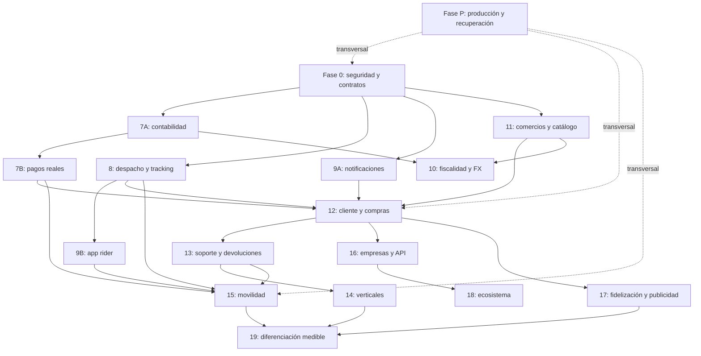

# Implementación de mejoras — Delivery360 — V1

**Fecha:** 24 de octubre de 2026, America/Caracas.  
**Estado:** propuesta de implementación pendiente; ninguna mejora de código se ejecuta con este documento.  
**Código revisado:** commit `d6ce659e9afe039fbe6d74ec3a8a7e6d9f0df488`.  
**Alcance de esta actualización:** guardar el diagnóstico, las fases, sus dependencias y los criterios de preparación para producción. Crear este documento no autoriza por sí mismo pagos, migraciones, despliegues ni cambios de datos.

Para llevar Delivery360 a producción y después competir con el alcance de Yummy, hay que completar tres trabajos distintos: corregir la base existente, terminar las fases 7–10 y desarrollar los productos que hoy no existen, especialmente comercios, clientes y transporte de pasajeros.

El roadmap actual cubre principalmente la operación de repartidores. Completarlo literalmente no produciría todavía una plataforma equivalente a todo el ecosistema de Yummy.

## Fuentes y alcance de la revisión

Se contrastaron los siguientes documentos con endpoints, servicios, modelos, migraciones, frontend, workers y configuración de CI/CD:

- [ROADMAP_PROXIMAS_FASES_7-10.md](ROADMAP_PROXIMAS_FASES_7-10.md).
- [4-informe_comparativo_delivery360_vs_yummy.md](4-informe_comparativo_delivery360_vs_yummy.md).
- [Informe_Sistema_V1.md](Informe_Sistema_V1.md), como referencia del análisis anterior.

También se revisaron páginas públicas de Yummy para actualizar el alcance de comparación. La información comercial publicada no constituye una auditoría del funcionamiento interno de Yummy ni acredita su arquitectura, proveedores, rendimiento o algoritmos.

La revisión que fundamenta esta propuesta fue informativa: no modificó código ni datos. Los cálculos puros indicados se reprodujeron de forma aislada; los demás hallazgos se sustentan en lectura del código y evidencia previa identificada. No se ejecutaron pagos, migraciones ni cierres de entregas. No se relanzaron las suites históricas de pruebas ni se inspeccionó producción.

## 1. Qué hay que corregir en la interpretación del roadmap

| Afirmación documental | Lo que respalda el código revisado | Consecuencia |
|---|---|---|
| Bonos completados al 100 % | Existe la fórmula y el desglose, pero hay cierres inconsistentes y modificación del tier desde el perfil propio | Requieren consolidación y controles antes de considerarse terminados |
| Sistema financiero 96/100 | Conviven libros, unidades y caminos de escritura diferentes | Esa puntuación no acredita integridad financiera |
| Fase 7: pagos reales | Existen modelos y gestión de retiros; no se encontró un circuito completo de desembolso real con proveedor | Falta la integración financiera efectiva |
| Fase 8: mapas avanzados | Hay tracking, mapas y optimización heurística | Falta cerrar autorización, WebSocket, sincronización y restricciones operativas |
| Fase 9: app móvil | El código utiliza “fase 9” para notificaciones | La app móvil del roadmap sigue siendo un trabajo separado |
| Fase 10: consolidación financiera | Hay fiscalidad, FX y snapshots de reparto | No equivale a facturación validada ni liquidación real a comercios |
| 2FA completado | No se encontró un flujo completo de enrolamiento, verificación y recuperación en los módulos revisados | Debe permanecer pendiente de implementación o demostración |
| Listo para producción | Persisten bloqueantes de seguridad, dinero, compilación y operación | Esa conclusión documental no sirve como criterio de lanzamiento |

Las cifras de calificación, presupuestos y plazos de los documentos antiguos son estimaciones históricas, no mediciones verificadas de preparación actual. También hay afirmaciones sobre arquitectura interna, proveedores y algoritmos de Yummy que esos documentos no demuestran; no deben utilizarse como base cierta para decidir tecnología o presupuesto.

## 2. Qué significa hacer todas las funciones de Yummy

La oferta pública consultada incluye delivery de varias categorías, movilidad, marketplace y servicios adicionales para comercios. Esto amplía considerablemente el alcance original de Delivery360. Fuente: [oferta pública de Yummy](https://www.yummysuperapp.com/).

Yummy presenta además soluciones corporativas para administrar usuarios, presupuestos, viajes y envíos, y una plataforma de publicidad autogestionada. Fuentes: [Yummy Corporate](https://corporate.yummysuperapp.com/) y [Yummy Ads Manager](https://marcas.yummysuperapp.com/).

| Objetivo | Qué debe poder hacer Delivery360 |
|---|---|
| Producción logística | Administrar pedidos, repartidores, entregas y dinero con seguridad y trazabilidad |
| Competencia en delivery | Permitir que clientes compren a comercios, paguen, reciban y resuelvan incidencias |
| Competencia en movilidad | Solicitar y ejecutar viajes de pasajeros |
| Competencia como ecosistema | Incorporar empresas, marketplace, fidelización y servicios adicionales |
| Superación competitiva | Demostrar mejores resultados en entregas, soporte, transparencia o rentabilidad |

“Superior a Yummy” debe convertirse en objetivos medibles. No puede deducirse de tener más módulos, usar microservicios o incorporar IA.

## 3. Bloqueantes antes de ampliar el producto

Estos problemas pertenecen a una fase de estabilización obligatoria. P0 indica bloqueo prioritario del alcance afectado; P1 indica alta prioridad. Los defectos estáticos no implican que se haya realizado una explotación ni que se haya observado su impacto en producción.

| Prioridad | Problema verificado o sustentado en el código | Riesgo |
|---|---|---|
| P0 | Cierre de entrega sin comprobación uniforme de propietario | Alteración de operaciones ajenas |
| P0 | Actualización del propio tier por el repartidor | Modificación de un factor de remuneración |
| P0 | Distintas rutas generan cierres y movimientos financieros diferentes | Compensaciones inconsistentes |
| P0 | Estado de entrega y compensación no forman una operación atómica uniforme | Entregas cerradas sin movimiento correspondiente |
| P0 | Reservas y escrituras de saldo sin un bloqueo común obligatorio | Riesgo de retiros concurrentes incompatibles |
| P0 | Documentos personales publicados mediante montaje estático | Acceso por URL sin autorización del propietario |
| P0 | Caché sin identidad en la clave | Diseño incompatible con respuestas privadas |
| P0 financiero | Cálculo incorrecto del total con IVA incluido | Facturación por importe incorrecto |
| P1 | Wallet usa UserRole.RIDER, inexistente | Fallo directo al utilizar ese circuito |
| P1 | Servicio síncrono de wallet recibe sesión asíncrona | Incompatibilidad de ejecución |
| P1 | Tracking WebSocket mal anotado y autorización de canales incompleta | Handshake defectuoso o acceso indebido |
| P1 | Estados terminales y OTP no están protegidos uniformemente | Reapertura y evidencia insuficiente |
| P1 | Workers con imports y atributos incompatibles | Automatizaciones no operativas |
| P1 | Contratos de frontend, API y modelos desalineados | Pantallas y operaciones fallidas |
| P1 | Simulaciones devuelven estados aparentemente exitosos | Indicadores que no acreditan ejecución externa |

Referencias de código:

- Cierre de entregas: [backend/app/api/v1/deliveries.py](backend/app/api/v1/deliveries.py#L508).
- Modificación del tier: [backend/app/api/v1/riders.py](backend/app/api/v1/riders.py#L831).
- WebSocket y archivos estáticos: [backend/app/main.py](backend/app/main.py#L148).
- IVA incluido: [backend/app/services/tax_engine.py](backend/app/services/tax_engine.py#L201).
- Conversión monetaria: [backend/app/services/fx_service.py](backend/app/services/fx_service.py#L78).

### Cálculos comprobados nuevamente

Se ejecutaron únicamente funciones de cálculo extraídas, sin importar la aplicación, conectar la base ni iniciar tareas.

| Caso | Resultado |
|---|---|
| Precio de 11.600 centavos con IVA incluido al 16 % | El cálculo devuelve total de 10.000; debería conservar 11.600 bajo esa regla |
| Conversión cuyo resultado es 1,50 unidades menores | Devuelve 1, aunque el comentario promete redondeo HALF_UP, que daría 2 |

En FX también se admite una tasa implícita de 1 para monedas desconocidas. Ese comportamiento puede servir como simulación de desarrollo, pero no debe autorizar una conversión monetaria real.

**Matiz de caché:** además de no aislar por identidad, existen problemas de inicialización y doble deserialización en la combinación revisada. El efecto inmediato al activar esa combinación puede ser un error en hits. No se afirma una fuga observada; corregir solo la deserialización dejaría el defecto de aislamiento.

## 4. Esquema general de fases pendientes

Se mantiene la referencia histórica 7–10 y se añaden subdivisiones para evitar confundir lo desarrollado con lo pendiente.

| Fase propuesta | Objetivo | Naturaleza |
|---|---|---|
| 0 | Estabilización, seguridad y contratos | Corregir |
| 7A | Consolidación contable y saldos | Corregir y completar |
| 7B | Cobros, retiros y conciliación reales | Desarrollar e integrar |
| 8 | Despacho, tracking y rutas operativas | Corregir y completar |
| 9A | Notificaciones confiables | Completar lo existente |
| 9B | App móvil de repartidores | Desarrollar |
| 10 | Fiscalidad, FX y liquidación comercial | Corregir y completar |
| 11 | Comercios, sucursales, catálogo e inventario | Desarrollar |
| 12 | Experiencia completa del cliente | Desarrollar |
| 13 | Soporte, devoluciones, reputación y seguridad operativa | Desarrollar |
| 14 | Supermercado, farmacia, paquetería y otras verticales | Desarrollar |
| 15 | Transporte de pasajeros | Desarrollar |
| 16 | Plataforma corporativa y API para empresas | Ampliar |
| 17 | Promociones, fidelización, suscripciones y publicidad | Desarrollar |
| 18 | Servicios adicionales del ecosistema | Desarrollar o integrar |
| 19 | Optimización y diferenciación demostrable | Evolucionar |
| P | Operación de producción y recuperación | Transversal a todas |

Las primeras fases permiten explotar una operación logística confiable. Las posteriores convierten esa operación en una plataforma comercial y de movilidad.

## 5. Fase 0 — Estabilización y seguridad

**Objetivo:** que el negocio existente tenga un comportamiento consistente y seguro.

### Trabajo pendiente

1. Centralizar la autorización por recurso:
   - Qué usuario puede leer o modificar cada pedido.
   - Qué repartidor puede operar cada entrega.
   - Qué roles pueden revisar documentos, modificar niveles o aprobar dinero.
   - Qué suscripciones WebSocket puede abrir cada identidad.
2. Separar campos de perfil y campos administrativos:
   - El repartidor solo modifica datos permitidos.
   - Tier, aprobación y asignaciones sensibles requieren permisos específicos.
   - Registrar actor, motivo y cambio.
3. Proteger documentos:
   - Almacenamiento privado y descarga autorizada.
   - Validación de archivos.
   - Retención y acceso auditado.
4. Consolidar contratos:
   - Unificar estados entre frontend, schemas, ORM y BD.
   - Resolver prefijos duplicados.
   - Corregir imports y tipos.
   - Definir una política única para users.id y riders.id.
5. Consolidar la máquina de estados:
   - Transiciones explícitas.
   - Rechazo de reapertura accidental.
   - Reintentos idempotentes.
   - Prueba de entrega según política del servicio.
6. Completar sesiones:
   - MFA para administración y operaciones financieras.
   - Gestión de sesiones y revocación.
   - Recuperación segura.
   - Suspensión operativa aplicada uniformemente.
7. Corregir o retirar temporalmente el caché de respuestas privadas hasta disponer de aislamiento e invalidación adecuados.

**Criterio de cierre:** las pruebas de permisos demuestran que un usuario no puede leer ni modificar recursos ajenos y que ninguna ruta alternativa evita las reglas del flujo principal.

**Dependencia:** precede al uso de pagos reales y a cualquier lanzamiento público.

## 6. Fase 7A — Unificación contable

**Objetivo:** disponer de una fuente coherente de verdad para el dinero.

Actualmente existen financials, financial_transactions, wallets alternativas y saldos auxiliares. No basta con corregir cada endpoint por separado.

### Trabajo pendiente

- Elegir el modelo contable canónico y definir cómo se conserva o migra el legado.
- Identificar moneda y unidad de cada importe.
- Usar reglas monetarias exactas; evitar flotantes para saldos y liquidaciones.
- Separar disponible, pendiente, reservado, en retiro y retenido por disputa.
- Registrar movimientos compensatorios en lugar de alterar historial financiero.
- Hacer obligatoria la idempotencia por evento de negocio.
- Establecer control de concurrencia compartido.
- Vincular entrega, compensación y evento contable de forma consistente.
- Corregir el auxiliar de conciliación que puede producir una nueva diferencia.

Para una plataforma que administrará fondos de comercios, clientes y repartidores, se recomienda diseñar partida doble con cuentas y asientos balanceados. El ledger actual no acredita por sí mismo ese modelo.

**Criterio de cierre:** repetir o ejecutar concurrentemente una operación no duplica dinero; el saldo se explica íntegramente mediante movimientos y reservas.

**Dependencia:** fase 0; base para 7B y 10.

## 7. Fase 7B — Pagos y retiros reales

**Objetivo:** convertir estados administrativos en operaciones verificables con proveedores.

### Trabajo pendiente

- Cobro al cliente: autorización, captura, cancelación y devolución.
- Desembolso al repartidor.
- Alta y verificación de beneficiarios.
- Métodos de pago tokenizados.
- Webhooks autenticados y resistentes a duplicación.
- Procesamiento de eventos fuera de orden.
- Reintentos y consulta posterior al proveedor.
- Conciliación entre proveedor y contabilidad.
- Comisiones, plazos y límites.
- Gestión de contracargos y disputas.
- Tratamiento de efectivo y rendición de cobros cuando corresponda.
- Resolución de operaciones cuyo resultado quedó desconocido tras un timeout.

**Decisión pendiente del roadmap:** Stripe y Mercado Pago son candidatos, no una garantía de disponibilidad. Deben seleccionarse proveedores según país, entidad operadora, moneda y producto que realmente permitan contratar. El fee de 1,5 % y los tiempos de retiro del documento requieren validación comercial; no se consideran vigentes por estar escritos allí.

**Criterio de cierre:** un cobro, retiro o devolución puede rastrearse desde la solicitud hasta el identificador y resultado del proveedor, incluso tras reinicios o webhooks repetidos.

**Dependencia:** 7A y controles de seguridad de fase 0.

## 8. Fase 8 — Despacho, tracking y rutas

**Objetivo:** asignar correctamente y seguir la operación en condiciones reales.

### Trabajo pendiente

- Corregir firma y autorización del WebSocket.
- Unificar geometría y coordenadas planas.
- Identificar antigüedad y precisión de posiciones.
- Reconexión y recuperación del último estado.
- Distribución de eventos entre varias instancias.
- Medición de frescura GPS.
- Geocodificación y direcciones utilizables.
- ETA basada en red vial y tiempos de preparación.
- Reasignación cuando un rider no acepta o pierde disponibilidad.
- Oferta de pedidos con vencimiento y aceptación atómica.

La asignación debe considerar más que cercanía:

| Factor | Razón |
|---|---|
| Disponibilidad real | Evitar asignar a alguien desconectado |
| Carga activa | No sobrecargar al mismo rider |
| Capacidad y vehículo | Compatibilidad con el envío |
| Zona | Restricciones de cobertura |
| Recogida y entrega | Precedencia correcta |
| Ventanas horarias | Cumplir compromisos |
| Tiempo de preparación | Evitar esperas innecesarias |
| Jornada y pausas | Respetar la operación del repartidor |

La optimización actual es heurística. Puede conservarse como alternativa inicial si cumple objetivos, pero debe incorporar restricciones y medirse contra una referencia justa.

No es obligatorio sustituir Leaflet para estar en producción. La visualización del mapa y el motor de rutas son decisiones diferentes.

**Criterio de cierre:** las asignaciones respetan restricciones; el tracking funciona entre instancias y el error de ETA se mide por zona y franja horaria.

**Dependencia:** fase 0; relación con infraestructura de eventos de fase P.

## 9. Fase 9A — Notificaciones confiables

Esta fase reconoce el trabajo de notificaciones que el código ya denomina “fase 9”.

### Trabajo pendiente

- Corregir deduplicación por destinatario, canal y evento.
- Separar estados de simulación, aceptación por proveedor y entrega.
- Configurar push, correo y SMS reales.
- Registrar respuestas y errores.
- Procesar confirmaciones cuando existan.
- Persistir eventos antes de intentar enviarlos.
- Disponer de reintentos y bandeja de fallos.
- Gestionar preferencias, dispositivos y tokens caducados.
- Evitar que un evento financiero crítico dependa exclusivamente de una tarea en memoria.

**Criterio de cierre:** un evento llega a todos sus destinatarios previstos y su estado refleja lo sucedido, sin marcar como enviado lo que solo fue simulado.

**Dependencia:** fase 0 e infraestructura de eventos de fase P.

## 10. Fase 9B — App móvil para repartidores

**Estado:** la web de rider no satisface por sí sola la app móvil propuesta en el roadmap.

### Trabajo pendiente

- Registro y revisión documental.
- Inicio y cierre de disponibilidad.
- Recepción, aceptación y rechazo de ofertas.
- Navegación.
- Tracking en segundo plano con permisos adecuados.
- Foto, firma, OTP o QR según política.
- Incidencias y soporte.
- Ganancias, reservas y retiros.
- Almacenamiento seguro de credenciales.
- Actualización y compatibilidad de versiones.

### Funcionamiento sin conexión

- Guardar entregas activas.
- Encolar acciones con identificadores idempotentes.
- Sincronizar sin duplicar cierres ni compensaciones.
- Resolver conflictos.
- Conservar evidencia con fecha de captura y de recepción.
- Informar qué acciones todavía no han sido confirmadas.

La biometría local de un teléfono no equivale a identidad verificada ni reemplaza automáticamente el MFA del servidor.

**Criterio de cierre:** los recorridos funcionan con pantalla apagada, conectividad intermitente, cierre de la app y reintentos, sin duplicar operaciones.

**Dependencia:** API estable, fases 8 y 9A; wallet sobre 7A/7B.

## 11. Fase 10 — Fiscalidad, moneda y liquidación comercial

**Objetivo:** transformar los componentes fiscales existentes en un circuito confiable para los países habilitados.

### Trabajo pendiente

- Corregir IVA incluido y redondeo.
- Manejar moneda y unidades menores correctamente.
- Rechazar o retener operaciones sin tasa válida.
- Registrar fuente, vigencia y tasa utilizada.
- Evitar tasas de desarrollo en operaciones reales.
- Corregir numeración, rangos y concurrencia.
- Integrar y validar proveedores fiscales por país.
- Diferenciar aceptación simulada de aceptación externa.
- Implementar notas, anulaciones y recuperación de errores.
- Definir quién factura a quién: comercio a cliente; plataforma por su servicio; repartidor cuando corresponda.
- Separar precio de mercancía, envío, comisión, impuesto, propina y descuento.
- Crear liquidación real al comercio.

El servicio actual declara expresamente que no hay modelo Vendor y fija restaurant_share_cents=0. El split actual no completa el reparto a restaurantes previsto por el roadmap.

**Criterio de cierre:** cada país habilitado tiene casos validados de emisión, rechazo, repetición y cancelación; la contabilidad concuerda con los documentos y liquidaciones.

**Dependencia:** 7A/7B y fase 11 para liquidar comercios.

## 12. Fase 11 — Comercios, sucursales y catálogo

**Objetivo:** convertir una plataforma de gestión de entregas en un marketplace de compra.

### Desarrollo pendiente

- Comercios y propietarios.
- Sucursales y personal.
- Verificación y contratos.
- Catálogo, categorías y productos.
- Variantes, modificadores y adicionales.
- Precios y disponibilidad.
- Horarios y cierres excepcionales.
- Inventario y reservas.
- Tiempos de preparación.
- Aceptación y rechazo de pedidos.
- Comisiones por contrato.
- Portal comercial.
- Reportes y liquidaciones.
- Integraciones POS concretas.

El POSConnector existente es una base genérica con URL de ejemplo; no demuestra integración productiva con un POS específico.

**Entidades previsibles:** comercio, sucursal, membresía, producto, variante, inventario, movimiento de stock, contrato y liquidación. Son propuestas de diseño, no tablas ya implementadas.

**Criterio de cierre:** un comercio administra su oferta, recibe una compra, prepara el pedido y comprende cuánto se le debe liquidar.

**Dependencia:** seguridad y aislamiento desde fase 0; dinero desde 7A/7B.

## 13. Fase 12 — Producto completo para clientes

**Objetivo:** que el cliente pueda realizar todo el recorrido sin intervención de un operador.

### Desarrollo pendiente

- Registro y recuperación.
- Direcciones y cobertura.
- Descubrimiento de comercios.
- Búsqueda y filtros.
- Detalle de productos.
- Carrito.
- Cotización y desglose.
- Checkout y pago.
- Entrega inmediata o programada.
- Seguimiento.
- Cancelación y devolución.
- Historial y repetición.
- Favoritos.
- Propinas y valoración.
- Accesibilidad y experiencia móvil.

Debe decidirse expresamente si el carrito admite varios comercios. Si los admite, debe generar subpedidos, cobros, asignaciones y cancelaciones coherentes.

**Criterio de cierre:** un cliente puede comprar, recibir, reclamar y obtener resolución sin que el equipo técnico intervenga.

**Dependencia:** 11, 7B, 8 y 9A; soporte y fiscalidad del alcance publicado antes del lanzamiento.

## 14. Fase 13 — Soporte, devoluciones y confianza

**Objetivo:** resolver las excepciones que aparecen diariamente en producción.

### Desarrollo pendiente

- Tickets vinculados a pedido, pago y entrega.
- Chat o mensajería con acceso controlado.
- Priorización, asignación y tiempos de atención.
- Productos faltantes, equivocados o dañados.
- Cliente ausente y dirección incorrecta.
- Cancelaciones según etapa.
- Devoluciones totales y parciales.
- Logística inversa.
- Evidencias y apelaciones.
- Valoraciones verificadas y moderación.
- Incidentes de seguridad.
- Procedimientos de escalamiento.

La reputación necesita registros verificables; un campo de rating o un componente visual no constituye un sistema completo de calificaciones.

**Criterio de cierre:** cada incidencia tiene responsable, evidencia, resolución y efecto contable trazable.

**Dependencia:** puede comenzar junto a 11 y 12; es requisito para su lanzamiento público.

## 15. Fase 14 — Verticales adicionales

**Objetivo:** soportar supermercado, farmacia, paquetería y otras categorías sin tratar todos los pedidos como una entrega de comida.

| Vertical | Capacidades específicas |
|---|---|
| Supermercado | Peso variable, sustituciones, faltantes y aprobación de diferencias |
| Farmacia | Restricciones y documentación según producto y jurisdicción |
| Bebidas y productos restringidos | Elegibilidad y verificación de recepción |
| Paquetería | Dimensiones, valor declarado, custodia y devolución |
| Retail | Variantes, stock, cambios y logística inversa |
| Mandados | Instrucciones, límites de gasto y comprobantes |

**Trabajo común:** capacidades del vehículo, manejo especial, reglas de precio, cobertura y prueba de entrega por servicio.

**Criterio de cierre:** cada vertical dispone de estados, excepciones, cobro y responsabilidades definidos.

**Dependencia:** marketplace, soporte y pagos.

## 16. Fase 15 — Transporte de pasajeros

**Objetivo:** cubrir el ámbito de movilidad representado por Yummy Rides.

Es un producto nuevo. Reutiliza identidad, mapas y pagos, pero no debe reducirse a renombrar una entrega.

### Desarrollo pendiente

- Perfil de pasajero.
- Habilitación de conductores.
- Categorías y requisitos de vehículos.
- Cotización.
- Solicitud y oferta de viaje.
- Aceptación y llegada al punto.
- Espera.
- Inicio y finalización.
- Cancelación y no presentación.
- Tarifa final, peajes y propina.
- Viajes programados.
- Valoración.
- Compartir recorrido.
- Soporte y SOS.
- Gestión de incidentes y requisitos operativos del mercado.

**Entidades previsibles:** solicitud de viaje, viaje, cotización, oferta, habilitación de conductor, tarifa y evento de seguridad.

**Criterio de cierre:** el ciclo completo del viaje y sus excepciones funciona en un piloto controlado, con soporte operativo disponible.

**Dependencia:** 7A/7B, 8, 9A/9B y 13.

## 17. Fase 16 — Empresas y API de última milla

**Objetivo:** permitir a empresas administrar usuarios, gastos y envíos con aislamiento.

### Desarrollo pendiente

- Organizaciones y membresías.
- Sucursales empresariales.
- Centros de costo.
- Presupuestos.
- Políticas de aprobación.
- Límites por usuario.
- Pedidos masivos.
- Viajes o envíos para terceros.
- Facturación consolidada.
- Contratos y SLA.
- API versionada.
- Credenciales con permisos.
- Webhooks documentados.
- Cuotas y entorno de pruebas.

**Criterio de cierre:** una empresa opera sin acceder a información ajena y concilia su consumo por usuario, centro de costo y período.

**Dependencia:** aislamiento, pagos y el producto logístico o de movilidad correspondiente.

## 18. Fase 17 — Crecimiento, fidelización y publicidad

**Objetivo:** competir en adquisición, recurrencia y monetización comercial.

### Desarrollo pendiente

- Cupones y promociones.
- Referidos.
- Créditos promocionales separados del dinero retirable.
- Programa de puntos.
- Suscripciones.
- Renovaciones, cancelaciones y beneficios.
- Campañas por ciudad y segmento.
- Espacios patrocinados.
- Presupuesto publicitario.
- Impresiones, clics y atribución.
- Prevención de abuso.

El coste de cada promoción debe asignarse a plataforma, comercio o ambos. Una promoción que funciona visualmente pero no se refleja en liquidación genera otra discrepancia financiera.

**Criterio de cierre:** se conocen coste, uso, contribución y efecto de cada campaña; los beneficios no crean dinero retirable indebidamente.

**Dependencia:** compras, contabilidad y analítica confiable.

## 19. Fase 18 — Extensión al ecosistema completo

Si “todas las funciones de Yummy” incluye su oferta pública ampliada, deben contemplarse estas líneas. Su sitio presenta marketplace, eventos, viajes y herramientas para comercios. Fuente: [ecosistema publicado por Yummy](https://www.yummysuperapp.com/).

| Línea | Desarrollo o integración necesaria |
|---|---|
| Marketplace entre vendedores y compradores | Publicaciones, identidad, moderación, mensajería y disputas |
| Eventos | Inventario, reserva, pago, emisión y validación de entradas |
| Viajes | Búsqueda, reserva, emisión, cambios y soporte mediante proveedores |
| POS | Caja, inventario, compras, devoluciones y sincronización |
| Comercio conversacional | Catálogo, cotización, confirmación y despacho desde mensajería |

Estas capacidades pueden construirse o contratarse mediante integración. No es necesario crear desde cero un sistema de reservas aéreas para ofrecer ese servicio.

**Criterio de cierre:** cada integración tiene responsabilidades, conciliación, soporte y tratamiento de fallos definidos.

**Dependencia:** identidad, pagos y APIs estables.

## 20. Fase 19 — Mejoras para superar a la competencia

Aquí comienza la diferenciación demostrable.

| Mejora propuesta | Qué debería demostrar |
|---|---|
| Bonos explicables y versionados | Menos disputas y comprensión del ingreso |
| Simulador de tarifas y capacidad | Mejor margen sin deteriorar el servicio |
| ETA con intervalo de confianza | Menor error y mejor comunicación |
| Reasignación preventiva | Menos pedidos vencidos |
| Planificación de demanda | Menos espera y cobertura más equilibrada |
| Liquidación transparente | Comercio y rider pueden explicar cada diferencia |
| Soporte con contexto completo | Menor tiempo de resolución |
| Operación con mala conectividad | Menos entregas interrumpidas |
| Detección de anomalías | Menor fraude con revisión humana |
| Medición de eficiencia | Menos kilómetros por entrega comparable |

Para usar ML primero deben existir eventos consistentes, datos suficientes y una referencia de comparación. De lo contrario, solo se añade complejidad.

**Criterio de cierre:** mejora medida en piloto y después en operación, sin degradar seguridad, equidad o rentabilidad.

## 21. Fase P — Preparación real para producción

Comienza con la estabilización y acompaña todas las fases.

### Infraestructura y despliegue

- Separar desarrollo, staging y producción.
- Eliminar dependencias operativas de --reload y montajes de desarrollo.
- Proteger BD y Redis.
- Configurar secretos fuera del repositorio.
- Desplegar workers y scheduler efectivamente utilizados.
- Evitar ejecuciones duplicadas entre instancias.
- Crear los artefactos de infraestructura que CI referencia.
- Usar imágenes y versiones identificables.

### Confiabilidad

- Persistir eventos antes de entregarlos a procesos externos.
- Reintentos idempotentes.
- Bandeja de fallos.
- Recuperación de operaciones interrumpidas.
- Health checks correctos.
- Respaldo y restauración ensayada.
- Migraciones compatibles con despliegues.
- Procedimiento de rollback.

### Observabilidad

- Métricas reales.
- Logs sin tokens ni documentación personal.
- Trazabilidad entre pedido, entrega, pago y notificación.
- Alertas sobre operaciones atascadas.
- Detección de diferencias financieras.
- Visibilidad de colas y proveedores.

### Calidad

- Compilación y tipos aprobados.
- Pruebas de integración.
- Recorridos completos por rol.
- Pruebas negativas de permisos.
- Concurrencia financiera.
- Duplicación y desorden de webhooks.
- Reinicio durante operaciones.
- Carga representativa.
- Pruebas de conectividad móvil.

**Criterio de cierre:** el equipo puede desplegar, detectar una falla, recuperarse y explicar el estado del negocio sin depender de reparaciones manuales improvisadas.

Kubernetes, microservicios y sharding deben responder a una necesidad medida. No son requisitos automáticos para el primer lanzamiento.

## 22. Orden recomendado de ejecución



El gráfico expresa dependencias principales, no una obligación de esperar al final para iniciar soporte. Soporte, fiscalidad e infraestructura deben trabajarse antes del lanzamiento de los productos que los requieren, aunque su integración se cierre después. La fase P aplica a todas las fases, no solo a los nodos dibujados.

### Liberaciones recomendadas

| Liberación | Alcance | Requisito |
|---|---|---|
| L1: piloto logístico | Pedidos y entregas administrados por operadores | Seguridad, dinero, tracking y operación estabilizados |
| L2: delivery comercial | Clientes compran a comercios | Catálogo, checkout, pagos, soporte y liquidación |
| L3: múltiples verticales y empresas | Retail, supermercado, paquetería y B2B | Reglas específicas y aislamiento |
| L4: movilidad | Transporte de pasajeros | Producto y operación de viajes completos |
| L5: ecosistema y diferenciación | Fidelización, publicidad y servicios adicionales | Datos y procesos consolidados |

## 23. Qué exigir para autorizar cada lanzamiento

No se utilizará una puntuación global como “92/100”. Se requiere evidencia por capacidad.

| Puerta de salida | Evidencia mínima |
|---|---|
| Seguridad | Sin defectos críticos abiertos en el alcance publicado; permisos negativos aprobados |
| Dinero | Conciliación explicable; idempotencia y concurrencia verificadas |
| Funcionalidad | Recorrido completo y excepciones aprobados |
| Integraciones | Confirmación real del proveedor; simulaciones claramente separadas |
| Calidad | CI, tipos, pruebas y build aprobados |
| Operación | Alertas, soporte y recuperación ensayados |
| Datos | Migraciones y restauración verificadas |
| Capacidad | Carga objetivo validada con margen acordado |
| Experiencia | Uso real validado con clientes, comercios y repartidores |
| País habilitado | Requisitos comerciales, fiscales y operativos del servicio revisados |

Como propuesta inicial, deben definirse objetivos de disponibilidad, frescura GPS, error de ETA, recuperación y conciliación. Sus valores se acuerdan según mercado y capacidad operativa; las cifras del roadmap no se consideran compromisos ya alcanzados.

La prioridad inmediata es la fase 0 y la consolidación contable 7A. Después conviene cerrar un primer circuito de producción logística y comercial antes de ampliar a movilidad y al resto del ecosistema.

## Estado de implementación de este documento

Todas las fases descritas son propuestas pendientes de ejecución o consolidación; el estado de cada módulo existente se detalla en sus secciones. No se marca ninguna mejora como completada por la mera creación de este archivo.

Esta entrega crea exclusivamente Implementacion_de_mejoras_V1.md. No actualiza el roadmap histórico, la comparación ni el código. No realiza commit, push, despliegue ni migración.


## Registro de avance — Fase 0, bloque 1 — 24 de octubre de 2026

**Estado:** implementación local del primer bloque; la fase 0 y el resto del plan siguen parciales. Esta sección actualiza el estado histórico de propuesta indicado al inicio del documento. La publicación se registra en el commit/PR correspondiente.

### Cambios de este bloque

- Política compartida para lectura y escritura de pedidos y entregas: personal operativo, auditor de solo lectura y repartidor asignado. CLIENTE no hereda acceso operativo sin relación de propiedad implementada.
- Comprobación de propietario antes de delegar el cierre legacy de una entrega. Se incluye delivery_id al construir ProofOfDeliveryCreate.
- Protección de tier, vehicle_ownership_type y assigned_vehicle_id en ambas rutas de actualización de rider; solo GERENTE y SUPERADMIN pueden modificarlos.
- Rechazo de reapertura de estados terminales mediante el endpoint de estado y rechazo de actualizaciones GPS fuera de entregas en curso.
- OTP obligatorio cuando existe un secreto o el tipo de prueba es OTP. Se aplica en el servicio de cierre, el endpoint unificado y el cierre alternativo desde pedidos. Las entregas sin OTP configurado conservan su flujo.
- Estadísticas de pedidos filtradas al rider autenticado cuando corresponde.
- El caché HTTP omite rutas /api/, peticiones con Authorization y peticiones con cookies; las respuestas API ejecutan siempre sus dependencias. Se corrige la doble deserialización del hit público.
- Corrección de siete errores de TypeScript, declaración de componente cliente para notificaciones, límites Suspense en login/restablecimiento y carga exclusivamente en navegador de páginas de mapas que importan Leaflet.
- Jest utiliza el preset JSX/TypeScript de Next. La prueba de teléfono usa el schema real del formulario, extraído sin cambiar sus reglas.
- Los archivos de registro creados por pruebas se aíslan en directorios temporales. La fixture de notificaciones no depende del caché Redis externo.

### Verificación

Comandos desde backend:

```bash
PYTHONDONTWRITEBYTECODE=1 python -m pytest -q -p no:cacheprovider
```

Comandos desde frontend:

```bash
npx tsc --noEmit --incremental false
npm test -- --runInBand --watchAll=false
NEXT_TELEMETRY_DISABLED=1 npm run build
```

Resultados locales del bloque: 186 pruebas backend, 21 pruebas frontend, comprobación TypeScript y build de producción. La suite backend conserva advertencias anteriores de configuración pytest y relaciones SQLAlchemy; no se presentan como resueltas. Los tests de seguridad usan handlers HTTP reales y persistencia simulada, y los tests de auth existentes usan SQLite de prueba. No prueban concurrencia PostgreSQL ni un recorrido completo de navegador.

### Cambios de contrato deliberados

- CLIENTE recibe 403 en los endpoints operativos revisados; su futuro acceso requiere relaciones y endpoints de la fase 12.
- AUDITOR tiene lectura operativa, no mutación. La deriva del enum SQL de AUDITOR sigue pendiente de migración específica.
- Enviar campos administrativos de rider sin permiso devuelve 403, incluso si se envía null; no se ignoran silenciosamente.
- El cierre de pedido admite otp_code opcional como query; se exige cuando la entrega tiene OTP configurado.
- Un estado terminal no se reabre mediante PATCH de estado. No se añade aquí un proceso administrativo de reversión.

### Pendientes que este bloque no resuelve

- Atomicidad integral de entrega, pedido y contabilidad; bloqueo concurrente e idempotencia de todos los circuitos de dinero.
- Unificación de los libros financieros, pagos reales, wallet alternativa y conciliación.
- Privacidad y migración de documentos actualmente servidos desde uploads; requiere coordinar acceso frontend y almacenamiento.
- Autorización de tracking/canales WebSocket, lifecycle y sesiones/MFA.
- IVA incluido, FX, facturación real, numeración fiscal y durabilidad de hooks.
- Workers, migraciones de deriva ORM/BD y despliegue/observabilidad completos.
- Cobertura funcional exhaustiva, pruebas de carga, restauración y validación productiva.

No se realizan migraciones, pagos reales ni despliegues con este bloque. La compilación y las pruebas aprobadas no equivalen a certificación de producción de todas las capacidades.


### Resultado del CI remoto del primer bloque

El [PR #243](https://github.com/corporacionbethelst-ux/Delivery_360-DEV/pull/243) publica este bloque en `fix/fase0-permisos-entregas`. La [ejecución 40103131774](https://github.com/corporacionbethelst-ux/Delivery_360-DEV/actions/runs/40103131774) detectó bloqueos en controles previos a las pruebas:

| Job | Bloqueo observado | Trabajo siguiente |
|---|---|---|
| backend-test | Flake8 F821: FastApiIntegration, SqlalchemyIntegration, RedisIntegration y CeleryIntegration sin definir en app/monitoring/sentry_config.py | Revisar y corregir imports y disponibilidad opcional del SDK; después ejecutar formato y tipos, que este job todavía no alcanzó |
| frontend-test | next lint solicita configurar ESLint y termina con código 1 | Declarar configuración y dependencias compatibles, ejecutar reglas y corregir los hallazgos antes de continuar los checks |
| security-scan | Los dos uploads SARIF de Trivy usan la misma categoría y el segundo es rechazado | Asignar categorías distintas a backend/frontend y actualizar la acción upload-sarif obsoleta |

Los archivos Sentry y workflow no se modificaron en este bloque; la configuración ESLint ya estaba ausente en la base revisada. Los fallos se identifican como deuda previa, no como una aprobación del pipeline. En esa ejecución las pruebas y el build remotos quedaron omitidos al fallar los pasos previos. Los 186 tests backend, 21 frontend, TypeScript y build indicados arriba son resultados locales.

**Integración a main pendiente:** no se fusiona este bloque mientras esos controles estén en rojo. La siguiente tarea de estabilización es corregir los bloqueos del pipeline y atender los resultados de formato/tipos que aparezcan, conservando los controles en lugar de deshabilitarlos. No se declara que el CI completo esté aprobado.


## Registro de avance — Fase 0 / CI, bloque 2 — 24 de octubre de 2026

**Base:** `c23cb90`, que ya incorpora el PR #243. Esta continuación se desarrolla en `fix/ci-quality-v1`; no modifica la historia del PR anterior.

### Correcciones implementadas

- Sentry: imports reales de FastAPI, SQLAlchemy, Redis y Celery; SDK declarado como dependencia de runtime y nivel de mensaje tipado según su contrato. Ocho pruebas nuevas verifican el caso sin DSN, la configuración y el envío delegado de niveles, sin transmitir eventos externos. No se activa Sentry en main.py como parte de este bloque.
- ESLint: configuración explícita `next/core-web-vitals`; se corrigen 15 comillas sin escapar en JSX preservando el texto mostrado y se mueve el hook condicional de NotificationBell antes del retorno. Tres pruebas nuevas cubren apertura, carga de inbox y acciones de lectura.
- Tipos de pruebas: `@types/jest` sustituye las declaraciones globales mínimas con any. El lockfile mantiene las versiones de las dependencias existentes; solo incorpora tipos de desarrollo necesarios.
- SARIF: categorías distintas `trivy-backend` / `trivy-frontend`, permisos explícitos y actualización de upload-sarif a v3.
- Pipeline: herramientas Python fijadas en requirements-dev.txt. Flake8, Black, mypy y pruebas permanecen activos. Se separan los pasos y las comprobaciones posteriores se ejecutan cuando las dependencias se instalaron, incluso si falló un control anterior; el job sigue fallando si cualquiera de ellos falla. Los builds/publicaciones conservan su dependencia de jobs aprobados.
- Formato: commit separado que aplica Black a 143 archivos restantes; equivalencia AST comprobada en los 154 archivos Python de app y suite repetida después. No se alteran reglas de negocio en ese commit.
- Los reportes coverage/ del frontend se excluyen de Git como artefactos generados.

### Resultados locales

| Control | Resultado |
|---|---|
| Flake8: E9,F63,F7,F82 sobre app | Aprobado, 0 hallazgos |
| Black sobre app | Aprobado, 154 archivos sin cambios pendientes |
| mypy de sentry_config.py, con imports seguidos en modo silent | Aprobado en el módulo corregido; no acredita el resto de app |
| pytest desde backend | 194 aprobadas; cuatro advertencias previas de pytest/ORM |
| ESLint | Aprobado con advertencias previas; reglas conservadas |
| TypeScript | Aprobado sin el stub de globals any |
| Jest sin cobertura | 24 pruebas aprobadas |
| Build Next.js | Aprobado |
| Workflow YAML | Parseado y verificadas categorías distintas y conservación de controles |
| pip check | Sin dependencias incompatibles |
| git diff --check | Aprobado |

### Bloqueos reales que continúan abiertos

**El CI completo todavía no se considera aprobado.** Al ejecutar todos los controles se confirmó deuda que antes quedaba oculta por pasos anteriores:

1. `mypy app --ignore-missing-imports`: 785 errores en 72 archivos con la herramienta fijada. El diagnóstico inicial era 788; se resolvieron cinco de Sentry y el cambio de líneas del formateador hace visibles dos diagnósticos adicionales de expresiones que ya existían. La comprobación de equivalencia AST confirma que el commit de formato no cambió su lógica. Incluye discrepancias ORM/SQLAlchemy, atributos y enums inexistentes y contratos sync/async. Requiere correcciones tipadas por módulo y pruebas; no se oculta con Any ni ignores generales.
2. Jest con cobertura: las 24 pruebas pasan, pero el mínimo global del 50 % no se cumple. Cobertura medida: statements 0,42 %, branches 0,44 %, functions 0,53 %, lines 0,46 %. El baseline anterior a las pruebas de campana era 0,01 % de líneas. Los umbrales permanecen intactos: el comando debe fallar mientras no se añada cobertura suficiente.

Los porcentajes bajos reflejan el alcance real de pruebas existentes sobre toda la aplicación, no una regresión causada por las correcciones. Los siguientes bloques deben ampliar pruebas funcionales de servicios, stores, hooks, componentes y recorridos, y corregir contratos de tipos priorizando las rutas activas y el dinero. No se declarará la preparación de producción ni se fusionará este bloque por el solo hecho de que compilen sus cambios.

No se ejecutan migraciones, pagos ni despliegues con esta continuación. Los cambios funcionales y de formato se mantienen en commits separados para facilitar revisión y reversión.


## Registro de avance — Fase 0 / Contratos ORM y wallet, bloque 3 — 24 de octubre de 2026

**Base:** `66e8ac2`, que ya incorpora el PR #244. Rama: `fix/orm-wallet-contracts-v1`.

### Problemas verificados y correcciones

1. **Wallet incompatible con la sesión real.** `get_db` entrega `AsyncSession`, pero WalletService utilizaba `query`, `commit` y `refresh` síncronos. Las operaciones se convierten a consultas y escrituras asíncronas. Saldo y movimiento/solicitud se confirman juntos; ante un error se revierte la transacción completa.
2. **Rol e identificación del repartidor incorrectos.** La API referenciaba `UserRole.RIDER`, inexistente, y podía utilizar users.id como riders.id. Ahora exige `REPARTIDOR`, consulta explícitamente el perfil por user_id y responde 404 si falta. Comparte las dependencias de autenticación y autorización de la API principal, sin acceder a relaciones ORM de carga diferida para resolver el perfil.
3. **Concurrencia y reintentos.** Se bloquea la fila de wallet antes de modificar saldo; la creación bloquea primero su repartidor padre. Las transiciones bloquean la solicitud y el rechazo bloquea además la wallet para reintegrar una sola vez. `populate_existing` refresca los valores tras adquirir el bloqueo, incluso si la sesión ya conservaba una instancia antigua. La clave de idempotencia verifica la identidad completa de la operación; una reutilización incompatible devuelve conflicto y no altera saldo. Los conflictos de la restricción única global se resuelven después de revertir la escritura perdedora.
4. **Validación monetaria.** Se rechazan montos no enteros, booleanos, cero, negativos, desbordamientos de INTEGER, sobregiros y operaciones nuevas sobre wallets inactivas. La solicitud HTTP admite una clave opcional de idempotencia; las llamadas anteriores sin clave siguen siendo válidas, pero no tienen protección frente a reintentos del cliente. La metadata de movimientos se serializa como JSON válido.
5. **Estados incompatibles en el frontend.** El backend de `/payouts` usa seis estados canónicos, pero el adaptador solo aceptaba cuatro estados anteriores. Ahora acepta `APROBADO`, `EN_PROCESO`, `COMPLETADO` y `FALLIDO`, y las pantallas los presentan explícitamente. Se conservan `PROCESADO` y `CANCELADO` para respuestas históricas. Aprobar conserva el estado `EN_PROCESO` devuelto por el backend; el indicador de completados cuenta `COMPLETADO`. No se interpreta una aprobación como confirmación de transferencia bancaria. Se rechazan importes no finitos en solicitudes y respuestas del adaptador.
6. **Contratos ORM tipados.** User y los cuatro modelos financieros de financial.py declaran `Mapped`/`mapped_column` con UUID, Decimal, enums y nulabilidad reales. Se preserva el DDL de PostgreSQL, incluidos índices, claves, defaults y valores de enums: una instantánea tomada antes del cambio se compara mediante prueba automatizada. No se modifica el esquema ni se añade una migración. Los CRUD materializan las listas declaradas y adaptan UUID al contrato textual del servicio contable existente.
7. **Autenticación.** Se retiran impresiones de fragmentos de token, payload y datos personales. Los subjects ausentes, no textuales o UUID inválidos se rechazan con 401; las cuentas heredadas sin rol no provocan errores 500 ni reciben tokens. Se reutilizan los esquemas de recuperación ya existentes y se eliminan alias iniciales nulos de dependencias que posteriormente tenían implementación real.

### Validación local

| Control | Resultado |
|---|---|
| pytest, suite completa | **225 aprobadas**, frente a 194 de la base; cuatro advertencias anteriores |
| Persistencia / HTTP | Pruebas de saldo e historial firmado, reintentos, conflictos, rollback, sobregiro, desbordamiento, wallet inactiva, reserva/reintegro, estados, permisos y separación user/rider |
| Concurrencia real PostgreSQL 16 | **7 aprobadas**: débitos simultáneos, clave repetida en la misma wallet y entre wallets, reservas/rechazos simultáneos, saldo obsoleto en sesión, creación simultánea y reintentos de solicitud |
| Aislamiento de pruebas PostgreSQL | Contenedor local desechable; esquema privado por prueba; solo TEST_DATABASE_URL explícita con nombre test_*; limpieza al terminar; sin fallback a DATABASE_URL |
| Contrato de tablas | Comparación exacta del DDL ORM PostgreSQL, índices, defaults y enums de las cinco tablas afectadas |
| Flake8 E9,F63,F7,F82 | 0 hallazgos |
| Black sobre app | 154 archivos aprobados |
| mypy global | **629 diagnósticos en 66 archivos**, frente a 785 en 72; el control todavía falla |
| Jest | **53 aprobadas**, frente a 24; 29 nuevas sobre el adaptador de retiros |
| Cobertura global Jest | Statements 1,19 %, branches 1,45 %, functions 0,97 %, lines 1,23 %; el mínimo del 50 % sigue incumplido |
| TypeScript / ESLint / build Next.js | Aprobados; ESLint conserva advertencias anteriores |
| git diff --check | Aprobado |

El workflow proporciona TEST_DATABASE_URL sobre su servicio PostgreSQL de pruebas para ejecutar las siete verificaciones de concurrencia. Sin esa variable, estas pruebas se omiten explícitamente: SQLite no demuestra bloqueos de filas. Se usa NullPool únicamente en esas pruebas para no compartir conexiones asyncpg entre bucles de pytest/TestClient; el pool de producción no cambia.

### Límites y trabajo que continúa pendiente

- **Este bloque no completa la fase financiera ni certifica producción.** El subsistema alternativo `rider_wallets/financial_transactions/payout_requests` sigue separado de `financials/payouts` y de `riders.wallet_balance`. No se consolidan ni se reconcilian saldos automáticamente. Sus reservas se representan por solicitudes; este bloque no añade asientos contables de reserva/reintegro a ese historial.
- Las acciones administrativas de aprobar/completar de la wallet mantienen su contrato manual: no envían dinero ni prueban que un banco lo haya transferido. Pendientes: proveedor real, webhooks verificados, conciliación, auditoría de actores y contabilidad unificada.
- Deben revisarse estados y callbacks del circuito principal `/payouts`, sus reglas de disponibilidad y la recuperación de fallos; corregir el adaptador visual no acredita todo ese flujo. Las estadísticas mensuales siguen dependiendo de las fechas que suministra ese contrato.
- La comparación DDL acredita equivalencia entre los modelos antes y después, **no** que una instalación tenga todas sus migraciones aplicadas ni que los enums físicos coincidan con el código actual. Las pruebas PostgreSQL crean únicamente las tablas necesarias; no sustituyen pruebas de migración y actualización desde una instalación histórica.
- El nuevo tipado también hace visibles defectos anteriores: roles/timestamps anulables que otros consumidores asumen completos y contratos UUID declarados como int o Column. No se ocultan con Any, casts ni ignores generales. Los 629 diagnósticos restantes requieren corrección por módulos y pruebas.
- La idempotencia de clientes debe conservar una misma clave cuando reintenta una misma operación. La generación de una clave nueva en cada nueva llamada del adaptador principal no sustituye ese comportamiento de la interfaz; sigue pendiente su integración completa. Los registros antiguos con metadata serializada de otra forma pueden generar conflicto conservador al reutilizar claves.
- Quedan pendientes cobertura global del 50 %, recorridos completos, carga, observabilidad, restauración, secretos y los siguientes bloques del plan. No se reducen umbrales ni se desactivan controles para presentar una aprobación artificial.

**Publicación:** rama y PR de revisión; no se fusiona ni se despliega este bloque mientras continúen los bloqueos globales de tipos/cobertura. No se ejecutan migraciones ni movimientos monetarios reales.


## Registro de avance — Conciliación segura y reportes, bloque 4 — 24 de octubre de 2026

**Base:** `831ee40`, fusión del PR #245. Rama: `fix/financial-report-contracts-v1`. Por instrucción del propietario, el siguiente PR se publica **sin borrador**, listo para revisión; ese estado no equivale a aprobación de los controles ni a certificación de producción.

### Hallazgos corregidos

- **dry_run ignorado:** `/reconciliation/fix-all-discrepancies` llamaba al servicio que escribía incluso con dry_run=True. Ahora la vista previa no modifica caché, versión ni ledger. Informa discrepancy_count y total_discrepancy_amount; fixed_count y total_adjusted_amount permanecen en cero durante la simulación.
- **GET con efectos monetarios:** GET `/reconciliation/wallet/{rider_id}` pasa a ser estrictamente informativo. Para sincronizar la caché existe POST `/reconciliation/wallet/{rider_id}/sync`, exclusivo de SUPERADMIN y con dry_run=True por defecto; la escritura exige dry_run=false. No se invoca contra datos productivos durante este trabajo.
- **Asientos artificiales de conciliación:** una discrepancia de caché generaba un AJUSTE_MANUAL, que además tiene dirección de débito en el ledger canónico. Esto podía cambiar la fuente usada para conciliar y dejar saldos incoherentes tras repetir la operación. Ahora la aplicación explícita sincroniza únicamente riders.wallet_balance con el saldo del ledger y aumenta su versión; no fabrica ingresos, retiros ni ajustes contables. Se usa bloqueo de fila y rollback si falla el guardado.
- **Control de versión no atómico:** la comprobación de versión y su escritura eran pasos separados. Se sustituyen por UPDATE condicionado por la versión esperada, con incremento SQL y RETURNING. Dos solicitudes con la misma versión no pueden ganar ambas. El método participa en la transacción del llamador y no confirma por su cuenta.
- **Fuente de saldo:** el último snapshot se restringe a movimientos procesados/pagados; una fila pendiente o rechazada no puede sustituirlo. En el fallback de snapshots históricos nulos, AJUSTE_MANUAL deja de contarse simultáneamente como débito y ajuste. AJUSTE conserva su signo.
- **Permisos y consultas:** las rutas de conciliación pasaban listas a require_role, cuyo contrato real recibe roles separados. Se corrige el contrato. El informe diario consulta nombres sin relaciones de carga diferida; las fechas históricas se rechazan explícitamente, porque comparar la caché actual bajo una fecha antigua producía un informe engañoso. Los UUID de las rutas se validan antes de consultar.
- **Liquidación diaria:** row.count identificaba el método de la fila, no el agregado SQL llamado count. Se lee la columna por su mapping; el resultado contiene un entero incluso cuando no hay movimientos.
- **Importe mostrado de órdenes:** si faltaba subtotal y había artículos y envío, el cálculo podía devolver solamente el envío. Ahora considera los artículos antes de usar únicamente la tarifa. Se mantienen la prioridad de totales explícitos y la prevención de doble suma.
- **Paginación del frontend financiero:** límites negativos, cero, fraccionarios y no finitos se normalizan a límites válidos en historial, desglose y reporte de órdenes. Los fallos del servidor siguen propagándose; no se sustituyen por reportes ficticios.

### Validación

| Control | Resultado local |
|---|---|
| Suite backend completa con PostgreSQL aislado | **237 aprobadas**, 12 nuevas frente a la base; cuatro advertencias anteriores |
| Concurrencia nueva en PostgreSQL | Dos pruebas aprobadas: compare-and-swap con un solo ganador y sincronizaciones repetidas sin asientos ni versiones duplicadas |
| Pruebas nuevas de persistencia / HTTP | Vista previa sin escrituras, aplicación sin alterar ledger, reintento, rollback, tolerancia de un centavo, perfil ausente, permisos, lote, fechas históricas, estados no procesados, fallback histórico y conteo de liquidación |
| Jest | **75 aprobadas**, 22 nuevas frente a la base |
| TypeScript / ESLint / build Next.js | Aprobados; advertencias anteriores de ESLint conservadas |
| Mypy global | **613 diagnósticos en 64 archivos**, frente a 629 en 66; sin diagnósticos en financial_service.py ni reconciliation.py en esta ejecución |
| Cobertura frontend global | Statements 2,16 %, branches 2,33 %, functions 1,50 %, lines 2,12 %; umbral global del 50 % todavía incumplido |
| Flake8 / Black / git diff --check | Aprobados |

La ejecución remota del bloque anterior [40108519477](https://github.com/corporacionbethelst-ux/Delivery_360-DEV/actions/runs/40108519477) confirmó pruebas backend y build aprobados, así como ejecución del análisis de seguridad. Los jobs globales fallaron en mypy y cobertura, tal como se había informado. Este bloque conserva todos esos controles.

### Límites y compatibilidad que deben revisarse

- **Cambio intencional de contrato:** GET ya no corrige saldos. Los consumidores que dependieran de esa escritura deben pasar al POST explícito. La simulación informa `discrepancy` donde antes el servicio podía devolver `reconciled` después de escribir. Se conservan los campos monetarios y se añaden dry_run/message e indicadores de discrepancias.
- La tolerancia previa de un centavo se mantiene. El lote confirma cada repartidor de forma independiente, informa fallos y no promete atomicidad global. La acción de sincronizar caché sigue requiriendo auditoría durable del actor antes de considerarse cerrada toda la fase financiera.
- Las pruebas demuestran coordinación entre sincronizaciones y actualizaciones con el nuevo control de versión, **no** que todos los escritores del ledger utilicen el mismo bloqueo ni que todos sus snapshots históricos sean correctos. La serialización global de asientos, revisión de snapshots, idempotencia del ledger principal y consolidación de los dos subsistemas financieros siguen pendientes.
- El auditor existente informa balances ausentes y distribución por tipo; se corrige su descripción para que no afirme verificar continuidad ni aritmética completa de saldos. Esa auditoría completa continúa pendiente.
- El cálculo de importe de orden es de presentación; no confirma cobros, modalidad de pago ni liquidación bancaria. Los reportes fiscales, moneda, carga, cobertura completa y recorridos de usuario requieren sus propios siguientes bloques.
- No se cambia el esquema, no se aplican migraciones, no se ejecutan conciliaciones sobre datos de negocio, no se envía dinero y no se despliega. **El PR se publica listo para revisión por petición del usuario, con los bloqueos globales informados y sin desactivar controles.**


## Registro de avance — Validación de sesiones y acceso al panel, bloque 5 — 24 de octubre de 2026

**Base:** `b6b05b8`, fusión del PR #246. Rama: `fix/session-validation-v1`. Publicación sin borrador por instrucción del propietario.

### Fallos verificados y cambios

1. **Suspensión sin efecto sobre tokens existentes.** El login comprobaba el perfil del repartidor, pero refresh y las dependencias de acceso solo validaban el usuario. Una cuenta con usuario activo y repartidor suspendido podía renovar y seguir utilizando tokens. La política compartida verifica el estado actual del perfil en login, refresh y las dos dependencias de acceso existentes. PENDIENTE, INACTIVO, SUSPENDIDO y perfil ausente reciben 403. ACTIVO y OCUPADO conservan acceso; estar realizando una entrega no equivale a una suspensión. Usuarios inactivos o sin rol siguen rechazándose.
2. **Autenticación basada en caché del navegador.** checkAuth promovía el perfil guardado a sesión autenticada antes de obtener el perfil del servidor, y Zustand rehidrataba isAuthenticated. Ahora los datos persistidos no acreditan autenticación: se ignoran al rehidratar y la sesión se habilita solo después de verificar un perfil activo con rol reconocido.
3. **Respuestas tardías después del cierre.** Se incorpora una revisión de operación para impedir que una respuesta de login o perfil obsoleta restaure la sesión o borre una sesión nueva. forceLogout invalida operaciones pendientes. El cierre local es inmediato aunque el servidor tarde o falle.
4. **Validación antes de montar páginas.** SessionGate verifica la sesión al entrar al dashboard y muestra un estado de espera. No monta las páginas protegidas ni sus consultas mientras espera. Una sesión inválida redirige a login. Se elimina una verificación redundante del resumen financiero para evitar un ciclo de montaje/validación.
5. **Limpieza excesiva por versión.** Se sustituye localStorage.clear por limpieza de credenciales y claves de autenticación propias. Se conservan preferencias ajenas a autenticación. Un login nuevo registra la versión actual, evitando que la siguiente verificación borre una sesión recién iniciada.
6. **Rotación de tokens y errores.** La cookie de navegación usa el token que queda almacenado tras validar el perfil, para no restaurar uno anterior si hubo renovación. Los errores del store se manejan como unknown, sin registrar su contenido completo.

### Verificación local

| Control | Resultado |
|---|---|
| Backend completo, PostgreSQL de pruebas configurado | **244 aprobadas**, incluidas las nueve pruebas anteriores de concurrencia; cuatro advertencias previas |
| Nuevas pruebas backend | Siete casos: cuatro estados/perfil ausente rechazados en acceso, refresh y login; ACTIVO/OCUPADO aceptados; suspensión posterior a emisión de tokens |
| Frontend completo | **92 aprobadas**, 17 nuevas frente a la base |
| Store | Login validado, perfil cacheado sin confianza, respuestas tardías, sesión nueva protegida frente a fallo antiguo, cambio de versión sin borrar preferencias, ausencia de tokens, perfil inactivo, fallo de verificación, cierre inmediato, rehidratación manipulada y cookie con token renovado |
| SessionGate | Contenido bloqueado hasta verificar, redirección en sesión inválida y retirada de contenido al cerrar sesión |
| Mypy global | **613 diagnósticos en 64 archivos**, igual que la base; nuevo módulo session_policy.py sin diagnósticos |
| Cobertura Jest | Statements 3,22 %, branches 2,95 %, functions 2,24 %, lines 3,20 %; todavía no alcanza el mínimo global del 50 % |
| Flake8 / Black | Aprobados, 155 archivos de app formateados |
| TypeScript / ESLint / compilación | Aprobados; TypeScript repetido después del build para evitar competir por archivos generados de Next.js; advertencias anteriores de ESLint conservadas |
| git diff --check | Aprobado |

La ejecución remota anterior [40109567159](https://github.com/corporacionbethelst-ux/Delivery_360-DEV/actions/runs/40109567159) terminó con los bloqueos conocidos de mypy y cobertura; los pasos de pruebas backend y build fueron aprobados. Se mantienen controles y umbrales.

### Límites y siguientes pendientes

- Esta política actúa en las rutas que usan las dependencias HTTP corregidas. No acredita por sí sola la autorización de WebSockets, procesos en segundo plano ni módulos de autenticación alternativos. Se debe completar ese inventario.
- El logout continúa siendo cierre local; **no añade revocación centralizada de JWT**. Tokens copiados siguen sujetos a firma, vencimiento y validación del estado de cuenta en cada petición. Quedan pendientes revocación, rotación con detección de reutilización y gestión de sesiones por dispositivo.
- Se conserva el mecanismo existente de tokens accesibles desde JavaScript y cookies de navegación. SessionGate y las cookies no son una frontera de autorización; el backend sigue siendo responsable de comprobar cada operación. La migración a cookies HttpOnly/Secure y su protección CSRF requiere un bloque propio y pruebas de integración.
- El perfil puede guardarse como metadata de presentación, pero no se usa como prueba de autenticación. Las preferencias ajenas a autenticación se mantienen al cambiar de versión.
- El control verifica el estado cuando se solicita acceso o renovación; no promete desconectar activamente conexiones ya abiertas ni reaccionar en todas las pestañas sin una nueva petición.
- No se cambia el esquema, no se aplican migraciones, no se hacen pagos, no se modifica la política de CI ni se despliega. Se publica PR listo para revisión; **tipos y cobertura global siguen pendientes**.


## Registro de avance — Integridad de asientos y límites transaccionales, bloque 6 — 24 de octubre de 2026

**Base:** `bae9659`, fusión del PR #247. Rama: `fix/ledger-integrity-v1`. Publicación sin borrador, conservando controles y límites pendientes.

### Hallazgos corregidos

1. **Idempotencia sin comprobar identidad.** El servicio devolvía cualquier asiento que tuviera la misma clave, aunque el nuevo importe, repartidor o concepto fueran distintos. Ahora compara repartidor, monto normalizado, tipo, estado, descripción, referencia, origen y actor. Un reintento equivalente devuelve el mismo asiento; una reutilización incompatible devuelve conflicto 409. Se rechazan claves suministradas vacías o demasiado largas. Sin clave, dos llamadas siguen siendo operaciones diferentes.
2. **Snapshots simultáneos incompatibles.** Dos escrituras podían leer el mismo saldo previo. El servicio bloquea la fila padre del repartidor antes de leer y calcular el saldo. El asiento y sus snapshots se preparan bajo ese bloqueo. Esto también coordina el servicio con la sincronización de caché del bloque 4, que bloquea el mismo padre.
3. **Colisión global de claves.** Una clave puede competir entre repartidores distintos aunque cada uno tenga su bloqueo. El insert usa un savepoint: una violación de unicidad revierte el insert perdedor y permite comprobar la identidad del ganador sin dejar inutilizada la sesión. commit=False conserva la transacción y el commit en manos del llamador; commit=True revierte ante un fallo.
4. **Montos/snapshots fuera de contrato.** Se rechazan NaN, infinitos, booleanos, cero después del redondeo y valores fuera de NUMERIC(10,2). El saldo inicial opcional debe coincidir con el saldo real al adquirir el bloqueo y debe ser finito. Se preservan las reglas previas de dirección de créditos, débitos y AJUSTE firmado, así como el redondeo monetario existente.
5. **Orden temporal ambiguo.** El lector usa created_at/id para elegir el último snapshot. Se garantiza orden creciente de los nuevos asientos por repartidor aun con timestamps iguales o pequeños retrocesos del reloj. Si el historial se adelanta más de cinco segundos al reloj actual, se rechaza la escritura y se pide revisar su cronología; no se desplazan nuevas operaciones a otro período por arrastrar una fecha futura corrupta.
6. **Saldo disponible confundido con saldo contable.** La aprobación de un payout pasaba al ledger un saldo que ya descontaba otras reservas. Ahora el payout conserva su snapshot de disponibilidad, pero el asiento deriva el saldo contable bajo su propio bloqueo. Prueba concreta: con saldo 100, retiro 30 y otra reserva 20, el payout registra disponibilidad 80→50 y el ledger saldo contable 100→70. La reserva ajena no se convierte en un débito contable adicional.
7. **Notificaciones que confirmaban antes de terminar.** Aprobar y rechazar invocaban NotificationService dentro de la transacción; ese servicio hace commits internos y además recibía riders.id como user_id. Se retiran esas llamadas duplicadas. Se conservan los hooks omnicanal existentes, posteriores al commit y con sesión propia. Las pruebas verifican un solo commit de negocio y rollback de estado, historial y ledger si falla la confirmación final.
8. **Conflictos de dominio convertidos en 500.** Se registra AppException con su código de estado y mensaje público; una clave incompatible produce 409 en lugar de un error interno genérico.
9. **Frontend convertía importes defectuosos en cero.** El adaptador de transacciones valida números finitos e identidad mínima, normaliza strings numéricos y snapshots, conserva ajustes negativos y admite snapshots ausentes. Un importe nulo, booleano, vacío o no finito genera un error visible en lugar de datos financieros ficticios.

### Validación local

| Control | Resultado |
|---|---|
| Backend completo | **275 aprobadas**, 31 nuevas frente a las 244 de la base; cuatro advertencias previas |
| PostgreSQL real aislado | Seis pruebas nuevas del ledger: saldos consecutivos, reintentos concurrentes, colisión de clave entre repartidores forzada con barrera, rollback del llamador, timestamps iguales/retroceso pequeño e historial fechado en el futuro |
| Persistencia / retiros | Identidad de operación, montos inválidos, snapshots explícitos, rollback, respuesta HTTP 409 y aprobación/rechazo sin commits tempranos; pruebas anteriores del servicio convertidas de stubs incompletos a filas reales |
| Total de pruebas PostgreSQL | 15, incluidas las nueve anteriores; conexión explícita a test_* y esquemas privados con limpieza |
| Frontend | **110 aprobadas**, 18 nuevas para el adaptador de transacciones |
| Mypy global | **606 diagnósticos en 64 archivos**, frente a 613; servicio financiero y manejador de dominio sin diagnósticos en esta ejecución |
| Cobertura frontend | Statements 3,77 %, branches 3,74 %, functions 2,51 %, lines 3,73 %; mínimo global del 50 % todavía incumplido |
| TypeScript / ESLint / build Next.js | Aprobados; advertencias anteriores de ESLint conservadas |
| Flake8 / Black / git diff --check | Aprobados |

La ejecución remota anterior [40113571917](https://github.com/corporacionbethelst-ux/Delivery_360-DEV/actions/runs/40113571917) terminó con los bloqueos conocidos de tipos y cobertura. No se cambia su exigencia ni se activa despliegue como parte de este bloque.

### Alcance real y siguientes pendientes

- La serialización protege las escrituras que pasan por FinancialService. Inserciones directas o cambios de estado de asientos existentes requieren inventario y adaptación; no se afirma que todo escritor del repositorio use ya ese protocolo.
- **No se certifica todo el circuito principal de retiros.** Su cálculo de disponibilidad, reservas simultáneas, estados terminales, deducciones, fallback de órdenes y notificaciones de creación necesitan el siguiente bloque con pruebas propias. El servicio contable conserva la posibilidad de balances negativos para la política de débitos/ajustes existente; este trabajo no equivale a una nueva regla universal de sobregiro.
- Los snapshots históricos y sus fechas no se reescriben ni se auditan por completo. El bloqueo rechaza cronología futura excesiva para revisión; no intenta repararla automáticamente. La tolerancia de cinco segundos se limita a ordenación técnica, no autoriza backdating de negocio.
- La identidad estricta puede revelar usos anteriores de una misma clave para operaciones diferentes o reintentos después de modificar el estado del asiento. Esos casos requieren resolver el contrato de origen, no sobrescribir el historial ni ignorar el conflicto.
- commit=False no confirma ni revierte por su cuenta toda la unidad externa. El llamador debe propagar el error y hacer rollback; get_db lo hace cuando falla una petición. Un savepoint no sustituye una transacción de negocio completa.
- Los hooks posteriores al commit usan el mecanismo anterior de tareas en memoria. No se añade outbox durable ni se garantiza entrega de notificaciones si el proceso termina. Los eventos Redis emitidos antes de la confirmación tampoco constituyen auditoría transaccional durable.
- El frontend conserva sus compatibilidades previas de tipos/estados y moneda; validar importes no acredita alineación completa de enums, contabilidad multimoneda ni cifras agregadas de todos los reportes.
- No se altera el esquema, no se aplican migraciones, no se ejecutan movimientos de negocio reales ni se despliega. Se mantienen pendientes 606 diagnósticos de tipos, cobertura global, conciliación completa y los siguientes bloques del plan.
