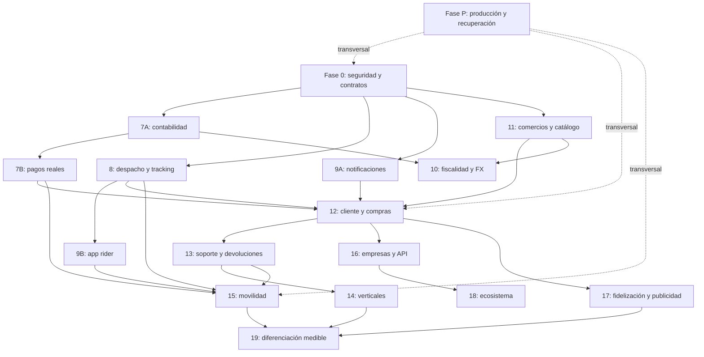

# Implementación de mejoras — Delivery360 — V1

**Fecha:** 24 de octubre de 2026, America/Caracas.  
**Estado:** propuesta de implementación pendiente; ninguna mejora de código se ejecuta con este documento.  
**Código revisado:** commit `d6ce659e9afe039fbe6d74ec3a8a7e6d9f0df488`.  
**Alcance de esta actualización:** guardar el diagnóstico, las fases, sus dependencias y los criterios de preparación para producción. Crear este documento no autoriza por sí mismo pagos, migraciones, despliegues ni cambios de datos.

Para llevar Delivery360 a producción y después competir con el alcance de Yummy, hay que completar tres trabajos distintos: corregir la base existente, terminar las fases 7–10 y desarrollar los productos que hoy no existen, especialmente comercios, clientes y transporte de pasajeros.

El roadmap actual cubre principalmente la operación de repartidores. Completarlo literalmente no produciría todavía una plataforma equivalente a todo el ecosistema de Yummy.

## Fuentes y alcance de la revisión

Se contrastaron los siguientes documentos con endpoints, servicios, modelos, migraciones, frontend, workers y configuración de CI/CD:

- [ROADMAP_PROXIMAS_FASES_7-10.md](ROADMAP_PROXIMAS_FASES_7-10.md).
- [4-informe_comparativo_delivery360_vs_yummy.md](4-informe_comparativo_delivery360_vs_yummy.md).
- [Informe_Sistema_V1.md](Informe_Sistema_V1.md), como referencia del análisis anterior.

También se revisaron páginas públicas de Yummy para actualizar el alcance de comparación. La información comercial publicada no constituye una auditoría del funcionamiento interno de Yummy ni acredita su arquitectura, proveedores, rendimiento o algoritmos.

La revisión que fundamenta esta propuesta fue informativa: no modificó código ni datos. Los cálculos puros indicados se reprodujeron de forma aislada; los demás hallazgos se sustentan en lectura del código y evidencia previa identificada. No se ejecutaron pagos, migraciones ni cierres de entregas. No se relanzaron las suites históricas de pruebas ni se inspeccionó producción.

## 1. Qué hay que corregir en la interpretación del roadmap

| Afirmación documental | Lo que respalda el código revisado | Consecuencia |
|---|---|---|
| Bonos completados al 100 % | Existe la fórmula y el desglose, pero hay cierres inconsistentes y modificación del tier desde el perfil propio | Requieren consolidación y controles antes de considerarse terminados |
| Sistema financiero 96/100 | Conviven libros, unidades y caminos de escritura diferentes | Esa puntuación no acredita integridad financiera |
| Fase 7: pagos reales | Existen modelos y gestión de retiros; no se encontró un circuito completo de desembolso real con proveedor | Falta la integración financiera efectiva |
| Fase 8: mapas avanzados | Hay tracking, mapas y optimización heurística | Falta cerrar autorización, WebSocket, sincronización y restricciones operativas |
| Fase 9: app móvil | El código utiliza “fase 9” para notificaciones | La app móvil del roadmap sigue siendo un trabajo separado |
| Fase 10: consolidación financiera | Hay fiscalidad, FX y snapshots de reparto | No equivale a facturación validada ni liquidación real a comercios |
| 2FA completado | No se encontró un flujo completo de enrolamiento, verificación y recuperación en los módulos revisados | Debe permanecer pendiente de implementación o demostración |
| Listo para producción | Persisten bloqueantes de seguridad, dinero, compilación y operación | Esa conclusión documental no sirve como criterio de lanzamiento |

Las cifras de calificación, presupuestos y plazos de los documentos antiguos son estimaciones históricas, no mediciones verificadas de preparación actual. También hay afirmaciones sobre arquitectura interna, proveedores y algoritmos de Yummy que esos documentos no demuestran; no deben utilizarse como base cierta para decidir tecnología o presupuesto.

## 2. Qué significa hacer todas las funciones de Yummy

La oferta pública consultada incluye delivery de varias categorías, movilidad, marketplace y servicios adicionales para comercios. Esto amplía considerablemente el alcance original de Delivery360. Fuente: [oferta pública de Yummy](https://www.yummysuperapp.com/).

Yummy presenta además soluciones corporativas para administrar usuarios, presupuestos, viajes y envíos, y una plataforma de publicidad autogestionada. Fuentes: [Yummy Corporate](https://corporate.yummysuperapp.com/) y [Yummy Ads Manager](https://marcas.yummysuperapp.com/).

| Objetivo | Qué debe poder hacer Delivery360 |
|---|---|
| Producción logística | Administrar pedidos, repartidores, entregas y dinero con seguridad y trazabilidad |
| Competencia en delivery | Permitir que clientes compren a comercios, paguen, reciban y resuelvan incidencias |
| Competencia en movilidad | Solicitar y ejecutar viajes de pasajeros |
| Competencia como ecosistema | Incorporar empresas, marketplace, fidelización y servicios adicionales |
| Superación competitiva | Demostrar mejores resultados en entregas, soporte, transparencia o rentabilidad |

“Superior a Yummy” debe convertirse en objetivos medibles. No puede deducirse de tener más módulos, usar microservicios o incorporar IA.

## 3. Bloqueantes antes de ampliar el producto

Estos problemas pertenecen a una fase de estabilización obligatoria. P0 indica bloqueo prioritario del alcance afectado; P1 indica alta prioridad. Los defectos estáticos no implican que se haya realizado una explotación ni que se haya observado su impacto en producción.

| Prioridad | Problema verificado o sustentado en el código | Riesgo |
|---|---|---|
| P0 | Cierre de entrega sin comprobación uniforme de propietario | Alteración de operaciones ajenas |
| P0 | Actualización del propio tier por el repartidor | Modificación de un factor de remuneración |
| P0 | Distintas rutas generan cierres y movimientos financieros diferentes | Compensaciones inconsistentes |
| P0 | Estado de entrega y compensación no forman una operación atómica uniforme | Entregas cerradas sin movimiento correspondiente |
| P0 | Reservas y escrituras de saldo sin un bloqueo común obligatorio | Riesgo de retiros concurrentes incompatibles |
| P0 | Documentos personales publicados mediante montaje estático | Acceso por URL sin autorización del propietario |
| P0 | Caché sin identidad en la clave | Diseño incompatible con respuestas privadas |
| P0 financiero | Cálculo incorrecto del total con IVA incluido | Facturación por importe incorrecto |
| P1 | Wallet usa UserRole.RIDER, inexistente | Fallo directo al utilizar ese circuito |
| P1 | Servicio síncrono de wallet recibe sesión asíncrona | Incompatibilidad de ejecución |
| P1 | Tracking WebSocket mal anotado y autorización de canales incompleta | Handshake defectuoso o acceso indebido |
| P1 | Estados terminales y OTP no están protegidos uniformemente | Reapertura y evidencia insuficiente |
| P1 | Workers con imports y atributos incompatibles | Automatizaciones no operativas |
| P1 | Contratos de frontend, API y modelos desalineados | Pantallas y operaciones fallidas |
| P1 | Simulaciones devuelven estados aparentemente exitosos | Indicadores que no acreditan ejecución externa |

Referencias de código:

- Cierre de entregas: [backend/app/api/v1/deliveries.py](backend/app/api/v1/deliveries.py#L508).
- Modificación del tier: [backend/app/api/v1/riders.py](backend/app/api/v1/riders.py#L831).
- WebSocket y archivos estáticos: [backend/app/main.py](backend/app/main.py#L148).
- IVA incluido: [backend/app/services/tax_engine.py](backend/app/services/tax_engine.py#L201).
- Conversión monetaria: [backend/app/services/fx_service.py](backend/app/services/fx_service.py#L78).

### Cálculos comprobados nuevamente

Se ejecutaron únicamente funciones de cálculo extraídas, sin importar la aplicación, conectar la base ni iniciar tareas.

| Caso | Resultado |
|---|---|
| Precio de 11.600 centavos con IVA incluido al 16 % | El cálculo devuelve total de 10.000; debería conservar 11.600 bajo esa regla |
| Conversión cuyo resultado es 1,50 unidades menores | Devuelve 1, aunque el comentario promete redondeo HALF_UP, que daría 2 |

En FX también se admite una tasa implícita de 1 para monedas desconocidas. Ese comportamiento puede servir como simulación de desarrollo, pero no debe autorizar una conversión monetaria real.

**Matiz de caché:** además de no aislar por identidad, existen problemas de inicialización y doble deserialización en la combinación revisada. El efecto inmediato al activar esa combinación puede ser un error en hits. No se afirma una fuga observada; corregir solo la deserialización dejaría el defecto de aislamiento.

## 4. Esquema general de fases pendientes

Se mantiene la referencia histórica 7–10 y se añaden subdivisiones para evitar confundir lo desarrollado con lo pendiente.

| Fase propuesta | Objetivo | Naturaleza |
|---|---|---|
| 0 | Estabilización, seguridad y contratos | Corregir |
| 7A | Consolidación contable y saldos | Corregir y completar |
| 7B | Cobros, retiros y conciliación reales | Desarrollar e integrar |
| 8 | Despacho, tracking y rutas operativas | Corregir y completar |
| 9A | Notificaciones confiables | Completar lo existente |
| 9B | App móvil de repartidores | Desarrollar |
| 10 | Fiscalidad, FX y liquidación comercial | Corregir y completar |
| 11 | Comercios, sucursales, catálogo e inventario | Desarrollar |
| 12 | Experiencia completa del cliente | Desarrollar |
| 13 | Soporte, devoluciones, reputación y seguridad operativa | Desarrollar |
| 14 | Supermercado, farmacia, paquetería y otras verticales | Desarrollar |
| 15 | Transporte de pasajeros | Desarrollar |
| 16 | Plataforma corporativa y API para empresas | Ampliar |
| 17 | Promociones, fidelización, suscripciones y publicidad | Desarrollar |
| 18 | Servicios adicionales del ecosistema | Desarrollar o integrar |
| 19 | Optimización y diferenciación demostrable | Evolucionar |
| P | Operación de producción y recuperación | Transversal a todas |

Las primeras fases permiten explotar una operación logística confiable. Las posteriores convierten esa operación en una plataforma comercial y de movilidad.

## 5. Fase 0 — Estabilización y seguridad

**Objetivo:** que el negocio existente tenga un comportamiento consistente y seguro.

### Trabajo pendiente

1. Centralizar la autorización por recurso:
   - Qué usuario puede leer o modificar cada pedido.
   - Qué repartidor puede operar cada entrega.
   - Qué roles pueden revisar documentos, modificar niveles o aprobar dinero.
   - Qué suscripciones WebSocket puede abrir cada identidad.
2. Separar campos de perfil y campos administrativos:
   - El repartidor solo modifica datos permitidos.
   - Tier, aprobación y asignaciones sensibles requieren permisos específicos.
   - Registrar actor, motivo y cambio.
3. Proteger documentos:
   - Almacenamiento privado y descarga autorizada.
   - Validación de archivos.
   - Retención y acceso auditado.
4. Consolidar contratos:
   - Unificar estados entre frontend, schemas, ORM y BD.
   - Resolver prefijos duplicados.
   - Corregir imports y tipos.
   - Definir una política única para users.id y riders.id.
5. Consolidar la máquina de estados:
   - Transiciones explícitas.
   - Rechazo de reapertura accidental.
   - Reintentos idempotentes.
   - Prueba de entrega según política del servicio.
6. Completar sesiones:
   - MFA para administración y operaciones financieras.
   - Gestión de sesiones y revocación.
   - Recuperación segura.
   - Suspensión operativa aplicada uniformemente.
7. Corregir o retirar temporalmente el caché de respuestas privadas hasta disponer de aislamiento e invalidación adecuados.

**Criterio de cierre:** las pruebas de permisos demuestran que un usuario no puede leer ni modificar recursos ajenos y que ninguna ruta alternativa evita las reglas del flujo principal.

**Dependencia:** precede al uso de pagos reales y a cualquier lanzamiento público.

## 6. Fase 7A — Unificación contable

**Objetivo:** disponer de una fuente coherente de verdad para el dinero.

Actualmente existen financials, financial_transactions, wallets alternativas y saldos auxiliares. No basta con corregir cada endpoint por separado.

### Trabajo pendiente

- Elegir el modelo contable canónico y definir cómo se conserva o migra el legado.
- Identificar moneda y unidad de cada importe.
- Usar reglas monetarias exactas; evitar flotantes para saldos y liquidaciones.
- Separar disponible, pendiente, reservado, en retiro y retenido por disputa.
- Registrar movimientos compensatorios en lugar de alterar historial financiero.
- Hacer obligatoria la idempotencia por evento de negocio.
- Establecer control de concurrencia compartido.
- Vincular entrega, compensación y evento contable de forma consistente.
- Corregir el auxiliar de conciliación que puede producir una nueva diferencia.

Para una plataforma que administrará fondos de comercios, clientes y repartidores, se recomienda diseñar partida doble con cuentas y asientos balanceados. El ledger actual no acredita por sí mismo ese modelo.

**Criterio de cierre:** repetir o ejecutar concurrentemente una operación no duplica dinero; el saldo se explica íntegramente mediante movimientos y reservas.

**Dependencia:** fase 0; base para 7B y 10.

## 7. Fase 7B — Pagos y retiros reales

**Objetivo:** convertir estados administrativos en operaciones verificables con proveedores.

### Trabajo pendiente

- Cobro al cliente: autorización, captura, cancelación y devolución.
- Desembolso al repartidor.
- Alta y verificación de beneficiarios.
- Métodos de pago tokenizados.
- Webhooks autenticados y resistentes a duplicación.
- Procesamiento de eventos fuera de orden.
- Reintentos y consulta posterior al proveedor.
- Conciliación entre proveedor y contabilidad.
- Comisiones, plazos y límites.
- Gestión de contracargos y disputas.
- Tratamiento de efectivo y rendición de cobros cuando corresponda.
- Resolución de operaciones cuyo resultado quedó desconocido tras un timeout.

**Decisión pendiente del roadmap:** Stripe y Mercado Pago son candidatos, no una garantía de disponibilidad. Deben seleccionarse proveedores según país, entidad operadora, moneda y producto que realmente permitan contratar. El fee de 1,5 % y los tiempos de retiro del documento requieren validación comercial; no se consideran vigentes por estar escritos allí.

**Criterio de cierre:** un cobro, retiro o devolución puede rastrearse desde la solicitud hasta el identificador y resultado del proveedor, incluso tras reinicios o webhooks repetidos.

**Dependencia:** 7A y controles de seguridad de fase 0.

## 8. Fase 8 — Despacho, tracking y rutas

**Objetivo:** asignar correctamente y seguir la operación en condiciones reales.

### Trabajo pendiente

- Corregir firma y autorización del WebSocket.
- Unificar geometría y coordenadas planas.
- Identificar antigüedad y precisión de posiciones.
- Reconexión y recuperación del último estado.
- Distribución de eventos entre varias instancias.
- Medición de frescura GPS.
- Geocodificación y direcciones utilizables.
- ETA basada en red vial y tiempos de preparación.
- Reasignación cuando un rider no acepta o pierde disponibilidad.
- Oferta de pedidos con vencimiento y aceptación atómica.

La asignación debe considerar más que cercanía:

| Factor | Razón |
|---|---|
| Disponibilidad real | Evitar asignar a alguien desconectado |
| Carga activa | No sobrecargar al mismo rider |
| Capacidad y vehículo | Compatibilidad con el envío |
| Zona | Restricciones de cobertura |
| Recogida y entrega | Precedencia correcta |
| Ventanas horarias | Cumplir compromisos |
| Tiempo de preparación | Evitar esperas innecesarias |
| Jornada y pausas | Respetar la operación del repartidor |

La optimización actual es heurística. Puede conservarse como alternativa inicial si cumple objetivos, pero debe incorporar restricciones y medirse contra una referencia justa.

No es obligatorio sustituir Leaflet para estar en producción. La visualización del mapa y el motor de rutas son decisiones diferentes.

**Criterio de cierre:** las asignaciones respetan restricciones; el tracking funciona entre instancias y el error de ETA se mide por zona y franja horaria.

**Dependencia:** fase 0; relación con infraestructura de eventos de fase P.

## 9. Fase 9A — Notificaciones confiables

Esta fase reconoce el trabajo de notificaciones que el código ya denomina “fase 9”.

### Trabajo pendiente

- Corregir deduplicación por destinatario, canal y evento.
- Separar estados de simulación, aceptación por proveedor y entrega.
- Configurar push, correo y SMS reales.
- Registrar respuestas y errores.
- Procesar confirmaciones cuando existan.
- Persistir eventos antes de intentar enviarlos.
- Disponer de reintentos y bandeja de fallos.
- Gestionar preferencias, dispositivos y tokens caducados.
- Evitar que un evento financiero crítico dependa exclusivamente de una tarea en memoria.

**Criterio de cierre:** un evento llega a todos sus destinatarios previstos y su estado refleja lo sucedido, sin marcar como enviado lo que solo fue simulado.

**Dependencia:** fase 0 e infraestructura de eventos de fase P.

## 10. Fase 9B — App móvil para repartidores

**Estado:** la web de rider no satisface por sí sola la app móvil propuesta en el roadmap.

### Trabajo pendiente

- Registro y revisión documental.
- Inicio y cierre de disponibilidad.
- Recepción, aceptación y rechazo de ofertas.
- Navegación.
- Tracking en segundo plano con permisos adecuados.
- Foto, firma, OTP o QR según política.
- Incidencias y soporte.
- Ganancias, reservas y retiros.
- Almacenamiento seguro de credenciales.
- Actualización y compatibilidad de versiones.

### Funcionamiento sin conexión

- Guardar entregas activas.
- Encolar acciones con identificadores idempotentes.
- Sincronizar sin duplicar cierres ni compensaciones.
- Resolver conflictos.
- Conservar evidencia con fecha de captura y de recepción.
- Informar qué acciones todavía no han sido confirmadas.

La biometría local de un teléfono no equivale a identidad verificada ni reemplaza automáticamente el MFA del servidor.

**Criterio de cierre:** los recorridos funcionan con pantalla apagada, conectividad intermitente, cierre de la app y reintentos, sin duplicar operaciones.

**Dependencia:** API estable, fases 8 y 9A; wallet sobre 7A/7B.

## 11. Fase 10 — Fiscalidad, moneda y liquidación comercial

**Objetivo:** transformar los componentes fiscales existentes en un circuito confiable para los países habilitados.

### Trabajo pendiente

- Corregir IVA incluido y redondeo.
- Manejar moneda y unidades menores correctamente.
- Rechazar o retener operaciones sin tasa válida.
- Registrar fuente, vigencia y tasa utilizada.
- Evitar tasas de desarrollo en operaciones reales.
- Corregir numeración, rangos y concurrencia.
- Integrar y validar proveedores fiscales por país.
- Diferenciar aceptación simulada de aceptación externa.
- Implementar notas, anulaciones y recuperación de errores.
- Definir quién factura a quién: comercio a cliente; plataforma por su servicio; repartidor cuando corresponda.
- Separar precio de mercancía, envío, comisión, impuesto, propina y descuento.
- Crear liquidación real al comercio.

El servicio actual declara expresamente que no hay modelo Vendor y fija restaurant_share_cents=0. El split actual no completa el reparto a restaurantes previsto por el roadmap.

**Criterio de cierre:** cada país habilitado tiene casos validados de emisión, rechazo, repetición y cancelación; la contabilidad concuerda con los documentos y liquidaciones.

**Dependencia:** 7A/7B y fase 11 para liquidar comercios.

## 12. Fase 11 — Comercios, sucursales y catálogo

**Objetivo:** convertir una plataforma de gestión de entregas en un marketplace de compra.

### Desarrollo pendiente

- Comercios y propietarios.
- Sucursales y personal.
- Verificación y contratos.
- Catálogo, categorías y productos.
- Variantes, modificadores y adicionales.
- Precios y disponibilidad.
- Horarios y cierres excepcionales.
- Inventario y reservas.
- Tiempos de preparación.
- Aceptación y rechazo de pedidos.
- Comisiones por contrato.
- Portal comercial.
- Reportes y liquidaciones.
- Integraciones POS concretas.

El POSConnector existente es una base genérica con URL de ejemplo; no demuestra integración productiva con un POS específico.

**Entidades previsibles:** comercio, sucursal, membresía, producto, variante, inventario, movimiento de stock, contrato y liquidación. Son propuestas de diseño, no tablas ya implementadas.

**Criterio de cierre:** un comercio administra su oferta, recibe una compra, prepara el pedido y comprende cuánto se le debe liquidar.

**Dependencia:** seguridad y aislamiento desde fase 0; dinero desde 7A/7B.

## 13. Fase 12 — Producto completo para clientes

**Objetivo:** que el cliente pueda realizar todo el recorrido sin intervención de un operador.

### Desarrollo pendiente

- Registro y recuperación.
- Direcciones y cobertura.
- Descubrimiento de comercios.
- Búsqueda y filtros.
- Detalle de productos.
- Carrito.
- Cotización y desglose.
- Checkout y pago.
- Entrega inmediata o programada.
- Seguimiento.
- Cancelación y devolución.
- Historial y repetición.
- Favoritos.
- Propinas y valoración.
- Accesibilidad y experiencia móvil.

Debe decidirse expresamente si el carrito admite varios comercios. Si los admite, debe generar subpedidos, cobros, asignaciones y cancelaciones coherentes.

**Criterio de cierre:** un cliente puede comprar, recibir, reclamar y obtener resolución sin que el equipo técnico intervenga.

**Dependencia:** 11, 7B, 8 y 9A; soporte y fiscalidad del alcance publicado antes del lanzamiento.

## 14. Fase 13 — Soporte, devoluciones y confianza

**Objetivo:** resolver las excepciones que aparecen diariamente en producción.

### Desarrollo pendiente

- Tickets vinculados a pedido, pago y entrega.
- Chat o mensajería con acceso controlado.
- Priorización, asignación y tiempos de atención.
- Productos faltantes, equivocados o dañados.
- Cliente ausente y dirección incorrecta.
- Cancelaciones según etapa.
- Devoluciones totales y parciales.
- Logística inversa.
- Evidencias y apelaciones.
- Valoraciones verificadas y moderación.
- Incidentes de seguridad.
- Procedimientos de escalamiento.

La reputación necesita registros verificables; un campo de rating o un componente visual no constituye un sistema completo de calificaciones.

**Criterio de cierre:** cada incidencia tiene responsable, evidencia, resolución y efecto contable trazable.

**Dependencia:** puede comenzar junto a 11 y 12; es requisito para su lanzamiento público.

## 15. Fase 14 — Verticales adicionales

**Objetivo:** soportar supermercado, farmacia, paquetería y otras categorías sin tratar todos los pedidos como una entrega de comida.

| Vertical | Capacidades específicas |
|---|---|
| Supermercado | Peso variable, sustituciones, faltantes y aprobación de diferencias |
| Farmacia | Restricciones y documentación según producto y jurisdicción |
| Bebidas y productos restringidos | Elegibilidad y verificación de recepción |
| Paquetería | Dimensiones, valor declarado, custodia y devolución |
| Retail | Variantes, stock, cambios y logística inversa |
| Mandados | Instrucciones, límites de gasto y comprobantes |

**Trabajo común:** capacidades del vehículo, manejo especial, reglas de precio, cobertura y prueba de entrega por servicio.

**Criterio de cierre:** cada vertical dispone de estados, excepciones, cobro y responsabilidades definidos.

**Dependencia:** marketplace, soporte y pagos.

## 16. Fase 15 — Transporte de pasajeros

**Objetivo:** cubrir el ámbito de movilidad representado por Yummy Rides.

Es un producto nuevo. Reutiliza identidad, mapas y pagos, pero no debe reducirse a renombrar una entrega.

### Desarrollo pendiente

- Perfil de pasajero.
- Habilitación de conductores.
- Categorías y requisitos de vehículos.
- Cotización.
- Solicitud y oferta de viaje.
- Aceptación y llegada al punto.
- Espera.
- Inicio y finalización.
- Cancelación y no presentación.
- Tarifa final, peajes y propina.
- Viajes programados.
- Valoración.
- Compartir recorrido.
- Soporte y SOS.
- Gestión de incidentes y requisitos operativos del mercado.

**Entidades previsibles:** solicitud de viaje, viaje, cotización, oferta, habilitación de conductor, tarifa y evento de seguridad.

**Criterio de cierre:** el ciclo completo del viaje y sus excepciones funciona en un piloto controlado, con soporte operativo disponible.

**Dependencia:** 7A/7B, 8, 9A/9B y 13.

## 17. Fase 16 — Empresas y API de última milla

**Objetivo:** permitir a empresas administrar usuarios, gastos y envíos con aislamiento.

### Desarrollo pendiente

- Organizaciones y membresías.
- Sucursales empresariales.
- Centros de costo.
- Presupuestos.
- Políticas de aprobación.
- Límites por usuario.
- Pedidos masivos.
- Viajes o envíos para terceros.
- Facturación consolidada.
- Contratos y SLA.
- API versionada.
- Credenciales con permisos.
- Webhooks documentados.
- Cuotas y entorno de pruebas.

**Criterio de cierre:** una empresa opera sin acceder a información ajena y concilia su consumo por usuario, centro de costo y período.

**Dependencia:** aislamiento, pagos y el producto logístico o de movilidad correspondiente.

## 18. Fase 17 — Crecimiento, fidelización y publicidad

**Objetivo:** competir en adquisición, recurrencia y monetización comercial.

### Desarrollo pendiente

- Cupones y promociones.
- Referidos.
- Créditos promocionales separados del dinero retirable.
- Programa de puntos.
- Suscripciones.
- Renovaciones, cancelaciones y beneficios.
- Campañas por ciudad y segmento.
- Espacios patrocinados.
- Presupuesto publicitario.
- Impresiones, clics y atribución.
- Prevención de abuso.

El coste de cada promoción debe asignarse a plataforma, comercio o ambos. Una promoción que funciona visualmente pero no se refleja en liquidación genera otra discrepancia financiera.

**Criterio de cierre:** se conocen coste, uso, contribución y efecto de cada campaña; los beneficios no crean dinero retirable indebidamente.

**Dependencia:** compras, contabilidad y analítica confiable.

## 19. Fase 18 — Extensión al ecosistema completo

Si “todas las funciones de Yummy” incluye su oferta pública ampliada, deben contemplarse estas líneas. Su sitio presenta marketplace, eventos, viajes y herramientas para comercios. Fuente: [ecosistema publicado por Yummy](https://www.yummysuperapp.com/).

| Línea | Desarrollo o integración necesaria |
|---|---|
| Marketplace entre vendedores y compradores | Publicaciones, identidad, moderación, mensajería y disputas |
| Eventos | Inventario, reserva, pago, emisión y validación de entradas |
| Viajes | Búsqueda, reserva, emisión, cambios y soporte mediante proveedores |
| POS | Caja, inventario, compras, devoluciones y sincronización |
| Comercio conversacional | Catálogo, cotización, confirmación y despacho desde mensajería |

Estas capacidades pueden construirse o contratarse mediante integración. No es necesario crear desde cero un sistema de reservas aéreas para ofrecer ese servicio.

**Criterio de cierre:** cada integración tiene responsabilidades, conciliación, soporte y tratamiento de fallos definidos.

**Dependencia:** identidad, pagos y APIs estables.

## 20. Fase 19 — Mejoras para superar a la competencia

Aquí comienza la diferenciación demostrable.

| Mejora propuesta | Qué debería demostrar |
|---|---|
| Bonos explicables y versionados | Menos disputas y comprensión del ingreso |
| Simulador de tarifas y capacidad | Mejor margen sin deteriorar el servicio |
| ETA con intervalo de confianza | Menor error y mejor comunicación |
| Reasignación preventiva | Menos pedidos vencidos |
| Planificación de demanda | Menos espera y cobertura más equilibrada |
| Liquidación transparente | Comercio y rider pueden explicar cada diferencia |
| Soporte con contexto completo | Menor tiempo de resolución |
| Operación con mala conectividad | Menos entregas interrumpidas |
| Detección de anomalías | Menor fraude con revisión humana |
| Medición de eficiencia | Menos kilómetros por entrega comparable |

Para usar ML primero deben existir eventos consistentes, datos suficientes y una referencia de comparación. De lo contrario, solo se añade complejidad.

**Criterio de cierre:** mejora medida en piloto y después en operación, sin degradar seguridad, equidad o rentabilidad.

## 21. Fase P — Preparación real para producción

Comienza con la estabilización y acompaña todas las fases.

### Infraestructura y despliegue

- Separar desarrollo, staging y producción.
- Eliminar dependencias operativas de --reload y montajes de desarrollo.
- Proteger BD y Redis.
- Configurar secretos fuera del repositorio.
- Desplegar workers y scheduler efectivamente utilizados.
- Evitar ejecuciones duplicadas entre instancias.
- Crear los artefactos de infraestructura que CI referencia.
- Usar imágenes y versiones identificables.

### Confiabilidad

- Persistir eventos antes de entregarlos a procesos externos.
- Reintentos idempotentes.
- Bandeja de fallos.
- Recuperación de operaciones interrumpidas.
- Health checks correctos.
- Respaldo y restauración ensayada.
- Migraciones compatibles con despliegues.
- Procedimiento de rollback.

### Observabilidad

- Métricas reales.
- Logs sin tokens ni documentación personal.
- Trazabilidad entre pedido, entrega, pago y notificación.
- Alertas sobre operaciones atascadas.
- Detección de diferencias financieras.
- Visibilidad de colas y proveedores.

### Calidad

- Compilación y tipos aprobados.
- Pruebas de integración.
- Recorridos completos por rol.
- Pruebas negativas de permisos.
- Concurrencia financiera.
- Duplicación y desorden de webhooks.
- Reinicio durante operaciones.
- Carga representativa.
- Pruebas de conectividad móvil.

**Criterio de cierre:** el equipo puede desplegar, detectar una falla, recuperarse y explicar el estado del negocio sin depender de reparaciones manuales improvisadas.

Kubernetes, microservicios y sharding deben responder a una necesidad medida. No son requisitos automáticos para el primer lanzamiento.

## 22. Orden recomendado de ejecución



El gráfico expresa dependencias principales, no una obligación de esperar al final para iniciar soporte. Soporte, fiscalidad e infraestructura deben trabajarse antes del lanzamiento de los productos que los requieren, aunque su integración se cierre después. La fase P aplica a todas las fases, no solo a los nodos dibujados.

### Liberaciones recomendadas

| Liberación | Alcance | Requisito |
|---|---|---|
| L1: piloto logístico | Pedidos y entregas administrados por operadores | Seguridad, dinero, tracking y operación estabilizados |
| L2: delivery comercial | Clientes compran a comercios | Catálogo, checkout, pagos, soporte y liquidación |
| L3: múltiples verticales y empresas | Retail, supermercado, paquetería y B2B | Reglas específicas y aislamiento |
| L4: movilidad | Transporte de pasajeros | Producto y operación de viajes completos |
| L5: ecosistema y diferenciación | Fidelización, publicidad y servicios adicionales | Datos y procesos consolidados |

## 23. Qué exigir para autorizar cada lanzamiento

No se utilizará una puntuación global como “92/100”. Se requiere evidencia por capacidad.

| Puerta de salida | Evidencia mínima |
|---|---|
| Seguridad | Sin defectos críticos abiertos en el alcance publicado; permisos negativos aprobados |
| Dinero | Conciliación explicable; idempotencia y concurrencia verificadas |
| Funcionalidad | Recorrido completo y excepciones aprobados |
| Integraciones | Confirmación real del proveedor; simulaciones claramente separadas |
| Calidad | CI, tipos, pruebas y build aprobados |
| Operación | Alertas, soporte y recuperación ensayados |
| Datos | Migraciones y restauración verificadas |
| Capacidad | Carga objetivo validada con margen acordado |
| Experiencia | Uso real validado con clientes, comercios y repartidores |
| País habilitado | Requisitos comerciales, fiscales y operativos del servicio revisados |

Como propuesta inicial, deben definirse objetivos de disponibilidad, frescura GPS, error de ETA, recuperación y conciliación. Sus valores se acuerdan según mercado y capacidad operativa; las cifras del roadmap no se consideran compromisos ya alcanzados.

La prioridad inmediata es la fase 0 y la consolidación contable 7A. Después conviene cerrar un primer circuito de producción logística y comercial antes de ampliar a movilidad y al resto del ecosistema.

## Estado de implementación de este documento

Todas las fases descritas son propuestas pendientes de ejecución o consolidación; el estado de cada módulo existente se detalla en sus secciones. No se marca ninguna mejora como completada por la mera creación de este archivo.

Esta entrega crea exclusivamente Implementacion_de_mejoras_V1.md. No actualiza el roadmap histórico, la comparación ni el código. No realiza commit, push, despliegue ni migración.


## Registro de avance — Fase 0, bloque 1 — 24 de octubre de 2026

**Estado:** implementación local del primer bloque; la fase 0 y el resto del plan siguen parciales. Esta sección actualiza el estado histórico de propuesta indicado al inicio del documento. La publicación se registra en el commit/PR correspondiente.

### Cambios de este bloque

- Política compartida para lectura y escritura de pedidos y entregas: personal operativo, auditor de solo lectura y repartidor asignado. CLIENTE no hereda acceso operativo sin relación de propiedad implementada.
- Comprobación de propietario antes de delegar el cierre legacy de una entrega. Se incluye delivery_id al construir ProofOfDeliveryCreate.
- Protección de tier, vehicle_ownership_type y assigned_vehicle_id en ambas rutas de actualización de rider; solo GERENTE y SUPERADMIN pueden modificarlos.
- Rechazo de reapertura de estados terminales mediante el endpoint de estado y rechazo de actualizaciones GPS fuera de entregas en curso.
- OTP obligatorio cuando existe un secreto o el tipo de prueba es OTP. Se aplica en el servicio de cierre, el endpoint unificado y el cierre alternativo desde pedidos. Las entregas sin OTP configurado conservan su flujo.
- Estadísticas de pedidos filtradas al rider autenticado cuando corresponde.
- El caché HTTP omite rutas /api/, peticiones con Authorization y peticiones con cookies; las respuestas API ejecutan siempre sus dependencias. Se corrige la doble deserialización del hit público.
- Corrección de siete errores de TypeScript, declaración de componente cliente para notificaciones, límites Suspense en login/restablecimiento y carga exclusivamente en navegador de páginas de mapas que importan Leaflet.
- Jest utiliza el preset JSX/TypeScript de Next. La prueba de teléfono usa el schema real del formulario, extraído sin cambiar sus reglas.
- Los archivos de registro creados por pruebas se aíslan en directorios temporales. La fixture de notificaciones no depende del caché Redis externo.

### Verificación

Comandos desde backend:

```bash
PYTHONDONTWRITEBYTECODE=1 python -m pytest -q -p no:cacheprovider
```

Comandos desde frontend:

```bash
npx tsc --noEmit --incremental false
npm test -- --runInBand --watchAll=false
NEXT_TELEMETRY_DISABLED=1 npm run build
```

Resultados locales del bloque: 186 pruebas backend, 21 pruebas frontend, comprobación TypeScript y build de producción. La suite backend conserva advertencias anteriores de configuración pytest y relaciones SQLAlchemy; no se presentan como resueltas. Los tests de seguridad usan handlers HTTP reales y persistencia simulada, y los tests de auth existentes usan SQLite de prueba. No prueban concurrencia PostgreSQL ni un recorrido completo de navegador.

### Cambios de contrato deliberados

- CLIENTE recibe 403 en los endpoints operativos revisados; su futuro acceso requiere relaciones y endpoints de la fase 12.
- AUDITOR tiene lectura operativa, no mutación. La deriva del enum SQL de AUDITOR sigue pendiente de migración específica.
- Enviar campos administrativos de rider sin permiso devuelve 403, incluso si se envía null; no se ignoran silenciosamente.
- El cierre de pedido admite otp_code opcional como query; se exige cuando la entrega tiene OTP configurado.
- Un estado terminal no se reabre mediante PATCH de estado. No se añade aquí un proceso administrativo de reversión.

### Pendientes que este bloque no resuelve

- Atomicidad integral de entrega, pedido y contabilidad; bloqueo concurrente e idempotencia de todos los circuitos de dinero.
- Unificación de los libros financieros, pagos reales, wallet alternativa y conciliación.
- Privacidad y migración de documentos actualmente servidos desde uploads; requiere coordinar acceso frontend y almacenamiento.
- Autorización de tracking/canales WebSocket, lifecycle y sesiones/MFA.
- IVA incluido, FX, facturación real, numeración fiscal y durabilidad de hooks.
- Workers, migraciones de deriva ORM/BD y despliegue/observabilidad completos.
- Cobertura funcional exhaustiva, pruebas de carga, restauración y validación productiva.

No se realizan migraciones, pagos reales ni despliegues con este bloque. La compilación y las pruebas aprobadas no equivalen a certificación de producción de todas las capacidades.


### Resultado del CI remoto del primer bloque

El [PR #243](https://github.com/corporacionbethelst-ux/Delivery_360-DEV/pull/243) publica este bloque en `fix/fase0-permisos-entregas`. La [ejecución 40103131774](https://github.com/corporacionbethelst-ux/Delivery_360-DEV/actions/runs/40103131774) detectó bloqueos en controles previos a las pruebas:

| Job | Bloqueo observado | Trabajo siguiente |
|---|---|---|
| backend-test | Flake8 F821: FastApiIntegration, SqlalchemyIntegration, RedisIntegration y CeleryIntegration sin definir en app/monitoring/sentry_config.py | Revisar y corregir imports y disponibilidad opcional del SDK; después ejecutar formato y tipos, que este job todavía no alcanzó |
| frontend-test | next lint solicita configurar ESLint y termina con código 1 | Declarar configuración y dependencias compatibles, ejecutar reglas y corregir los hallazgos antes de continuar los checks |
| security-scan | Los dos uploads SARIF de Trivy usan la misma categoría y el segundo es rechazado | Asignar categorías distintas a backend/frontend y actualizar la acción upload-sarif obsoleta |

Los archivos Sentry y workflow no se modificaron en este bloque; la configuración ESLint ya estaba ausente en la base revisada. Los fallos se identifican como deuda previa, no como una aprobación del pipeline. En esa ejecución las pruebas y el build remotos quedaron omitidos al fallar los pasos previos. Los 186 tests backend, 21 frontend, TypeScript y build indicados arriba son resultados locales.

**Integración a main pendiente:** no se fusiona este bloque mientras esos controles estén en rojo. La siguiente tarea de estabilización es corregir los bloqueos del pipeline y atender los resultados de formato/tipos que aparezcan, conservando los controles en lugar de deshabilitarlos. No se declara que el CI completo esté aprobado.


## Registro de avance — Fase 0 / CI, bloque 2 — 24 de octubre de 2026

**Base:** `c23cb90`, que ya incorpora el PR #243. Esta continuación se desarrolla en `fix/ci-quality-v1`; no modifica la historia del PR anterior.

### Correcciones implementadas

- Sentry: imports reales de FastAPI, SQLAlchemy, Redis y Celery; SDK declarado como dependencia de runtime y nivel de mensaje tipado según su contrato. Ocho pruebas nuevas verifican el caso sin DSN, la configuración y el envío delegado de niveles, sin transmitir eventos externos. No se activa Sentry en main.py como parte de este bloque.
- ESLint: configuración explícita `next/core-web-vitals`; se corrigen 15 comillas sin escapar en JSX preservando el texto mostrado y se mueve el hook condicional de NotificationBell antes del retorno. Tres pruebas nuevas cubren apertura, carga de inbox y acciones de lectura.
- Tipos de pruebas: `@types/jest` sustituye las declaraciones globales mínimas con any. El lockfile mantiene las versiones de las dependencias existentes; solo incorpora tipos de desarrollo necesarios.
- SARIF: categorías distintas `trivy-backend` / `trivy-frontend`, permisos explícitos y actualización de upload-sarif a v3.
- Pipeline: herramientas Python fijadas en requirements-dev.txt. Flake8, Black, mypy y pruebas permanecen activos. Se separan los pasos y las comprobaciones posteriores se ejecutan cuando las dependencias se instalaron, incluso si falló un control anterior; el job sigue fallando si cualquiera de ellos falla. Los builds/publicaciones conservan su dependencia de jobs aprobados.
- Formato: commit separado que aplica Black a 143 archivos restantes; equivalencia AST comprobada en los 154 archivos Python de app y suite repetida después. No se alteran reglas de negocio en ese commit.
- Los reportes coverage/ del frontend se excluyen de Git como artefactos generados.

### Resultados locales

| Control | Resultado |
|---|---|
| Flake8: E9,F63,F7,F82 sobre app | Aprobado, 0 hallazgos |
| Black sobre app | Aprobado, 154 archivos sin cambios pendientes |
| mypy de sentry_config.py, con imports seguidos en modo silent | Aprobado en el módulo corregido; no acredita el resto de app |
| pytest desde backend | 194 aprobadas; cuatro advertencias previas de pytest/ORM |
| ESLint | Aprobado con advertencias previas; reglas conservadas |
| TypeScript | Aprobado sin el stub de globals any |
| Jest sin cobertura | 24 pruebas aprobadas |
| Build Next.js | Aprobado |
| Workflow YAML | Parseado y verificadas categorías distintas y conservación de controles |
| pip check | Sin dependencias incompatibles |
| git diff --check | Aprobado |

### Bloqueos reales que continúan abiertos

**El CI completo todavía no se considera aprobado.** Al ejecutar todos los controles se confirmó deuda que antes quedaba oculta por pasos anteriores:

1. `mypy app --ignore-missing-imports`: 785 errores en 72 archivos con la herramienta fijada. El diagnóstico inicial era 788; se resolvieron cinco de Sentry y el cambio de líneas del formateador hace visibles dos diagnósticos adicionales de expresiones que ya existían. La comprobación de equivalencia AST confirma que el commit de formato no cambió su lógica. Incluye discrepancias ORM/SQLAlchemy, atributos y enums inexistentes y contratos sync/async. Requiere correcciones tipadas por módulo y pruebas; no se oculta con Any ni ignores generales.
2. Jest con cobertura: las 24 pruebas pasan, pero el mínimo global del 50 % no se cumple. Cobertura medida: statements 0,42 %, branches 0,44 %, functions 0,53 %, lines 0,46 %. El baseline anterior a las pruebas de campana era 0,01 % de líneas. Los umbrales permanecen intactos: el comando debe fallar mientras no se añada cobertura suficiente.

Los porcentajes bajos reflejan el alcance real de pruebas existentes sobre toda la aplicación, no una regresión causada por las correcciones. Los siguientes bloques deben ampliar pruebas funcionales de servicios, stores, hooks, componentes y recorridos, y corregir contratos de tipos priorizando las rutas activas y el dinero. No se declarará la preparación de producción ni se fusionará este bloque por el solo hecho de que compilen sus cambios.

No se ejecutan migraciones, pagos ni despliegues con esta continuación. Los cambios funcionales y de formato se mantienen en commits separados para facilitar revisión y reversión.


## Registro de avance — Fase 0 / Contratos ORM y wallet, bloque 3 — 24 de octubre de 2026

**Base:** `66e8ac2`, que ya incorpora el PR #244. Rama: `fix/orm-wallet-contracts-v1`.

### Problemas verificados y correcciones

1. **Wallet incompatible con la sesión real.** `get_db` entrega `AsyncSession`, pero WalletService utilizaba `query`, `commit` y `refresh` síncronos. Las operaciones se convierten a consultas y escrituras asíncronas. Saldo y movimiento/solicitud se confirman juntos; ante un error se revierte la transacción completa.
2. **Rol e identificación del repartidor incorrectos.** La API referenciaba `UserRole.RIDER`, inexistente, y podía utilizar users.id como riders.id. Ahora exige `REPARTIDOR`, consulta explícitamente el perfil por user_id y responde 404 si falta. Comparte las dependencias de autenticación y autorización de la API principal, sin acceder a relaciones ORM de carga diferida para resolver el perfil.
3. **Concurrencia y reintentos.** Se bloquea la fila de wallet antes de modificar saldo; la creación bloquea primero su repartidor padre. Las transiciones bloquean la solicitud y el rechazo bloquea además la wallet para reintegrar una sola vez. `populate_existing` refresca los valores tras adquirir el bloqueo, incluso si la sesión ya conservaba una instancia antigua. La clave de idempotencia verifica la identidad completa de la operación; una reutilización incompatible devuelve conflicto y no altera saldo. Los conflictos de la restricción única global se resuelven después de revertir la escritura perdedora.
4. **Validación monetaria.** Se rechazan montos no enteros, booleanos, cero, negativos, desbordamientos de INTEGER, sobregiros y operaciones nuevas sobre wallets inactivas. La solicitud HTTP admite una clave opcional de idempotencia; las llamadas anteriores sin clave siguen siendo válidas, pero no tienen protección frente a reintentos del cliente. La metadata de movimientos se serializa como JSON válido.
5. **Estados incompatibles en el frontend.** El backend de `/payouts` usa seis estados canónicos, pero el adaptador solo aceptaba cuatro estados anteriores. Ahora acepta `APROBADO`, `EN_PROCESO`, `COMPLETADO` y `FALLIDO`, y las pantallas los presentan explícitamente. Se conservan `PROCESADO` y `CANCELADO` para respuestas históricas. Aprobar conserva el estado `EN_PROCESO` devuelto por el backend; el indicador de completados cuenta `COMPLETADO`. No se interpreta una aprobación como confirmación de transferencia bancaria. Se rechazan importes no finitos en solicitudes y respuestas del adaptador.
6. **Contratos ORM tipados.** User y los cuatro modelos financieros de financial.py declaran `Mapped`/`mapped_column` con UUID, Decimal, enums y nulabilidad reales. Se preserva el DDL de PostgreSQL, incluidos índices, claves, defaults y valores de enums: una instantánea tomada antes del cambio se compara mediante prueba automatizada. No se modifica el esquema ni se añade una migración. Los CRUD materializan las listas declaradas y adaptan UUID al contrato textual del servicio contable existente.
7. **Autenticación.** Se retiran impresiones de fragmentos de token, payload y datos personales. Los subjects ausentes, no textuales o UUID inválidos se rechazan con 401; las cuentas heredadas sin rol no provocan errores 500 ni reciben tokens. Se reutilizan los esquemas de recuperación ya existentes y se eliminan alias iniciales nulos de dependencias que posteriormente tenían implementación real.

### Validación local

| Control | Resultado |
|---|---|
| pytest, suite completa | **225 aprobadas**, frente a 194 de la base; cuatro advertencias anteriores |
| Persistencia / HTTP | Pruebas de saldo e historial firmado, reintentos, conflictos, rollback, sobregiro, desbordamiento, wallet inactiva, reserva/reintegro, estados, permisos y separación user/rider |
| Concurrencia real PostgreSQL 16 | **7 aprobadas**: débitos simultáneos, clave repetida en la misma wallet y entre wallets, reservas/rechazos simultáneos, saldo obsoleto en sesión, creación simultánea y reintentos de solicitud |
| Aislamiento de pruebas PostgreSQL | Contenedor local desechable; esquema privado por prueba; solo TEST_DATABASE_URL explícita con nombre test_*; limpieza al terminar; sin fallback a DATABASE_URL |
| Contrato de tablas | Comparación exacta del DDL ORM PostgreSQL, índices, defaults y enums de las cinco tablas afectadas |
| Flake8 E9,F63,F7,F82 | 0 hallazgos |
| Black sobre app | 154 archivos aprobados |
| mypy global | **629 diagnósticos en 66 archivos**, frente a 785 en 72; el control todavía falla |
| Jest | **53 aprobadas**, frente a 24; 29 nuevas sobre el adaptador de retiros |
| Cobertura global Jest | Statements 1,19 %, branches 1,45 %, functions 0,97 %, lines 1,23 %; el mínimo del 50 % sigue incumplido |
| TypeScript / ESLint / build Next.js | Aprobados; ESLint conserva advertencias anteriores |
| git diff --check | Aprobado |

El workflow proporciona TEST_DATABASE_URL sobre su servicio PostgreSQL de pruebas para ejecutar las siete verificaciones de concurrencia. Sin esa variable, estas pruebas se omiten explícitamente: SQLite no demuestra bloqueos de filas. Se usa NullPool únicamente en esas pruebas para no compartir conexiones asyncpg entre bucles de pytest/TestClient; el pool de producción no cambia.

### Límites y trabajo que continúa pendiente

- **Este bloque no completa la fase financiera ni certifica producción.** El subsistema alternativo `rider_wallets/financial_transactions/payout_requests` sigue separado de `financials/payouts` y de `riders.wallet_balance`. No se consolidan ni se reconcilian saldos automáticamente. Sus reservas se representan por solicitudes; este bloque no añade asientos contables de reserva/reintegro a ese historial.
- Las acciones administrativas de aprobar/completar de la wallet mantienen su contrato manual: no envían dinero ni prueban que un banco lo haya transferido. Pendientes: proveedor real, webhooks verificados, conciliación, auditoría de actores y contabilidad unificada.
- Deben revisarse estados y callbacks del circuito principal `/payouts`, sus reglas de disponibilidad y la recuperación de fallos; corregir el adaptador visual no acredita todo ese flujo. Las estadísticas mensuales siguen dependiendo de las fechas que suministra ese contrato.
- La comparación DDL acredita equivalencia entre los modelos antes y después, **no** que una instalación tenga todas sus migraciones aplicadas ni que los enums físicos coincidan con el código actual. Las pruebas PostgreSQL crean únicamente las tablas necesarias; no sustituyen pruebas de migración y actualización desde una instalación histórica.
- El nuevo tipado también hace visibles defectos anteriores: roles/timestamps anulables que otros consumidores asumen completos y contratos UUID declarados como int o Column. No se ocultan con Any, casts ni ignores generales. Los 629 diagnósticos restantes requieren corrección por módulos y pruebas.
- La idempotencia de clientes debe conservar una misma clave cuando reintenta una misma operación. La generación de una clave nueva en cada nueva llamada del adaptador principal no sustituye ese comportamiento de la interfaz; sigue pendiente su integración completa. Los registros antiguos con metadata serializada de otra forma pueden generar conflicto conservador al reutilizar claves.
- Quedan pendientes cobertura global del 50 %, recorridos completos, carga, observabilidad, restauración, secretos y los siguientes bloques del plan. No se reducen umbrales ni se desactivan controles para presentar una aprobación artificial.

**Publicación:** rama y PR de revisión; no se fusiona ni se despliega este bloque mientras continúen los bloqueos globales de tipos/cobertura. No se ejecutan migraciones ni movimientos monetarios reales.


## Registro de avance — Conciliación segura y reportes, bloque 4 — 24 de octubre de 2026

**Base:** `831ee40`, fusión del PR #245. Rama: `fix/financial-report-contracts-v1`. Por instrucción del propietario, el siguiente PR se publica **sin borrador**, listo para revisión; ese estado no equivale a aprobación de los controles ni a certificación de producción.

### Hallazgos corregidos

- **dry_run ignorado:** `/reconciliation/fix-all-discrepancies` llamaba al servicio que escribía incluso con dry_run=True. Ahora la vista previa no modifica caché, versión ni ledger. Informa discrepancy_count y total_discrepancy_amount; fixed_count y total_adjusted_amount permanecen en cero durante la simulación.
- **GET con efectos monetarios:** GET `/reconciliation/wallet/{rider_id}` pasa a ser estrictamente informativo. Para sincronizar la caché existe POST `/reconciliation/wallet/{rider_id}/sync`, exclusivo de SUPERADMIN y con dry_run=True por defecto; la escritura exige dry_run=false. No se invoca contra datos productivos durante este trabajo.
- **Asientos artificiales de conciliación:** una discrepancia de caché generaba un AJUSTE_MANUAL, que además tiene dirección de débito en el ledger canónico. Esto podía cambiar la fuente usada para conciliar y dejar saldos incoherentes tras repetir la operación. Ahora la aplicación explícita sincroniza únicamente riders.wallet_balance con el saldo del ledger y aumenta su versión; no fabrica ingresos, retiros ni ajustes contables. Se usa bloqueo de fila y rollback si falla el guardado.
- **Control de versión no atómico:** la comprobación de versión y su escritura eran pasos separados. Se sustituyen por UPDATE condicionado por la versión esperada, con incremento SQL y RETURNING. Dos solicitudes con la misma versión no pueden ganar ambas. El método participa en la transacción del llamador y no confirma por su cuenta.
- **Fuente de saldo:** el último snapshot se restringe a movimientos procesados/pagados; una fila pendiente o rechazada no puede sustituirlo. En el fallback de snapshots históricos nulos, AJUSTE_MANUAL deja de contarse simultáneamente como débito y ajuste. AJUSTE conserva su signo.
- **Permisos y consultas:** las rutas de conciliación pasaban listas a require_role, cuyo contrato real recibe roles separados. Se corrige el contrato. El informe diario consulta nombres sin relaciones de carga diferida; las fechas históricas se rechazan explícitamente, porque comparar la caché actual bajo una fecha antigua producía un informe engañoso. Los UUID de las rutas se validan antes de consultar.
- **Liquidación diaria:** row.count identificaba el método de la fila, no el agregado SQL llamado count. Se lee la columna por su mapping; el resultado contiene un entero incluso cuando no hay movimientos.
- **Importe mostrado de órdenes:** si faltaba subtotal y había artículos y envío, el cálculo podía devolver solamente el envío. Ahora considera los artículos antes de usar únicamente la tarifa. Se mantienen la prioridad de totales explícitos y la prevención de doble suma.
- **Paginación del frontend financiero:** límites negativos, cero, fraccionarios y no finitos se normalizan a límites válidos en historial, desglose y reporte de órdenes. Los fallos del servidor siguen propagándose; no se sustituyen por reportes ficticios.

### Validación

| Control | Resultado local |
|---|---|
| Suite backend completa con PostgreSQL aislado | **237 aprobadas**, 12 nuevas frente a la base; cuatro advertencias anteriores |
| Concurrencia nueva en PostgreSQL | Dos pruebas aprobadas: compare-and-swap con un solo ganador y sincronizaciones repetidas sin asientos ni versiones duplicadas |
| Pruebas nuevas de persistencia / HTTP | Vista previa sin escrituras, aplicación sin alterar ledger, reintento, rollback, tolerancia de un centavo, perfil ausente, permisos, lote, fechas históricas, estados no procesados, fallback histórico y conteo de liquidación |
| Jest | **75 aprobadas**, 22 nuevas frente a la base |
| TypeScript / ESLint / build Next.js | Aprobados; advertencias anteriores de ESLint conservadas |
| Mypy global | **613 diagnósticos en 64 archivos**, frente a 629 en 66; sin diagnósticos en financial_service.py ni reconciliation.py en esta ejecución |
| Cobertura frontend global | Statements 2,16 %, branches 2,33 %, functions 1,50 %, lines 2,12 %; umbral global del 50 % todavía incumplido |
| Flake8 / Black / git diff --check | Aprobados |

La ejecución remota del bloque anterior [40108519477](https://github.com/corporacionbethelst-ux/Delivery_360-DEV/actions/runs/40108519477) confirmó pruebas backend y build aprobados, así como ejecución del análisis de seguridad. Los jobs globales fallaron en mypy y cobertura, tal como se había informado. Este bloque conserva todos esos controles.

### Límites y compatibilidad que deben revisarse

- **Cambio intencional de contrato:** GET ya no corrige saldos. Los consumidores que dependieran de esa escritura deben pasar al POST explícito. La simulación informa `discrepancy` donde antes el servicio podía devolver `reconciled` después de escribir. Se conservan los campos monetarios y se añaden dry_run/message e indicadores de discrepancias.
- La tolerancia previa de un centavo se mantiene. El lote confirma cada repartidor de forma independiente, informa fallos y no promete atomicidad global. La acción de sincronizar caché sigue requiriendo auditoría durable del actor antes de considerarse cerrada toda la fase financiera.
- Las pruebas demuestran coordinación entre sincronizaciones y actualizaciones con el nuevo control de versión, **no** que todos los escritores del ledger utilicen el mismo bloqueo ni que todos sus snapshots históricos sean correctos. La serialización global de asientos, revisión de snapshots, idempotencia del ledger principal y consolidación de los dos subsistemas financieros siguen pendientes.
- El auditor existente informa balances ausentes y distribución por tipo; se corrige su descripción para que no afirme verificar continuidad ni aritmética completa de saldos. Esa auditoría completa continúa pendiente.
- El cálculo de importe de orden es de presentación; no confirma cobros, modalidad de pago ni liquidación bancaria. Los reportes fiscales, moneda, carga, cobertura completa y recorridos de usuario requieren sus propios siguientes bloques.
- No se cambia el esquema, no se aplican migraciones, no se ejecutan conciliaciones sobre datos de negocio, no se envía dinero y no se despliega. **El PR se publica listo para revisión por petición del usuario, con los bloqueos globales informados y sin desactivar controles.**


## Registro de avance — Validación de sesiones y acceso al panel, bloque 5 — 24 de octubre de 2026

**Base:** `b6b05b8`, fusión del PR #246. Rama: `fix/session-validation-v1`. Publicación sin borrador por instrucción del propietario.

### Fallos verificados y cambios

1. **Suspensión sin efecto sobre tokens existentes.** El login comprobaba el perfil del repartidor, pero refresh y las dependencias de acceso solo validaban el usuario. Una cuenta con usuario activo y repartidor suspendido podía renovar y seguir utilizando tokens. La política compartida verifica el estado actual del perfil en login, refresh y las dos dependencias de acceso existentes. PENDIENTE, INACTIVO, SUSPENDIDO y perfil ausente reciben 403. ACTIVO y OCUPADO conservan acceso; estar realizando una entrega no equivale a una suspensión. Usuarios inactivos o sin rol siguen rechazándose.
2. **Autenticación basada en caché del navegador.** checkAuth promovía el perfil guardado a sesión autenticada antes de obtener el perfil del servidor, y Zustand rehidrataba isAuthenticated. Ahora los datos persistidos no acreditan autenticación: se ignoran al rehidratar y la sesión se habilita solo después de verificar un perfil activo con rol reconocido.
3. **Respuestas tardías después del cierre.** Se incorpora una revisión de operación para impedir que una respuesta de login o perfil obsoleta restaure la sesión o borre una sesión nueva. forceLogout invalida operaciones pendientes. El cierre local es inmediato aunque el servidor tarde o falle.
4. **Validación antes de montar páginas.** SessionGate verifica la sesión al entrar al dashboard y muestra un estado de espera. No monta las páginas protegidas ni sus consultas mientras espera. Una sesión inválida redirige a login. Se elimina una verificación redundante del resumen financiero para evitar un ciclo de montaje/validación.
5. **Limpieza excesiva por versión.** Se sustituye localStorage.clear por limpieza de credenciales y claves de autenticación propias. Se conservan preferencias ajenas a autenticación. Un login nuevo registra la versión actual, evitando que la siguiente verificación borre una sesión recién iniciada.
6. **Rotación de tokens y errores.** La cookie de navegación usa el token que queda almacenado tras validar el perfil, para no restaurar uno anterior si hubo renovación. Los errores del store se manejan como unknown, sin registrar su contenido completo.

### Verificación local

| Control | Resultado |
|---|---|
| Backend completo, PostgreSQL de pruebas configurado | **244 aprobadas**, incluidas las nueve pruebas anteriores de concurrencia; cuatro advertencias previas |
| Nuevas pruebas backend | Siete casos: cuatro estados/perfil ausente rechazados en acceso, refresh y login; ACTIVO/OCUPADO aceptados; suspensión posterior a emisión de tokens |
| Frontend completo | **92 aprobadas**, 17 nuevas frente a la base |
| Store | Login validado, perfil cacheado sin confianza, respuestas tardías, sesión nueva protegida frente a fallo antiguo, cambio de versión sin borrar preferencias, ausencia de tokens, perfil inactivo, fallo de verificación, cierre inmediato, rehidratación manipulada y cookie con token renovado |
| SessionGate | Contenido bloqueado hasta verificar, redirección en sesión inválida y retirada de contenido al cerrar sesión |
| Mypy global | **613 diagnósticos en 64 archivos**, igual que la base; nuevo módulo session_policy.py sin diagnósticos |
| Cobertura Jest | Statements 3,22 %, branches 2,95 %, functions 2,24 %, lines 3,20 %; todavía no alcanza el mínimo global del 50 % |
| Flake8 / Black | Aprobados, 155 archivos de app formateados |
| TypeScript / ESLint / compilación | Aprobados; TypeScript repetido después del build para evitar competir por archivos generados de Next.js; advertencias anteriores de ESLint conservadas |
| git diff --check | Aprobado |

La ejecución remota anterior [40109567159](https://github.com/corporacionbethelst-ux/Delivery_360-DEV/actions/runs/40109567159) terminó con los bloqueos conocidos de mypy y cobertura; los pasos de pruebas backend y build fueron aprobados. Se mantienen controles y umbrales.

### Límites y siguientes pendientes

- Esta política actúa en las rutas que usan las dependencias HTTP corregidas. No acredita por sí sola la autorización de WebSockets, procesos en segundo plano ni módulos de autenticación alternativos. Se debe completar ese inventario.
- El logout continúa siendo cierre local; **no añade revocación centralizada de JWT**. Tokens copiados siguen sujetos a firma, vencimiento y validación del estado de cuenta en cada petición. Quedan pendientes revocación, rotación con detección de reutilización y gestión de sesiones por dispositivo.
- Se conserva el mecanismo existente de tokens accesibles desde JavaScript y cookies de navegación. SessionGate y las cookies no son una frontera de autorización; el backend sigue siendo responsable de comprobar cada operación. La migración a cookies HttpOnly/Secure y su protección CSRF requiere un bloque propio y pruebas de integración.
- El perfil puede guardarse como metadata de presentación, pero no se usa como prueba de autenticación. Las preferencias ajenas a autenticación se mantienen al cambiar de versión.
- El control verifica el estado cuando se solicita acceso o renovación; no promete desconectar activamente conexiones ya abiertas ni reaccionar en todas las pestañas sin una nueva petición.
- No se cambia el esquema, no se aplican migraciones, no se hacen pagos, no se modifica la política de CI ni se despliega. Se publica PR listo para revisión; **tipos y cobertura global siguen pendientes**.


## Registro de avance — Integridad de asientos y límites transaccionales, bloque 6 — 24 de octubre de 2026

**Base:** `bae9659`, fusión del PR #247. Rama: `fix/ledger-integrity-v1`. Publicación sin borrador, conservando controles y límites pendientes.

### Hallazgos corregidos

1. **Idempotencia sin comprobar identidad.** El servicio devolvía cualquier asiento que tuviera la misma clave, aunque el nuevo importe, repartidor o concepto fueran distintos. Ahora compara repartidor, monto normalizado, tipo, estado, descripción, referencia, origen y actor. Un reintento equivalente devuelve el mismo asiento; una reutilización incompatible devuelve conflicto 409. Se rechazan claves suministradas vacías o demasiado largas. Sin clave, dos llamadas siguen siendo operaciones diferentes.
2. **Snapshots simultáneos incompatibles.** Dos escrituras podían leer el mismo saldo previo. El servicio bloquea la fila padre del repartidor antes de leer y calcular el saldo. El asiento y sus snapshots se preparan bajo ese bloqueo. Esto también coordina el servicio con la sincronización de caché del bloque 4, que bloquea el mismo padre.
3. **Colisión global de claves.** Una clave puede competir entre repartidores distintos aunque cada uno tenga su bloqueo. El insert usa un savepoint: una violación de unicidad revierte el insert perdedor y permite comprobar la identidad del ganador sin dejar inutilizada la sesión. commit=False conserva la transacción y el commit en manos del llamador; commit=True revierte ante un fallo.
4. **Montos/snapshots fuera de contrato.** Se rechazan NaN, infinitos, booleanos, cero después del redondeo y valores fuera de NUMERIC(10,2). El saldo inicial opcional debe coincidir con el saldo real al adquirir el bloqueo y debe ser finito. Se preservan las reglas previas de dirección de créditos, débitos y AJUSTE firmado, así como el redondeo monetario existente.
5. **Orden temporal ambiguo.** El lector usa created_at/id para elegir el último snapshot. Se garantiza orden creciente de los nuevos asientos por repartidor aun con timestamps iguales o pequeños retrocesos del reloj. Si el historial se adelanta más de cinco segundos al reloj actual, se rechaza la escritura y se pide revisar su cronología; no se desplazan nuevas operaciones a otro período por arrastrar una fecha futura corrupta.
6. **Saldo disponible confundido con saldo contable.** La aprobación de un payout pasaba al ledger un saldo que ya descontaba otras reservas. Ahora el payout conserva su snapshot de disponibilidad, pero el asiento deriva el saldo contable bajo su propio bloqueo. Prueba concreta: con saldo 100, retiro 30 y otra reserva 20, el payout registra disponibilidad 80→50 y el ledger saldo contable 100→70. La reserva ajena no se convierte en un débito contable adicional.
7. **Notificaciones que confirmaban antes de terminar.** Aprobar y rechazar invocaban NotificationService dentro de la transacción; ese servicio hace commits internos y además recibía riders.id como user_id. Se retiran esas llamadas duplicadas. Se conservan los hooks omnicanal existentes, posteriores al commit y con sesión propia. Las pruebas verifican un solo commit de negocio y rollback de estado, historial y ledger si falla la confirmación final.
8. **Conflictos de dominio convertidos en 500.** Se registra AppException con su código de estado y mensaje público; una clave incompatible produce 409 en lugar de un error interno genérico.
9. **Frontend convertía importes defectuosos en cero.** El adaptador de transacciones valida números finitos e identidad mínima, normaliza strings numéricos y snapshots, conserva ajustes negativos y admite snapshots ausentes. Un importe nulo, booleano, vacío o no finito genera un error visible en lugar de datos financieros ficticios.

### Validación local

| Control | Resultado |
|---|---|
| Backend completo | **275 aprobadas**, 31 nuevas frente a las 244 de la base; cuatro advertencias previas |
| PostgreSQL real aislado | Seis pruebas nuevas del ledger: saldos consecutivos, reintentos concurrentes, colisión de clave entre repartidores forzada con barrera, rollback del llamador, timestamps iguales/retroceso pequeño e historial fechado en el futuro |
| Persistencia / retiros | Identidad de operación, montos inválidos, snapshots explícitos, rollback, respuesta HTTP 409 y aprobación/rechazo sin commits tempranos; pruebas anteriores del servicio convertidas de stubs incompletos a filas reales |
| Total de pruebas PostgreSQL | 15, incluidas las nueve anteriores; conexión explícita a test_* y esquemas privados con limpieza |
| Frontend | **110 aprobadas**, 18 nuevas para el adaptador de transacciones |
| Mypy global | **606 diagnósticos en 64 archivos**, frente a 613; servicio financiero y manejador de dominio sin diagnósticos en esta ejecución |
| Cobertura frontend | Statements 3,77 %, branches 3,74 %, functions 2,51 %, lines 3,73 %; mínimo global del 50 % todavía incumplido |
| TypeScript / ESLint / build Next.js | Aprobados; advertencias anteriores de ESLint conservadas |
| Flake8 / Black / git diff --check | Aprobados |

La ejecución remota anterior [40113571917](https://github.com/corporacionbethelst-ux/Delivery_360-DEV/actions/runs/40113571917) terminó con los bloqueos conocidos de tipos y cobertura. No se cambia su exigencia ni se activa despliegue como parte de este bloque.

### Alcance real y siguientes pendientes

- La serialización protege las escrituras que pasan por FinancialService. Inserciones directas o cambios de estado de asientos existentes requieren inventario y adaptación; no se afirma que todo escritor del repositorio use ya ese protocolo.
- **No se certifica todo el circuito principal de retiros.** Su cálculo de disponibilidad, reservas simultáneas, estados terminales, deducciones, fallback de órdenes y notificaciones de creación necesitan el siguiente bloque con pruebas propias. El servicio contable conserva la posibilidad de balances negativos para la política de débitos/ajustes existente; este trabajo no equivale a una nueva regla universal de sobregiro.
- Los snapshots históricos y sus fechas no se reescriben ni se auditan por completo. El bloqueo rechaza cronología futura excesiva para revisión; no intenta repararla automáticamente. La tolerancia de cinco segundos se limita a ordenación técnica, no autoriza backdating de negocio.
- La identidad estricta puede revelar usos anteriores de una misma clave para operaciones diferentes o reintentos después de modificar el estado del asiento. Esos casos requieren resolver el contrato de origen, no sobrescribir el historial ni ignorar el conflicto.
- commit=False no confirma ni revierte por su cuenta toda la unidad externa. El llamador debe propagar el error y hacer rollback; get_db lo hace cuando falla una petición. Un savepoint no sustituye una transacción de negocio completa.
- Los hooks posteriores al commit usan el mecanismo anterior de tareas en memoria. No se añade outbox durable ni se garantiza entrega de notificaciones si el proceso termina. Los eventos Redis emitidos antes de la confirmación tampoco constituyen auditoría transaccional durable.
- El frontend conserva sus compatibilidades previas de tipos/estados y moneda; validar importes no acredita alineación completa de enums, contabilidad multimoneda ni cifras agregadas de todos los reportes.
- No se altera el esquema, no se aplican migraciones, no se ejecutan movimientos de negocio reales ni se despliega. Se mantienen pendientes 606 diagnósticos de tipos, cobertura global, conciliación completa y los siguientes bloques del plan.


## Registro de avance — Reservas y disponibilidad de retiros, bloque 7 — 24 de octubre de 2026

**Base:** `5214ca3`, fusión del PR #248. Rama: `fix/payout-reservations-v1`. Publicación sin borrador, sin modificar los controles globales pendientes.

### Correcciones implementadas

1. **Respaldo contable de disponibilidad.** El cálculo anterior sumaba créditos, ignoraba deducciones y podía recurrir al valor de órdenes entregadas sin asiento de ingreso. Ahora parte del saldo procesado/pagado del ledger y resta únicamente las reservas que todavía no tienen un débito correspondiente. Las deducciones y ajustes ya afectan ese saldo; no se inventa crédito retirable desde órdenes. Los saldos negativos no producen disponibilidad positiva.
2. **Estados que retenían/liberaban incorrectamente dinero.** PENDIENTE y APROBADO se consideran pendientes; EN_PROCESO y COMPLETADO continúan comprometidos. Un retiro sin asiento de débito sigue retenido, incluso completado, hasta conciliación. Si existe un RETIRO procesado/pagado del mismo repartidor, importe y referencia/origen de payout, no se descuenta dos veces. Los estados nulos históricos se retienen conservadoramente; una reserva de importe inválido bloquea el cálculo con 409 para revisión.
3. **Reservas simultáneas.** Solicitar, aprobar y rechazar coordinan su decisión mediante el bloqueo del repartidor padre usado también por el ledger. El saldo se comprueba después de adquirirlo. Las transiciones refrescan el estado del payout al bloquearlo, evitando aceptar una instancia obsoleta de la sesión. El snapshot de saldo liberado al rechazar se recalcula excluyendo esa reserva, en lugar de sumar su monto a un valor previamente limitado a cero.
4. **Reintentos e identidad de solicitud.** La misma clave solo devuelve la solicitud previa si coinciden usuario, repartidor, monto, método y últimos dígitos. Las reutilizaciones incompatibles devuelven 409. La restricción única global resuelve colisiones entre repartidores mediante rollback y consulta del registro ganador; no quedan historial ni reservas del perdedor.
5. **Validación de entrada.** El monto usa Decimal, máximo de NUMERIC(10,2) y hasta dos decimales. Se mantiene el mínimo de 10.00. Los últimos dígitos, cuando se proporcionan, deben ser cuatro números; las claves no pueden estar vacías. Booleanos, NaN y exceso de precisión se rechazan antes de escribir.
6. **Notificación aislada.** Se sustituye la llamada de notificación que compartía la sesión de creación del retiro por un registro de inbox en una sesión propia, lanzado después del commit. Un fallo de esa sesión no revierte ni confirma nuevamente el retiro. La notificación queda pendiente; este bloque no simula haberla entregado a un proveedor push.
7. **Lectura de enums antiguos.** El filtro compartido de estados contables compara su representación textual, evitando que una lectura de PROCESADO/PAGADO falle únicamente porque el enum físico antiguo no contiene PAGADO. Una prueba PostgreSQL crea esa variante en su esquema privado y verifica el saldo. Esto no añade etiquetas físicas ni habilita escrituras con estados inexistentes.
8. **Formulario de retiro.** Conserva una misma clave para reintentar el mismo importe/cuenta después de una respuesta incierta; cambia de intención al modificar esos datos. Valida sufijos incompletos. Se retiran promesas de depósito por ciclo/viernes que no estaban garantizadas por el backend; el usuario puede consultar el estado de su solicitud.

### Evidencia local

| Control | Resultado |
|---|---|
| Backend completo con PostgreSQL de pruebas | **295 aprobadas**, 20 nuevas frente a la base; cuatro advertencias anteriores |
| Total PostgreSQL | **23 pruebas**, ocho nuevas: competencia por saldo, reintentos, colisión global forzada, aprobación/solicitud, aprobaciones simultáneas, rechazo/solicitud, identidad obsoleta y paymentstatus antiguo |
| Persistencia / HTTP | Estados comprometidos y nulos, débito ya contabilizado sin descuento doble, deducciones, ausencia de ledger, monto/clave/banco inválidos, identidad estricta y fallo de notificación aislado |
| Frontend | **113 aprobadas**, tres nuevas sobre reintento del formulario, cambio de intención y sufijo bancario incompleto |
| TypeScript / ESLint | Aprobados; advertencias anteriores conservadas |
| Compilación Next.js | Aprobada |
| Mypy global | **605 diagnósticos en 64 archivos**, frente a 606; sin introducir ignores ni reducir controles |
| Cobertura frontend | Statements 4,58 %, branches 4,25 %, functions 3,21 %, lines 4,57 %; no alcanza el umbral del 50 % |
| Flake8 / Black / git diff --check | Aprobados |

Las pruebas PostgreSQL usan esquemas privados de una base test_* explícita. La variante de enum se modifica únicamente allí y se elimina con el esquema. No se ejecutan cambios de esquema ni migraciones sobre datos de negocio. La ejecución remota anterior [40122510284](https://github.com/corporacionbethelst-ux/Delivery_360-DEV/actions/runs/40122510284) continuó fallando en tipos y cobertura; los pasos de pruebas backend y build estuvieron aprobados.

### Compatibilidad, alcance y siguientes pendientes

- **Cambio deliberado para instalaciones históricas:** órdenes sin crédito contable ya no financian retiros. Los saldos aparentes que dependían de ese fallback requieren revisión y conciliación autorizada; no se crean asientos retrospectivos ni se liberan fondos automáticamente.
- `pending` incorpora APROBADO y `processed` incorpora COMPLETADO. Son agrupaciones de solicitudes, no pruebas de una transferencia bancaria. Se añaden `ledger_balance` y `reserved` para explicar la disponibilidad; se conservan las claves anteriores del contrato.
- El reconocimiento de un retiro contabilizado exige importe completo, repartidor y referencia/origen coincidentes. Débitos parciales o sin vínculo identificable mantienen una retención conservadora hasta conciliación. Los datos históricos inconsistentes no se reparan en este bloque.
- Los GET de saldo son informativos y pueden cambiar mientras otras transacciones avanzan. La garantía de decisión serializada corresponde a las escrituras que participan en el protocolo de bloqueo. Escritores directos del ledger o cambios administrativos ajenos a ese protocolo requieren inventario y adaptación.
- La clave del formulario se conserva durante la vida de la página, no después de recargar o cerrar el navegador. La recuperación durable de una intención incierta, el historial visible para resolverla y la idempotencia entre dispositivos requieren un bloque adicional.
- Las notificaciones siguen siendo tareas en memoria y no constituyen un outbox durable. Los mensajes Redis y hooks existentes necesitan su propia revisión de entrega y auditoría transaccional. No se implementa un proveedor bancario/push ni se garantiza entrega efectiva.
- La compatibilidad de lectura con paymentstatus antiguo no acredita todos los enums/migraciones físicos. La moneda permanece en el contrato anterior COP y no se consolida con la wallet alternativa USD.
- Continúan pendientes 605 diagnósticos de tipos, cobertura global, auditoría completa de históricos, conciliación integral, proveedor de pagos, restauración/carga y los siguientes bloques del plan. No se fusiona ni despliega automáticamente este PR.


## Registro de avance — Recuperación de solicitudes inciertas, bloque 8 — 24 de octubre de 2026

**Base:** `2b28602`, fusión del PR #249. Rama: `fix/withdrawal-recovery-v1`. PR sin borrador, conservando controles y bloqueos globales.

### Comportamiento implementado

- **Intención recuperable tras recargar.** Antes de enviar un retiro se conserva en sessionStorage un registro versionado y separado por usuario: clave de idempotencia, monto en centavos y sufijo bancario opcional. No incluye tokens ni cuenta bancaria completa. Se valida formato, versión, propietario, precisión y límites antes de reutilizarlo. Si no puede conservarse, no se envía el POST.
- **Consulta de estado con autorización.** GET `/payouts/request-status?idempotency_key=...` devuelve únicamente una solicitud perteneciente al perfil del repartidor autenticado. La clave no concede permisos. Otro repartidor recibe el mismo 404 que una clave inexistente; otros roles reciben 403. El endpoint es informativo y no crea solicitudes, reservas, historial ni asientos.
- **Respuesta incierta.** Tras un fallo de red/servidor se conservan la clave y los datos; el formulario impide cambiar monto o cuenta mientras no esté resuelta esa intención. Ofrece consultar su estado, revisar historial o reintentar la misma solicitud. Una consulta 404 no elimina la intención: el POST original aún podría estar en curso. Tampoco se elimina si un reintento responde 400/422 después de una incertidumbre anterior.
- **Recuperación al montar la página.** Se restaura la intención y se consulta al servidor. Si existe, se muestran el monto y el estado devueltos, incluido RECHAZADO; no se vuelve a enviar. Si no aparece o el servidor falla, se conserva la misma clave. El reintento puede recuperar una reserva ya registrada aunque el saldo mostrado sea ahora menor: el backend comprueba la identidad existente antes de decidir si debe reservar fondos nuevos.
- **Limpieza condicionada.** Se retira la metadata al recibir confirmación del servidor, sin borrar una intención nueva que pudiera haberse guardado con otra clave. Un fallo de limpieza del navegador no convierte una respuesta confirmada en fracaso; una recarga puede volver a consultar esa misma clave con seguridad.
- **Rechazo inicial definitivo.** Una primera respuesta 400/422, sin una incertidumbre anterior, permite corregir los datos y comenzar una intención nueva. Los datos locales nunca se usan para confirmar autorización, saldo ni estado bancario.

### Evidencia local

| Control | Resultado |
|---|---|
| Backend completo | **305 aprobadas**, diez nuevas frente a la base; cuatro advertencias anteriores |
| PostgreSQL real aislado | **24 pruebas** en total; nueva comprobación de consulta por clave, propiedad y ausencia de reservas/historial adicionales |
| Nuevas pruebas HTTP | Lectura sin escrituras, estado actualizado, clave de otro repartidor indistinguible de una inexistente, roles, claves inválidas y falta de bearer token |
| Frontend | **130 aprobadas**, 17 nuevas frente a la base |
| Recuperación / navegador | Remontaje con saldo reducido y misma clave, registro ya existente sin POST adicional, estado RECHAZADO autoritativo, servicio de estado no disponible, rechazo después de incertidumbre, almacenamiento bloqueado, datos corruptos, separación por usuario y limpieza que respeta una intención más reciente |
| TypeScript / ESLint | Aprobados; advertencias anteriores conservadas |
| Compilación Next.js | Aprobada |
| Mypy global | **605 diagnósticos en 64 archivos**, igual que la base |
| Cobertura frontend | Statements 5,59 %, branches 5,19 %, functions 3,68 %, lines 5,54 %; umbral global del 50 % todavía incumplido |
| Flake8 / Black / git diff --check | Aprobados |

La consulta se declara antes de las rutas dinámicas de detalle para que request-status no sea interpretado como un UUID de payout. La API conserva sus rutas y contratos de retiro anteriores; se añade un GET y un método tipado del servicio frontend. No se añaden tablas ni migraciones.

### Límites y continuación necesaria

- sessionStorage conserva datos al recargar la **misma pestaña**, sin prometer persistencia después de cerrarla ni recuperación automática entre dispositivos. El historial del servidor continúa siendo la referencia. Una recuperación durable global requiere un modelo de intención/cancelación en backend y sus migraciones.
- No se añade cancelación ni tombstone de una intención aún inexistente. Si hubo incertidumbre, un 404 o un rechazo posterior no demuestra que ninguna petición original pueda terminar más tarde. Se conserva la clave hasta recuperar o registrar la solicitud, o resolver el caso mediante revisión del historial/soporte.
- Los datos locales son metadata no confiable: si están corruptos o tienen otra versión, se bloquea su reutilización y se indica revisar historial. No se descarta automáticamente una clave incierta para generar otra. La consulta de estado vuelve a comprobar el propietario en el servidor.
- Se mantienen las garantías y límites de reserva/idempotencia del bloque 7. Este trabajo no garantiza que solicitudes creadas deliberadamente con claves diferentes representen una sola intención de negocio, ni certifica exactamente-una-vez entre todos los dispositivos.
- No se realiza transferencia bancaria, no se acredita el proveedor de pagos ni se implementa outbox durable. Los estados mostrados son los del registro del sistema, no pruebas bancarias independientes.
- Continúan pendientes los 605 diagnósticos de tipos, la cobertura global, auditoría/conciliación integral, sesiones/revocación centralizadas y los siguientes bloques del plan. No se hacen migraciones sobre datos de negocio, pagos ni despliegues automáticos.


## Registro de avance — Cierre de calidad: contratos ORM, bloque 9 — 24 de octubre de 2026

**Base:** `b10d5c6`, fusión del PR #250. Rama: `fix/orm-financial-types-v1`. Este bloque prioriza reducir deuda de tipos y corregir consumidores; no incorpora otro producto o flujo financiero.

### Cambios

- Payout, PayoutStatusHistory, Rider y Vehicle declaran sus columnas mediante Mapped/mapped_column con UUID, Decimal, date/datetime, enums y nulabilidad reales. Los enums de Vehicle construidos con valores textuales se tipan como strings; no se confunden con los enums Python del repartidor. El JSON del repartidor tiene un contrato recursivo de valores JSON, sin sustituirlo por Any.
- Se tipan tres campos referenciados desde esos contratos: orders.assigned_rider_id, deliveries.rider_id y deliveries.locked_bonus_tier_level. Se conserva su nulabilidad original; no se endurece ni flexibiliza el esquema implícitamente.
- Las lecturas de estado/tipo de vehículo usan una conversión explícita que admite Enum, string heredado o None. Se evita llamar .value o .isoformat sobre campos históricos nulos. Los valores ausentes se representan como null, sin fabricar estados o fechas. El registro de cambios de vehículo ya no falla si el tipo anterior está ausente.
- El registro all_models importa explícitamente los modelos requeridos. Su paquete padre ya los importaba obligatoriamente; las guardas que asignaban None a clases/enums no aportaban opcionalidad efectiva y generaban contratos de tipos inconsistentes. Se mantienen los nombres exportados.
- La geometría last_location y las relaciones ORM no se convierten en este bloque; sus contratos de expresiones SQL/carga asíncrona requieren una revisión propia. No se emplean Any nuevos, casts para silenciar errores, ignores globales ni exclusiones de módulos.

### Prueba de conservación del esquema

Se tomó una instantánea **antes de modificar cada modelo** de las seis tablas implicadas: payouts, payout_status_history, riders, vehicles, orders y deliveries. Se compara automáticamente:

- DDL PostgreSQL: columnas, tipos, nulabilidad, claves y restricciones.
- Índices, incluidos los existentes de geometría.
- Defaults y onupdate de Python.
- Valores y opciones de enums.
- Claves foráneas, incluidos ondelete/onupdate y use_alter.

La comparación es exacta y pasa. Se conserva además el contrato previo de las cinco tablas del bloque 3. Esto demuestra equivalencia entre los modelos antes/después, **no** que una instalación productiva tenga sus migraciones aplicadas ni que sus datos históricos sean completos.

### Validación local

| Control | Resultado |
|---|---|
| Backend completo con PostgreSQL aislado | **309 aprobadas**, cuatro nuevas; 24 pruebas PostgreSQL incluidas; cuatro advertencias anteriores |
| Pruebas nuevas | Equivalencia de seis tablas; repartidor con estado/vehículo/fecha nulos y JSON persistido; enums textuales y fecha de seguro de vehículo; payout histórico con estado/método/fechas nulos |
| Mypy global | **511 diagnósticos en 60 archivos**, frente a 605 en 64: **94 diagnósticos menos** |
| Comparación de diagnósticos | Sin diagnósticos adicionales respecto al registro anterior, comparando módulo/mensaje y no números de línea |
| Flake8 / Black | Aprobados; 156 archivos de app formateados |
| Imports y registro de modelos | Verificados al importar la aplicación y ejecutar la suite |
| git diff --check | Aprobado |
| Frontend | Sin cambios en este bloque; última validación registrada: 130 pruebas y cobertura de líneas 5,54 % |

El comando global de mypy continúa fallando por los 511 diagnósticos restantes. No se declara CI aprobado ni producción lista; el mínimo frontend del 50 % continúa vigente.

### Hallazgo preservado y límites

**Política referencial pendiente:** deliveries.rider_id es NOT NULL y su FK declara ON DELETE SET NULL. Un borrado físico de un repartidor con entregas puede fallar al intentar establecer un nulo que la columna prohíbe. La contradicción ya existía; se preserva para no introducir una migración accidental. Su resolución exige definir la política de eliminación/retención de históricos y probar una migración deliberada. No se marca como corregida por este bloque.

Las anotaciones correctas no sustituyen validación de entrada, permisos o conciliación. Continúan pendientes otros modelos/consumidores, relaciones de carga diferida, contratos geográficos, documentos privados, sesiones y autorización restante. Los null de datos heredados no se corrigen con valores artificiales; deben tratarse explícitamente en clientes y procesos que los consuman.

No se altera el esquema, no se aplican migraciones, no se cambian saldos ni se ejecutan pagos. El PR se publica sin borrador, con los controles globales pendientes informados, sin fusión ni despliegue automáticos.

## Registro de avance — Cierre de calidad: pedidos y entregas, bloque 10 — 24 de octubre de 2026

**Base:** `49f1755`, fusión del PR #251. Rama: `fix/order-delivery-types-v1`.

### Correcciones y alcance

- Se completan los contratos Mapped/mapped_column de Order y Delivery: UUID, enums, fechas, nulabilidad, JSON recursivo y Decimal en las columnas Numeric de bonos. Se conserva Float en los importes de pedidos: convertirlos a Numeric requiere una migración deliberada y queda pendiente.
- La instantánea PostgreSQL existente de seis tablas sigue siendo la referencia, sin regenerarla. Se verifican DDL, índices, defaults, enums y claves foráneas; el esquema permanece idéntico. No se ejecutan migraciones.
- El servicio de pedidos usaba atributos que no existen en su DTO y nombres de coordenadas que no existen en el modelo. Ahora crea y actualiza usando los nombres persistidos, convierte los enums explícitamente y conserva el inicio PENDIENTE o ASIGNADO si se proporciona repartidor. Un estado terminal enviado al crear no salta ese inicio. El plazo por defecto sigue siendo de 60 minutos; no se presenta como motor de SLA configurable.
- Los cálculos de la API rechazan artículos con estructura incorrecta, importes negativos, booleanos, NaN, infinito y desbordamientos de multiplicación, suma o total. Se conserva la regla heredada por la que un total explícito cero usa subtotal más envío. No se cambia la política de precios ni se redondean a escondidas las columnas Float.
- El JSON compartido con Rider se valida como una copia recursiva de valores JSON: rechaza claves no textuales, objetos no serializables y flotantes no finitos.
- Los snapshots de bonos asignan Decimal cuantizado a dos decimales y enums canónicos. La configuración de bonos del servicio rechaza valores base no finitos/negativos y multiplicadores inválidos; devuelve cero con advertencia según su política anterior. Esto no certifica todas las rutas financieras ni implementa un proveedor de pagos.
- Los consumidores admiten estados históricos nulos sin llamar .value sobre None. Las consultas agregadas sin GROUP BY usan el contrato de una fila. Los filtros de entregas pasan argumentos explícitos y conservan sus condiciones anteriores.
- En el router legado combinado se corrige una fecha asignada a una columna de minutos: las duraciones son enteros no negativos y el tiempo en recogida solo se deriva cuando existen ambas marcas temporales. Este router de entregas no sustituye el router canónico registrado; su corrección no acredita por sí sola permisos, OTP o transiciones del legado.

### Evidencia y límites

- Mypy global: **410 errores en 58 archivos**, frente a 511 en 60; **101 menos**, sin mensajes nuevos al comparar módulo/mensaje. El comando todavía falla por deuda pendiente. No se añaden Any, casts de evasión, exclusiones de módulos ni ignores globales.
- Las pruebas nuevas cubren creación/actualización persistida de coordenadas y prioridad, estado inicial, JSON inválido, importes y desbordamientos, configuración inválida de bonos y un snapshot Decimal persistido sin commit dentro del helper.
- La comparación exacta de seis tablas y el contrato financiero previo se mantienen dentro de la suite. Los resultados finales de pruebas se registran abajo.
- Frontend sin cambios; última validación registrada: 130 pruebas y 5,54 % de cobertura de líneas. El umbral global del 50 % sigue incumplido. No se declara CI global aprobado ni producción lista.
- Se conserva el hallazgo NOT NULL / ON DELETE SET NULL en deliveries.rider_id. Siguen pendientes política de retención y migración explícita, tipos restantes, relaciones/geometría, revisión integral de autorizaciones y estados, conciliación y fases funcionales del plan.
- Persisten cuatro advertencias de pytest/ORM anteriores, incluidas relaciones superpuestas que requieren revisión propia. Esta mejora no silencia esas advertencias.

No se modifican datos de negocio, no se ejecutan pagos y no se fusiona ni despliega automáticamente. El PR se publica listo para revisión, sin borrador.

**Resultados finales locales:** suite completa **327 aprobadas**, incluidas las 24 pruebas PostgreSQL; después, el archivo completo de regresiones **19 aprobadas**, con una prueba adicional de persistencia Decimal incorporada tras iniciar la suite. Son **328 casos distintos aprobados**, 19 nuevos frente a los 309 de la base; no se presenta ese total como una única ejecución completa de 328. Black verifica 157 archivos de app, Flake8 crítico registra cero y git diff --check pasa. Se mantienen cuatro advertencias anteriores.

## Registro de avance — Fase 0: turnos y asistencia, bloque 11 — 24 de octubre de 2026

**Base:** `59b882d`, fusión del PR #252. Rama: `fix/shift-transition-safety-v1`. Alcance: API de turnos del panel operador, registrada como `/api/v1/shifts`, y reglas de transición que esa API utiliza.

### Problemas corregidos

1. **Concurrencia entre turnos del mismo repartidor.** Dos solicitudes podían consultar estados anteriores y activar simultáneamente dos turnos distintos. Las transiciones ahora bloquean primero la fila del repartidor y después la del turno mediante SELECT FOR UPDATE. El inicio verifica, dentro de esa transacción, que no exista otro turno EN_CURSO para el mismo repartidor. Un conflicto devuelve HTTP 409; los demás repartidores conservan sus bloqueos independientes.
2. **Reintentos y carreras de asistencia.** Dos inicios/cierres concurrentes podían duplicar marcas IN/OUT. Un reintento con el turno todavía en el estado solicitado devuelve el resultado existente, sin otra marca ni modificación de la hora. No se reabren turnos completados/cancelados. Esto es idempotencia por estado del recurso, no un registro durable de intenciones: intentar iniciar después de que otro proceso ya lo finalizó continúa rechazándose.
3. **Cancelación de un turno activo.** La API anterior permitía cancelar EN_CURSO sin registrar una salida. Ahora responde 409 e indica finalizar primero. PROGRAMADO e INCOMPLETO pueden cancelarse; repetir una cancelación ya realizada no cambia el motivo ni añade asistencia.
4. **Estado y asistencia en una misma transacción.** El helper no hace commit. Actualiza el estado y hace flush de la marca antes de que la API confirme ambos. Una inserción fallida o una respuesta que no se puede construir provoca rollback mediante la dependencia de sesión. La creación también prepara su respuesta antes del commit, evitando dejar un turno confirmado cuando falla la serialización previa.
5. **Horario planificado y real.** El cierre conserva end_time planificado; la salida real continúa en check_out_at. Se conserva el contrato de respuesta: si existe salida real, el campo end_time de la API la muestra; check_in_at/check_out_at siguen disponibles. No se toca el esquema para inventar un campo de duración.
6. **Turnos nocturnos y offsets.** Los horarios explícitos se normalizan a UTC sin zona, conforme a las columnas existentes. Las entradas sin offset se interpretan como UTC. La API acepta duración positiva de hasta 24 horas; rechaza con 422 los finales anteriores/iguales al inicio y los intervalos mayores, que no se representan fielmente con una sola fecha y dos campos Time. Un intervalo explícito de exactamente 24 horas sí se admite. Al serializar un horario planificado cuyo final es menor o igual al inicio, el final se interpreta al día siguiente. Esto es una convención para representar la planificación, no una reconstrucción certificada de históricos ambiguos. Si se omite el final, se conserva el valor por defecto 23:59 UTC, con paso al día siguiente cuando sea necesario.
7. **Datos históricos incoherentes.** Un cierre activo sin hora real de entrada, o con entrada futura, exige revisión con 409. Un reintento de inicio/cierre con marcas faltantes o contradictorias tampoco confirma un éxito aparente. No se fabrican horas de asistencia ni se reparan datos históricos automáticamente.
8. **Lecturas de repartidor limitadas a lo necesario.** La creación verifica su identificador; las lecturas para serializar turnos cargan solo el identificador y la zona operativa del repartidor. Se evita cargar su geometría y demás campos personales sin necesitarlos. Las uniones de usuario/zona y el formato público del panel se conservan.

### Autorización y límites de concurrencia

- SUPERADMIN, GERENTE y OPERADOR conservan la gestión del panel. REPARTIDOR, CLIENTE, AUDITOR y rol ausente reciben 403 antes de consultar turnos. Sin sesión, la ruta devuelve 401. No se añade una API de autoservicio del repartidor.
- El bloqueo garantiza la exclusión entre las transiciones de **esta API** en PostgreSQL. No sustituye una restricción única parcial en base de datos ni controla scripts SQL u otros escritores que omitan el protocolo. Una restricción adicional exige auditar y resolver duplicados históricos antes de su migración.
- No se modifica Rider.status, is_online ni la autorización de sesiones al marcar asistencia. Su sincronización con disponibilidad, pedidos activos y suspensión necesita una política explícita.
- No se añade auditoría durable de actor/motivo para cada marca, cálculo de nómina, conciliación de horas, geocerca ni prueba de presencia. El campo zone de creación conserva el comportamiento anterior; este bloque no implementa asignación de zona por turno.
- No se convierten los modelos/schema legacy ni se aplican migraciones. Los horarios multilocalidad requieren una política de zona horaria del negocio y una interfaz que la muestre; UTC aquí establece el contrato técnico, no esa política comercial.

### Hallazgo pendiente: caminos antiguos de turnos

`app/services/shift_service.py`, `app/crud/shift.py` y `app/schemas/shift.py` conservan contratos antiguos incompatibles: IDs enteros frente a UUID, estados ACTIVE/SCHEDULED/COMPLETED inexistentes en el modelo y campos de horario/asistencia que no existen. El servicio intentaba además cambiar estados de Rider inexistentes y confirmar asistencia/disponibilidad en commits separados. El router de turnos de `routers_combined.py` también conserva inconsistencias y controles insuficientes para reutilizarlo.

El registro actual usa `app/api/v1/shifts.py`; la búsqueda de referencias no muestra llamadas al servicio/CRUD antiguos desde esa API. **No se consideran corregidos ni autorizados para reutilización por este bloque.** El siguiente cierre de contratos debe adaptarlos al flujo común o retirarlos deliberadamente, sin volver a exponer rutas alternativas que eviten sus reglas. La consolidación completa de turnos sigue pendiente.

### Validación local

- **30 pruebas nuevas:** 23 sobre HTTP/persistencia y siete en PostgreSQL real aislado.
- HTTP/persistencia: roles y autenticación, UUID inválidos/inexistentes, inicio/cierre/cancelación y sus reintentos, rechazo de reapertura, un turno activo, conservación del horario, offsets/nocturnos/24h, intervalos inválidos, históricos incompletos y rollback si falla la respuesta o asistencia.
- PostgreSQL: dos inicios del mismo turno producen una sola entrada; dos turnos del mismo repartidor no se activan juntos; dos cierres producen una sola salida; carrera inicio/cancelación; repartidores distintos; rollback por el dueño de la transacción; fallo real de NOT NULL al insertar asistencia después de actualizar el estado.
- **Mypy: 410 errores en 58 archivos**, igual que la base; sin mensajes nuevos por módulo/mensaje. El módulo nuevo no tiene diagnósticos. No se cambia la configuración para silenciar deuda.
- **Black:** 158 archivos de app verificados. **Flake8 crítico:** cero. **git diff --check:** aprobado.
- Frontend sin cambios; última validación registrada: 130 pruebas y cobertura de líneas 5,54 %. La deuda de tipos y el umbral de cobertura global mantienen pendientes los controles generales de CI. Cuatro advertencias anteriores de pytest/ORM permanecen visibles.

No se ejecutan pagos, no se modifican datos de negocio y no se despliega ni fusiona automáticamente. Se publica un PR sin borrador. El resultado completo de la suite se registra al finalizarla.

**Resultado final:** suite completa **358 pruebas aprobadas**, 30 nuevas frente a la base; **31 pruebas PostgreSQL** incluidas (24 anteriores y siete nuevas). Cuatro advertencias anteriores. Ningún modelo ni archivo de migración fue modificado en este bloque.

## Registro de avance — Fase 0: contratos de turnos, bloque 12 — 24 de octubre de 2026 (America/Caracas)

**Base:** `ad4f099`, fusión del PR #253. Rama: `fix/shift-contracts-v1`. Se continúa el hallazgo del bloque 11: servicio, CRUD y schemas internos no concordaban con la base de datos. La API del operador conserva sus rutas y sus nombres de estados de interfaz.

### Contratos y conservación del esquema

- Shift y CheckInOut pasan a Mapped/mapped_column con UUID, datetime, time, enums y nulabilidad reales. Se conservan defaults, índices, claves foráneas, cascadas y opciones de enums; los importes históricos de turnos continúan siendo Float. Las relaciones y geometría ajenas no se modifican.
- Se capturó **antes del cambio** una instantánea PostgreSQL de shifts y check_in_out. La comparación automática exacta de DDL, índices, defaults, claves y enums pasa contra esa referencia, sin regenerarla después. No se añaden migraciones ni se presume que una instalación productiva tenga su esquema al día.
- Los schemas internos usan UUID y el mismo ShiftStatus del modelo. ShiftCreate exige inicio programado y solo admite el estado inicial PROGRAMADO; ShiftUpdate admite horario y notas, sin una escritura genérica de estado. Los campos de horario no pueden borrarse con null.
- Los antiguos metadata_json, photo_url, estados PAUSADO/ACTIVE y campos no soportados se rechazan explícitamente, evitando aceptarlos sin almacenamiento real. Los schemas de respuesta reflejan atributos persistidos y conservan null históricos. Esto cambia contratos internos incompatibles que no tenían consumidores HTTP registrados; **no cambia los aliases PLANIFICADO/ACTIVO/FINALIZADO de la API del panel**.

### Unificación del comportamiento

1. **Creación común:** API, CRUD y servicio usan el mismo helper de programación, que valida horario/notas y existencia del repartidor. No se intenta crear usando columnas inexistentes. El servicio verifica que el rider_id de su argumento coincida con el DTO.
2. **Asistencia del turno solicitado:** check_in/check_out utilizan el shift_id del request, verifican su pertenencia al rider_id recibido y llaman a la transición común. Ya no crean otro turno automáticamente, ignoran el turno solicitado ni cambian Rider.status usando enums inexistentes.
3. **Datos de asistencia:** coordenadas finitas, dentro de rango y en pares; notas de hasta 500 caracteres. La marca y las columnas de coordenadas del turno se guardan en la misma transacción. No se exige geolocalización para todas las operaciones ni se presenta la coordenada recibida como prueba de presencia.
4. **Reintentos:** se recupera el evento IN/OUT original, asociado al repartidor, turno, tipo y timestamp exactos. Un reintento no sobrescribe sus notas/coordenadas. Si faltan eventos o hay más de uno coincidente, se exige revisión con 409 en lugar de fabricar evidencia. El mismo control se aplica a la API del operador, aunque esta no consuma el evento devuelto.
5. **Control compartido de concurrencia:** ediciones de planificación, servicio, CRUD y API toman el bloqueo Rider→Shift. Reprogramar un turno activo o modificar uno terminal/inconsistente se rechaza. Las notas pueden cambiar mientras está activo; no se reabre un estado terminal. Un turno activo debe finalizarse antes de cancelarse.
6. **Transacciones:** los helpers comunes no confirman. Los adaptadores conservan commit por defecto para sus operaciones completas y ofrecen commit=False para que el dueño de una transacción compuesta confirme o revierta todo. Una operación de asistencia ya no hace un commit de turno y otro de estado del repartidor. La gestión de disponibilidad permanece separada.
7. **Consultas:** IDs UUID, estados existentes, orden por fecha/hora con desempate por ID, paginación validada y detección explícita de activos históricos duplicados. Los filtros de fecha utilizan shift_date y la hora programada, incluyendo históricos que guardan medianoche en shift_date, en lugar de columnas inexistentes o comparar Time con datetime.

### Cálculo de horas y productividad

El tipado expuso un consumidor que restaba campos Time y buscaba el estado COMPLETED inexistente. Se corrige el servicio de productividad que consume turnos:

- La productividad de un turno finalizado utiliza check_in_at/check_out_at, incluso cruzando medianoche; sin marcas válidas responde 409. Los IDs de sus resultados son UUID y los límites de sus consultas son fechas completas.
- La productividad por repartidor calcula horas con las marcas de turnos completados cuya salida está en el periodo, y duración media con marcas válidas de entregas completadas en el periodo. No sustituye horas reales por duración programada. El cálculo por repartidor recorre columnas mediante streaming en lotes y cierra ambos resultados, sin materializar todo el historial en memoria.
- Las estadísticas del servicio de turnos cuentan completados por planificación dentro del periodo, calculan horas/medias solo para marcas coherentes y exponen shifts_requiring_review. Por su propósito, este periodo por planificación es distinto al periodo por salida de la productividad del repartidor; no se afirma que ambos informes sean conciliables para nómina sin una política adicional.
- Estas métricas se derivan de marcas persistidas: no certifican presencia, nómina, ausencia de intervalos solapados ni integridad de todo el histórico. No se añaden escrituras de métricas ni cálculos de pagos.

### Retirada del camino alternativo antiguo

Se eliminan los handlers de turnos no registrados de routers_combined.py. Contenían campos inexistentes y una salida que no comprobaba propiedad. Su export shifts_router apunta ahora al router canónico con los permisos del operador. No se montan rutas adicionales ni se habilita autoservicio de repartidores. Una prueba comprueba el registro real y la ausencia de /checkin, /checkout y prefijos duplicados de turnos.

No se retiran ni certifican por extensión otros handlers antiguos de entregas, productividad u otros módulos. Su revisión continúa pendiente.

### Validación y pendientes

- **45 pruebas nuevas:** 41 de contratos/persistencia/consumidores y cuatro PostgreSQL de adaptadores mixtos. Cubren equivalencia de dos tablas, schemas estrictos, UUID, pertenencia, turno solicitado, recuperación de la misma marca, rechazo de evidencia ausente, coordenadas inválidas, estados, planificación, filtros, null históricos, horas/productividad y commit=False.
- PostgreSQL nuevo: servicio contra CRUD al activar dos turnos del mismo repartidor; reintentos concurrentes del servicio que recuperan el mismo evento; carrera de reprogramación contra inicio; rollback externo del servicio. Se conservan las siete pruebas de concurrencia del bloque 11 y las 24 financieras anteriores.
- **Mypy: 342 errores en 53 archivos**, frente a 410 en 58: **68 menos**, sin diagnósticos nuevos al comparar módulo/mensaje. No se añaden ignores de mypy, casts de evasión ni exclusiones. El control global sigue fallando por deuda restante.
- Black verifica 158 archivos de app; Flake8 crítico registra cero; git diff --check pasa. Las cuatro advertencias anteriores de pytest/ORM se conservan.
- Frontend sin cambios; última validación registrada: 130 pruebas y cobertura de líneas 5,54 %. El umbral global del 50 % y los errores restantes mantienen CI pendiente. La ejecución de main posterior al PR #253 terminó con fallo; no se presenta este bloque como CI global verde.

**Límites:** los servicios internos no autentican al actor. Un futuro consumidor debe autorizarlo y resolver rider_id desde su identidad, además de aplicar el control de pertenencia; no basta con aceptar un rider_id enviado por un cliente. Sigue pendiente una restricción única parcial y la revisión de duplicados históricos, auditoría durable de actor, disponibilidad, geocercas, nómina y política de zona horaria del negocio. Los workers y contratos restantes de productividad conservan deuda ajena a este consumidor y requieren otro bloque. No se aplican migraciones, pagos, reparaciones de históricos, fusión ni despliegue automáticos.

El resultado final de la suite completa se añade después de su ejecución. El PR se publica sin borrador.

**Resultado final local:** suite completa **403 pruebas aprobadas**, 45 nuevas respecto a las 358 de la base; **35 pruebas PostgreSQL** incluidas. Cuatro advertencias anteriores. Comparación exacta de las dos tablas nueva y contratos anteriores aprobados; sin migraciones ni cambios de datos de negocio.

## Registro de avance — Fase 0: confidencialidad de documentos, bloque 13 — 24 de octubre de 2026 (America/Caracas)

**Base:** `9f0d777`, fusión del PR #254. Rama: `fix/private-rider-documents-v1`.

### Hallazgo y resultado

Las licencias, documentos de identidad, registros de vehículo y seguros se guardaban en uploads/documents y el montaje público /uploads permitía obtenerlos sin pasar por las reglas de autorización de las APIs de documentos. Los listados protegidos no protegían los bytes enlazados. El panel de gestión abría esos enlaces directamente en otra pestaña.

Este bloque cierra ese acceso público **en la aplicación** y añade una descarga autenticada, sin mover ni eliminar archivos históricos y sin cambiar las referencias almacenadas en la base.

### Cambios de acceso y compatibilidad

- Nuevo **GET /api/v1/riders/documents/{doc_id}/download**. Exige la sesión existente. SUPERADMIN, GERENTE y OPERADOR conservan la lectura administrativa que ya permitía el listado; REPARTIDOR solo puede descargar documentos cuyo perfil pertenece a su user_id. CLIENTE, AUDITOR y rol ausente se rechazan antes de consultar el documento.
- Para otro repartidor, la respuesta es el mismo 404 que para un documento inexistente. No se aceptan rutas de disco ni URLs remotas como parámetros de descarga y no se realizan peticiones a referencias externas.
- La resolución de la referencia exige un archivo del directorio del mismo rider_id. Rechaza traversal, subdirectorios, archivos ausentes y enlaces simbólicos que salgan de ese directorio. No se repara una referencia inválida con una ubicación alternativa ni se revela la ruta física en el error.
- La respuesta usa attachment con nombre generado desde doc_id, Cache-Control private/no-store, Vary Authorization, nosniff y CSP con sandbox. Los formatos PDF/PNG/JPEG conservan su MIME; otros archivos se descargan como binario. Esto no acredita que su contenido sea inocuo.
- PublicUploads sustituye al StaticFiles genérico: bloquea /uploads/documents, variantes normalizadas/codificadas y alias simbólicos que resuelvan dentro de documentos. Los demás archivos públicos se conservan; una prueba comprueba un recurso ajeno a documentos.
- El middleware HTTP de caché excluye **todo /uploads**, además del API privado ya excluido. Así no consulta ni devuelve entradas antiguas de documentos antes de ejecutar el bloqueo; tampoco intenta decodificar como texto los recursos binarios públicos. Una prueba simula una entrada antigua con contenido privado y comprueba que no se lee.
- Los listados propios/administrativos y las respuestas de subida mantienen la clave file_url, pero ahora contienen el endpoint autenticado por ID, o null si no hay referencia. Se elimina la construcción de una URL absoluta con localhost y doble slash. **Ese valor ya no es un enlace público para abrir sin cabecera Authorization.** Los consumidores externos deben usar el flujo autenticado.
- Las consultas de existencia para los listados cargan el identificador necesario del repartidor, sin pedir su geometría ni sus demás datos. No se cambian estados de documentos, reglas de aprobación ni pertenencia.

### Panel y descarga

- Se reemplaza la apertura directa del enlace en el panel de gestión por DocumentDownloadButton. El servicio llama al cliente API autenticado usando un endpoint relativo fijo y doc_id validado; no usa file_url como destino, no coloca tokens en URLs y no recurre al enlace público si falla.
- El botón muestra progreso, evita clics duplicados, permite reintentar tras un error y descarga un Blob con nombre local controlado. Rechaza respuestas vacías o que no sean Blob y libera la URL temporal generada.
- Cambiar de documento o desmontar el componente cancela la petición e impide descargar una respuesta tardía. No se añade persistencia de blobs, enlaces firmados ni tokens nuevos. Las descargas ya completadas por un usuario autorizado no se pueden revocar desde la aplicación.

### Contrato de base de datos

RiderDocument se tipa con Mapped/mapped_column: UUID, enums, strings y fechas con la nulabilidad existente. Una instantánea PostgreSQL tomada **antes de modificar el modelo** verifica exactamente columnas, índices, defaults SQL, claves foráneas, cascadas y opciones de enums. Pasa sin regenerar la referencia. No hay migración, traslado de archivos ni reparación de registros.

El volumen uploads existente sigue siendo la ubicación física. No se presenta como un nuevo almacén de objetos privado ni se cambia su política de retención.

### Evidencia local

| Control | Resultado |
|---|---|
| Backend completo | **434 aprobadas**, 31 nuevas; **35 PostgreSQL** anteriores incluidas; cuatro advertencias anteriores |
| Pruebas de documentos | Roles, propietario y recurso ajeno, ausencia de sesión, cabeceras/attachment, metadata sin URL pública, referencias inválidas/remotas, traversal, archivos ausentes, alias simbólicos, GET/HEAD y variantes codificadas, recurso público conservado y bypass de caché antiguo |
| Frontend completo | **143 aprobadas**, 13 nuevas, en 12 suites |
| Pruebas de descarga frontend | Ruta fija y cancelación, IDs inválidos, errores sin fallback público, Blob/nombre/extensión, liberación de URL, doble clic, reintento, desmontaje y cambio de documento |
| TypeScript / ESLint / Next.js build | Aprobados; advertencias anteriores conservadas |
| Mypy | **330 errores en 52 archivos**, frente a 342 en 53: **12 menos**, sin diagnósticos nuevos por módulo/mensaje |
| Black / Flake8 crítico / git diff --check | Aprobados; 159 archivos de app verificados, cero errores críticos de lint |
| Contrato PostgreSQL de documentos | Comparación exacta aprobada; contratos anteriores conservados |
| Cobertura frontend | Statements **6,15 %**, branches **5,44 %**, functions **4,06 %**, lines **6,07 %**; sigue incumpliendo el mínimo global del 50 % |

Las 143 pruebas frontend pasan, pero el comando con cobertura termina con error por ese umbral. Mypy también termina con error por los 330 diagnósticos restantes. No se afirma CI global verde ni producción lista.

### Límites y requisitos para publicar la aplicación

1. **Límite de esta protección:** controla las respuestas que pasan por FastAPI. Un proxy, servidor estático, bucket o CDN que sirva directamente el volumen puede evitar ese control. Antes de desplegar se debe impedir el acceso directo a uploads/documents en esas capas y purgar copias públicas previas cuando existan. No se han inspeccionado ni modificado servicios de producción externos; no se afirma haber retirado contenido ya descargado o cacheado fuera de la aplicación.
2. Backend y panel deben publicarse coordinadamente. Los enlaces públicos antiguos dejan de servir documentos; se mantiene el acceso a archivos locales históricos mediante el endpoint autorizado. No hay fallback anónimo por compatibilidad.
3. Siguen pendientes validación robusta de tamaño/formato/contenido de subida, análisis de malware, cuotas, retención/borrado físico, cifrado del almacén y copias de seguridad, auditoría durable de cada lectura y protección operativa del volumen. Este bloque no modifica los escritores ni elimina archivos reemplazados u huérfanos.
4. El endpoint utiliza las reglas actuales de sesión. No añade una excepción de acceso para cuentas pendientes/suspendidas ni resuelve por sí solo la experiencia de onboarding y recuperación de documentación de esas cuentas.
5. Continúan los 330 diagnósticos, la cobertura global y las demás fases funcionales/operativas del plan. No se ejecutan pagos, migraciones ni cambios sobre datos de negocio. El PR se publica sin borrador, sin fusión ni despliegue automáticos.

## Registro de avance — Fase 0: subidas y ciclo de guardado de documentos, bloque 14 — 24 de octubre de 2026 (America/Caracas)

**Base:** `db3e173`, fusión del PR #255. Rama: `fix/document-upload-validation-v1`. Se conservan la descarga autenticada y el bloqueo estático del bloque 13.

### Política común de entrada

Las tres vías de escritura —registro público de repartidor, subida propia y subida administrativa— dejan de copiar archivos sin límite mediante helpers duplicados. Utilizan una política común:

- **Máximo 10 MiB por archivo**, medido leyendo como máximo el límite más un byte. No se confía en el tamaño declarado por el cliente. Un exceso devuelve 413; un archivo vacío, 422.
- Solo extensiones PDF, PNG y JPEG, con MIME congruente y una comprobación de sus cabeceras mágicas. Se admite MIME genérico application/octet-stream o ausente si extensión y cabecera concuerdan. SVG, HTML, extensiones no soportadas y discordancias devuelven 415. JPEG se guarda con extensión canónica .jpg.
- **Es una validación básica de contenedor**, no una decodificación completa, prueba de integridad del documento, sanitización ni análisis de malware. Un archivo con cabecera válida puede contener contenido malicioso; no se certifica su inocuidad.
- Los cuatro documentos del registro se validan antes de crear usuario/perfil o escribir archivos definitivos. Un cuarto documento inválido no deja una cuenta parcial ni las tres subidas anteriores guardadas.
- El navegador usa la misma selección de formatos/tamaño para mensajes tempranos. Los selectores de registro y perfil ya no anuncian image/* cuando solo se admiten PNG/JPEG; ambos servicios de subida y el servicio de registro verifican las selecciones. La validación del servidor sigue siendo la autoridad. Se eliminan cuatro ts-ignore del armado de archivos de registro usando el tipo existente con archivos.

### Límite anterior al parser multipart

DocumentUploadLimitMiddleware limita las tres rutas POST, también cuando llevan slash final:

| Ruta | Límite del cuerpo completo |
|---|---|
| Registro con cuatro documentos | **41 MiB**: cuatro archivos de 10 MiB y 1 MiB de margen multipart/campos |
| Subida propia o administrativa | **11 MiB**: un archivo de 10 MiB y 1 MiB de margen |

Cuenta los bytes recibidos, incluyendo cuerpos por chunks y Content-Length falso o ausente. Un Content-Length excesivo se rechaza antes de recibir el cuerpo; longitudes malformadas/duplicadas/inconsistentes se rechazan con 400. El parser multipart solo recibe el cuerpo después de verificar el límite.

Para ello usa un spool temporal privado: hasta 1 MiB en memoria y después disco temporal, con reproducción en chunks de 64 KiB y cierre garantizado al finalizar, fallar o desconectarse el cliente. Las operaciones de disco se ejecutan fuera del event loop. CORS y rate limiting envuelven este control; se comprueba una respuesta 413 a través de la aplicación real, con su cabecera CORS.

El límite es **por petición**, no una cuota global de RAM, disco o concurrencia. El spool y los temporales del framework pueden coexistir y duplicar datos temporalmente. No sustituye límites/timeouts del proxy, cuotas del volumen ni protección frente a muchas subidas simultáneas. No se limitan por extensión otras rutas ajenas a documentos.

### Archivos nuevos y transacción SQL

DocumentUploadBatch controla exclusivamente los archivos nuevos de su operación y la sesión transaccional de esa petición:

1. Los nombres se generan desde el tipo documental y un UUID; se descarta el nombre del cliente como destino. La creación exclusiva evita sobrescribir un archivo previo, incluso si colisiona el nombre. Los nuevos archivos tienen permisos 0600 y los nuevos directorios documentales, 0700; no se cambian permisos históricos.
2. Se rechazan enlaces simbólicos en el directorio documental o del repartidor antes de escribir fuera de la ubicación prevista. El contenido se escribe y sincroniza antes del commit SQL.
3. Ante una validación/política rechazada no se guarda un nuevo archivo. Ante fallo de disco o flush SQL **antes de intentar commit**, se hace rollback y se intenta eliminar solo los archivos nuevos de ese lote. Los originales y sus versiones históricas nunca se borran por compensación.
4. La respuesta se prepara antes del commit; se evita un refresh posterior como condición para devolver el éxito. No se confirma usuario, perfil o documentos en commits separados.
5. **Si se intentó commit y su confirmación falla, no se borran los archivos nuevos.** La base podría haber confirmado aunque el cliente haya perdido el acuse. Se devuelve 503 indicando consultar el estado antes de reenviar; un log operativo marca la incertidumbre sin incluir contenido, nombres originales ni parámetros SQL.
6. La cancelación anterior al commit limpia los archivos nuevos y propaga la cancelación. La limpieza/rollback se protegen frente a cancelación; si falla la limpieza se registra la necesidad de conciliación.

Esto es compensación controlada, **no una transacción atómica distribuida entre filesystem y PostgreSQL**. Un cierre abrupto del proceso, fallo de limpieza o resultado incierto puede dejar archivos para conciliación. No hay todavía registro durable de intención, job de recuperación ni garantía exactamente-una-vez para todos los reintentos administrativos. Las versiones anteriores se conservan hasta definir retención/borrado físico.

### Estado documental y concurrencia

- Se conservan las reglas: el repartidor puede crear o reemplazar rechazados; no puede reemplazar APROBADO ni PENDIENTE. GERENTE/SUPERADMIN pueden reemplazar pendientes, pero no aprobados. Los roles ajenos continúan rechazándose antes de guardar archivos.
- Las subidas incluidas toman el bloqueo Rider→RiderDocument y vuelven a leer el estado dentro de esa transacción. Dos subidas propias concurrentes no crean dos documentos pendientes del mismo tipo. Una revisión que confirma APROBADO antes de liberar el bloqueo impide que la subida posterior lo sobrescriba.
- Revisión y eliminación por ID usan el mismo orden de bloqueo. Las consultas auxiliares de revisión no cargan geometría ni campos innecesarios del repartidor. Los duplicados históricos del mismo tipo devuelven 409 y requieren revisión, sin elegir un registro arbitrariamente.
- Las referencias siguen bajo el volumen existente y la metadata sigue devolviendo la descarga autenticada. No se modifica el esquema ni se cambia la política de sesión/aprobación de cuentas.

### Evidencia final local

| Control | Resultado |
|---|---|
| Backend completo | **494 aprobadas**, **60 nuevas** frente a 434; cuatro advertencias anteriores |
| PostgreSQL real aislado | **40 pruebas** incluidas: cinco nuevas y 35 anteriores |
| PostgreSQL nuevo | Subidas propias concurrentes, repartidores distintos, fallo real de NOT NULL antes del commit, pérdida de acuse después de un commit real, espera de revisión y rechazo de sobrescritura de APROBADO |
| Política/persistencia/HTTP | Formatos, MIME/cabeceras, vacío y límite exacto; reemplazo propio/administrativo; permisos, estados y duplicados; registro de cuatro documentos; fallos parciales de disco/SQL; commit incierto; cancelación; nombres en colisión, symlinks, revisión y eliminación |
| Límite ASGI | Content-Length excesivo/falso/duplicado, chunks reales, reproducción del spool y cierre, desconexión, rutas ajenas conservadas, CORS y aplicación real |
| Frontend | **161 aprobadas**, **18 nuevas**, en 13 suites |
| TypeScript / ESLint / Next.js build | Aprobados; advertencias anteriores conservadas |
| Mypy | **330 errores en 52 archivos**, igual que la base; sin mensajes nuevos por módulo/mensaje. Los dos módulos nuevos no añaden diagnósticos |
| Black / Flake8 crítico / git diff --check | Aprobados; 161 archivos de app verificados, cero errores críticos de lint |
| Cobertura frontend | Statements **6,60 %**, branches **5,79 %**, functions **4,28 %**, lines **6,53 %**; sigue bajo el mínimo global del 50 % |

Las pruebas frontend pasan, pero su comando con cobertura falla por el umbral. Mypy mantiene su salida con error por la deuda anterior. No se declara CI global verde ni producción lista. Los contratos de esquema anteriores siguen dentro de la suite; no se aplican migraciones, pagos ni modificaciones sobre datos de negocio.

### Hallazgos y siguiente prioridad

**Revisión por versión pendiente.** La aprobación actual recibe doc_id y estado, pero no una revisión del archivo que vio el operador. Aunque las mutaciones se serializan, un reemplazo anterior a la confirmación del revisor puede hacer que este apruebe una versión distinta de la examinada. El próximo bloque debe exponer una revisión opaca del archivo y exigirla al aprobar/rechazar, rechazando revisiones desactualizadas. No se considera solucionado mediante el bloqueo por sí solo.

**Existencia y habilitación pendientes.** _required_document_error se apoya en tipos/estados, sin comprobar la disponibilidad física ni la revisión exacta de cada archivo. Los históricos aprobados con referencias ausentes o inválidas necesitan control explícito antes de habilitar al repartidor. La eliminación de un documento tampoco consolida por sí sola la política de suspensión/disponibilidad de su cuenta. Debe revisarse ese circuito junto con la aprobación por versión.

También siguen pendientes decodificación estructural completa/antimalware, cuotas y timeouts operativos, conciliación durable y retención de archivos, auditoría de acceso/revisión y los límites de proxy/CDN del bloque 13. No se despliega, no se fusiona automáticamente y el PR se publica sin borrador.

## Bloque 15 — Revisión documental por versión y habilitación coherente

Fecha: 24 de octubre de 2026 (America/Caracas). Base: main, commit 2204f64e233aed1beec2a3e96bd24cb0a741fc6d. Rama: fix/document-review-revisions-v1.

### Comportamiento implementado

Cada documento expone una revisión SHA-256 de su metadata: identidad, repartidor, tipo, referencia almacenada, estado, motivo de rechazo y fecha de actualización. Aprobar, rechazar y eliminar exigen la revisión esperada. Una operación desactualizada devuelve 409 sin modificar la versión actual; un token mal formado devuelve 422. La descarga admite If-Match y devuelve ETag. Se actualiza CORS para permitir/exponer estas cabeceras.

El panel captura la revisión al iniciar la acción, incluido el modal de rechazo. Una actualización en segundo plano no sustituye la revisión capturada. Ante conflicto se informa y recarga la lista; nunca se reintenta automáticamente una aprobación con la nueva versión. El botón de descarga cancela la petición anterior al cambiar la revisión. Los logs del servicio frontend dejan de imprimir errores Axios completos que podrían contener cabeceras de autorización.

Revisión, sustitución, eliminación y cambios administrativos de habilitación incluidos comparten bloqueo del repartidor antes del documento. Las consultas refrescan la metadata de la sesión SQL para evitar responder con valores previamente cargados.

Para habilitar se exigen los cuatro tipos documentales actuales, sin duplicados, aprobados y con archivo local seguro, legible y no vacío. Aprobar un archivo ausente, vacío o con referencia insegura se rechaza. El rechazo sigue disponible para corregir esas situaciones.

- Reemplazar documentación la deja pendiente y deshabilita disponibilidad. Una documentación incompleta convierte ACTIVO/OCUPADO en PENDIENTE y fuerza is_online=false; conserva estados cerrados como SUSPENDIDO/INACTIVO.
- La revisión documental solo activa automáticamente una cuenta PENDIENTE con todos sus documentos válidos. No levanta automáticamente suspensiones ni inactivaciones y la activación deja al repartidor desconectado.
- Eliminar metadata documental vuelve a evaluar la habilitación. Los archivos físicos históricos se conservan según la política anterior.
- La aprobación administrativa explícita y el cambio a ACTIVO verifican disponibilidad documental. La suspensión administrativa fuerza desconexión. La activación explícita de un administrador autorizado puede levantar una suspensión si se cumplen los requisitos.
- Los endpoints de disponibilidad y heartbeat de riders verifican el estado y los documentos antes de permitir conexión.

### Contratos y compatibilidad

approveDocument/rejectDocument envían expected_revision en JSON; DELETE exige If-Match. Se admiten tokens hexadecimales de 64 caracteres y, en cabecera, su representación entre comillas. Una revisión ausente se rechaza con 409. Clientes antiguos deben actualizarse para realizar estas escrituras; las descargas de lectura sin condición siguen disponibles con autorización. Backend y frontend deben publicarse coordinadamente.

No se cambian modelos ORM ni esquema, no se añaden migraciones y no se intervienen datos de negocio. La revisión no es una credencial, una firma de auditoría, un contador monotónico ni un hash del contenido. Su vínculo con el archivo depende de las referencias inmutables y los nombres exclusivos usados por las subidas de la aplicación. Una modificación externa de bytes bajo la misma referencia no queda detectada por este token.

### Verificación local

| Control | Resultado |
|---|---|
| Backend completo | **537 pruebas aprobadas**, 43 nuevas frente a 494; cuatro advertencias anteriores |
| PostgreSQL real aislado | **46 pruebas** incluidas, seis nuevas sobre carreras de revisión, sustitución, borrado, activación y suspensión |
| Frontend | **183 pruebas aprobadas** en 15 suites, 22 nuevas |
| TypeScript / ESLint / Next.js build | Aprobados; advertencias anteriores |
| Black / Flake8 crítico / git diff --check | Aprobados; 162 archivos de app, cero errores críticos de lint |
| Mypy | **330 errores en 52 archivos**, misma base; sin diagnósticos nuevos por archivo/mensaje |
| Cobertura frontend | Statements **8,16 %**, branches **6,74 %**, functions **5,53 %**, lines **8,19 %** |

Las pruebas cubren tokens ausentes/malformados/desactualizados, estados que invalidan la revisión, referencias inseguras y archivos vacíos/ausentes, preservación de suspensiones, duplicados, conflictos HTTP y carreras reales de PostgreSQL. El panel tiene pruebas de revisión capturada antes de refrescos y de ausencia de reintento automático. Las pruebas frontend pasan, pero el comando con cobertura continúa fallando por el mínimo global del 50 %. Mypy conserva deuda anterior. Estos resultados no equivalen a CI global verde ni certificación para producción.

### Hallazgos pendientes y siguiente bloque

1. **Otros escritores de disponibilidad.** telemetry.py y tracking_service.py pueden establecer is_online=true sin aplicar este protocolo documental y de bloqueo. No modifican Rider.status, pero pueden dejar inconsistente la bandera de conexión, especialmente con peticiones en vuelo. El siguiente bloque debe unificar estos escritores y probarlos con concurrencia.
2. **Cambio de vehículo y documentación.** update_my_profile conserva su circuito previo de invalidación documental: solo convierte ACTIVO en PENDIENTE y no comparte todavía el protocolo completo. Debe incluir OCUPADO y coordinarse con seguimiento/disponibilidad. Este bloque no modifica ese flujo.
3. **Documentos históricos y almacenamiento.** Se verifica acceso seguro y lectura de un byte; no hay análisis completo del contenedor, antivirus, OCR, caducidad legal ni certificación retrospectiva de revisiones humanas. La pérdida externa de archivos se detecta al ejecutar las comprobaciones incluidas, no mediante vigilancia continua del volumen.
4. **Auditoría y recuperación.** Quedan pendientes historial durable del actor/revisión, conciliación de archivos, retención y recuperación tras fallos. No hay atomicidad distribuida filesystem/SQL.
5. **Operación de entregas activas.** Deshabilitar disponibilidad no cancela ni reasigna entregas existentes. Falta definir y probar la política operativa cuando se invalida documentación durante una entrega.

No se fusiona ni despliega automáticamente. El PR se publica listo para revisión, sin borrador.

## Bloque 16 — Disponibilidad coherente en GPS y cambio propio de vehículo

Fecha: 25 de octubre de 2026 (America/Caracas). Base: main, commit 54c7a4f, con PR #257 fusionado. Rama: fix/rider-telemetry-eligibility-v1.

### Problema y comportamiento resultante

Los escritores de ubicación de telemetry.py y TrackingService podían asignar is_online=true sin verificar el estado administrativo ni la documentación. Un reporte concurrente podía reconectar la bandera de una cuenta suspendida o con documentos invalidados. El cambio propio de vehículo solo restringía ACTIVO y podía dejar OCUPADO conectado; además, su respuesta anunciaba PENDIENTE incluso si la cuenta conservaba una suspensión.

Se centraliza ensure_rider_can_report_online en el servicio documental. Toma el bloqueo del repartidor, refresca su estado dentro del bloqueo y verifica los documentos aprobados y físicamente disponibles antes de permitir escrituras de posición. Los escritores incluidos mantienen el bloqueo hasta confirmar su actualización SQL.

- Telemetría, TrackingService y heartbeat de riders admiten ACTIVO/OCUPADO con documentación válida. OCUPADO conserva su estado durante el seguimiento de una entrega. El interruptor explícito de conexión conserva su contrato anterior: exige ACTIVO.
- PENDIENTE, SUSPENDIDO e INACTIVO se rechazan con 403 y se conserva la desconexión. Si falta documentación válida en una cuenta ACTIVO/OCUPADO, se restringe a PENDIENTE y se desconecta.
- La comprobación se ejecuta antes de añadir historial GPS o cambiar coordenadas. Un reporte rechazado no guarda su posición ni emite su broadcast. La restricción de seguridad sí se confirma antes de devolver el error.
- TrackingService devuelve 404 para un repartidor inexistente antes de insertar ubicación. La autorización de propiedad/roles permanece en los endpoints y precede las mutaciones de seguridad.
- Las consultas calientes de ingreso cargan solo la identidad/estado necesario, sin cargar geometría ni relaciones como vehículos. Las actualizaciones geográficas de telemetría mantienen su escritura PostGIS anterior; el seguimiento conserva su snapshot plano.

### Cambio propio de vehículo

PUT /riders/me toma el mismo bloqueo y refresca tipo/placa/estado antes de detectar el cambio. La invalidación de documentos conserva su política previa y actualiza sus revisiones. ACTIVO y OCUPADO pasan a PENDIENTE; SUSPENDIDO e INACTIVO se conservan; todos quedan desconectados.

Tras la actualización SQL se refrescan explícitamente status/is_online antes de construir la auditoría: la expresión CASE puede expirar atributos del ORM y su lectura implícita provocaba MissingGreenlet. El evento y la respuesta ahora reflejan el estado real y el mensaje indica revisión documental/disponibilidad deshabilitada sin afirmar una reactivación o cambio a PENDIENTE inexistente.

### Compatibilidad y límites

No se modifican modelos, esquema, migraciones ni frontend. Los reportes que antes podían aceptar cuentas no habilitadas ahora devuelven 403. Los reportes válidos conservan formatos de respuesta y persistencia; el heartbeat de riders incorpora el caso OCUPADO que antes rechazaba. Las restricciones anteriores de aprobación documental por versión permanecen vigentes.

El helper confirma las restricciones al denegar y exige que sus llamadores lo invoquen antes de añadir cambios de negocio; no es un guard genérico para reutilizar después de acumular escrituras. Se preserva la emisión del evento de ubicación después del commit. Un evento correspondiente a un reporte válido ya confirmado puede llegar después de una suspensión posterior: no se garantiza orden global de eventos ni revocación retroactiva del historial.

### Hallazgos y prioridades siguientes

1. El cambio **administrativo** de vehículo/asignación y los demás flujos de flota requieren una revisión específica de invalidación documental y bloqueos. Este bloque cubre el cambio propio de tipo/placa; no declara cerrado todo el ciclo de vehículos.
2. No se cancelan ni reasignan entregas activas al invalidar documentos o suspender una cuenta. Debe definirse la continuidad operativa y el acceso mínimo necesario para cerrar esas entregas.
3. La comprobación física lee los archivos requeridos en cada intento de conexión/reporte; falta medir carga y latencia con concurrencia de producción antes de diseñar una caché coherente con las revisiones.
4. El rate limit de tracking sigue siendo local al proceso; faltan un límite distribuido, cuotas y controles del proxy/volumen. No se corrigen mediante el bloqueo SQL.
5. Persisten las limitaciones de históricos, análisis estructural/antimalware, auditoría durable de revisiones y conciliación/retención de archivos descritas en los bloques anteriores. Los logs heredados del cambio de vehículo todavía requieren revisión de minimización de datos personales.

### Evidencia final local del bloque 16

| Control | Resultado |
|---|---|
| Backend completo | **564 pruebas aprobadas**, 27 nuevas frente a 537; cuatro advertencias anteriores |
| PostgreSQL real aislado | **51 pruebas** incluidas, cinco nuevas: persistencia válida ACTIVO/OCUPADO, suspensión antes/después del bloqueo GPS y borrado concurrente |
| Nuevas pruebas restantes | 22 casos con base SQLite: denegación sin posición/broadcast, cuenta inexistente, propiedad, requisitos documentales, heartbeat nuevo/antiguo, cambio propio y auditoría en cuatro estados |
| Mypy con --ignore-missing-imports | **330 errores en 52 archivos**, sin diagnósticos nuevos por archivo/mensaje |
| Black / Flake8 crítico / git diff --check | Aprobados; 162 archivos de app, cero errores críticos de lint |
| Frontend | Sin cambios; se conserva la validación anterior de 183 pruebas y build, no repetida en este bloque exclusivamente backend |

Los dobles de sesión de Fase 8 se adaptan al contrato de consultas y documentos requeridos, con archivos reales temporales; no se omite la comprobación de elegibilidad para mantener esas pruebas. El doble de edición ordinaria incorpora la consulta asíncrona del bloqueo. Las pruebas PostgreSQL usan una base test_* y esquemas aislados, nunca datos de negocio.

Se mantienen la deuda Mypy y el umbral de cobertura frontend incumplido. No se declara producción lista ni CI global verde. El PR se publica sin borrador; no se fusiona ni despliega automáticamente.

## Bloque 17 — Integridad de asignaciones y cambios administrativos de vehículo

Fecha: 25 de octubre de 2026 (America/Caracas). Base: main, commit bcc0ae4, con PR #258 fusionado. Rama: fix/fleet-assignment-integrity-v1.

### Hallazgos tratados

La edición administrativa del repartidor no invalidaba sus documentos al cambiar tipo, placa, modelo o asignación. La reasignación actualizaba el vehículo nuevo, pero no liberaba siempre Vehicle.rider_id del anterior. Las comprobaciones de disponibilidad no bloqueaban el vehículo y podían aceptar solicitudes competidoras. La eliminación comprobaba únicamente Vehicle.rider_id, omitiendo referencias desde Rider.assigned_vehicle_id.

El nuevo servicio fleet_assignment comparte validaciones, bloqueo e invalidación entre la edición administrativa y la propia. La creación administrativa de repartidores con vehículo de empresa también usa el bloqueo y comprueba ambos vínculos.

### Protocolo transaccional

1. Se bloquean los vehículos anterior/nuevo por UUID ordenado, antes de bloquear el repartidor. Después se refrescan los campos relevantes dentro del bloqueo. Las operaciones documentales siguen bloqueando repartidor y luego documentos; no toman bloqueos de vehículos.
2. Si la asignación del repartidor cambió mientras esperaba, se devuelve 409 para recargar y revisar el perfil. No se aplica automáticamente la petición sobre una asignación distinta de la observada inicialmente.
3. Un vehículo de empresa debe existir y estar ACTIVO. Se comprueban tanto su vínculo a users.id como las referencias de perfiles riders.id; una referencia de otro perfil o un propietario incompatible devuelve 409. Las contradicciones históricas detectadas no se reparan eligiendo un dueño arbitrario.
4. Una reasignación libera el vínculo del vehículo anterior y establece el nuevo en la misma transacción que el perfil. Cambiar a PROPIO limpia la asignación de empresa y libera el vehículo anterior. Un fallo de validación produce rollback de la operación, incluida la creación de usuario cuando corresponda.
5. Para EMPRESA, tipo/placa/modelo se obtienen del vehículo de flota al asignarlo. Una edición directa incompatible de esos datos en un perfil ya asignado se rechaza con 409: debe desasignarse antes de editar el vehículo desde flota.
6. Un cambio real de tipo, placa, modelo, propiedad o asignación rechaza la documentación vigente y actualiza sus revisiones; ACTIVO/OCUPADO pasan a PENDIENTE y quedan desconectados. Se conservan SUSPENDIDO/INACTIVO. Reenviar exactamente la misma asignación/datos no invalida documentos aprobados sin motivo.

Los helpers no confirman transacciones: cada endpoint conserva el commit/rollback de la operación completa. No se añade un bloqueo global de flota; se serializan las filas que comparten los cambios. La garantía concurrente se verifica sobre PostgreSQL; SQLite no ofrece bloqueos de fila equivalentes.

### Edición y eliminación desde flota

Las rutas PATCH/DELETE de vehículos bloquean primero la fila del vehículo. La eliminación y los cambios efectivos de placa, tipo, modelo, año, estado o vencimiento del seguro exigen ausencia de propietario y ausencia de referencias desde perfiles. Un vehículo asignado devuelve 409 indicando desasignarlo antes. Esto evita modificar silenciosamente el vehículo que respalda documentos ya aprobados.

Color y notas pueden editarse conservando la asignación. Reenviar valores críticos sin cambios no se considera una modificación. Los campos obligatorios no admiten null y devuelven 422; insurance_expiry sigue admitiendo null, sujeto al control de asignación cuando cambia. Se conserva la normalización de placa y su comprobación previa de duplicados. La respuesta de edición vuelve a cargar explícitamente usuario/perfil para conservar los identificadores de asignación y evitar accesos lazy durante la serialización.

No se modifican frontend, modelos ORM, esquema ni migraciones. Los clientes deben gestionar 409 por ocupación, conflicto o necesidad de desasignar. El formato de las respuestas se mantiene; para EMPRESA los datos físicos reflejan la flota y no valores contradictorios del formulario. La creación rechazada no deja usuario/perfil parcial.

### Límites y próximos hallazgos

- Falta una conciliación de solo lectura de todos los históricos para identificar vínculos huérfanos/contradictorios, vehículos inactivos ya asignados y metadata física desactualizada. Las operaciones nuevas no certifican automáticamente los datos antiguos.
- Los listados heredados de disponibilidad aún se apoyan en Vehicle.rider_id; un vehículo con una referencia histórica incompleta puede anunciarse como libre aunque la nueva asignación se rechace. Debe alinearse la lectura con la validación de ambos vínculos.
- No se incorpora una restricción única adicional en Rider.assigned_vehicle_id ni triggers para escritores externos. Los bloqueos protegen las rutas de aplicación incluidas; una escritura SQL externa puede violar los vínculos.
- Sigue pendiente auditoría durable y uniforme de cambios administrativos de asignación. La auditoría propia conserva su circuito previo; no se declara un historial completo de flota.
- La comprobación previa de placa duplicada no sustituye la restricción única existente: falta tratar uniformemente sus conflictos concurrentes y revisar normalización histórica.
- No se programa automáticamente la caducidad de seguros ni se certifica validez legal de documentos. No hay reassignment/cancelación automática de entregas activas cuando un repartidor queda restringido.
- Se mantienen las deudas generales de tipado, cobertura, rendimiento bajo carga, rate limit distribuido, archivos históricos, recuperación y retención de los bloques anteriores.

El control de conflicto de asignación detecta cambios entre lectura inicial y adquisición del bloqueo en el servidor. Aún no exige una revisión esperada enviada por el formulario: no detecta por sí solo un formulario abierto antes de que comenzara la petición. Esa protección de edición obsoleta sigue pendiente.

### Evidencia final local del bloque 17

| Control | Resultado |
|---|---|
| Backend completo | **598 pruebas aprobadas**, 34 nuevas frente a 564; cuatro advertencias anteriores |
| PostgreSQL real aislado | **57 pruebas** incluidas; seis nuevas para asignaciones competidoras, liberación/reutilización, borrado, suspensión, mantenimiento y asignaciones obsoletas concurrentes |
| Pruebas nuevas restantes | 28 casos con SQLite: endpoints administrativos, estados, metadata canónica, no-op, rechazo sin vínculos parciales, creación/rollback, nulos, edición cosmética/crítica y eliminación |
| Mypy con --ignore-missing-imports | **330 errores en 52 archivos**, sin diagnósticos nuevos por archivo/mensaje; 163 archivos de app |
| Black / Flake8 crítico / git diff --check | Aprobados; 163 archivos de app; cero errores críticos de lint |
| Frontend | Sin cambios; se conserva su validación anterior de 183 pruebas y compilación, no repetida para este bloque backend |

PostgreSQL se ejecuta sobre una base test_* y esquemas privados por prueba. Las adiciones de columnas/tipos dentro de los fixtures solo construyen esos esquemas efímeros y no son migraciones de la aplicación. No se modifica una base de negocio. La deuda Mypy y el umbral de cobertura frontend siguen pendientes; no se declara CI global verde. El PR se publica sin borrador, sin fusión ni despliegue automáticos.

## Bloque 18 — Catálogo disponible coherente y conciliación de flota de solo lectura

Fecha: 25 de octubre de 2026 (America/Caracas). Base: main, commit b3518b7, con PR #259 fusionado. Rama: fix/fleet-reconciliation-readonly-v1.

### Catálogo de vehículos disponibles

GET /api/v1/vehicles/available y GET /api/v1/vehicles?available_only=true comparten ahora available_vehicle_condition: el vehículo debe estar ACTIVO, Vehicle.rider_id debe ser null y ningún perfil puede referenciarlo mediante Rider.assigned_vehicle_id. Se excluyen referencias históricas incompletas, aunque el propietario del vehículo esté ausente, y se conservan reservas de perfiles suspendidos hasta una desasignación explícita.

La ruta /available exige ACTIVO incluso sin ownership_type=EMPRESA; anteriormente podía devolver vehículos de mantenimiento o baja si se omitía ese filtro. Se mantienen filtros de tipo, límites y forma de respuesta, con desempate de orden por UUID. En el listado general, available_only=false conserva la consulta de vehículos asignados/inactivos según los filtros solicitados. Un filtro de estado incompatible con available_only=true devuelve cero candidatos.

La disponibilidad es una lectura del momento, no una reserva: una solicitud concurrente puede asignar el candidato después. La escritura debe seguir usando los controles transaccionales del bloque 17.

### Informe de conciliación

Nueva ruta: **GET /api/v1/vehicles/reconciliation**. Acceso: GERENTE y SUPERADMIN. OPERADOR, REPARTIDOR, CLIENTE y AUDITOR no acceden al informe; las rutas del catálogo conservan sus permisos anteriores. La ruta está registrada antes de /{vehicle_id} para que no se interprete como UUID de vehículo.

Parámetros:

| Parámetro | Contrato |
|---|---|
| limit | 100 por defecto; entre 1 y 500 hallazgos por página |
| code | Código opcional de la enumeración de controles; valores desconocidos devuelven 422 |
| cursor | Cursor devuelto en next_cursor; hasta 120 caracteres, formato/código/UUID validados; inválidos devuelven 422 |

El informe devuelve read_only=true, generated_at en UTC, snapshot_scope=single_statement_per_page, findings, page_count, has_more, next_cursor y checks. Cada hallazgo contiene únicamente code, entity_type, entity_id, related_id y description. No devuelve nombres, correos, placas, modelos ni documentos. Para entity_type=rider, related_id identifica el vehículo cuando existe referencia; para entity_type=vehicle, identifica users.id del vínculo propietario.

### Diccionario de hallazgos

| Código | Condición observada |
|---|---|
| COMPANY_WITHOUT_VEHICLE | Perfil EMPRESA sin vehículo asignado |
| NONCOMPANY_WITH_VEHICLE | Perfil no EMPRESA con una referencia de vehículo de flota |
| MISSING_VEHICLE | La referencia apunta a un vehículo inexistente; útil para importaciones/históricos sin integridad referencial |
| OWNER_MISMATCH | Vehicle.rider_id está ausente o difiere del usuario del perfil que lo referencia |
| MULTIPLE_RIDERS | Varios perfiles referencian el mismo vehículo; se informa cada perfil implicado |
| METADATA_MISMATCH | Tipo, placa o modelo del perfil EMPRESA difieren del vehículo; la comparación distingue null y diferencias de formato |
| INACTIVE_VEHICLE | Un perfil referencia un vehículo cuyo estado no es ACTIVO |
| OWNER_WITHOUT_PROFILE | El usuario vinculado al vehículo no tiene perfil de repartidor |
| OWNER_PROFILE_MISMATCH | El perfil del usuario vinculado al vehículo no referencia ese mismo vehículo |
| INVALID_OWNERSHIP | Propiedad del vehículo del perfil ausente o distinta de PROPIO/EMPRESA |

Una entidad puede producir varios hallazgos. page_count cuenta hallazgos de la página, no vehículos/repartidores ni el total global. checks enumera los controles disponibles, incluso al filtrar por un código. Una página vacía no certifica documentación, legalidad ni toda la salud del sistema.

### Garantía de lectura y consistencia

Se ejecuta una sola sentencia SELECT con CTE/UNION ALL por página, sin cargar entidades ORM, geometría ni relaciones. El servicio no hace commit, flush, delete, UPDATE ni FOR UPDATE; no_autoflush evita persistir cambios pendientes de una sesión llamadora. La respuesta usa Cache-Control: private, no-store y Vary: Authorization; el middleware existente excluye las rutas API/autenticadas de caché compartida.

PostgreSQL ofrece una vista consistente de los controles dentro de esa sentencia. La paginación por clave ordena código e identificadores y lee hasta limit+1 resultados para indicar si queda otra página. No emite un conteo global separado ni conserva una transacción histórica entre peticiones.

**Límite de snapshot:** cada página consulta el estado actual. Si cambian vínculos entre páginas, hallazgos pueden desaparecer, cambiar de clave o aparecer antes del cursor. No se promete una exportación inmutable ni un inventario completo de un instante al recorrer varias peticiones. Para una exportación histórica consistente haría falta un snapshot durable o una tarea específica. generated_at identifica la generación de la respuesta, no una certificación durable de los registros.

### Alcance y siguientes prioridades

No se cambian modelos, esquema, migraciones ni frontend. Este bloque habilita diagnóstico mediante API; no incorpora una pantalla de conciliación ni botones de reparación. No se ejecuta el informe sobre datos de producción durante el desarrollo y no se corrigen históricos automáticamente.

Quedan pendientes revisión operativa de hallazgos reales, reparaciones explícitas con revisión esperada y auditoría durable, protección de formularios obsoletos de asignación, conflicto uniforme de placas, caducidad de seguros y continuidad de entregas activas. El informe no revisa bytes/documentos, aprobaciones humanas, permisos de archivos, balances ni validez legal.

El límite controla la respuesta, no el coste total del escaneo/agregación SQL. No se ha medido un plan de ejecución ni latencia a escala de producción; hacen falta mediciones, índices efectivos y límites operativos antes de afirmar rendimiento bajo carga. Se conservan la deuda de Mypy, cobertura y los demás pendientes de producción previamente documentados.

Al cambiar el filtro code debe iniciarse de nuevo sin cursor. El cursor es una clave de recorrido de los resultados actuales, no una revisión del inventario ni una credencial de autorización.

### Evidencia final local del bloque 18

| Control | Resultado |
|---|---|
| Backend completo | **639 pruebas aprobadas**, 41 nuevas frente a 598; cuatro advertencias anteriores |
| PostgreSQL real aislado | **61 pruebas** incluidas; cuatro nuevas sobre READ ONLY, enums/comparación de metadata, duplicados/paginación, visibilidad de commits y desaparición de hallazgos entre páginas |
| Nuevas pruebas restantes | 37 casos HTTP/SQLite: diez códigos, catálogos/filtros, paginación, permisos/autenticación, no-store, parámetros inválidos y una sola consulta sin mutaciones/autoflush |
| Mypy con --ignore-missing-imports | **330 errores en 52 archivos**, sin diagnósticos nuevos por archivo/mensaje; 164 archivos de app |
| Black / Flake8 crítico / git diff --check | Aprobados; 164 archivos de app; cero errores críticos de lint |
| Frontend | Sin cambios; validación anterior de 183 pruebas y compilación conservada, no repetida en este bloque backend |

Las pruebas usan SQLite temporal y una base PostgreSQL test_* con esquemas privados. No se consulta ni repara una base de negocio. La prueba PostgreSQL ejecuta el servicio dentro de SET TRANSACTION READ ONLY; las pruebas HTTP verifican que roles denegados no llegan a consultar datos y que la salida no incluye campos personales. No se declara CI global verde ni producción lista: persisten Mypy y cobertura pendientes. El PR se publica sin borrador, sin fusión ni despliegue automáticos.

## Bloque 19 — Precondiciones de estado para formularios de asignación

Fecha: 25 de octubre de 2026 (America/Caracas). Base: main, commit 4a18785, con PR #260 fusionado. Rama: fix/fleet-form-preconditions-v1.

### Problema y contrato nuevo

El bloque 17 detectaba cambios entre la lectura inicial del servidor y la adquisición de los bloqueos, pero un formulario abierto anteriormente podía enviar datos antiguos después de una reasignación ya confirmada. Se añade assignment_revision a las respuestas serializadas de repartidores y expected_assignment_revision a RiderUpdate.

La revisión es SHA-256 de la identidad del perfil/usuario y sus campos de vehículo: propiedad, vehículo asignado, tipo, placa y modelo. El servidor compara el valor esperado después de bloquear vehículos/repartidor y refrescar esos campos, antes de modificar vínculos, documentos o campos personales del mismo envío.

- PATCH /api/v1/riders/{rider_id} y PUT /api/v1/riders/me exigen la revisión cuando el payload aplicado incluye campos de vehículo; los no-op que incluyen esos campos también se condicionan.
- Una revisión ausente o distinta del estado actual devuelve 409. Un formato distinto de 64 caracteres hexadecimales minúsculos devuelve 422.
- La revisión se excluye del payload aplicado al ORM: no se guarda como un atributo transitorio ni como columna.
- Las actualizaciones exclusivamente ajenas al vehículo conservan su contrato sin revisión de asignación. Crear un repartidor no requiere una revisión anterior inexistente.
- Las lecturas individuales y propias refrescan metadata previamente cargada en la sesión para devolver el estado actual.

No se reutiliza Rider.version, reservado para concurrencia financiera, ni updated_at, modificado por GPS y otras operaciones. Ubicación, conexión, estado administrativo, fechas y balance no invalidan por sí mismos el formulario de flota. La invalidación documental y preservación de suspensiones del bloque 17 permanecen vigentes.

### Editor de gerencia

Se corrige riderService.updateRider: enviaba PUT a /riders/{id}, mientras que el endpoint real acepta PATCH. El servicio conserva una copia del payload al retirar datos propios incompatibles con una asignación de empresa; no modifica el objeto del llamador.

RiderEditModal captura el perfil completo al abrir y conserva tanto los datos editados como la revisión inicial. Un refresco de props para el mismo perfil no reemplaza silenciosamente la revisión ni reinicia el borrador. La carga del catálogo tampoco cambia la selección del formulario. El vehículo actualmente asignado puede conservarse aunque no aparezca entre los disponibles.

Ante 409 el guardado queda bloqueado. El operador puede cerrar y recargar para revisar el estado vigente; no se descarga una revisión nueva para reenviar automáticamente los cambios antiguos. Cerrar/reabrir inicia un borrador nuevo. Las respuestas de una petición que ya no corresponde al borrador activo no cierran ni confirman otro editor.

El payload tiene tipo UpdateRiderPayload y declara tier/revisión. Además, el backend persiste phone/first_name/last_name administrativos en el User relacionado: antes los asignaba como atributos no persistidos del objeto Rider. La prueba nueva verifica persistencia real del teléfono y ausencia de cambios parciales ante conflicto de flota.

### Perfil propio

El formulario carga la revisión junto con los datos de la API, sin reemplazarla por refrescos del mismo usuario en el store de autenticación. El fallback del store permite visualizar datos, pero no habilita un guardado de vehículo sin revisión del servidor.

Un conflicto bloquea nuevos envíos y solicita Recargar perfil. Esta acción explícita repone datos y revisión juntos; no reenvía la edición anterior. El guardado también se deshabilita mientras se recarga. El 409 no se interpreta como si los documentos hubieran sido reiniciados ni redirige a documentos por ese motivo.

### Compatibilidad y límites de la garantía

Backend y frontend requieren publicación coordinada. Los clientes anteriores que escriban campos de vehículo sin expected_assignment_revision recibirán 409 y deben recargar con la versión nueva del cliente. La lectura sigue siendo compatible; el campo TypeScript es opcional para representar respuestas históricas, pero los servicios validan la revisión antes de enviar una escritura de flota.

**Es una precondición del estado actual, no un contador monotónico ni una prueba de eventos.** Si el sistema vuelve exactamente a los mismos valores de vehículo, la huella vuelve a ser la misma (caso A→B→A). No detecta por sí sola una historia intermedia ni acredita revisión humana. No es una credencial de autorización y no sustituye los permisos existentes.

La huella tampoco incluye la metadata del vehículo candidato todavía libre: la asignación toma los datos canónicos actuales bajo bloqueo. Si se requiere confirmar exactamente la ficha del candidato que vio el operador, hace falta una precondición adicional sobre ese vehículo. Tampoco protege de forma general ediciones concurrentes de teléfono, nombres o nivel cuando el estado de flota no cambia; queda pendiente un contrato de concurrencia específico de esos datos.

No se modifica esquema, modelos ni migraciones. Los escritores SQL externos o servicios alternativos no incorporados pueden modificar datos fuera del protocolo; no se declara un historial durable de asignaciones. Sigue pendiente auditoría uniforme de actor/cambio, reparaciones explícitas de históricos, conflictos de placas y continuidad de entregas activas.

### Evidencia final local del bloque 19

| Control | Resultado |
|---|---|
| Backend completo | **657 pruebas aprobadas**, 18 nuevas frente a 639; cuatro advertencias anteriores |
| PostgreSQL real aislado | **64 pruebas** incluidas; tres nuevas para formulario anterior, dos gestores con la misma revisión y cambio físico mientras una petición espera el bloqueo |
| Nuevas pruebas restantes de backend | 15 casos HTTP/SQLite: revisión ausente/malformada/incorrecta en ambas rutas, conflictos sin escrituras parciales, independencia GPS/finanzas, teléfono persistido y semántica A→B→A |
| Frontend | **204 pruebas aprobadas** en 18 suites; 21 nuevas para servicios, modal y perfil propio |
| TypeScript / ESLint / Next.js build | Aprobados; advertencias anteriores conservadas |
| Mypy con --ignore-missing-imports | **330 errores en 52 archivos**, sin diagnósticos nuevos por archivo/mensaje; 165 archivos de app |
| Black / Flake8 crítico / git diff --check | Aprobados; 165 archivos de app; cero errores críticos de lint |
| Cobertura frontend | Statements **9,72 %**, branches **8,23 %**, functions **6,77 %**, lines **9,82 %** |

La suite frontend pasa, pero su comando con cobertura mantiene salida con error por el umbral global del 50 %. Mypy conserva su deuda previa. No se declara CI global verde ni producción lista.

Las pruebas anteriores de flota se adaptan para enviar una revisión capturada antes de su operación. Los nuevos casos de conflicto conservan expresamente la revisión anterior; el frontend comprueba que no obtiene ni reenvía automáticamente una revisión nueva ante error. Las pruebas usan bases temporales/esquemas test_* aislados, nunca datos de negocio. No se aplican migraciones, pagos ni despliegues. El PR se publica listo para revisión, sin borrador; no se fusiona automáticamente.

## Bloque 20 — Auditoría transaccional de cambios de flota

Fecha: 25 de octubre de 2026 (America/Caracas). Base: main, commit 74dd458, con PR #261 fusionado. Rama: fix/fleet-audit-transactions-v1.

### Problema y resultado

La edición propia tenía una auditoría parcial dentro de un try/except que podía continuar sin registrar el cambio. La edición administrativa y la creación administrativa de perfiles no compartían ese registro. Se incorpora fleet_audit sobre la tabla audit_logs existente, con eventos RIDER_FLEET v1 dentro de la misma transacción SQL que el cambio de perfil, vínculos y documentos.

Rutas cubiertas:

| Ruta | source del evento | Alcance |
|---|---|---|
| POST /api/v1/riders | admin_create | Creación administrativa de perfil, propio o de empresa |
| PATCH /api/v1/riders/{id} | rider_patch | Cambios reales de vehículo/asignación autorizados en esa ruta |
| PUT /api/v1/riders/me | self_profile | Cambios reales de vehículo/asignación desde el perfil propio |

source identifica la ruta, no acredita por sí mismo un rol administrativo: la autorización previa del endpoint sigue siendo la autoridad. El actor se obtiene de la sesión autenticada, nunca del cuerpo enviado por el cliente.

### Contenido durable del evento

Se guarda el identificador del actor y su rol observado, resource_type=Rider y resource_id del perfil. No se duplica el correo, nombre, teléfono, tokens, IP ni user-agent del actor. El antes/después recoge usuario del perfil, propiedad, vehículo asignado, tipo, placa, modelo, estado, conexión, revisión de asignación y vínculos de los vehículos implicados.

Los datos nuevos incluyen event_family=RIDER_FLEET, schema_version=1, source, operation, changed_fields y documents_invalidated. Este último cuenta los registros documentales procesados/marcados RECHAZADO, no solo los que estaban aprobados. Se conserva status_changed_to para compatibilidad con la traza propia anterior. La hora occurred_at_utc lleva Z explícita y coincide con created_at almacenado como UTC naive según el modelo existente; identifica la generación del evento antes del commit, no una hora certificada de confirmación de PostgreSQL.

| operation | ActionType existente | Significado |
|---|---|---|
| CREATE | CREATE | Perfil creado desde administración |
| ASSIGN | ASSIGN | Primera asignación de empresa desde un perfil sin asignación |
| REASSIGN | REASSIGN | Sustitución de un vehículo asignado por otro |
| UNASSIGN | UPDATE | Liberación de la asignación de empresa |
| VEHICLE_UPDATE | UPDATE | Cambio de datos físicos/propiedad conservando la clasificación anterior de vínculos |
| LINK_REPAIR | UPDATE | Corrección de un vínculo incompleto inequívoco durante un guardado autorizado |

Los registros contienen datos personales operativos, incluidos placa e identificadores, y llevan contains_personal_data=true. No se presenta este historial como anonimizado ni como cumplimiento legal certificado.

### Transacción y fallos

El estado anterior se copia después de obtener bloqueos y validar la revisión esperada, antes de modificar los vínculos. Tras aplicar el cambio se invalidan documentos, se actualiza la disponibilidad y se registra el estado resultante. La inserción del evento hace flush, sin commit independiente. El endpoint confirma la operación completa.

Si una operación SQL de auditoría falla antes del commit, se hace rollback y se devuelve 503 sin exponer el error SQL. No se confirma el cambio de negocio sin su evento. Un rollback del llamador después del flush de auditoría también elimina ambos. El almacenamiento/permisos de audit_logs son una dependencia obligatoria de estas escrituras; si están indisponibles, las operaciones cubiertas dejan de confirmarse.

Las peticiones denegadas o con revisión desactualizada no producen eventos exitosos de cambio. Los no-op reales no añaden eventos ni invalidan documentos otra vez. Este flujo no registra todos los intentos fallidos ni sustituye los logs operativos de errores.

**Vínculo incompleto:** el servicio ya podía completar Vehicle.rider_id cuando había una única referencia compatible desde el perfil. Antes ese caso podía pasar como no-op. Ahora se considera un cambio, queda registrado como LINK_REPAIR e invalida documentación para revisión. No se toma posesión de vehículos con propietario contradictorio ni de referencias de otro perfil; esos casos siguen rechazándose.

Se eliminan las impresiones heredadas de correo/placa del cambio propio y el try/except que podía ocultar la ausencia de auditoría. Se conservan las revisiones y bloqueos de los bloques anteriores.

### Consulta y panel

Los eventos se consultan en el endpoint existente GET /api/v1/audit, filtrando resource_type=Rider y resource_id del perfil; search=RIDER_FLEET permite localizar esta familia. La API de lectura conserva sus permisos de GERENTE/SUPERADMIN y expone old_values/new_values existentes, sin añadir una API de escritura de eventos.

El panel muestra el identificador del usuario cuando falta su correo, en lugar de atribuir una acción humana a SYSTEM. Los eventos que sí tienen correo conservan esa presentación; SYSTEM se usa cuando no hay identidad. Para eventos nuevos se muestra la hora occurred_at_utc explícita; los antiguos conservan el fallback de fecha previo.

### Límites y próximos pendientes

No se modifica esquema, modelos ni migraciones. El registro SQL es durable tras un commit confirmado, pero no es inmutable frente a un administrador de base de datos ni está firmado/encadenado criptográficamente. No reconstruye autores ni estados históricos anteriores a este bloque.

Un fallo de comunicación durante commit puede dejar incierto el acuse para el cliente: negocio y auditoría pertenecen a la misma transacción, pero no se añade una clave de idempotencia de petición ni una garantía universal exactamente-una-vez. Debe consultarse el estado antes de repetir a ciegas.

Quedan fuera los cambios exclusivamente de nombres/teléfono/nivel, las ediciones de inventario de vehículos, la inscripción propia de auth/register y escritores alternativos/SQL externos que no usan estas rutas. No se certifica que toda escritura del sistema esté auditada. Siguen pendientes retención, exportación/anónimos y políticas de acceso/operación de datos personales, revisión esperada de la ficha del vehículo candidato, concurrencia del perfil ajeno a flota y reparación operativa de históricos. No se cancelan ni reasignan entregas activas automáticamente.

### Evidencia final local del bloque 20

| Control | Resultado |
|---|---|
| Backend completo | **671 pruebas aprobadas**, 14 nuevas frente a 657; cuatro advertencias anteriores |
| PostgreSQL real aislado | **68 pruebas** incluidas; cuatro nuevas para persistencia tras commit, rechazo por CHECK real de auditoría, rollback posterior al flush y dos cambios con la misma revisión |
| Nuevas pruebas restantes de backend | 10 casos HTTP/SQLite: antes/después, actor distinto del usuario del perfil, rutas/orígenes, no-op, conflicto/denegación, corrección de vínculo, creación y tres fallos reales de inserción con rollback |
| Frontend | **206 pruebas aprobadas** en 19 suites; dos nuevas para identidad humana/sistema/legado y fecha UTC explícita |
| TypeScript / ESLint / Next.js build | Aprobados; advertencias anteriores conservadas |
| Mypy con --ignore-missing-imports | **329 errores en 52 archivos**, uno menos que la base y sin diagnósticos nuevos por archivo/mensaje; 166 archivos de app |
| Black / Flake8 crítico / git diff --check | Aprobados; 166 archivos de app; cero errores críticos de lint |
| Cobertura frontend | Statements **10,19 %**, branches **8,85 %**, functions **7,16 %**, lines **10,31 %** |

El comando frontend con cobertura sigue fallando por el umbral global del 50 %, aunque las pruebas pasan. Mypy mantiene deuda anterior; no se declara CI global verde ni producción lista.

Los fallos de auditoría se provocan con triggers SQLite y una restricción CHECK real en PostgreSQL aislado. No se intervienen datos de negocio ni se ejecutan cambios de esquema sobre producción. La adaptación de DDL SQLite para el default de UUID solo afecta al fixture y restaura el metadata original. No se aplican migraciones ni se despliega. El PR se publica sin borrador, sin fusión automática.

## Bloque 21 — Revisión esperada del vehículo seleccionado

Fecha: 25 de octubre de 2026 (America/Caracas). Base: main, commit de555ee, con PR #262 fusionado. Rama: fix/selected-vehicle-preconditions-v1.

### Problema y contrato de lectura

La precondición del bloque 19 protege el estado del repartidor, pero no la ficha del vehículo candidato. Un vehículo libre podía cambiar de placa/modelo/tipo después de mostrarse en el catálogo y ser asignado usando datos distintos de los elegidos por el operador.

Las respuestas de vehículos incorporan revision. El vehículo ya asignado, incluido dentro del perfil del repartidor, también devuelve su revisión. Es SHA-256 de id, tipo, placa, modelo, color, año, estado, vencimiento del seguro y usuario vinculado. No incluye notas administrativas ni updated_at/created_at, para no invalidar una selección por cambios de notas/fechas que no alteran la ficha protegida.

### Precondición de escritura

RiderCreate y RiderUpdate aceptan expected_vehicle_revision: 64 caracteres hexadecimales minúsculos. Al crear o guardar un perfil EMPRESA se exige la revisión del vehículo asignado, incluso cuando se conserva la asignación actual. Para PROPIO no se requiere ficha de empresa.

- Ausencia o diferencia respecto de la ficha actual: 409 y solicitud de recarga/reselección.
- Formato inválido: 422.
- La comparación ocurre bajo el bloqueo del vehículo, después del bloqueo/refresco del repartidor en las actualizaciones y antes de cambiar vínculos o documentos.
- La creación administrativa toma el mismo bloqueo; un rechazo revierte también el usuario/perfil parcialmente preparados.
- La revisión del repartidor sigue siendo necesaria en actualizaciones de flota. Las dos condiciones protegen estados distintos; una revisión fresca del repartidor no autoriza una ficha candidata antigua.
- Las reglas de estado ACTIVO, propietario y referencias de otros perfiles permanecen vigentes. La revisión no sustituye esas validaciones.

La auditoría RIDER_FLEET guarda selected_vehicle_revision con la revisión aceptada para EMPRESA. Para PROPIO se guarda null, sin presentar una huella suministrada pero no comprobada como si hubiera sido validada. Al asignar un vehículo libre cambia su propietario y, por tanto, su revisión resultante: el valor auditado identifica la ficha anterior a esa asignación.

### Formularios y servicios

El modal captura una copia del candidato en el momento de selección, incluido el caso de selección inicial. Un refresco del catálogo padre no sustituye esa copia ni la revisión que se enviará. El vehículo de empresa que ya estaba asignado usa la revisión incluida en el perfil capturado al abrir. Tras un conflicto se conserva el bloqueo de guardado y la recarga explícita del bloque 19.

El registro de repartidores captura la ficha cargada/seleccionada y adjunta su revisión. Un 409 bloquea nuevos envíos; Recargar vehículos limpia la selección anterior y muestra datos/revisión actuales antes de un nuevo guardado manual. No se reenvía automáticamente la petición rechazada. El guardado queda deshabilitado mientras se carga el catálogo o falta candidato. La presentación del candidato seleccionado conserva su copia, sin cambiar silenciosamente sus datos mientras el formulario está abierto.

El perfil propio conserva la revisión de su vehículo de empresa junto con los demás datos cargados. Los servicios de creación/edición validan la presencia/forma de la huella pertinente sin obtener una ficha nueva en el momento de enviar.

El store de repartidores valida la revisión al crear y delega la edición al servicio compartido. Se corrige allí la llamada PUT heredada a /riders/{id} por PATCH, que es el método existente; las precondiciones viajan con el comando. La política restante de creación del store se conserva. Los logs de error de vehículos y de creación del store dejan de imprimir errores Axios completos con posibles cabeceras de autorización.

### Compatibilidad y límites

Backend y frontend requieren publicación coordinada. Los clientes anteriores sin expected_vehicle_revision reciben 409 en escrituras EMPRESA, incluidas las que conservan vehículo. Los clientes actualizados pueden obtener la revisión desde el catálogo/detalle o el vehículo incorporado al perfil. Las respuestas mantienen los demás campos. No se modifica esquema, modelos ni migraciones.

Es una huella de estado actual, no un contador monotónico, firma, credencial ni comprobante de revisión humana. Si los datos vuelven exactamente al estado anterior, la huella también puede repetirse. No acredita una historia intermedia ni constituye una reserva de vehículo: los bloqueos y comprobaciones al escribir siguen siendo necesarios.

Se comprueba que el vencimiento del seguro no haya cambiado desde la selección; no se añade una certificación legal ni una regla automática que prohíba todo seguro caducado. No se incorporan precondiciones a las ediciones/eliminaciones del inventario mismo ni se cierran los pendientes de concurrencia de nombres/teléfono/nivel, retención de auditoría, reparación de históricos o continuidad de entregas activas.

### Evidencia final local del bloque 21

| Control | Resultado |
|---|---|
| Backend completo | **692 pruebas aprobadas**, 21 nuevas frente a 671; cuatro advertencias anteriores |
| PostgreSQL real aislado | **71 pruebas** incluidas; tres nuevas sobre ficha cambiada antes de la petición, cambio durante espera del bloqueo y dos perfiles compitiendo por la misma ficha libre |
| Nuevas pruebas restantes de backend | 18 casos HTTP/SQLite: precondición ausente/malformada/incorrecta en tres rutas, siete cambios de ficha, revisión visible/auditada y notas sin invalidación de la huella |
| Frontend | **218 pruebas aprobadas** en 21 suites; 12 nuevas para servicios/store, selección capturada, catálogo refrescado, recarga explícita y logs sin credenciales |
| TypeScript / ESLint / Next.js build | Aprobados; advertencias anteriores conservadas |
| Mypy con --ignore-missing-imports | **329 errores en 52 archivos**, sin diagnósticos nuevos por archivo/mensaje; 167 archivos de app |
| Black / Flake8 crítico / git diff --check | Aprobados; 167 archivos de app; cero errores críticos de lint |
| Cobertura frontend | Statements **11,95 %**, branches **9,99 %**, functions **9,16 %**, lines **12,08 %** |

La suite frontend pasa, pero su comando con cobertura sigue fallando por el mínimo global del 50 %. Mypy conserva deuda anterior; no se declara CI global verde ni producción lista.

Las pruebas existentes se adaptan para presentar revisiones capturadas antes de su operación; los nuevos conflictos usan expresamente una revisión anterior y prueban ausencia de cambios parciales y de eventos de éxito. Las pruebas de formulario verifican que no se consulta una ficha fresca para reenviar automáticamente el comando. Se usan SQLite temporal y PostgreSQL test_* con esquemas aislados, nunca datos de negocio. No se aplican migraciones ni despliegues. El PR se publica sin borrador y no se fusiona automáticamente.

## Bloque 22 — Edición, baja y eliminación de inventario con precondición

Fecha: 25 de octubre de 2026 (America/Caracas). Base: main, commit db45c21, con PR #263 fusionado. Rama: fix/vehicle-inventory-preconditions-v1.

### Revisión de selección y revisión de edición

La revisión del bloque 21 excluye notas para no invalidar una selección de candidato por cambios administrativos. Usarla para editar inventario permitiría sobrescribir notas desde un formulario antiguo. Se añade edit_revision: SHA-256 de la revisión de selección y las notas actuales. Protege todos los campos editables de inventario, además del usuario vinculado.

revision conserva su contrato de selección. edit_revision es la precondición para editar, dar de baja o eliminar la ficha; las dos huellas no son intercambiables. Ambas se devuelven en las respuestas de vehículos. No se añaden columnas ni se reutiliza una versión financiera.

### Contrato HTTP

| Operación | Requisito |
|---|---|
| GET /api/v1/vehicles/{id} | Refresca metadata de sesión, devuelve edit_revision y ETag entre comillas; Cache-Control: private, no-store y Vary: Authorization |
| PATCH /api/v1/vehicles/{id} | If-Match con edit_revision observada, comprobada después de bloquear el vehículo y antes de modificarlo |
| Baja lógica | PATCH de status=BAJA con la misma precondición |
| DELETE /api/v1/vehicles/{id} | If-Match comprobado bajo bloqueo antes de validar desasignación y eliminar |

La cabecera acepta una huella hexadecimal minúscula de 64 caracteres, cruda o entre comillas. Ausencia o estado distinto devuelven 409; formato incorrecto, comodín, lista o etiqueta débil devuelven 422. No se admite If-Match=* como forma de omitir la revisión concreta. Una ficha eliminada por otro proceso puede devolver 404.

Los permisos previos siguen vigentes: solo GERENTE/SUPERADMIN pueden escribir inventario. La huella no autoriza una operación ni sustituye la exigencia de desasignar antes de cambios críticos o eliminación. Notas/color siguen pudiendo editarse en un vehículo asignado si la revisión vigente coincide. Un cambio de propietario invalida incluso una edición cosmética abierta anteriormente.

ETag representa el estado editable que usa esta precondición; no se incorpora una caché ni un mecanismo de 304 por bytes de toda la respuesta con datos derivados de usuario. Las fechas internas y los nombres del usuario relacionado no forman parte de la huella de campos editables.

### Formularios y servicios

El editor conserva id y edit_revision cargados junto con el formulario. Guardar usa ese id capturado, no un parámetro de ruta que pudiera haber cambiado mientras terminaba una petición. Una carga obsoleta se descarta al navegar a otra ficha. La respuesta de un guardado anterior tampoco confirma ni redirige otro formulario activo.

Tras 409 se bloquea guardar y se mantiene la indicación de conflicto aunque se edite un campo. Recargar ficha es una acción explícita que repone datos y revisión juntos; no reenvía automáticamente la edición anterior. La baja lógica captura una copia del registro al abrir la confirmación. Un refresco de la lista no reemplaza la revisión de ese diálogo; ante conflicto se exige cerrar/actualizar antes de intentarlo de nuevo.

vehicleService.update, deactivate y delete validan la revisión capturada antes de enviar y construyen If-Match entre comillas. No consultan una ficha nueva para reemplazar la precondición durante el guardado. delete queda protegido aunque no se añada una pantalla nueva de borrado físico.

Se corrige el vaciado de campos opcionales del editor: limpiar notas o fecha de seguro envía null. Antes se enviaba undefined, por lo que PATCH conservaba silenciosamente el dato anterior. VehicleUpdateInput admite estas anulaciones sin cambiar el contrato de creación.

### Compatibilidad y límites

Se requiere publicación coordinada de backend/frontend. Los clientes anteriores que editen, den de baja o eliminen sin If-Match reciben 409. Los listados y la creación conservan sus contratos, con el nuevo campo de lectura. Las revisiones de asignación del repartidor y del candidato continúan siendo independientes y necesarias en sus rutas correspondientes.

No se modifican esquema, modelos ni migraciones. Las huellas comparan estado, no cuentan eventos: un retorno exacto A→B→A puede repetir una revisión. No son recibos firmados, credenciales ni una garantía universal exactamente-una-vez. La pérdida del acuse de commit puede dejar una operación confirmada con respuesta incierta; la precondición evita sobrescribir cambios posteriores, pero no certifica al cliente ese acuse.

Este bloque protege la concurrencia del inventario; todavía no incorpora una auditoría transaccional específica de creación/edición/baja/borrado de vehículos. Siguen pendientes esa traza, el tratamiento uniforme de colisiones de placa, retención de auditoría, caducidad de seguros, concurrencia ajena a flota y continuidad de entregas activas. No se modifican datos de negocio ni se despliega automáticamente.

### Evidencia final local del bloque 22

| Control | Resultado |
|---|---|
| Backend completo | **716 pruebas aprobadas**, 24 nuevas frente a 692; cuatro advertencias anteriores |
| PostgreSQL real aislado | **75 pruebas** incluidas; cuatro nuevas: editores con la misma revisión, notas cambiadas durante espera del bloqueo, edición/borrado concurrentes y cambio de propietario |
| Nuevas pruebas restantes de backend | 20 casos HTTP/SQLite: precondiciones inválidas/ausentes, notas y revisión de selección independientes, tags crudos/citados, vaciado explícito, segundo editor, revisión equivocada y permisos |
| Frontend | **231 pruebas aprobadas** en 23 suites; 13 nuevas para servicios, editor, cambios de ruta y confirmación de baja frente a refresco/conflicto |
| TypeScript / ESLint / Next.js build | Aprobados; advertencias anteriores conservadas |
| Mypy con --ignore-missing-imports | **329 errores en 52 archivos**, sin diagnósticos nuevos por archivo/mensaje; 167 archivos de app |
| Black / Flake8 crítico / git diff --check | Aprobados; 167 archivos de app; cero errores críticos de lint |
| Cobertura frontend | Statements **13,35 %**, branches **11,15 %**, functions **10,43 %**, lines **13,48 %** |

Las pruebas frontend pasan, pero el comando con cobertura mantiene salida con error por el umbral global del 50 %. Mypy conserva deuda anterior; no se declara CI global verde ni producción lista.

Las pruebas existentes presentan una revisión obtenida antes de su escritura; los casos nuevos conservan expresamente un tag antiguo para comprobar rechazo sin sobrescritura. Las carreras se ejecutan en PostgreSQL test_* con esquemas privados y las pruebas HTTP en SQLite temporal, sin datos de negocio. No se aplican migraciones ni despliegues. El PR se publica sin borrador y no se fusiona automáticamente.

## Bloque 23 — Auditoría transaccional del inventario de vehículos

Fecha: 25 de octubre de 2026 (America/Caracas). Base: main, commit 203731c, con PR #264 fusionado. Rama: fix/vehicle-inventory-audit-v1.

### Problema y rutas cubiertas

Los bloques anteriores protegían asignaciones e inventario contra sobrescrituras, pero las operaciones de inventario no compartían una traza durable. Se incorpora vehicle_inventory_audit usando la tabla audit_logs existente; no se crea una tabla ni una migración nuevas.

| Ruta | Evento |
|---|---|
| POST /api/v1/vehicles | CREATE, con el estado creado |
| PATCH /api/v1/vehicles/{id} | UPDATE, STATUS_CHANGE o DEACTIVATE según los campos realmente modificados |
| DELETE /api/v1/vehicles/{id} | DELETE, conservando el estado anterior aunque desaparezca la fila |

Se mantienen If-Match, los bloqueos de vehículo, permisos de GERENTE/SUPERADMIN y los controles de desasignación. El registro de auditoría no permite omitir una revisión ni conceder acceso a otro rol.

### Datos registrados

El actor se toma del usuario autenticado: user_id y rol observado, sin duplicar correo/nombre, IP, user-agent ni cabeceras de autenticación. resource_type=Vehicle y resource_id conserva el UUID del vehículo sin depender de una FK hacia la fila que puede eliminarse.

old_values contiene la ficha anterior o null en una creación. new_values contiene event_family=VEHICLE_INVENTORY, schema_version=1, source=vehicle_inventory, operation, vehicle_id, changed_fields, occurred_at_utc y state. state contiene la ficha resultante; es null cuando se elimina físicamente.

La ficha registrada incluye tipo, placa, modelo, color, año, estado, seguro, notas, usuario vinculado, revision y edit_revision. Se conservan además created_at/updated_at como UTC explícito según la convención de timestamps del modelo. El evento lleva contains_personal_data=true: la placa, identificadores y notas son datos operativos que requieren gestión de retención/acceso. No se presenta el contenido como anonimizado.

| operation | ActionType |
|---|---|
| CREATE | CREATE |
| UPDATE | UPDATE |
| STATUS_CHANGE | STATUS_CHANGE |
| DEACTIVATE, cuando el nuevo estado es BAJA | STATUS_CHANGE |
| DELETE | DELETE |

Si un PATCH cambia estado y otros datos, la clasificación de estado no oculta los demás campos: changed_fields y las dos fichas conservan el conjunto completo. Se omiten eventos cuando los campos materiales editables no cambian; una actualización interna de updated_at no se considera por sí sola una edición de inventario a auditar.

### Atomicidad y lectura después del borrado

El estado anterior se captura bajo bloqueo después de comprobar If-Match. La escritura/eliminación y el INSERT de auditoría usan la misma sesión/transacción. El servicio hace flush, nunca commit independiente; el endpoint confirma ambos juntos.

Un fallo SQL durante el registro revierte la operación y devuelve 503 con mensaje genérico, sin revelar la causa SQL. Una inserción de auditoría rechazada restaura también un vehículo que ya había sido eliminado dentro de la transacción. Un rollback posterior al flush del evento elimina la traza y revierte el negocio. No se generan eventos de éxito para conflictos, denegaciones o no-op materiales.

La tabla audit_logs y los permisos de INSERT son ahora una dependencia obligatoria también para estas escrituras de inventario. Una indisponibilidad impide confirmar la operación, en lugar de guardar un cambio sin traza.

Los registros se consultan en GET /api/v1/audit con resource_type=Vehicle y resource_id del vehículo. search=VEHICLE_INVENTORY localiza la familia mediante la descripción. El historial sigue disponible después de que GET /vehicles/{id} devuelva 404. El panel existente ya admite la identidad por UUID y occurred_at_utc; no se modifica frontend en este bloque.

### Alcance y límites

No se modifica esquema, modelos, precondiciones, forma de respuesta ni frontend. No se reconstruye la historia anterior a esta versión ni se añaden reparaciones/undo automáticos de vehículos borrados. La fecha del evento se genera antes del commit y no es una certificación de su instante de confirmación.

La historia SQL no es inmutable frente a un administrador de base de datos, ni está firmada o encadenada. La transacción garantiza la pertenencia conjunta de negocio y evento, pero no una garantía universal exactamente-una-vez ante pérdida del acuse del commit. Debe consultarse estado/historial antes de reenviar a ciegas.

Quedan pendientes retención y gestión de datos personales, tratamiento uniforme de colisiones de placa, validaciones operativas de seguros, concurrencia de datos personales/nivel y continuidad de entregas activas. Los scripts/SQL externos que no usan estas rutas no quedan automáticamente auditados. No se modifican bases de negocio ni se despliega o fusiona automáticamente.

### Evidencia final local del bloque 23

| Control | Resultado |
|---|---|
| Backend completo | **731 pruebas aprobadas**, 15 nuevas frente a 716; cuatro advertencias anteriores |
| PostgreSQL real aislado | **79 pruebas** incluidas; cuatro nuevas para historia tras commit/borrado, restauración del borrado por fallo CHECK de auditoría, rollback externo tras flush y competencia por una revisión |
| Nuevas pruebas restantes | 11 casos HTTP/SQLite: ciclo de inventario completo, consulta tras eliminación, estado/baja, no-op/conflicto, cuatro fallos de inserción con rollback y cuatro roles no autorizados |
| Mypy con --ignore-missing-imports | **329 errores en 52 archivos**, sin diagnósticos nuevos por archivo/mensaje; 168 archivos de app |
| Black / Flake8 crítico / git diff --check | Aprobados; 168 archivos de app; cero errores críticos de lint |
| Frontend | Sin cambios; se conserva la validación anterior de **231 pruebas**, TypeScript, lint y compilación, no repetida en este bloque backend |

Los fallos se fuerzan mediante un trigger SQLite y una restricción CHECK real de PostgreSQL. Las pruebas nativas vuelven a abrir sesiones para comprobar persistencia o rollback, y verifican que un vehículo eliminado por una transacción fallida siga disponible con la misma revisión. Se usan bases temporales/test_* y esquemas aislados; no se intervienen datos de negocio.

Mypy conserva deuda previa y la cobertura frontend anterior (**13,48 % de líneas**) sigue bajo el mínimo global del 50 %. No se declara CI global verde ni producción lista. No se aplican migraciones ni despliegues. El PR se publica sin borrador y no se fusiona automáticamente.

## Bloque 24 — Normalización y conflictos concurrentes de placas

Fecha: 25 de octubre de 2026 (America/Caracas). Base: main, commit ad3f767, con PR #265 fusionado. Rama: fix/vehicle-plate-conflicts-v1.

### Problema resuelto y contrato de entrada

Las altas y ediciones consultaban placas antes de escribir, pero esa consulta por sí sola no protegía dos solicitudes simultáneas. Una colisión del índice UNIQUE podía terminar como error interno o como indisponibilidad de auditoría. La búsqueda también podía fallar al encontrar varias filas históricas con diferencias de mayúsculas o espacios.

POST /api/v1/vehicles y PATCH /api/v1/vehicles/{id} comparten ahora un normalizador: elimina espacios ASCII exteriores (espacio, tabulación, CR, LF, tabulación vertical y salto de página), acepta entre 1 y 20 letras ASCII, números o guiones, y guarda mayúsculas. Rechaza vacío, espacios interiores, caracteres no ASCII y otros símbolos con 422. La validación se realiza antes de las escrituras y conserva las reglas de campos obligatorios.

Esta restricción hace explícita en API la política de caracteres ya utilizada por el servicio frontend. Las integraciones que antes enviaban otros caracteres deberán adecuar sus solicitudes; no se transforma ni elimina automáticamente información histórica.

### Reserva de placa dentro de la transacción

En PostgreSQL cada alta o edición que incluye placa obtiene un pg_advisory_xact_lock para la placa canónica. La clave combina el espacio de nombres 0x44563350 con un entero firmado de 32 bits derivado de SHA-256. Solicitudes a la misma placa esperan la finalización de la transacción anterior; después vuelven a consultar las filas existentes. Una colisión del hash únicamente serializa placas diferentes y la consulta final distingue sus valores.

El bloqueo es transaccional: commit o rollback lo liberan. PATCH mantiene primero el bloqueo de la fila del vehículo y la revisión If-Match; después reserva la placa. Las reglas de desasignación para cambios críticos siguen vigentes. El control se apoya en el aislamiento READ COMMITTED usado por las sesiones PostgreSQL del proyecto, para observar el resultado confirmado por el solicitante anterior al hacer la consulta siguiente.

La búsqueda usa UPPER sobre TRIM/BTRIM de espacios ASCII, consulta solo un identificador y limita a una coincidencia. Reconoce diferencias históricas de mayúsculas y espacios exteriores, sin exigir que solo exista una coincidencia. La edición excluye su propia fila, pero no ignora otros registros equivalentes.

### Error de negocio uniforme y atomicidad

| Situación | Resultado |
|---|---|
| Placa ocupada detectada en la consulta | 409, detail.code=VEHICLE_PLATE_CONFLICT y mensaje legible |
| Violación real del índice/restricción UNIQUE de placa | Mismo conflicto 409, con rollback |
| Placa mal formada | 422, sin cambios |
| Ficha modificada desde que fue cargada | Conserva el conflicto de revisión y exige recarga |
| Fallo al insertar la auditoría | Conserva 503 y rollback del negocio; no se presenta como placa duplicada |

El respaldo ante IntegrityError reconoce SQLSTATE 23505 y los nombres ix_vehicles_plate o vehicles_plate_key en los metadatos de PostgreSQL, incluida la causa del adaptador asyncpg. En SQLite exige el código extendido UNIQUE y la referencia exacta vehicles.plate. No interpreta cualquier excepción ni una coincidencia parcial del texto SQL como placa duplicada.

La escritura del vehículo se descarga con flush antes de registrar la auditoría, dentro de la misma transacción. Una colisión no confirma cambios secundarios como notas y no crea un evento de éxito. Los fallos propios del registro de auditoría siguen siendo gestionados por su servicio. No se modifica la estructura ni el contenido del evento VEHICLE_INVENTORY.

### Comportamiento del formulario

El servicio frontend conserva el código estructurado, estado HTTP y mensaje de la API. El editor distingue VEHICLE_PLATE_CONFLICT de un conflicto de revisión: muestra el error, mantiene el borrador y permite corregir la placa y reenviar con la revisión originalmente cargada. No obtiene otra revisión ni reintenta automáticamente la operación.

Si la ficha cambia mientras se corrige la placa, If-Match sigue protegiéndola y la nueva solicitud será rechazada por revisión. Los conflictos de ficha desactualizada continúan bloqueando el guardado hasta la recarga explícita.

### Límites y pendientes

No se añaden índices, restricciones, tablas ni migraciones. El índice UNIQUE existente continúa siendo sensible al valor almacenado; la equivalencia canónica entre escritores concurrentes se garantiza mediante este protocolo de API en PostgreSQL. SQL externo o procesos que no utilizan el protocolo pueden introducir variantes equivalentes. SQLite conserva la comprobación previa y el respaldo del índice, pero no ofrece esta serialización de reservas entre conexiones.

No se reparan duplicados anteriores, no se recorre el inventario para limpiarlo y no se aplica equivalencia Unicode ni eliminación de espacios interiores. La cancelación/borrado de otra transacción puede hacer necesario reenviar una solicitud rechazada tras verificar el estado. No se incorpora idempotencia para altas ante pérdida del acuse de commit.

Continúan pendientes la gestión de duplicados históricos con revisión operativa, retención de auditoría/datos personales, validaciones operativas de seguros, concurrencia de datos personales/nivel y continuidad de entregas activas. Las pruebas usan SQLite temporal y PostgreSQL test_* con esquemas aislados. No se modifican datos de negocio ni se despliega o fusiona automáticamente.

### Evidencia final local del bloque 24

| Control | Resultado |
|---|---|
| Backend completo | **751 pruebas aprobadas**, 20 nuevas frente a 731; cuatro advertencias anteriores |
| PostgreSQL real aislado | **86 pruebas** incluidas; siete nuevas: tres carreras de altas/renombrados, espera hasta commit y liberación por rollback, dos violaciones reales del índice de placa y otra restricción UNIQUE que no se confunde con la placa |
| Nuevas pruebas restantes de backend | 13 casos HTTP/SQLite: normalización, ocho entradas inválidas, rechazo atómico con corrección posterior, varias equivalencias históricas y dos fallos reales del índice sin comprobación previa |
| Frontend | **233 pruebas aprobadas** en 23 suites; dos nuevas para conservar el error estructurado y corregir una placa duplicada sin perder borrador/revisión |
| TypeScript / ESLint / Next.js build | Aprobados; advertencias anteriores conservadas |
| Mypy con --ignore-missing-imports | **329 errores en 52 archivos**, sin diagnósticos nuevos por archivo/mensaje; 169 archivos de app |
| Black / Flake8 crítico / git diff --check | Aprobados; formato comprobado también en las dos suites nuevas |
| Cobertura frontend | Statements **13,41 %**, branches **11,34 %**, functions **10,51 %**, lines **13,53 %** |

El comando de cobertura conserva salida con error por el umbral global del 50 %, aunque todas las pruebas frontend pasan. Mypy mantiene deuda anterior; no se declara CI global verde ni producción lista. El PR se publica sin borrador y no se fusiona automáticamente.

## Bloque 25 — Diagnóstico de placas históricas duplicadas

Fecha: 25 de octubre de 2026 (America/Caracas). Base: main, commit 14e2f91, con PR #266 fusionado. Rama: fix/fleet-plate-reconciliation-v1.

### Finalidad y consulta

El control transaccional del bloque 24 evita nuevas colisiones desde las rutas de inventario, pero no identifica por sí solo todos los registros históricos que requieren revisión. Se amplía el informe existente con el código DUPLICATE_PLATE:

```http
GET /api/v1/vehicles/reconciliation?code=DUPLICATE_PLATE&limit=100
```

La consulta requiere GERENTE o SUPERADMIN. Se mantienen autenticación, Cache-Control: private, no-store, Vary: Authorization, límites entre 1 y 500 y paginación por cursor. El catálogo checks incorpora el nuevo código; el esquema de cada hallazgo conserva sus campos anteriores.

### Qué se detecta

El informe agrupa vehículos por UPPER(TRIM/BTRIM(plate)) retirando exclusivamente los espacios ASCII exteriores, incluyendo tabulaciones y saltos de línea. Se comparte la expresión SQL con la comprobación de placas de las altas/ediciones para evitar dos criterios distintos. Una agrupación con más de una fila produce un hallazgo por vehículo, con entity_type=vehicle, entity_id igual al UUID del registro y related_id=null. Este último campo no representa un propietario ni un duplicado elegido arbitrariamente.

La detección incluye vehículos ACTIVO, MANTENIMIENTO y BAJA, tengan o no repartidor vinculado. Por ejemplo, `" abc-123 "` y `"ABC-123"` originan dos hallazgos. No se eliminan guiones ni espacios interiores, ni se aplica equivalencia de acentos. El informe no certifica que la placa cumpla el formato admitido para nuevas escrituras: un valor histórico inválido también puede formar un grupo repetido.

Los hallazgos identifican registros; la revisión de su ficha se realiza con las rutas de inventario existentes. No se añaden placas, nombres ni información personal al cuerpo del diagnóstico. Cada registro aparece una vez para este código, sin multiplicar resultados por todos los pares de un grupo.

### Solo lectura, consistencia y límites

El diagnóstico conserva una única sentencia SELECT por página y no realiza flush, commit, bloqueo de filas, reserva advisory ni escrituras de auditoría. Funciona dentro de una transacción PostgreSQL READ ONLY y no descarga cambios pendientes de la sesión. La subconsulta de agrupación y los hallazgos pertenecen a la misma sentencia.

Como en el informe anterior, snapshot_scope=single_statement_per_page: páginas consultadas en momentos distintos pueden reflejar cambios confirmados entre ellas. No se promete una fotografía estable de todo el recorrido ni se devuelve un recuento global. Los cursores existentes siguen admitidos; los consumidores que filtren códigos con una enumeración propia deben incorporar DUPLICATE_PLATE.

No se fusionan, eliminan, renumeran ni corrigen registros automáticamente. Tampoco se modifica la disponibilidad del catálogo o la asignación de vehículos históricos por este hallazgo. Cualquier corrección posterior requiere revisar propietarios, documentación y entregas, y usar las precondiciones y controles de inventario existentes. No se añade índice funcional: la agrupación puede examinar el inventario completo aunque la página sea pequeña; debe medirse su coste en inventarios grandes antes de sondeos frecuentes.

Se mantienen pendientes la revisión operativa y reparación autorizada de duplicados, validaciones de seguros, concurrencia de datos personales/nivel, continuidad de entregas activas y retención de auditoría. No se cambian modelos, esquema, frontend ni bases de negocio. No se aplican migraciones, despliegues ni fusiones automáticas.

### Evidencia final local del bloque 25

| Control | Resultado |
|---|---|
| Backend completo | **760 pruebas aprobadas**, nueve nuevas frente a 751; cuatro advertencias anteriores |
| PostgreSQL real aislado | **88 pruebas** incluidas; dos nuevas para duplicados/paginación bajo READ ONLY y visibilidad antes/después del commit de otra sesión |
| Nuevas pruebas restantes | Siete casos HTTP/SQLite: nuevo código en el catálogo de anomalías, tres estados de vehículo con paginación/sin reparación, y tres pares que no deben fusionarse al normalizar |
| Regresión enfocada | **70 pruebas aprobadas** de conciliación y placas, incluyendo las carreras del bloque 24 |
| Mypy con --ignore-missing-imports | **329 errores en 52 archivos**, sin diagnósticos nuevos por archivo/mensaje; 169 archivos de app |
| Black / Flake8 crítico / git diff --check | Aprobados; Black comprobó app y los dos archivos de pruebas modificados |
| Frontend | Sin cambios; se conserva la validación anterior de **233 pruebas**, TypeScript, lint y build, no repetida en este bloque |

Las pruebas nativas usan PostgreSQL test_* con esquemas privados y las pruebas HTTP usan SQLite temporal. No se consultan ni corrigen duplicados en bases de negocio. Mypy conserva deuda anterior y la cobertura frontend previa (**13,53 % de líneas**) sigue bajo el mínimo global del 50 %. No se declara CI global verde ni producción lista. El PR se publica sin borrador y no se fusiona automáticamente.

## Bloque 26 — Diagnóstico de fechas de seguro en el inventario

Fecha: 25 de octubre de 2026 (America/Caracas). Base: main, commit 61a1775, con PR #267 fusionado. Rama: feat/fleet-insurance-diagnostics-v1.

### Finalidad y contrato

La fecha insurance_expiry ya estaba almacenada en Vehicle, pero no aparecía en los controles de conciliación. El informe incorpora dos diagnósticos independientes, sin introducir un bloqueo operativo basado en una política de seguros aún pendiente:

| Código | Condición y significado |
|---|---|
| INSURANCE_EXPIRED | La fecha registrada es anterior al día de referencia UTC |
| INSURANCE_EXPIRY_MISSING | No hay fecha registrada; la vigencia es desconocida |

Se consultan en GET /api/v1/vehicles/reconciliation con code=INSURANCE_EXPIRED o code=INSURANCE_EXPIRY_MISSING. Si no se filtra por código, aparecen junto con las anomalías de vínculos y placas. Cada hallazgo representa un vehículo con entity_type=vehicle, entity_id igual a su UUID y related_id=null. Se incluyen vehículos ACTIVO, MANTENIMIENTO y BAJA, asignados o libres.

### Regla temporal explícita

La respuesta añade insurance_reference_date, en formato YYYY-MM-DD. Se obtiene del mismo instante UTC usado en generated_at antes de ejecutar la consulta; no depende de CURRENT_DATE ni de la zona horaria de la sesión SQL. La comparación con la columna Date se realiza dentro de la sentencia del informe.

Una fecha igual al día de referencia no se marca vencida; empieza a aparecer como vencida al día siguiente UTC. Esta es una regla de diagnóstico de fechas registradas, no una determinación legal sobre horarios de cobertura de una aseguradora. Si una consulta cruza medianoche mientras espera, se mantiene el día de referencia capturado y publicado para esa página. Otras páginas pueden tener una referencia diferente al cruzar el cambio de día; el recorrido no fija una fotografía global.

Una fecha ausente no se interpreta como seguro vencido ni como ausencia demostrada de póliza. Una fecha futura tampoco certifica cobertura válida: no se verifican contrato, aseguradora, pago, documentos, hora de vencimiento ni vigencia legal. No se añaden estos hallazgos a documentación personal de vehículos PROPIO que no pertenezcan al inventario Vehicle.

### Preservación del comportamiento operativo

El informe sigue usando una sola sentencia SELECT por página, sin autoflush, commit, reservas de placa, bloqueos de filas ni eventos de éxito de auditoría. Mantiene permisos GERENTE/SUPERADMIN, cabeceras privadas y límites/cursor. Funciona dentro de una transacción PostgreSQL READ ONLY. Los valores almacenados y estados de los vehículos no se cambian al consultar.

No se rechaza una asignación, no se cambia el catálogo disponible, no se desconecta un repartidor y no se altera una entrega por estos diagnósticos. El endurecimiento operativo requiere completar una política de fechas/zonas, tratamiento de fechas desconocidas, acreditación de pólizas y continuidad de entregas activas antes de activarlo. Este bloque permite identificar los datos pendientes sin adoptar esas decisiones de forma implícita.

El catálogo checks añade los dos códigos y el cuerpo añade insurance_reference_date; los consumidores con validación estricta deben admitirlos. No se cambian modelos, tablas, índices, migraciones ni frontend. El coste del diagnóstico depende del inventario examinado, además de la paginación de resultados. No se intervienen bases de negocio ni se despliega o fusiona automáticamente.

### Evidencia final local del bloque 26

| Control | Resultado |
|---|---|
| Backend completo | **771 pruebas aprobadas**, once nuevas frente a 760; cuatro advertencias anteriores |
| PostgreSQL real aislado | **89 pruebas** incluidas; una nueva con columna Date nativa, fechas vencidas/ausentes y transacción READ ONLY |
| Nuevas pruebas restantes | Diez casos HTTP/SQLite: dos códigos en el catálogo de anomalías, cuatro fechas límite/ausencia, tres estados con paginación y conservación de datos, y cambio de día UTC |
| Regresión enfocada | **61 pruebas aprobadas** de conciliación, incluidas las de placas y los controles anteriores de lectura/permisos |
| Mypy con --ignore-missing-imports | **329 errores en 52 archivos**, sin diagnósticos nuevos por archivo/mensaje; 169 archivos de app |
| Black / Flake8 crítico / git diff --check | Aprobados; formato comprobado en app y los dos archivos de pruebas modificados |
| Frontend | Sin cambios; se conserva la validación anterior de **233 pruebas**, TypeScript, lint y build, no repetida |

Las pruebas usan SQLite temporal y PostgreSQL test_* con esquemas privados. Los datos saludables de las pruebas de conciliación incluyen ahora una fecha futura conocida, para distinguirlos de un inventario con fecha desconocida. No se modifican las fechas de bases de negocio. Mypy conserva deuda anterior y la cobertura frontend previa (**13,53 % de líneas**) sigue bajo el mínimo global del 50 %. No se declara CI global verde ni producción lista. El PR se publica sin borrador y no se fusiona automáticamente.

## Bloque 27 — Precondiciones para datos personales y nivel del repartidor

Fecha: 25 de octubre de 2026 (America/Caracas). Base: main, commit 0d333d6, con PR #268 fusionado. Rama: fix/rider-profile-preconditions-v1.

### Problema y contrato de escritura

La revisión de asignación protegía el vehículo, pero dos formularios podían sobrescribir teléfono, nombre o nivel usando información anterior. PUT /api/v1/riders/me y PATCH /api/v1/riders/{id} requieren ahora expected_profile_revision cuando actualizan valores no nulos de first_name, last_name, phone, operating_zone, cpf, cnh o tier. Una revisión ausente o desactualizada devuelve 409; una revisión mal formada devuelve 422. Los permisos sobre nivel y flota se verifican antes y no cambian.

Las respuestas Rider generadas por el serializador común incluyen profile_revision. Es una huella SHA-256 de los identificadores del perfil/usuario y sus valores personales/nivel persistidos. Incluye campos de User y Rider para que una modificación en cualquiera de ellos invalide una ficha anterior. Es independiente de assignment_revision y de la revisión del vehículo seleccionado.

No intervienen GPS, disponibilidad, estado administrativo, puntos, saldos, fechas internas ni metadatos del vehículo. Un cambio de flota no obliga por sí solo a descartar una edición exclusivamente personal. Una solicitud que cambia ambos ámbitos debe presentar ambas revisiones; las selecciones EMPRESA siguen requiriendo además expected_vehicle_revision.

### Bloqueos y atomicidad

Las actualizaciones personales bloquean primero Rider y luego User. Si la solicitud también toca flota, mantiene el orden previo de vehículos por UUID, Rider, User y finalmente documentos. Antes de comparar la revisión se vuelven a leer los campos personales de Rider y se refresca User bajo bloqueo; no se confía en valores antiguos de la sesión ORM.

La comprobación precede a la aplicación de datos personales/nivel y no confirma una transacción propia. Si el cambio de flota había preparado vínculos y falla la revisión personal, el rollback de la solicitud revierte toda la operación, sin asignación parcial, invalidación de documentos ni evento de éxito. Los cambios de User se aplican al usuario cargado y bloqueado del perfil tanto en la ruta personal como en la administrativa.

### Formularios y compatibilidad

El editor de gerencia captura profile_revision junto con el borrador ya congelado. Un refresco de la lista del mismo repartidor no sustituye silenciosamente la revisión; cerrar y reabrir permite capturar la ficha nueva. El perfil del repartidor carga ambas revisiones desde el servidor, las envía al guardar y bloquea nuevos envíos tras un conflicto hasta una recarga explícita. Los datos de respaldo del almacén local no autorizan un guardado sin revisión de servidor.

El servicio frontend valida la revisión antes de enviar cambios personales/nivel; no obtiene un token nuevo ni reintenta automáticamente. Los consumidores anteriores de estas dos rutas deben incorporar expected_profile_revision. Las escrituras exclusivamente de flota conservan su contrato anterior. Se mantiene el tratamiento previo de null como campo omitido en RiderUpdate; este bloque no añade borrado explícito de campos personales.

### Límites y pendientes

La huella representa valores, no un contador de eventos: volver exactamente a los valores anteriores produce la misma revisión. No es una credencial, firma de auditoría, anonimización ni prueba de que una persona revisó el contenido. La combinación de varios campos no implica que sus datos personales puedan divulgarse sin control.

La exclusión optimista cubre las dos rutas Rider modificadas. Las rutas generales /users/me y /users/{id}, tareas, scripts y SQL que actualicen datos sin este protocolo siguen pendientes de unificación. Si un cambio externo ya se confirmó antes de la comprobación, la nueva lectura lo detecta; no se garantiza evitar sobrescrituras originadas después por escritores que no presentan su propia precondición. Tampoco se incorpora aquí una auditoría personal/nivel ni protección monotónica contra cambios y retornos al mismo valor.

Las garantías de espera y bloqueo se validan en PostgreSQL. SQLite permite comprobar contrato HTTP y rollback, pero no representa esos bloqueos de fila. No cambian esquema, modelos, migraciones, reglas de cálculo de bonos o permisos. No se modifican datos de negocio ni se despliega o fusiona automáticamente.

### Evidencia final local del bloque 27

| Control | Resultado |
|---|---|
| Backend completo | **785 pruebas aprobadas**, catorce nuevas frente a 771; cuatro advertencias anteriores |
| PostgreSQL real aislado | **92 pruebas** incluidas; tres nuevas para editores simultáneos, refresco del usuario tras esperar y coexistencia de perfil/flota sin orden inverso de bloqueos |
| Nuevas pruebas restantes | Once casos HTTP/SQLite: revisiones ausentes/malformadas/desactualizadas en ambas rutas, segundo editor, rollback mixto de perfil/flota, independencia de telemetría/flota y denegación del cambio de tier a REPARTIDOR |
| Frontend | **240 pruebas aprobadas** en 23 suites; siete nuevas para rechazos locales, ausencia de revisión en formularios y conservación de revisión en el almacén |
| TypeScript / ESLint / Next.js build | Aprobados; advertencias anteriores conservadas |
| Mypy con --ignore-missing-imports | **329 errores en 52 archivos**, sin diagnósticos nuevos por archivo/mensaje; 170 archivos de app |
| Black / Flake8 crítico / git diff --check | Aprobados; los archivos Python nuevos también fueron formateados |
| Cobertura frontend | Statements **13,57 %**, branches **11,45 %**, functions **10,67 %**, lines **13,66 %** |

Las pruebas anteriores de autorización con persistencia simulada aíslan ahora ese objetivo del servicio de precondición; las pruebas nuevas ejercitan la protección real con SQLite y PostgreSQL. Los auxiliares de pruebas obtienen la revisión antes de cambios independientes; los casos de conflicto conservan expresamente una revisión antigua. El almacén frontend puede incluir propiedades undefined sin convertirlas en cambios personales: se valida la revisión de los valores no nulos que realmente se enviarían.

El comando de cobertura sigue terminando con error por el umbral global del 50 %, aunque todas las pruebas frontend pasan. Mypy mantiene deuda anterior; no se declara CI global verde ni producción lista. Se usan únicamente bases temporales/test_* con esquemas aislados. El PR se publica sin borrador, sin despliegue ni fusión automática.

## Bloque 28 — Precondiciones en edición y desactivación de usuarios

Fecha: 25 de octubre de 2026 (America/Caracas). Base: main, commit 6bf9ffc, con PR #269 fusionado. Rama: fix/user-edit-preconditions-v1.

### Problema y rutas cubiertas

El bloque 27 protegía las rutas Rider, pero las rutas generales de usuarios podían sobrescribir los mismos nombres y teléfonos sin comprobar la ficha observada. Se incorpora user_revision al serializador común de usuarios, incluyendo detalle, perfil propio, listado y respuestas de escritura.

| Ruta | Precondición |
|---|---|
| PUT /api/v1/users/me | expected_user_revision en el cuerpo |
| PATCH /api/v1/users/me | expected_user_revision en el cuerpo |
| PATCH /api/v1/users/{id} | expected_user_revision en el cuerpo, incluidos cambios de rol/estado |
| DELETE /api/v1/users/{id} | If-Match con la revisión capturada; admite el valor crudo o entre comillas |

Una revisión ausente o desactualizada devuelve 409. El formato inválido devuelve 422; no se admiten tags débiles, comodines ni listas de revisiones en DELETE. Se exige la precondición también para una escritura sin cambios materiales. DELETE conserva la desactivación lógica: no elimina la fila.

La huella cubre UUID, correo, nombre, apellido, teléfono, avatar, rol, is_active e is_superuser. Excluye contraseña, tokens, últimos accesos, intentos fallidos, bloqueo temporal y timestamps internos, para que la actividad de autenticación no invalide por sí sola una ficha de edición. Volver a valores exactamente iguales produce la misma revisión; no es un contador de eventos ni una credencial o anonimización.

### Concurrencia y permisos

La escritura obtiene la fila User con FOR UPDATE y populate_existing antes de comprobar la revisión. Este servicio no solicita un bloqueo Rider: es compatible con el orden vehículos → Rider → User del bloque anterior. La modificación del usuario y su respuesta permanecen en la transacción de la solicitud, sin commit independiente de la comprobación.

Las reglas de acceso gerencial y las restricciones contra desactivación/cambio de rol propios se mantienen. La autorización para administrar el rol del destinatario se evalúa sobre su fila refrescada bajo bloqueo: si otro proceso lo convirtió en SUPERADMIN mientras el gerente esperaba, el cambio se rechaza con 403. La ruta administrativa de contraseña también obtiene esa fila fresca antes de comprobar el rol, pero conserva su contrato de credenciales independiente.

Las huellas de User y Rider son distintas y cubren ámbitos diferentes. Comparten de forma natural los valores persistidos de nombre/apellido/teléfono: una escritura por /users invalida una revisión Rider anterior cuando modifica esos valores; una escritura por /riders invalida la revisión User anterior por el mismo motivo. Los bloqueos impiden que dos solicitudes de esos protocolos confirmen sobrescrituras del mismo teléfono desde sus respectivas fichas antiguas. Un cambio exclusivo de CPF/tier no invalida por sí solo user_revision.

### Formularios, servicios y resultados parciales

El editor administrativo captura ID/revisión al cargar la ficha. Descarta respuestas antiguas al cambiar de ruta o recargar, bloquea el guardado sin revisión y exige recarga explícita tras un conflicto. Los servicios validan y transmiten la revisión del llamante; no realizan un GET para conseguir un token nuevo ni reintentan automáticamente.

La confirmación de desactivación guarda una copia de la fila observada. Un refresco de la lista no sustituye su revisión. Un conflicto deshabilita el reintento dentro de esa confirmación y ofrece cerrar/actualizar. La confirmación no se cierra mientras la solicitud está en curso.

Los datos y la contraseña siguen usando dos solicitudes distintas. Si se guardan los datos y falla después la operación de contraseña, la interfaz lo informa expresamente y exige recargar antes de volver a guardar. No utiliza la revisión de esa respuesta para reenviar un borrador sin revisar, no afirma que toda la operación fue atómica ni reintenta la contraseña automáticamente. Una respuesta de una ficha anterior no inicia el cambio de contraseña ni navega desde otra ficha.

Los errores del servicio de usuarios registran únicamente contexto y estado HTTP, sin imprimir el objeto Axios completo con posibles cabeceras de autorización. Los detalles estructurados de validación no se renderizan como objetos dentro del mensaje del formulario.

### Alcance, compatibilidad y pendientes

Los consumidores de estas rutas deben obtener user_revision desde /users/me, detalle o listado y presentarla al escribir. Las respuestas de autenticación no se convierten en una fuente nueva de esa revisión; authService.updateProfile exige la revisión explícita del llamante. Crear usuarios conserva su contrato. La ruta de contraseña mantiene su solicitud independiente y no forma parte de la huella de metadatos.

Scripts, SQL directo y procesos que no participan del protocolo continúan pendientes de unificación. No se incorpora un contador monotónico, idempotencia ante pérdida del acuse de commit, auditoría de cambios de usuario, revocación general de sesiones ni una operación atómica de datos y contraseña. Las colisiones simultáneas de correo entre usuarios diferentes siguen requiriendo tratamiento uniforme; el bloqueo por usuario no es una reserva global de correo.

La política de null y los normalizadores de nombres/correo/teléfono permanecen como antes. No cambian modelos, tablas, índices o migraciones. Se conservan los límites de acceso existentes y no se intervienen datos de negocio. No se despliega ni fusiona automáticamente.

### Evidencia final local del bloque 28

| Control | Resultado |
|---|---|
| Backend completo | **810 pruebas aprobadas**, veinticinco nuevas frente a 785; cuatro advertencias anteriores |
| PostgreSQL real aislado | **96 pruebas** incluidas; cuatro nuevas: dos editores de usuario, competencia User/Rider por teléfono, edición/desactivación con una revisión y cambio de rol durante la espera del gerente |
| Nuevas pruebas HTTP/SQLite | Veintiún casos: revisiones en PUT/PATCH propios y PATCH administrativo, cruces User/Rider en ambos sentidos, independencia de autenticación, precondiciones DELETE, desactivación lógica, rol actualizado y protección contra bloqueo propio |
| Frontend | **254 pruebas aprobadas** en 26 suites; catorce nuevas para servicios, protección de cabeceras en logs, edición/recarga/cambio de ruta, respuesta sin revisión, fallo parcial de contraseña y confirmación de desactivación |
| TypeScript / ESLint / Next.js build | Aprobados; advertencias anteriores conservadas |
| Mypy con --ignore-missing-imports | **329 errores en 52 archivos**, sin diagnósticos nuevos por archivo/mensaje; 171 archivos de app |
| Black / Flake8 crítico / git diff --check | Aprobados; Black incluyó app y los dos archivos nuevos de pruebas Python |
| Cobertura frontend | Statements **15,20 %**, branches **12,88 %**, functions **12,00 %**, lines **15,28 %** |

Las pruebas usan SQLite temporal y PostgreSQL test_* con esquemas privados. Los escenarios nativos ejercitan esperas reales y límites de tiempo, no una simulación de FOR UPDATE. No se consultan ni modifican bases de negocio.

El comando de cobertura mantiene salida con error por el mínimo global del 50 %, aunque todas sus pruebas pasan. Mypy conserva deuda anterior; no se declara CI global verde ni producción lista. El PR se publica sin borrador, sin despliegue ni fusión automática.

## Bloque 29 — Normalización y conflictos concurrentes de correo

Fecha: 25 de octubre de 2026 (America/Caracas). Base: main, commit 13ef781, con PR #270 fusionado. Rama: fix/user-email-conflicts-v1.

### Problema y rutas cubiertas

Un bloqueo de User protege una ficha, pero no evita que dos cuentas diferentes intenten tomar el mismo correo. Además, el registro público y la creación administrativa de repartidores no compartían la normalización utilizada en usuarios. Se incorpora un servicio común para estas escrituras:

| Ruta | Operación |
|---|---|
| POST /api/v1/users | Alta administrativa de usuario |
| POST /api/v1/riders | Alta administrativa de usuario y repartidor, con flota/auditoría cuando corresponde |
| POST /api/v1/auth/register-rider | Alta pública con cuatro documentos |
| PUT/PATCH /api/v1/users/me | Cambio del correo propio |
| PATCH /api/v1/users/{id} | Cambio administrativo de correo |

La normalización retira espacios ASCII exteriores y pasa el texto a minúsculas. No permite un valor vacío o superior a los 255 caracteres del modelo. Se preserva la validación sintáctica previa de cada ruta: UserCreate/Update sigue usando EmailStr; el registro público y Rider conservan sus campos de texto existentes, sin adoptar una restricción adicional que impida direcciones de prueba o identidades históricas. Este bloque no certifica que un correo exista, reciba mensajes o tenga su propiedad verificada.

### Reserva transaccional y orden de bloqueos

En PostgreSQL las escrituras obtienen un pg_advisory_xact_lock por correo canónico. Su espacio de nombres es 0x44563345 y la clave es un entero firmado de 32 bits derivado de SHA-256 del texto UTF-8. Una colisión del hash solo serializa correos diferentes; no los trata como iguales. El bloqueo se libera al confirmar o revertir la transacción.

El orden para operaciones que incluyen correo es correo → vehículos por UUID, cuando correspondan → Rider → User → documentos. En particular, el cambio de correo reserva su valor antes de bloquear la fila User. El alta de repartidor también reserva correo antes de entrar en flota. Esto evita un ciclo en el que un editor retenga User esperando correo, un alta retenga correo esperando vehículo y otro editor retenga vehículo esperando User.

Después de reservar se consulta una coincidencia mediante LOWER(TRIM/BTRIM(email)), retirando espacios ASCII exteriores y excluyendo la propia fila cuando se edita. La consulta limita a un identificador: varias equivalencias históricas originan un conflicto, sin producir MultipleResultsFound ni repararse por conjetura. Las cuentas inactivas siguen reservando su correo.

La visibilidad tras una espera se apoya en READ COMMITTED, usado por las sesiones del proyecto. No se introduce un índice funcional ni una migración. El índice UNIQUE existente sigue protegiendo el valor almacenado; escritores externos que omitan este protocolo no reciben automáticamente una garantía de equivalencia canónica.

### Conflicto uniforme y atomicidad

Un correo ocupado se comunica como conflicto de negocio: HTTP 409, detail.code=USER_EMAIL_CONFLICT y un mensaje que permite corregir el dato. El servicio no identifica en la respuesta a la cuenta que ocupa el correo.

El respaldo de integridad reconoce únicamente una violación UNIQUE de correo en el flush del índice inmediato existente: SQLSTATE 23505 con ix_users_email/users_email_key en PostgreSQL o el código extendido UNIQUE con referencia exacta users.email en SQLite. No convierte un fallo de otra restricción, documentos o auditoría en correo duplicado.

El flush de User precede al guardado del perfil/documentos/auditoría. En el alta pública, un conflicto real de integridad se traduce antes de que DocumentUploadBatch procese la salida de la transacción, conservando su rollback/limpieza y la respuesta de negocio 409. La operación rechazada no confirma un usuario, perfil, vínculo ni documentos parciales. Las precondiciones y permisos de las ediciones se conservan bajo bloqueo; una reserva de correo por sí sola no autoriza a modificar la cuenta.

### Búsqueda para acceso y recuperación

Login y forgot-password utilizan la misma expresión de búsqueda de correo y admiten diferencias de mayúsculas y espacios exteriores. Antes de seleccionar identidad consultan hasta dos coincidencias, sin filtrar primero por actividad: si la búsqueda resulta ambigua, no se elige una cuenta aunque otra esté inactiva.

Login devuelve el error genérico de credenciales cuando no hay una identidad única. Recuperación devuelve el mismo mensaje genérico de siempre y no genera/envía un enlace para una búsqueda ambigua. Los controles posteriores de cuenta activa, rol y estado del repartidor permanecen vigentes. No se modifica automáticamente el correo de una cuenta histórica al acceder.

### Formularios y mensajes

El editor de usuarios distingue USER_EMAIL_CONFLICT de un conflicto de revisión. Permite corregir el correo con el borrador y la revisión previamente capturados, sin un GET nuevo ni reintento automático. Si esa revisión quedó obsoleta, la solicitud posterior con otro correo libre seguirá siendo rechazada por la precondición de usuario.

El registro administrativo de repartidores conserva el vehículo seleccionado y su revisión cuando falla solo el correo. Los mensajes estructurados se traducen a texto en registro público, alta de usuarios y servicio de repartidores. Los formularios de registro dejan de imprimir objetos Axios completos en esos errores, evitando incluir posibles cabeceras de autorización.

### Límites y pendientes

No se eliminan o fusionan cuentas históricas equivalentes ni se reasignan sesiones, documentos o propiedades. Las identidades ambiguas detectadas requieren revisión autorizada antes de recuperar acceso. La consulta depende de LOWER y de las reglas de texto de cada base: no garantiza equivalencia Unicode universal, IDN/punycode, alias, puntos o sufijos de proveedores. La normalización de nuevas escrituras usa minúsculas de Python; datos Unicode históricos con reglas distintas requieren revisión específica.

SQLite conserva comprobaciones previas y respaldo de su índice, pero no la serialización advisory entre conexiones de PostgreSQL. La agrupación/búsqueda normalizada puede examinar usuarios sin un índice funcional; debe medirse con volúmenes grandes. No se promete idempotencia frente a pérdida del acuse del commit ni clasificación de restricciones diferidas o esquemas externos distintos al contrato comprobado.

Quedan pendientes verificación de propiedad del correo, unificación futura de validación sintáctica tras revisar datos existentes, diagnóstico/reparación operativa de identidades históricas, auditoría de usuarios, revocación de sesiones y escritores externos. No se modifican modelos, esquema, bases de negocio ni credenciales de usuarios reales. No se despliega ni fusiona automáticamente.

### Hallazgo existente: dependencia del correo de recuperación

Al preparar la prueba de recuperación se verificó que app/core/email_service.py importa fastapi_mail, mientras requirements.txt tiene comentada la entrada fastapi-mail==1.4.1. El import directo falla en este entorno con ModuleNotFoundError. aiosmtplib sí figura como dependencia, pero ese módulo de recuperación no lo utiliza directamente.

La ruta actual atrapa fallos al importar/enviar y conserva su respuesta genérica; por ello una respuesta 200 no demuestra que haya salido un mensaje. Este bloqueo debe resolverse y validarse con transporte de pruebas antes de considerar operativa la recuperación por correo. No se habilita SMTP ni se envían correos reales en este bloque. La prueba de identidad ambigua utiliza un adaptador de envío simulado y comprueba que no se invoca; no se presenta como validación de entrega de correo.

### Evidencia final local del bloque 29

| Control | Resultado |
|---|---|
| Backend completo | **837 pruebas aprobadas**, veintisiete nuevas frente a 810; cuatro advertencias anteriores |
| PostgreSQL real aislado | **105 pruebas** incluidas; nueve nuevas: tres carreras de altas/ediciones, dos errores reales del índice, orden correo/vehículo/perfil, liberación por rollback, equivalencias históricas y restricción UNIQUE ajena |
| Nuevas pruebas HTTP/SQLite | Dieciocho casos: normalización y duplicados en tres altas, corrección con la misma revisión, identidad histórica ambigua, login normalizado, tres fallos reales del índice y seis entradas vacías/excesivas |
| Frontend | **257 pruebas aprobadas** en 26 suites; tres nuevas para corrección de correo en usuario/registro de repartidor y conservación del error estructurado |
| TypeScript / ESLint / Next.js build | Aprobados; advertencias anteriores conservadas |
| Mypy con --ignore-missing-imports | **329 errores en 52 archivos**, sin diagnósticos nuevos por archivo/mensaje; 172 archivos de app |
| Black / Flake8 crítico / git diff --check | Aprobados; formato comprobado también en las dos suites nuevas |
| Cobertura frontend | Statements **15,28 %**, branches **13,07 %**, functions **12,16 %**, lines **15,34 %** |

La prueba de identidades ambiguas también se reforzó y ejecutó individualmente con una contraseña válida para las dos filas equivalentes: login mantiene el rechazo genérico y recuperación no invoca el adaptador simulado. No se envían mensajes reales. La prueba nativa del orden de bloqueos utiliza tres sesiones y espera real para detectar el ciclo descrito, con límites de tiempo.

Las pruebas usan SQLite temporal y PostgreSQL test_* con esquemas privados, sin datos de negocio. La cobertura sigue por debajo del mínimo global del 50 % y su comando mantiene salida con error pese a aprobar todas las pruebas. Mypy conserva deuda anterior. La dependencia del correo de recuperación descrita arriba continúa pendiente; no se declara entrega SMTP validada, CI global verde ni producción lista. El PR se publica sin borrador, sin despliegue ni fusión automática.

## Bloque 30 — Autorización de tracking WebSocket y lecturas REST

Fecha: 25 de octubre de 2026 (America/Caracas). Base: main, commit 1b120bf, con PR #271 fusionado. Rama: fix/tracking-websocket-permissions-v1.

### Hallazgo corregido

El WebSocket validaba el tipo del JWT, pero aceptaba el canal de la URL y posteriores acciones subscribe sin comprobar rol o propiedad. Su comentario describía controles que no se ejecutaban. Se incorpora una política de tracking compartida por el handshake, las suscripciones, la entrega de mensajes y las lecturas REST /tracking/live/{order_id} y /tracking/history/{rider_id}.

También se declara websocket: WebSocket en el wrapper montado en main.py: FastAPI debe inyectar la conexión, en lugar de tratar ese parámetro sin anotación como entrada de consulta. Las pruebas nuevas utilizan la ruta montada de la aplicación, no una copia del handler.

### Matriz de permisos

| Canal | Identidades permitidas |
|---|---|
| dashboard, alias exacto all-riders | SUPERADMIN y GERENTE |
| rider:{UUID} | SUPERADMIN, GERENTE, OPERADOR, AUDITOR; REPARTIDOR únicamente para su propio perfil |
| order:{UUID} | Los mismos permisos individuales, comprobados contra el repartidor de la asignación coherente del pedido/entrega |
| Otros prefijos, tópicos arbitrarios, UUID inválidos | Rechazados, incluso como suscripción posterior |
| CLIENTE | Sin acceso a estos canales operativos: todavía no existe relación verificable de propiedad de pedido con su cuenta |

Un pedido debe existir, tener una única entrega y coincidir en Order.assigned_rider_id y Delivery.rider_id. Una asignación ausente o contradictoria requiere revisión; no se elige silenciosamente uno de los enlaces. El alias order se vincula al tópico físico rider correspondiente. Si ese vínculo cambia, la conexión anterior se cierra antes de entregar datos tras la nueva comprobación; no sigue automáticamente al nuevo repartidor.

Los alias de orden son para personal operativo o el propio repartidor. No constituyen un feed limitado a una compra de cliente: una futura experiencia del cliente deberá implementar propiedad verificable y un alcance de eventos/duración por pedido, en lugar de conceder acceso a todo el feed del repartidor.

### Cuenta y autorización durante la conexión

Cada comprobación utiliza get_current_user y la política de sesión existente, con una sesión SQL nueva y breve: firma/tipo/expiración/subject del token, existencia de usuario, actividad, rol y estado permitido del repartidor cuando corresponde. Los campos de rol que pudieran viajar en un JWT no sustituyen el rol persistido.

Se comprueba antes de aceptar, al recibir mensajes, al añadir suscripciones y antes de cada mensaje saliente. El ConnectionManager admite una guarda opcional por conexión; tracking la registra. Una denegación cierra con 1008 y retira conexión, suscripciones, guarda y bloqueo de envío. Si falla la comprobación por un error de infraestructura, se cierra con 1011 sin entregar el payload ni revelar el diagnóstico interno.

La guarda revalida todos los vínculos lógicos de la conexión. Una desactivación, suspensión, eliminación o cambio de rol que invalide los permisos se detecta en la siguiente comprobación. No se mantiene una transacción abierta mientras se espera un mensaje WebSocket. Una conexión inactiva no se cierra necesariamente al instante del cambio: se verifica al recibir o enviar; no se promete revocación de latencia cero ni atomicidad entre la lectura SQL y el envío por red.

### Suscripciones, límites y fan-out

Se aceptan únicamente dashboard/all-riders exactos, rider:UUID y order:UUID. Se admiten hasta 32 vínculos lógicos por conexión y hasta 4096 caracteres por mensaje de aplicación; no sustituyen los límites de transporte o una política global de rate limiting. JSON inválido o no objeto produce un error sin añadir canales. Una solicitud de canal no permitido cierra la conexión.

Un alias order y un canal rider pueden compartir tópico físico. Desuscribir uno no elimina el otro. Los envíos protegidos se serializan por conexión. El broadcast recorre copias de los identificadores: retirar un suscriptor denegado no hace saltar al siguiente suscriptor autorizado. Se comprueba además la pertenencia al tópico antes y después de la guarda asíncrona: un mensaje pendiente se descarta si el cliente se desuscribió durante la comprobación, sin cerrar una conexión que continúa autorizada.

Se conserva el formato POSITION_UPDATE y el protocolo de token en query utilizado por el frontend. El hook existente ya detiene la reconexión automática ante 1008/4001, por lo que no se cambia frontend. Se añaden confirmaciones subscribed/unsubscribed compatibles con el gestor existente. El alias all-riders se restringe al valor exacto; ya no se aceptan prefijos arbitrarios que empiecen por ese texto.

### Lecturas alternativas y alcance

Las rutas REST de ubicación por pedido e historial individual aplican la misma autorización antes de cargar posiciones. Una cuenta autenticada ajena no obtiene la información recurriendo al fallback. El dashboard y el optimizador mantienen sus permisos previos de gerencia; la ingesta GPS conserva sus controles anteriores.

La guarda del gestor es opcional para conservar compatibilidad con los otros consumidores. Este bloque la activa en tracking: no declara cerrada la autenticación continua del WebSocket de notificaciones ni del helper genérico no montado. Queda pendiente aplicar allí una política equivalente donde corresponda.

No se cambia esquema, modelos, índices, JWT, reglas de dinero ni estado de cuentas de negocio. El fan-out sigue siendo local al proceso: no se implementa un puente Redis multiworker. Debe medirse el coste de consultar permisos por frame y completar límites de conexión/rate limiting, control de origen, transporte seguro y política de tokens en URL. No se introduce un registro de revocación de tokens individuales.

Siguen pendientes la reparación del transporte de recuperación por correo, deuda de Mypy/cobertura, migraciones y el resto del cierre de producción. No se despliega ni fusiona automáticamente.

### Evidencia final local del bloque 30

| Control | Resultado |
|---|---|
| Backend completo | **885 pruebas aprobadas**, cuarenta y ocho nuevas frente a 837; cuatro advertencias anteriores |
| PostgreSQL real aislado | **108 pruebas** incluidas; tres nuevas con UUID/enums nativos, propiedad individual, cambio confirmado de asignación y rechazo de cuenta desactivada en una sesión nueva |
| Nuevas pruebas ASGI | Cuarenta y cuatro casos sobre la ruta real montada: matriz de roles, credenciales, propiedad, suscripciones posteriores, reasignación, cambios de cuenta, expiración, REST alternativo, fallo de BD, JSON/límites y limpieza |
| Nueva prueba del gestor | Desuscripción durante una guarda pendiente: el mensaje no se entrega ni se cierra una conexión autorizada; se eliminan entradas vacías y recursos de la conexión |
| Regresión final focalizada | **66 pruebas aprobadas** de tracking, gestor y notificaciones después del último ajuste de limpieza de tópicos vacíos |
| Mypy con --ignore-missing-imports | **329 errores en 52 archivos**, sin diagnósticos nuevos por archivo/mensaje; 173 archivos de app |
| Black / Flake8 crítico / git diff --check | Aprobados; formato comprobado en app y las tres suites nuevas |
| Frontend | Sin cambios; se conserva la validación anterior de **257 pruebas**, TypeScript, lint y build, sin repetirla |

Las pruebas ASGI usan TestClient contra la aplicación montada y una BD SQLite privada por caso, con sesiones independientes; no sustituyen autenticación ni autorización por mocks. El reloj de validación JWT se adelanta para comprobar expiración sin esperas. El fallo de infraestructura se inyecta después de aceptar para comprobar que no sale una posición ni un diagnóstico privado. La prueba del gestor coordina la guarda y la desuscripción con eventos, sin depender de una pausa arbitraria.

La suite completa se ejecutó con la comprobación de pertenencia del envío; el último ajuste de eliminación de tópicos vacíos se verificó repitiendo las 66 pruebas focalizadas. Las pruebas PostgreSQL usan test_* y esquemas privados. No se accede a usuarios de producción ni se ensaya una explotación contra ellos.

Mypy conserva deuda previa y la cobertura frontend anterior (**15,34 % de líneas**) sigue bajo el mínimo global del 50 %. No se declara CI global verde, todos los WebSockets cerrados ni producción lista. El PR se publica sin borrador, sin despliegue ni fusión automática.

## Bloque 31 — Notificaciones privadas con autorización continua y fallback verificable

Fecha: 25 de octubre de 2026, America/Caracas. Base: main b68532d, bloque 30 fusionado mediante PR #272. Rama: fix/notification-websocket-permissions-v1.

### Problemas corregidos y comportamiento resultante

El WebSocket de notificaciones comprobaba el JWT sin consultar nuevamente la cuenta. Una cuenta desactivada podía mantener acceso con un token todavía vigente. Ahora se aplica get_current_user con sesiones SQL breves antes de aceptar, al recibir mensajes y antes de cada envío. Se comprueban las condiciones de cuenta que ya exige la autenticación REST, incluido el perfil permitido del repartidor cuando corresponde. La identidad queda vinculada a la conexión: el cliente no elige otro usuario ni cambia de tópico. Todos los roles válidos, incluido CLIENTE, conservan acceso a su propia bandeja, conforme al alcance de las rutas REST existentes.

Una denegación de sesión cierra con 1008; un fallo de infraestructura al verificar o cargar datos cierra con 1011. La cuenta se consulta otra vez antes del envío mediante la guarda del ConnectionManager incorporada en el bloque 30. No se sustituye un fallo de consulta del contador por un cero aparente. Las comprobaciones no mantienen una transacción abierta esperando tráfico de red.

Antes, cada socket abría un suscriptor Redis y retransmitía cada evento a todos los sockets del usuario. Con dos sesiones podían recibirse dos copias en cada una. Cada suscriptor entrega ahora exclusivamente a su propia conexión. Se comprueba el tópico y se acepta únicamente NEW_NOTIFICATION con un UUID válido. El identificador se utiliza para consultar NotificationLog por id, usuario autenticado y canal IN_APP. Título, cuerpo, estado, fechas y contador proceden de la BD; el contenido Redis no decide el destinatario ni los campos visibles. Eventos ajenos, inexistentes, eliminados, de otros canales o malformados se descartan.

### Disponibilidad y protocolo

CONNECTED incluye realtime_available. Si Redis no está disponible, el socket informa false y el frontend continúa consultando la bandeja REST cada 60 segundos aunque el WebSocket esté abierto. Si Redis falla después de conectar, se cierra la conexión; el frontend activa el fallback y su política de reconexión existente. Se aceptan tanto action: ping como type: ping, este último utilizado por el hook actual. No se permiten órdenes de suscripción o suplantación.

Los eventos nuevos incluyen unread_count calculado en la BD. El hook aplica ese contador sin incrementarlo de nuevo ante eventos repetidos y actualiza una fila ya conocida con su estado persistido. Se mantiene compatibilidad con mensajes antiguos sin ese campo; esa compatibilidad no garantiza deduplicar el contador de un servidor antiguo.

La conexión y suscripción inicial a Redis tienen tiempo acotado; la lectura de Pub/Sub no usa un timeout de dos segundos, pues un canal sin eventos debe permanecer válido. La liberación de recursos acota cada operación de Redis, retira primero el registro del gestor y protege la limpieza asíncrona ante cancelación del contexto ASGI. Las pruebas con Redis real detectaron y permitieron corregir un registro residual que no aparecía con el doble de prueba.

Se rechazan mensajes entrantes de más de 4096 caracteres y se descartan payloads Redis de más de 65536 unidades de longitud antes de procesarlos. Estos controles de aplicación no sustituyen límites de transporte, conexiones o tasa. No se cambia esquema, estado de negocio, reglas financieras ni formato de JWT.

### Verificación y alcance de las pruebas

Se incorporan 32 casos ASGI sobre la ruta real de la aplicación y una BD SQLite privada con sesiones independientes: roles, tokens ausentes/inválidos/expirados, cuentas eliminadas/desactivadas, suspensión, rol inválido, pertenencia de notificación, contenido Redis no confiable, varias sesiones, fallback, fallos de BD/Redis y limpieza. El contrato antiguo de snapshot se mantiene como prueba aislada con autenticación sustituida; las nuevas pruebas de permisos utilizan autenticación y cuentas persistidas reales.

Se añaden dos pruebas con Redis 7 real: entrega privada a dos sockets sin multiplicación, retirada de suscripciones y funcionamiento después de un periodo inactivo superior a dos segundos. Requieren TEST_NOTIFICATION_REDIS_URL explícita, loopback y /15, y utilizan prefijos únicos por caso. Redis Pub/Sub comparte canales entre bases: el prefijo único proporciona el aislamiento de canal; /15 no constituye aislamiento de Pub/Sub. CI habilita estas pruebas usando el servicio Redis efímero ya existente.

Se añaden cuatro pruebas del hook: polling con socket abierto sin Redis, ausencia de polling innecesario con stream disponible, contador/filas ante duplicados y cierre 1008 sin reconexión automática. No se envían correos, mensajes push ni notificaciones a usuarios externos.

### Límites y pendientes

Pub/Sub no es una cola durable: siguen pendientes outbox, replay, confirmaciones y garantías de entrega frente a desconexiones. No se garantiza atomicidad entre consulta SQL y envío por red ni orden global de snapshots entre dispositivos. Una cuenta inactiva se detecta en la siguiente comprobación; no hay revocación instantánea de conexiones o registro de revocación por token. Un cambio de rol que mantiene válido el acceso a la propia bandeja no requiere cierre.

Quedan pendientes medir carga y coste de revalidar por mensaje, límites de conexión/tasa, política de origen, transporte seguro y política para tokens en URL. Este bloque no modifica los demás consumidores del gestor ni demuestra que todos los WebSockets estén protegidos. Las nuevas pruebas de filas de notificación usan SQLite; las pruebas PostgreSQL de regresión conservan su alcance anterior.

El transporte de recuperación por correo sigue pendiente: email_service importa fastapi_mail, mientras la dependencia aparece comentada en requirements. La deuda de Mypy, cobertura, migraciones y el cierre comercial/operativo del roadmap siguen abiertos. No se declara producción lista ni CI global verde. Se publica un PR listo para revisión, sin borrador, sin fusión ni despliegue automático.

### Evidencia final local del bloque 31

| Control | Resultado |
|---|---|
| Backend completo | **919 pruebas aprobadas**, 34 nuevas; cuatro advertencias de relaciones SQLAlchemy anteriores |
| PostgreSQL real aislado | **108 pruebas** de regresión incluidas en el total |
| Redis 7 real aislado | **2 pruebas** nuevas incluidas; entrega por sesión, inactividad y liberación |
| Frontend completo | **261 pruebas aprobadas en 27 suites**, cuatro nuevas |
| TypeScript / lint / build | Aprobados; lint conserva advertencias previas |
| Cobertura frontend | **16,38 % de líneas**; el comando de cobertura falla por umbrales globales del 50 %, aunque los tests pasan |
| Mypy con --ignore-missing-imports | **329 errores en 52 archivos**, exactamente los mismos diagnósticos por archivo/mensaje que la base; 173 archivos de app |
| Black / Flake8 crítico | Aprobados; Black comprueba 175 archivos entre app y las dos suites nuevas |
| Workflow YAML / git diff --check | Aprobados |

Las pruebas usan contenedores locales desechables, cuentas de prueba y canales privados de prefijo único. No se ejecutan migraciones ni acciones contra producción.

## Bloque 32 — Transporte SMTP real para recuperación de contraseña

Fecha: 25 de octubre de 2026, America/Caracas. Base: main 4801bc8, bloque 31 fusionado mediante PR #273. Rama: fix/password-recovery-email-v1.

### Problema y corrección

email_service.py importaba fastapi_mail, cuya dependencia estaba comentada en requirements.txt. Además, construía ConnectionConfig al importar con parámetros antiguos MAIL_TLS/MAIL_SSL. La ruta capturaba el error y devolvía su respuesta genérica, pero el transporte no podía enviar el enlace. El servicio registraba direcciones y texto de excepciones del proveedor, y la ruta ignoraba el resultado booleano de envío.

Se sustituye ese transporte por aiosmtplib==3.0.1, dependencia ya fijada en el proyecto. No se incorpora otro proveedor ni una dependencia nueva. La configuración se evalúa al solicitar el envío, sin abrir una conexión ni construir un cliente al importar el módulo. La ruta comprueba disponibilidad de configuración antes de reemplazar el token anterior.

El cliente SMTP se autentica con SMTP_USER/SMTP_PASSWORD y utiliza exclusivamente STARTTLS explícito o TLS implícito, con validación de certificado y nombre del servidor. No se degrada a texto plano si el servidor no anuncia STARTTLS. Se admiten un remitente y un destinatario validados, sin listas ni cabeceras inyectadas. El correo es multipart/alternative con texto y HTML; el enlace se escapa en HTML.

El resultado verdadero significa que SMTP aceptó el mensaje y concluyó el intercambio utilizado por el cliente; no confirma llegada al buzón, lectura o ausencia de rebotes posteriores. Un fallo, rechazo, timeout o configuración no utilizable devuelve falso. El resultado falso tampoco demuestra que el proveedor no aceptó nada si la conexión se perdió después de procesar DATA: SMTP no proporciona atomicidad entre el servidor remoto y la aplicación.

### Configuración de recuperación

| Variable | Uso |
|---|---|
| EMAILS_ENABLED | Debe estar activada para emitir un correo de recuperación; desactivada no simula envío ni reemplaza tokens |
| SMTP_HOST / SMTP_PORT | Servidor y puerto; 587 suele usarse con STARTTLS y 465 con TLS implícito |
| SMTP_TLS / SMTP_SSL | Exactamente una activa; valores predeterminados True / False para STARTTLS |
| SMTP_USER / SMTP_PASSWORD | Credenciales obligatorias en este transporte |
| SMTP_TIMEOUT_SECONDS | Límite por operación y presupuesto total del intercambio; predeterminado 10 segundos, rango aceptado mayor que cero y hasta 60 |
| EMAIL_FROM / APP_NAME | Dirección del remitente y nombre visible |
| FRONTEND_URL | Base absoluta del frontend; permite subruta y quita barra final al añadir /reset-password |
| ENVIRONMENT | Con el valor production, el enlace exige HTTPS |

Se corrige SMTP_HOST sin signo igual en el ejemplo raíz y se documentan los modos TLS en ambos ejemplos de entorno. Los nombres visibles de remitente de esos ejemplos se ajustan a APP_NAME, que es la variable utilizada. Estas nuevas opciones SMTP se aplican a recuperación; este bloque no migra el dispatcher omnicanal.

### Flujo y respuesta pública

1. La ruta conserva la búsqueda canónica de correo y el rechazo de identidades históricas ambiguas del bloque 29. Una cuenta inexistente/inactiva no genera correo.
2. Si el correo está deshabilitado, faltan credenciales o hay una configuración inválida de SMTP/enlace, se conserva el token anterior. No se abre una conexión SMTP.
3. Con configuración utilizable, se genera el token opaco criptográfico existente y se construye el enlace exclusivamente desde FRONTEND_URL. Se rechazan esquemas distintos de HTTP/HTTPS, URLs relativas, credenciales incrustadas, query/fragmento y puertos inválidos. No se deriva la URL de cabeceras Host o de un parámetro del solicitante; el token se codifica como parámetro de consulta.
4. Se persiste el token y su vencimiento UTC de una hora antes de contactar SMTP, para que un enlace aceptado ya sea utilizable. No se mantienen bloqueos SQL durante la espera del proveedor.
5. La ruta evalúa el resultado de envío y registra un aviso genérico si no hay confirmación de aceptación. Siempre mantiene el mismo status y mensaje público para cuentas ausentes, inactivas, ambiguas, configuración incompleta y fallos del proveedor. Ese mensaje no es una confirmación de entrega.

Los nuevos logs del transporte y de la solicitud no contienen dirección, enlace, token, contraseña SMTP ni texto crudo de excepciones. No se incluyen tracebacks del proveedor en esos avisos. Esto no constituye una revisión de todos los logs de autenticación: por ejemplo, el log anterior del endpoint de cambio de contraseña sigue pendiente de una revisión de datos personales.

Si SMTP falla después de persistir, el token nuevo sigue almacenado hasta expirar o ser sustituido; no se restaura automáticamente uno anterior ni se implementan reintentos. Una nueva solicitud habilitada puede sustituir el enlace anterior incluso si posteriormente el envío falla. Queda registrado para el diseño posterior de entrega durable y concurrencia.

### Cierre de conexiones y evidencia de TLS

Las pruebas contra un servidor local detectaron que aiosmtplib 3.0.1 puede dejar abierto el transporte cuando connect falla durante STARTTLS o autenticación, antes de entrar correctamente en su contexto asíncrono. Se utiliza un cliente explícito con cierre en finally, incluido timeout o cancelación del solicitante. Se fija local_hostname para evitar la búsqueda síncrona de FQDN del cliente en el event loop.

El sink SMTP de pruebas escucha únicamente en loopback, tiene un certificado efímero con SAN localhost/127.0.0.1 y conserva los mensajes en memoria, sin retransmisión. Se prueba el cliente instalado real, no solo un mock de la llamada. La CA de prueba se confía mediante SSL_CERT_FILE exclusivamente en el proceso del test; el código de aplicación mantiene validate_certs=True. Se verifican STARTTLS, TLS implícito, rechazo de certificado no confiable, rechazo de autenticación y servidor sin STARTTLS; los casos de fallo comprueban que el cliente cierra y que no se envían credenciales/cuerpo sin cifrado.

Otras pruebas verifican configuración incompleta, dirección o cabecera inválida, escape HTML, timeout total, cancelación, respuesta pública sanitizada, conservación del token cuando la configuración no permite enviar y el recorrido sobre la ruta montada con BD privada: persistencia antes de SMTP, enlace utilizable, cambio de contraseña, rechazo de reutilización secuencial y login con la nueva contraseña.

### Pendientes de seguridad y operación que este bloque no cierra

- El token sigue almacenado en claro en User.reset_token y el consumo actual usa lectura seguida de actualización. La invalidación secuencial está probada; **no se garantiza uso único bajo solicitudes concurrentes**. Debe implementarse almacenamiento de digest y consumo atómico, con política explícita para enlaces ya emitidos y pruebas nativas PostgreSQL.
- Faltan límites por cuenta/IP, tratamiento de tiempos para reducir enumeración por latencia, política de contraseña consistente y revocación de sesiones/tokens ya emitidos tras un reset. La respuesta genérica evita diferencias de contenido, no demuestra indistinguibilidad temporal.
- No se añaden outbox, cola durable, reintento o trazabilidad de rebotes. No se prueba entrega externa, reputación, SPF/DKIM/DMARC ni credenciales del proveedor de producción. La aplicación debe desplegarse con EMAILS_ENABLED y valores reales verificados posteriormente.
- Hallazgo separado: OmnichannelNotificationService.dispatch_email utiliza starttls=True en lugar de start_tls y no pasa usuario/contraseña al cliente. También conserva su comportamiento de stub sin credenciales. Requiere un bloque propio para corregir transporte y semántica de estado/reintento sin marcar entrega externa simulada como real. No se afirma que el correo omnicanal esté corregido por reparar recuperación.
- Siguen abiertos Mypy, cobertura frontend, migraciones y cierre del roadmap. No hay cambios de esquema, frontend, reglas financieras, fusión automática ni despliegue.

El PR #273 fusionado conserva fallos de CI por los 329 errores previos de Mypy y cobertura frontend inferior al 50 %. La consulta de sus logs confirma esos motivos; no se los presenta como checks aprobados ni se relajan los umbrales para ocultarlos.

### Evidencia final local del bloque 32

| Control | Resultado |
|---|---|
| Backend completo | **960 pruebas aprobadas**, 41 nuevas frente a 919; cuatro advertencias anteriores |
| PostgreSQL real aislado | **108 pruebas** de regresión incluidas |
| Redis 7 real aislado | **2 pruebas** de regresión incluidas |
| SMTP local con TLS real | **5 pruebas** nuevas incluidas; no hay relay externo |
| Nuevas pruebas de cliente/configuración/ASGI | **36 casos** incluidos |
| Regresión focalizada final | **59 aprobadas**, incluyendo correos canónicos; repetidas tras reforzar la observación de persistencia previa al envío en el test |
| Mypy con --ignore-missing-imports | **329 errores en 52 archivos**, sin nuevos ni eliminados por archivo/mensaje; 173 archivos de app |
| Black / Flake8 crítico / git diff --check | Aprobados; Black comprueba 175 archivos, app y dos suites nuevas |
| Frontend | Sin cambios; se conserva la validación previa de **261 pruebas en 27 suites**, TypeScript, lint y build, sin repetirla |

La suite completa valida el código de aplicación final. El último ajuste fue reforzar una aserción de prueba de persistencia; después se repitieron los 59 casos focalizados y el formato. Las pruebas de recuperación usan SQLite privada y sesiones independientes; no se presentan como prueba del consumo concurrente del token en PostgreSQL. Los contenedores de regresión son locales y desechables. No se contacta ningún SMTP externo, no se cambia configuración de producción ni se despliega. La cobertura frontend previa de 16,38 % de líneas sigue bajo el umbral global del 50 %.

## Bloque 33 — Huellas de tokens y consumo atómico de recuperación

Fecha: 26 de octubre de 2026, America/Caracas. Base: main 3599ebd, bloque 32 fusionado mediante PR #274. Rama: fix/password-reset-token-consumption-v1.

### Hallazgos corregidos

El flujo anterior guardaba el secreto enviado por correo directamente en User.reset_token y consumía el enlace mediante SELECT seguido de cambios al objeto ORM. Dos solicitudes concurrentes podían leer el mismo token válido y guardar contraseñas diferentes, ambas con respuesta de éxito. La solicitud de recuperación también podía sobrescribir un token después de que una operación más reciente cambiara la contraseña o los datos de la cuenta.

El servicio password_reset.py centraliza emisión y consumo. El secreto público conserva el formato generado por secrets.token_urlsafe(32): 32 bytes aleatorios, codificados en 43 caracteres URL-safe. Solo se guarda sha256$ seguido por los 64 caracteres hexadecimales de SHA-256. La huella tiene 71 caracteres y cabe en la columna existente; no se cambia esquema ni se ejecutan migraciones. SHA-256 se aplica a un secreto aleatorio de alta entropía, no a una contraseña elegida por una persona. La contraseña conserva bcrypt.

La huella almacenada no se acepta como secreto público: el endpoint exige exactamente 43 caracteres del alfabeto URL-safe, sin espacios, saltos de línea, Unicode o prefijos internos. Tampoco se acepta el valor hexadecimal extraído. Tokens desconocidos, inexistentes, caducados o de cuenta inactiva conservan el mensaje genérico anterior de token inválido. Si la consulta detecta más de una cuenta elegible con la misma huella, se rechaza sin escoger una.

### Política para enlaces anteriores y despliegue futuro

**Los tokens antiguos guardados en claro dejan de ser aceptados por este código. Sus titulares deben solicitar un nuevo enlace.** No hay fallback a comparación en claro ni una migración automática de secretos. Los valores históricos pueden permanecer en la columna hasta ser sustituidos; este bloque no ejecuta una purga contra datos de producción.

El formato del enlace y el contrato público de respuesta permanecen. El frontend continúa enviando el valor token sin interpretarlo. Esta compatibilidad no implica que enlaces emitidos por la versión anterior sean válidos.

Un despliegue futuro debe coordinar todos los nodos que emiten o consumen estos tokens. No se debe mezclar durante una actualización/rollback el handler antiguo que compara en claro con el nuevo que guarda huellas: podría causar enlaces rechazados y el código antiguo trataría una huella como credencial si se le presentara ese valor. Volver a la versión antigua requiere planificar previamente la invalidación de los valores de recuperación correspondientes. No se hace despliegue, rollback ni invalidación masiva en este trabajo; el PR deja este impacto explícito para su revisión.

### Emisión condicionada

Después de validar la configuración del correo y construir el enlace como en el bloque 32, se emite un UPDATE condicionado por id, email exacto, hash de contraseña observado y actividad vigente. Si alguno cambió desde la lectura de la cuenta, no se reemplaza el token y no se envía correo. La respuesta pública sigue siendo genérica. Una solicitud atrasada no puede reinstalar un token después de un reset exitoso que ya cambió el hash de contraseña.

Si dos solicitudes de emisión conservan el mismo estado de cuenta, ambas pueden completar; la última actualización confirmada sustituye el token anterior. El orden de recepción de correos no está garantizado. No se promete entrega exactamente una vez ni que cualquier enlace recibido sea todavía el más reciente.

En PostgreSQL, emisión y validación utilizan timezone('UTC', clock_timestamp()) para trabajar con el reloj actual de la BD, convertido a timestamp UTC sin zona, compatible con las columnas existentes. No se usa now() de PostgreSQL para la caducidad, pues queda fijado al inicio de la transacción. La emisión fija vencimiento a una hora desde ese reloj. SQLite usa el reloj UTC de la aplicación en las pruebas privadas.

### Consumo y garantías transaccionales

1. Se valida el formato del secreto y se consulta por su huella. Solo una coincidencia elegible puede continuar; no hay búsqueda por email ni selección arbitraria entre coincidencias.
2. Se calcula bcrypt en un thread de trabajo mediante run_in_threadpool. La lectura inicial no bloquea la fila ni mantiene un bloqueo durante ese cálculo; el trabajo de CPU no detiene el event loop de ASGI.
3. Se ejecuta un único UPDATE por id, condicionado nuevamente por huella, actividad, vencimiento vigente, email y hash de contraseña leídos. En esa misma sentencia se cambia la contraseña y se ponen a NULL token y vencimiento. Si no retorna una fila, se hace rollback y se responde con el mismo error genérico de token inválido.
4. Solo después del commit se devuelve éxito. Las solicitudes concurrentes que perdieron la condición no cambian la contraseña ni eliminan un token recién sustituido. Una excepción de commit se propaga como fallo de infraestructura; la dependencia/cierre de sesión revierte la transacción en lugar de simular éxito.

Esta garantía protege el consumo de la misma versión del token. No representa una revocación global de sesiones ni una garantía de caducidad al instante exacto del commit o de entrega de la respuesta HTTP. La condición temporal se evalúa en SQL; la latencia de red posterior no forma parte del vencimiento.

Se retira el email del log de éxito del reset. Los nuevos logs de este flujo no publican secreto, huella, contraseña o dirección. Las auditorías de datos personales del resto del sistema siguen pendientes.

### Límites de la contraseña en este endpoint

Se conserva el mínimo actual de seis caracteres para mantener el contrato del formulario. Se rechazan contraseñas de más de 72 bytes UTF-8, bytes NUL y texto con sustitutos Unicode que no puede codificarse como UTF-8. Así no se presenta como contraseña distinta una entrada que bcrypt truncaría a los primeros 72 bytes, ni se produce un error interno por entradas incompatibles. Se prueba el límite tanto con ASCII como con caracteres multibyte. Las entradas rechazadas no consumen el token.

La unificación de política de contraseña en registro, creación administrativa, cambio de contraseña y reset continúa pendiente. Este límite local no modifica todos los demás usos de bcrypt del sistema. Los errores nuevos son respuestas 400 de detalle textual que el formulario existente ya puede mostrar; no se cambia frontend.

### Pruebas y aislamiento

Se añaden 25 casos sobre la ruta montada de ASGI y SQLite privada: desconocido/caducado/inactivo, vencimiento ausente, token histórico en claro, intento de usar la huella como secreto, ambigüedad de candidatos, formatos malformados, contraseñas límite, sustitución de enlaces y logs sin datos sensibles. Se actualiza el test de correo del bloque 32 para comprobar que el secreto enviado difiere del valor persistido y que este último es su huella.

Se añaden 13 casos PostgreSQL con UUID/enums nativos y sesiones independientes: dos/cuatro consumidores coordinados que alcanzan la fase de hash antes de competir, cambios de actividad/email/contraseña/token durante la operación, expiración según reloj de BD después de la lectura inicial, emisor atrasado tras cambio de cuenta o reset, rollback de contraseña y token ante fallo de commit, ambigüedad de candidatos y emisión con reloj de aplicación atrasado. La prueba de concurrencia comprueba la contraseña final del único ganador y que las otras no fueron guardadas. No se basa únicamente en códigos de respuesta ni simula bloqueos con SQLite.

Al ampliar los tests se detectó dependencia del orden entre casos: la fixture ASGI compartía el historial de IP del limitador real. Se asigna una instancia nueva de RateLimiter por caso de esa fixture, conservando middleware y límites efectivos, en lugar de desactivar la protección o elevar sus umbrales. Se mantiene el aislamiento de sesiones, BD y gestores de WebSocket previo.

### Hallazgos y pendientes siguientes

- RateLimitMiddleware tiene una regla /api/v1/auth/password-reset que no coincide con /forgot-password ni /reset-password. Su identificador también comparte historial entre rutas para la misma IP/usuario, lo que puede mezclar el presupuesto de solicitudes con el límite de login. El fallo 429 observado entre pruebas permitió verificar este comportamiento. Se requiere corregir la política por endpoint, cuenta/IP y su almacenamiento distribuido; este bloque solo aísla el estado de los tests y no cambia esa política en producción.
- No se revocan JWT access/refresh ya emitidos al cambiar la contraseña. Debe diseñarse una versión de credencial/sesión u otra política de revocación verificable.
- Los chequeos de email y contraseña protegen los cambios ocurridos entre lectura y escritura de esta operación. No vinculan permanentemente un enlace emitido a una versión de credencial: un cambio administrativo anterior a la lectura del consumo todavía puede dejar válido un token vigente si esa otra ruta no lo invalida. La invalidación consistente desde todas las rutas de cambio de email/contraseña/estado requiere una revisión posterior.
- No se añade una restricción UNIQUE o índice de búsqueda de reset_token. La consulta detecta candidatos elegibles ambiguos ya presentes; las garantías frente a corrupción concurrente deliberada de varias cuentas y el coste de búsqueda con gran volumen requieren revisión de esquema/migraciones. La emisión legítima utiliza 256 bits aleatorios.
- No se añaden outbox, recuperación de correos perdidos, garantías de entrega ni padding temporal para ocultar existencia de cuentas. Persisten los límites de SMTP y emisión del bloque 32: un fallo de envío posterior puede dejar un token nuevo almacenado y sustituir el enlace anterior.
- El error independiente del dispatcher omnicanal (parámetro SMTP y autenticación), la deuda de Mypy/cobertura, migraciones y el resto del cierre de producción siguen abiertos.

Este bloque cierra el almacenamiento en claro de **tokens nuevos** y el doble consumo concurrente del mismo token que quedaron señalados en el bloque 32. No se declara listo todo el subsistema de autenticación ni producción.

### Evidencia final local del bloque 33

| Control | Resultado |
|---|---|
| Backend completo | **998 pruebas aprobadas**, 38 nuevas frente a 960; cuatro advertencias anteriores |
| PostgreSQL real aislado | **121 pruebas** incluidas; 13 nuevas de tokens y concurrencia |
| Nuevas pruebas ASGI | **25 casos** con SQLite privada sobre la ruta montada |
| Regresión focalizada | **97 pruebas aprobadas**, incluida recuperación por SMTP y correo canónico |
| Redis / SMTP TLS local | Se conservan **2 pruebas Redis** y **5 SMTP/TLS reales** incluidas en la suite completa |
| Mypy con --ignore-missing-imports | **329 errores en 52 archivos**, sin diagnósticos nuevos ni eliminados por archivo/mensaje; 174 archivos de app |
| Black / Flake8 crítico / git diff --check | Aprobados; Black comprueba 178 archivos: app y las cuatro suites modificadas/nuevas |
| Frontend | Sin cambios; se conserva la validación anterior de **261 pruebas en 27 suites**, TypeScript, lint y build, sin repetirla |

La suite completa incluye el código final y el aislamiento de historial del limitador en tests. Las bases y contenedores son locales y desechables; no se actúa sobre cuentas de producción ni se envía correo externo. La cobertura frontend anterior de 16,38 % de líneas permanece por debajo del 50 % global. No se rebajan checks para declarar verde CI. El PR se publica listo para revisión, sin borrador, sin fusión ni despliegue automático.

## Bloque 34 — Presupuestos de peticiones por política de ruta

Fecha: 26 de octubre de 2026, America/Caracas. Base: main ff5a86e, bloque 33 fusionado mediante PR #275. Rama: fix/auth-rate-limit-scopes-v1.

### Problema y comportamiento resultante

El middleware configuraba /api/v1/auth/password-reset, mientras los endpoints reales son /forgot-password y /reset-password. Estos usaban el límite genérico. Además, el identificador del contador contenía solo IP/usuario: solicitudes normales o de recuperación podían agotar el presupuesto de cinco peticiones con el que luego se evaluaba login. Añadir un JWT válido también podía cambiar el identificador de una operación pública de autenticación y obtener otro presupuesto.

Se incorpora una política estable al identificador. Las rutas conocidas agrupan sus subrutas bajo el prefijo configurado; las rutas sin regla comparten un grupo default. No se crea un contador distinto por cada query, UUID o path arbitrario. La telemetría individual conserva su grupo de 240 solicitudes/minuto. Los umbrales existentes de login, registro, órdenes y entregas se conservan; se aplica a las dos rutas reales de recuperación el presupuesto de dos solicitudes cada cinco minutos que antes apuntaba al nombre incorrecto.

| Operación | Límite por IP en la política correspondiente |
|---|---|
| Login | 5 solicitudes / 60 segundos |
| Solicitar enlace: forgot-password | 2 solicitudes / 300 segundos |
| Consumir enlace: reset-password | 2 solicitudes / 300 segundos |
| Registro de repartidor | 3 solicitudes / 300 segundos |

Los presupuestos de solicitar y consumir enlace son independientes. Las peticiones rechazadas por validación o credenciales cuentan como intentos si alcanzaron el middleware, igual que antes. La tercera petición de una misma política de recuperación en su ventana devuelve 429 antes del handler, incluso si el cuerpo cambia de email o token. El mismo presupuesto limita una barra final y variantes de query. No se incluyen secretos del cuerpo en las claves.

Para las rutas del espacio /api/v1/auth, la identidad del presupuesto es siempre la IP del peer ASGI: añadir, sustituir o retirar un bearer no genera otro contador. Fuera de autenticación se conserva la identidad usuario+IP cuando puede extraerse el subject de un access token firmado, e IP en otro caso. Esta identificación del contador no autoriza la petición ni sustituye get_current_user.

Los prefijos y exenciones se comparan respetando frontera de ruta: /health-evil no queda exento por empezar por /health; /orders-extra o /login-extra no heredan la política de /orders o /login. Las subrutas reales siguen compartiendo su prefijo de política. Un nombre nuevo de ruta no crea automáticamente un presupuesto ilimitadamente distinto.

El 429 conserva su JSON y cabeceras X-RateLimit, e incluye Retry-After con un mínimo de un segundo a partir del cálculo del motor existente. Se mantiene el algoritmo de ventana deslizante. No se promete precisión subsegundo de retry/reset ni se alteran los controles de autorización, el esquema, SMTP o los tokens de recuperación.

### Pruebas

Se añaden diez casos ASGI: umbral exacto de las cuatro operaciones, vencimiento de ventana con reloj controlado, separación de login/recuperación/tráfico ordinario, variaciones de query/barra/JWT/cabecera, independencia de IPs, grupos de cardinalidad estable y rutas/exenciones. Dos casos usan la aplicación real montada: la tercera solicitud de enlace no invoca el handler, y dos resets inválidos consumen su presupuesto sin impedir un login independiente. Los otros usan el middleware real con un receptor de prueba que registra si fue llamado. No se envían correos ni se consulta una BD de producción.

La prueba previa de sustitución de enlaces se ajusta al presupuesto real: su tercer intento de consumo devuelve 429. El rechazo de reutilización del mismo token dentro de presupuesto sigue probado por el recorrido de correo y por las pruebas transaccionales del bloque 33. No se elevan umbrales ni se desactiva el middleware en tests. Las 71 pruebas focalizadas de middleware, tokens y correo pasan antes de la regresión completa.

### Límites y siguientes trabajos

El RateLimiter global sigue inicializado sin Redis: los contadores son locales al proceso. No se declara protección distribuida entre workers ni persistencia ante reinicio. Las ramas Redis del motor existente tienen operaciones no atómicas y el miembro de sorted set utiliza un timestamp que puede repetirse; deben sustituirse/probarse con un diseño atómico antes de conectar Redis al limitador global. Tampoco se corrigen las otras estrategias no utilizadas por este middleware.

Faltan cuotas por cuenta canónica y protección frente a ataques distribuidos entre IPs, medidas frente a bloqueo malicioso de cuentas, política de fallo de Redis y límites de memoria/limpieza de identidades locales inactivas. El número de grupos de política es acotado; el total de identidades IP/usuario no lo es. Tras reiniciar o actualizar se renueva el presupuesto local, como ocurría antes; las claves nuevas no conservan historial con el formato anterior.

Un proxy/NAT puede agrupar varios usuarios bajo la misma IP; ahora las rutas de autenticación mantienen el límite por esa IP aunque lleven JWT. Debe verificarse la topología real y configurar proxies de confianza. El middleware no lee X-Forwarded-For directamente, pero el servidor/proxy anterior puede transformar el peer ASGI; los tests de cabecera no demuestran seguridad de una configuración de ingress desconocida.

Siguen pendientes revocación de sesiones tras reset, invalidación de enlaces desde otras rutas administrativas, transporte/estado del correo omnicanal, entrega durable, Mypy/cobertura, migraciones y el resto del roadmap. Este bloque no declara producción lista ni cambia frontend.

### Evidencia final local del bloque 34

| Control | Resultado |
|---|---|
| Backend completo | **1008 pruebas aprobadas**, diez nuevas frente a 998; cuatro advertencias anteriores |
| PostgreSQL real | **121 pruebas** de regresión incluidas |
| Redis / SMTP TLS local | **2 Redis** y **5 SMTP/TLS** de regresión incluidas; no son pruebas de limitación distribuida |
| Regresión focalizada | **71 casos aprobados** de middleware, recuperación y tokens |
| Mypy | **329 errores en 52 archivos**, sin nuevos ni eliminados por archivo/mensaje; 174 archivos de app |
| Black / Flake8 crítico / git diff --check | Aprobados; Black comprueba 176 archivos entre app y dos suites modificada/nueva |
| Frontend | Sin cambios; se conserva la validación previa de **261 pruebas en 27 suites**, TypeScript, lint y build, sin repetirla |

La suite completa incluye el código final y los umbrales efectivos. Los recursos de PostgreSQL/Redis son contenedores locales desechables. No se envía correo externo, se cambian credenciales de producción ni se ejecutan migraciones. La cobertura frontend anterior de 16,38 % de líneas sigue bajo el 50 % global; Mypy mantiene deuda. Se publica un PR listo para revisión, sin borrador, sin fusión ni despliegue automático.

### Corrección de revisión del PR #276 — preflight CORS

La revisión señaló un caso que faltaba probar: CORS está dentro del limitador, por lo que un OPTIONS de preflight con Origin y Access-Control-Request-Method consumía uno de los dos intentos. El POST JSON posterior consumía el otro y un envío corregido recibía 429 aunque solo hubiera ocurrido un intento efectivo. Se corrige en la misma rama/PR.

El middleware delega directamente esos preflights a la cadena existente, que conserva la validación de origen, método y cabeceras de CORS. No se mueve el orden de middlewares ni se permiten nuevos orígenes. Tanto un preflight aceptado como uno rechazado por CORS quedan fuera del presupuesto de intentos de aplicación. El método debe ser OPTIONS y ambas cabeceras deben estar presentes: un POST que las copie no evade el límite; un OPTIONS común o incompleto sigue contando. El control de volumen del propio tráfico de preflight en el ingress continúa pendiente.

Se añaden ocho regresiones: cuatro combinaciones de solicitar/consumir enlace y origen permitido/rechazado sobre la aplicación real, tres OPTIONS incompletos y un POST con cabeceras de preflight. Las pruebas montadas comprueban varias preflights, dos POST que alcanzan el endpoint y bloqueo del tercero, junto con la cabecera del origen permitido. Los tests focalizados pasan: **79 casos** frente a los 71 anteriores.

Se consultan también los logs de GitHub de la revisión original: los checks rojos corresponden a **329 errores previos de Mypy** y al umbral de cobertura frontend (en ese run, **16,37 % de líneas**, con **261 tests aprobados**). El hallazgo de CORS sí es un defecto del cambio y se corrige; no se atribuye a esa deuda ni se ocultan los checks anteriores. No se declara que esos checks globales estén verdes.

Verificación final de la corrección: **1016 tests backend aprobados**, incluidos 121 PostgreSQL, 2 Redis y 5 SMTP/TLS locales; cuatro advertencias anteriores. **79 tests focalizados aprobados**. Black (176 archivos), Flake8 crítico y git diff --check aprobados. Mypy mantiene exactamente 329 diagnósticos en 52 archivos, sin nuevos ni eliminados por archivo/mensaje. El frontend no cambia. Estos resultados reemplazan la cifra de 1008 como evidencia del estado final de este PR, sin declarar resuelta la deuda global de CI. Se actualiza el PR #276 existente, sin borrador, fusión ni despliegue.

## Bloque 35 — Transporte SMTP compartido y estados reales del canal EMAIL

Fecha: 26 de octubre de 2026, America/Caracas. Base: main 52f8fb9, PR #276 fusionado con la corrección CORS. Rama: fix/omnichannel-smtp-delivery-v1.

### Hallazgos corregidos

OmnichannelNotificationService.dispatch_email enviaba starttls=True al cliente, cuyo argumento válido es start_tls, y no pasaba SMTP_USER/SMTP_PASSWORD. Si faltaban destinatario, librería o credenciales devolvía True; el flujo marcaba EMAIL como ENVIADO sin aceptación externa. La recuperación reparada en el bloque 32 tenía otro transporte, por lo que aquella corrección no había reparado este dispatcher.

Se extrae send_smtp_email en el módulo existente email_service.py y se comparte entre recuperación y notificaciones. Se mantiene aiosmtplib==3.0.1, sin dependencias, modelos ni migraciones nuevas. Ambos flujos usan autenticación, STARTTLS obligatorio o TLS implícito, validación de certificados, presupuesto total de tiempo y cierre explícito ante fallo/cancelación. El cliente no se construye al importar el módulo. Los nuevos logs de este transporte no incluyen destinatario, contenido, credenciales o excepciones crudas del proveedor.

La recuperación conserva su interfaz send_reset_email, enlace, asunto y plantilla de texto/HTML; reset_email_is_configured delega en la configuración compartida. La notificación utiliza NOTIFICATION_EMAIL_FROM con el fallback EMAIL_FROM ya definido, validando la dirección efectiva. El nombre visible sigue APP_NAME. El contenido existente se incluye como alternativa HTML y como texto plano literal; no se implementa conversión de etiquetas a texto ni un nuevo motor de plantillas.

### Configuración y estados

EMAILS_ENABLED debe estar activo y SMTP debe estar configurado como en el bloque 32. NOTIFICATIONS_ENABLED apagado impide el envío SMTP desde el dispatcher, incluido el reintento de un EMAIL ya pendiente; el flujo general de creación conserva su fallback previo a IN_APP cuando ese flag maestro está apagado.

| Situación | Resultado de EMAIL |
|---|---|
| SMTP acepta y finaliza el intercambio del cliente | True; ENVIADO con sent_at |
| Destinatario ausente/inválido, remitente inválido o configuración incompleta | False; no se simula entrega |
| EMAILS_ENABLED o NOTIFICATIONS_ENABLED apagado | Sin envío externo; False |
| Rechazo de credenciales, TLS/certificado inválido, timeout o fallo de proveedor | False, diagnóstico genérico |
| Fallo inicial | PENDIENTE con contador y próximo reintento según política existente |
| Reintento fallido | Se aplica la misma política acotada; al agotarla, FALLIDO sin próximo reintento |
| Aceptación tras fallo | ENVIADO, limpiando próximo reintento y error previo |

La aceptación SMTP no confirma llegada al buzón o lectura: no se establece delivered_at para EMAIL. Los flags deshabilitados consumen la política de reintentos igual que otros fallos; no se mantiene un trabajo indefinidamente en espera de configuración. Una vez FALLIDO, este bloque no implementa una acción de reenvío manual.

Se conserva el máximo de reintentos y el backoff existentes. El contador representa reintentos programados además del intento inicial; no se cambia a una interpretación distinta. Los errores de email que lleguen a _dispatch_one se sanitizan antes de persistirlos. La API de dispatch sigue devolviendo bool, preservando los llamadores.

### Pruebas y alcance

Se añaden quince casos: siete condiciones sin aceptación, aceptación con remitente específico y limpieza de metadata, dos recorridos persistidos de reintento/agotamiento y cinco casos con SMTP/TLS real en loopback. Las pruebas consultan NotificationLog en una sesión nueva para verificar estado, sent_at, error y siguiente reintento. No dependen solo del bool retornado. La persistencia nueva usa SQLite privada; las pruebas PostgreSQL de la suite conservan su alcance anterior.

El servidor local de pruebas conserva mensajes en memoria y no retransmite a Internet. Se prueba STARTTLS y TLS implícito con credenciales, rechazo de certificado no confiable, ausencia de STARTTLS y credenciales rechazadas. Se reutiliza la fixture del bloque 32. Al ampliar su uso se detectó una carrera de Python 3.12: start_tls puede dejar un transporte None cuando el peer rechaza el handshake y _replace_writer lo dereferencia. La fixture restaura la referencia al transporte original para su cierre en ese caso concreto y acota wait_closed. Es una reparación del sink de test, no una relajación de TLS en producción ni una captura genérica de errores del código de aplicación.

La regresión focalizada incorpora recuperación y las suites existentes de Fase 9: **83 tests aprobados**, con las cuatro advertencias anteriores después de corregir la limpieza de TLS. Mypy elimina cuatro diagnósticos del dispatcher antiguo y no añade ninguno: **325 errores en 52 archivos**, frente a 329. La deuda restante sigue impidiendo declarar CI global verde.

### Límites y siguientes trabajos

No se garantizan entrega exactamente una vez ni atomicidad entre SMTP y el commit SQL. Si SMTP acepta el mensaje y la respuesta final/QUIT o el commit falla, un reintento puede duplicarlo. La cola no reclama filas con exclusión entre workers; siguen pendientes outbox, leases/locks e idempotencia de proveedores. El uso de una AsyncSession compartida en dispatch paralelo de distintos canales también requiere revisión transaccional propia. Este bloque prueba el canal EMAIL individual, no declara resueltos esos problemas multicanal.

No se revisan todavía los stubs y estados de PUSH/SMS, la revalidación de cuentas/preferencias en cola, consentimiento, rebotes o callbacks de entrega. Tampoco se validan credenciales reales, reputación de remitente ni SPF/DKIM/DMARC. No se reescriben logs históricos que ya figuraban ENVIADO bajo el comportamiento simulado anterior.

La desactivación del proveedor pasa ahora a fallo/reintento en lugar de éxito aparente: es un cambio deliberado en el estado visible del canal EMAIL. Las operaciones de negocio mantienen el aislamiento previo del servicio de notificación, sin modificar importes ni reglas financieras. Persisten los pendientes de autenticación, límites distribuidos, Mypy/cobertura, migraciones y cierre del roadmap. No se cambia frontend ni se envía correo externo durante las pruebas.

### Evidencia final local del bloque 35

| Control | Resultado |
|---|---|
| Backend completo | **1031 tests aprobados**, quince nuevos frente a 1016; cuatro advertencias anteriores |
| PostgreSQL real | **121 tests** de regresión incluidos |
| Redis real | **2 tests** de regresión incluidos |
| SMTP/TLS real en loopback | **10 tests** incluidos: cinco anteriores de recuperación y cinco nuevos del dispatcher |
| Regresión focalizada | **83 tests aprobados**, recuperación y Fase 9 incluidos |
| Mypy | **325 errores en 52 archivos**, cuatro eliminados y ninguno nuevo por archivo/mensaje; 174 archivos de app |
| Black / Flake8 crítico / git diff --check | Aprobados; formato de 176 archivos entre app y las dos suites nueva/modificada |
| Frontend | Sin cambios; se conserva validación anterior de **261 tests en 27 suites**, TypeScript, lint y build, sin repetirla |

La suite completa valida el código final y la fixture TLS corregida. No se desactivan ni rebajan checks; Mypy y el umbral de cobertura frontend siguen pendientes. Los recursos de prueba se ejecutan localmente y se retiran al terminar. Se publica un PR listo para revisión, sin borrador, fusión ni despliegue automático.

## Bloque 36 — Texto de notificaciones seguro en la alternativa HTML del correo

Fecha: 26 de octubre de 2026, America/Caracas. Base: main 5c84382, PR #277 fusionado. Rama: fix/notification-email-html-escaping-v1.

### Hallazgo prioritario y corrección

La revisión del PR #277 identificó una regresión de seguridad del bloque 35: el cuerpo de las notificaciones, antes enviado como texto, se incluyó también como HTML sin escape. Los nombres guardados en perfiles pueden terminar como rider_name en alertas de desviación para gerentes; render_template los sustituye literalmente. Un nombre con etiquetas podía introducir enlaces, imágenes u otro marcado en un mensaje enviado por el remitente autenticado de la aplicación.

Se atiende este hallazgo antes de continuar el trabajo de cola/transacciones. Las plantillas existentes se tratan como texto: dispatch_email aplica html.escape con escape de comillas sobre el cuerpo completo y lo coloca dentro de un contenedor pre estático con white-space: pre-wrap. El contenedor permite conservar espacios/saltos sin interpretar el texto como etiquetas. No se habilita un modo de HTML confiable ni una lista de etiquetas permitidas aportadas por usuarios.

El escape ocurre exclusivamente al construir la alternativa HTML de EMAIL, después de la sustitución de variables. Así cubre valores procedentes de perfiles, el resto de contexto, cuerpos persistidos y reintentos sin exigir que cada productor escape correctamente su entrada. La alternativa text/plain conserva el contenido original. NotificationLog.body y el perfil no se modifican, por lo que no se acumula escape en BD ni se cambia el texto de IN_APP, PUSH o SMS. Una cadena que ya contiene entidades se muestra como su texto literal original, en lugar de interpretarse como HTML.

La interfaz heredada sigue llamando html al argumento de dispatch_email, pero su contrato es cuerpo de notificación en texto. Una plantilla que contenga etiquetas las mostrará literalmente. Para incorporar plantillas de HTML enriquecido en el futuro haría falta una política explícita de confianza, escape de variables por contexto y pruebas independientes; este bloque no la introduce. La recuperación de contraseña conserva su plantilla HTML propia y el transporte SMTP compartido no cambia.

### Verificación

Se actualiza la aserción de formato del bloque 35 y se añaden diez casos: ocho combinaciones de cuatro nombres de perfil persistidos y envío inicial/reintento, más dos recorridos SMTP reales con STARTTLS/TLS implícito. Los valores incluyen enlaces externos, imágenes con atributos de evento, intento de cerrar el contenedor e insertar script, ampersands, Unicode y saltos de línea.

Las pruebas leen el perfil desde una sesión nueva, lo sustituyen en una alerta de desviación y consultan el log persistido después del envío. Analizan la alternativa HTML: solo aparece el contenedor estático y su texto visible coincide con el cuerpo original. También verifican text/plain, estado ENVIADO y conservación exacta del cuerpo/perfil en BD. El sink SMTP escucha en loopback y no retransmite mensajes. La comparación normaliza CRLF de la representación SMTP a LF para no confundir el formato de transporte con cambios del contenido.

La regresión focalizada de correo, recuperación y Fase 9 pasa con **93 tests**, frente a 83, y las cuatro advertencias anteriores. Mypy conserva **325 errores en 52 archivos**, sin diagnósticos nuevos ni eliminados. No se cambian esquema, configuración TLS, credenciales, flags, reintentos, autorización ni frontend.

### Pendientes conservados

El trabajo previsto de aislamiento transaccional, reclamación de cola y exclusión entre workers sigue pendiente; se priorizó el hallazgo de seguridad concreto de la revisión. Continúan los límites de SMTP/commit no atómicos, posibles duplicados, invalidación de sesiones, rate limiting distribuido, PUSH/SMS, Mypy/cobertura y cierre de producción. No se declara que todo contexto de salida del sistema esté auditado por escapar el canal EMAIL.

La corrección se publica en un nuevo PR porque #277 ya estaba fusionado. Hasta incorporar y desplegar ese nuevo cambio, la versión anterior conserva el riesgo descrito. No se realiza fusión ni despliegue automático, ni se envía correo externo.

### Evidencia final local del bloque 36

| Control | Resultado |
|---|---|
| Backend completo | **1041 tests aprobados**, diez nuevos frente a 1031; cuatro advertencias anteriores |
| PostgreSQL real | **121 tests** de regresión incluidos |
| Redis real | **2 tests** de regresión incluidos |
| SMTP/TLS real en loopback | **12 tests** incluidos: diez previos y dos nuevos de contenido seguro |
| Regresión focalizada | **93 tests aprobados**, incluidos recuperación y Fase 9 |
| Mypy | **325 errores en 52 archivos**, sin nuevos ni eliminados por archivo/mensaje; 174 archivos de app |
| Black / Flake8 crítico / git diff --check | Aprobados; Black comprueba 175 archivos entre app y la suite modificada |
| Frontend | Sin cambios; se conserva la validación previa de **261 tests en 27 suites**, TypeScript, lint y build, sin repetirla |

La suite completa valida el código final. Se utilizan bases locales desechables y un sink SMTP sin retransmisión externa. No se relajan checks para declarar verde CI: continúan la deuda de Mypy y cobertura frontend. El PR se publica listo para revisión, sin borrador, sin fusión ni despliegue automático.

## Bloque 37 — Secuencia de envío compatible con una sola AsyncSession

Fecha: 26 de octubre de 2026, America/Caracas. Base: main 625bdf1, PR #278 fusionado sin nuevas observaciones. Rama: fix/notification-dispatch-transactions-v1.

### Hallazgo y corrección

El envío inicial utilizaba asyncio.gather para EMAIL, IN_APP y PUSH/SMS, pero cada tarea reutilizaba la misma AsyncSession y ejecutaba su propio commit. AsyncSession no soporta ese uso concurrente. El comentario decía que cada canal estaba aislado, aunque compartían transacción/identidad de sesión. Además, return_exceptions=True ocultaba fallos de persistencia y permitía continuar hasta la publicación WebSocket sin comprobarlos.

Ahora los canales de una llamada send se procesan secuencialmente con esa sesión, en el orden efectivo solicitado. Se mantiene el commit de encolado inicial y el commit por resultado de canal. No se abre otro pool ni se introducen sesiones o tareas en segundo plano. La diferencia deliberada es que las operaciones de SQL/commit de esos canales no se solapan y las excepciones de SQL pueden alcanzar el límite de error de send.

Un fallo normal de proveedor sigue registrado por _dispatch_one como PENDIENTE/reintento y permite continuar con los demás canales. Una excepción de persistencia detiene la secuencia; send devuelve [] y no publica el evento final como si hubiera completado todo el lote. Ante un SQLAlchemyError intenta rollback para dejar la sesión reutilizable. Si el rollback también falla, se registra un diagnóstico genérico y se mantiene la contención del error del servicio; eso no implica que una conexión rota haya sido recuperada.

El rollback no se añade indiscriminadamente a cualquier excepción de Python: un error de plantilla o lógica no SQL no debe descartar cambios pendientes del llamador. Los logs nuevos del límite de error omiten el texto crudo de la excepción, que podría contener SQL, parámetros o contenido de notificaciones.

### Garantías y límites de transacción

La garantía es específica: dentro de una llamada inicial a send, los canales no ejecutan operaciones concurrentes sobre su AsyncSession. No convierte la clase o una sesión compartida en segura para varias llamadas send simultáneas externas; cada propietario debe seguir usando su sesión de forma secuencial.

Los resultados ya confirmados de canales anteriores permanecen si falla uno posterior. El commit inicial de encolado también permanece. Un correo puede haber sido aceptado por SMTP antes del fallo SQL; no hay atomicidad con el proveedor ni garantía de entrega exactamente una vez. La función puede devolver [] con un lote parcialmente persistido: no debe interpretarse como prueba de que nada ocurrió.

Los logs de canales no procesados pueden quedar PENDIENTE sin next_retry_at tras un fallo SQL. La cola actual solo selecciona aquellos con próximo reintento vencido, por lo que este bloque no añade recuperación automática de ese estado ambiguo. Debe resolverse con outbox, reclamación y política explícita de recuperación; reenviar ciegamente un correo aceptado puede duplicarlo. La publicación final WebSocket se omite si se interrumpe la secuencia, aunque pueda haber resultados previos visibles por REST.

Serializar puede aumentar la latencia total de un lote frente a los proveedores en paralelo. Se elige esta secuencia porque el modelo actual comparte sesión. Para recuperar paralelismo de forma segura se requieren sesiones/propiedad de transacciones independientes y un diseño de cola, con medición de carga y tiempos.

### Pruebas nuevas

Se añaden siete casos: seis con PostgreSQL real y uno de contención de fallo de rollback. La fixture usa el TEST_DATABASE_URL explícito de una base test_*, esquema privado, tipos nativos y los modelos reales de logs, plantillas, preferencias y tokens; los proveedores externos se sustituyen por dobles que no envían mensajes.

- Se envían EMAIL, IN_APP y PUSH, coordinando el punto de commit para detectar solapamientos. Se exige un máximo de un commit activo y cuatro commits confirmados: encolado más los tres resultados. Otra sesión comprueba todos los estados y delivered_at de IN_APP.
- Un proveedor que devuelve falso o lanza excepción deja su canal pendiente, conserva el reintento y no impide persistir los demás canales. El diagnóstico privado inyectado no se persiste en EMAIL.
- Se provoca un error SQL real durante el segundo commit. Se comprueba que no se llame al proveedor siguiente ni al publicador, que los estados no confirmados continúen pendientes y que la sesión pueda consultar después del rollback.
- Con el flag maestro apagado se conserva el fallback de solo IN_APP.
- Un error no SQL simulado en la notificación conserva un cambio pendiente del llamador, que puede confirmarse y leerse desde otra sesión.
- Un fallo SQL seguido por fallo de rollback no se propaga como excepción del servicio ni revela diagnósticos privados en sus logs nuevos.

La regresión focalizada aprueba **100 pruebas**, incluidas SMTP, recuperación y Fase 9. Mypy mantiene exactamente **325 errores en 52 archivos**, sin diagnósticos nuevos ni eliminados.

### Pendientes siguientes y hallazgo de integración

La reclamación de filas y exclusión entre varios workers de process_retry_queue siguen pendientes. Este bloque no modifica ese método, no añade leases/locks ni outbox y no demuestra que dos procesos no envíen el mismo log. Tampoco garantiza recuperación tras interrupción del proceso entre aceptación SMTP y persistencia.

Se confirma además una discrepancia previa en notification_hooks.py: su comentario dice que usar db del llamador no hace commits adicionales, pero el servicio sí los hace al encolar y despachar. El aislamiento respecto a la transacción de negocio requiere una revisión propia de hooks y sus puntos de llamada, idealmente con eventos después de commit/outbox. El rollback de un fallo SQL afecta la transacción de la sesión proporcionada; este bloque no afirma proteger una transacción de negocio que comparta indebidamente esa sesión. Las pruebas solo demuestran conservación de trabajo pendiente ante errores no SQL y recuperación de una transacción SQL abortada.

Se conservan las correcciones de SMTP y escape HTML de los bloques 35/36. Siguen abiertos JWT/revocación, límites distribuidos, PUSH/SMS, Mypy/cobertura, migraciones y cierre de producción. No se cambia esquema, frontend ni reglas financieras, ni se envía correo externo.

### Evidencia final local del bloque 37

| Control | Resultado |
|---|---|
| Backend completo | **1048 tests aprobados**, siete nuevos frente a 1041; cuatro advertencias anteriores |
| PostgreSQL real | **127 tests** incluidos, seis nuevos de sesión/commit multicanal |
| Contención de rollback | Un caso nuevo adicional sin BD/proveedor externo |
| Redis / SMTP TLS local | **2 Redis** y **12 SMTP/TLS** de regresión incluidos |
| Regresión focalizada | **100 tests aprobados**, incluidos SMTP, recuperación y Fase 9 |
| Mypy | **325 errores en 52 archivos**, sin nuevos ni eliminados por archivo/mensaje; 174 archivos de app |
| Black / Flake8 crítico / git diff --check | Aprobados; formato de 175 archivos entre app y suite nueva |
| Frontend | Sin cambios; se conserva validación previa de **261 tests en 27 suites**, TypeScript, lint y build, sin repetirla |

La suite completa incluye la limitación del rollback a fallos SQL y la prueba de conservación del cambio del llamador. Los contenedores/bases son locales desechables y los proveedores se sustituyen o se prueban en loopback sin retransmisión externa. No se rebajan checks; la deuda de Mypy y cobertura frontend sigue pendiente. Se publica un PR listo para revisión, sin borrador, fusión ni despliegue automático.

## Bloque 38 — Sesión propia y contrato post-commit de notify_event

Fecha: 26 de octubre de 2026, America/Caracas. Base: main eec0f58, PR #279 fusionado sin nuevas observaciones. Rama: fix/notification-hook-session-isolation-v1.

### Hallazgo y decisión

notification_hooks.notify_event decía que no hacía commits adicionales cuando recibía db del llamador, pero construía el servicio con esa misma sesión. El servicio confirma el encolado y los resultados por canal, y ante errores SQL puede hacer rollback. Por ello un hook podía confirmar o revertir trabajo de la transacción que lo invocaba.

El hook ahora usa siempre una AsyncSession propia para el despacho. Cuando recibe db, esta solo selecciona el AsyncEngine y debe no tener ninguna transacción activa; no se pasa al servicio ni se invocan sus métodos commit/rollback. Se construye un sessionmaker sobre el mismo engine, conservando su pool/configuración y evitando seleccionar otra base por accidente. No se crea un engine/pool nuevo por evento.

Si db ya está en transacción, se registra una advertencia genérica y no se intenta el envío. Esto incluye el autobegin de una lectura, cambios aún sin flush y cambios ya enviados a SQL pero sin commit. El contrato exige invocar después de commit y antes de abrir otra transacción, o invocar sin db cuando el llamador ya garantizó que los datos referenciados están confirmados. No se confía solo en dirty/new: una transacción puede tener escrituras ya enviadas y esas colecciones vacías.

Las sesiones ligadas a una AsyncConnection o sin un AsyncEngine directo se rechazan. Abrir otra AsyncSession sobre la misma conexión podría seguir compartiendo la transacción del llamador; no se simula aislamiento en ese caso. Las configuraciones avanzadas con binds por mapper requieren un contrato específico futuro.

Sin db se conserva la fábrica AsyncSessionLocal existente. No se inspecciona ni intenta confirmar trabajo ajeno: el productor debe garantizar que sus referencias de negocio ya son visibles antes de invocar. El contexto de la sesión propia se cierra al terminar. Un error de apertura/ejecución se contiene y se registra sin texto crudo del proveedor/SQL ni contexto privado. La cancelación asíncrona no se convierte artificialmente en éxito.

### Llamadores revisados

Aprobación/rechazo de retiros y asignación de entregas ya lanzan notify_event sin db después del commit de negocio. Se mantiene ese orden y sus tareas existentes, sin cambiar importes, estados financieros, destinatarios o payloads.

El scheduler de desviaciones todavía pasaba su db de lectura abierta. Se elimina ese argumento para usar la sesión propia del hook; sus lecturas siguen en la sesión del scheduler y los logs se escriben desde otra. Las referencias utilizadas por ese recorrido corresponden a filas persistidas consultadas por el scheduler. Este ajuste evita que las alertas se pierdan por el nuevo rechazo explícito de transacciones activas.

Una nueva integración que cree un usuario, entrega o retiro debe confirmar primero los datos antes de invocar sin db. Usar una conexión independiente mientras se retienen escrituras no confirmadas puede causar referencias invisibles o espera de claves foráneas: este bloque no recomienda llamar antes del commit ni registra callbacks implícitos sobre transacciones.

### Cambio de contrato y límites

Una invocación antigua notify_event(db=sesion_activa) deja de despachar. No se guarda para después, no se confirma automáticamente la sesión y no se añade un reintento oculto. Es un rechazo de uso inseguro con advertencia. Se adaptó el llamador de producción que utilizaba ese patrón; otros consumidores externos deberán migrar a post-commit o un outbox.

El hook sigue siendo best-effort y retorna None: no es un recibo de entrega ni una garantía de que se creó un log. Las tareas create_task de los llamadores todavía pueden perderse si el proceso se detiene. Continúan pendientes outbox, diferimiento durable después de commit, reenvío de estados ambiguos y reclamación de cola entre trabajadores. Tampoco hay atomicidad entre SMTP y el commit del log.

Este aislamiento cubre notify_event, no convierte en seguras todas las instancias directas de OmnichannelNotificationService que reciban una sesión de negocio. La API de prueba de envío y otros consumidores del servicio conservan su contrato anterior. El helper separado resolve_payout_recipient aún consulta con la sesión del llamador y tiene su manejo de errores previo; este bloque no declara auditados todos los helpers ni sustituye la revisión transaccional de cada flujo.

### Pruebas

Se añaden doce casos: diez con PostgreSQL real y dos de contención sin BD. Usan la base test_* explícita, esquemas privados y proveedores sustituidos; no envían correo externo.

- Después de commit, el servicio recibe una sesión diferente sobre el mismo engine, crea logs reales y no invoca commit/rollback de la sesión del llamador.
- Con una transacción de lectura, cambios sin flush o cambios con flush, se rechaza el uso inseguro. Cada estado se prueba con commit y rollback posterior del propietario; no se crean notificaciones y sus datos conservan el resultado elegido por el llamador.
- Un hook sin db confirma sus logs desde una sesión propia, mientras un cambio pendiente en otra sesión sigue sin confirmarse y puede revertirse.
- Se provoca un fallo SQL real durante los commits de la sesión propia y se verifica que el cambio de negocio de otra sesión todavía se puede confirmar y leer. No se expone el diagnóstico privado.
- Una sesión ligada a una conexión no es reutilizada y la conexión original sigue operativa.
- El fallo al abrir la sesión propia se contiene con log genérico; un destinatario None no abre sesión.

La regresión focalizada aprueba **112 tests**, incluyendo despacho secuencial, correo, recuperación y Fase 9. Mypy mantiene **325 errores en 52 archivos**, sin diagnósticos nuevos ni eliminados. No se cambia esquema, frontend, credenciales ni configuración TLS.

### Evidencia final local del bloque 38

| Control | Resultado |
|---|---|
| Backend completo | **1060 tests aprobados**, doce nuevos frente a 1048; cuatro advertencias anteriores |
| PostgreSQL real | **137 tests** incluidos, diez nuevos de propiedad/aislamiento de sesiones |
| Casos nuevos sin BD | Dos de apertura fallida y destinatario ausente |
| Redis / SMTP TLS local | **2 Redis** y **12 SMTP/TLS** de regresión incluidos |
| Regresión focalizada | **112 tests aprobados**, incluidos despacho, correo, recuperación y Fase 9 |
| Mypy | **325 errores en 52 archivos**, sin nuevos ni eliminados por archivo/mensaje; 174 archivos de app |
| Black / Flake8 crítico / git diff --check | Aprobados; Black comprueba 175 archivos entre app y suite nueva |
| Frontend | Sin cambios; se conserva validación anterior de **261 tests en 27 suites**, TypeScript, lint y build, sin repetirla |

La suite completa incluye el scheduler adaptado y el rechazo explícito de transacciones activas. Los recursos de prueba son locales y desechables; los proveedores se sustituyen o se prueban con SMTP loopback sin retransmisión externa. Se conservan los checks y la deuda de Mypy/cobertura. El PR se publica listo para revisión, sin borrador, fusión ni despliegue automático.

## Bloque 39 — Reclamación de reintentos por fila en PostgreSQL

Fecha: 26 de octubre de 2026, America/Caracas. Base: main aedc109, PR #280 fusionado sin nuevas observaciones. Rama: fix/notification-retry-row-locks-v1.

### Hallazgo y corrección

process_retry_queue seleccionaba un lote sin bloqueo y contactaba proveedores antes de confirmar el resultado. Dos procesos podían seleccionar los mismos logs PENDIENTE y enviar ambos. El lote terminaba con un commit general, pero algunas ramas confirmaban antes: el usuario ausente y la actualización de fallos de tokens PUSH. Esos commits también habrían liberado cualquier bloqueo agregado superficialmente al SELECT del lote.

Se sustituye esa selección por una secuencia que reclama una sola fila con FOR UPDATE OF notification_logs SKIP LOCKED, procesa su proveedor y confirma su resultado antes de buscar otra. Otro trabajador que utilice este mismo protocolo salta la fila bloqueada y puede atender una diferente. La exclusión dura mientras la transacción y conexión de PostgreSQL mantienen el bloqueo; no es una garantía externa de entrega exactamente una vez.

La consulta conserva los filtros PENDIENTE, próximo reintento no nulo y vencido respecto al inicio de la pasada. Ordena por next_retry_at e id, limita a una fila y refresca su estado desde BD para no utilizar una copia vieja del identity map. Mantiene una lista acotada de UUID ya tratados para no repetir una fila en la misma pasada, incluso si una configuración de backoff la hiciera elegible inmediatamente.

Cada resultado confirma también los cambios de tokens que le correspondan. _mark_token_failures ahora hace flush, no commit: sus llamadores _dispatch_one y process_retry_queue son quienes confirman. Se conserva la desactivación de token tras tres fallos. El helper es privado y ya no ofrece confirmación independiente fuera de esos propietarios.

### Límites de pasada y propiedad de transacción

batch_size acepta enteros de 1 a 100, rechazando bool, valores fraccionarios, cero, negativos o superiores antes de consultar BD. El scheduler continúa con su valor predeterminado de 50. Es un límite de filas confirmadas en una llamada, no un número de filas prebloqueadas ni un timeout de proveedor.

Una pasada sin filas termina su transacción de lectura con commit. La función requiere una sesión dedicada, como ya usa el scheduler: sus commits/rollbacks no deben operar sobre una sesión que contenga trabajo de negocio ajeno. No se reutiliza una transacción activa de una API financiera para escanear esta cola.

Se mantiene el presupuesto/backoff previo de reintentos. Se elimina una consulta de plantilla cuyo resultado no se usaba: el reintento entrega el cuerpo previamente persistido. La revalidación de plantillas, preferencias o actividad de cuenta no se introduce implícitamente en este cambio.

Un usuario ausente convierte la fila a FALLIDO, elimina su próximo reintento y cuenta como procesada. Es una protección para estados históricos/corruptos; con claves foráneas sanas no se espera ese caso ordinariamente. No se modifica el esquema ni se ejecuta una limpieza de datos.

### Fallos, cancelación y alcance de exclusión

Una excepción SQL, un error inesperado de proveedor o una cancelación provoca un intento de rollback de la fila actual y se propaga al propietario. Los resultados ya confirmados de filas anteriores permanecen. Si el rollback falla, se registra el fallo sin afirmar que la conexión quedó recuperada; el propietario cierra su sesión y aplica su política de ciclo. La prueba de cancelación usa un proveedor asíncrono cooperativo: no promete interrumpir inmediatamente una llamada síncrona bloqueada de un proveedor legacy.

Al cerrarse una conexión de un trabajador interrumpido, PostgreSQL libera los bloqueos. La detección de una conexión muerta depende de PostgreSQL/red/timeouts. No se añaden leases temporales, columnas de propietario ni un timeout de negocio nuevo. La sesión puede mantener el bloqueo durante la espera del proveedor; deben medirse latencia, conexiones y límites de PostgreSQL antes de aumentar carga/lotes.

La garantía solo cubre trabajadores cooperantes de esta versión, sobre PostgreSQL y transacciones normales. SQLite ignora FOR UPDATE y sirve aquí para regresiones secuenciales, no para demostrar exclusión distribuida. Un despliegue futuro debe actualizar todos los workers: uno antiguo que seleccione sin bloqueo y llame al proveedor puede duplicar envíos aunque su actualización SQL posterior espere el bloqueo.

Si SMTP acepta y luego falla el commit, el siguiente trabajador puede reenviar. Una caída de conexión SQL mientras el proveedor sigue trabajando tampoco proporciona fencing externo: el bloqueo puede desaparecer antes de terminar ese contacto. Siguen pendientes idempotencia/conciliación por proveedor y outbox; no se etiqueta esta solución como entrega exactamente una vez.

### Pruebas nuevas

Se añaden doce casos: siete PostgreSQL reales y cinco límites de entrada sin BD. Los workers usan sesiones diferentes, coordinación explícita con eventos y proveedores sustituidos, sin envío externo.

- Un trabajador mantiene el proveedor en espera y el otro devuelve cero para la misma fila, sin llamarlo.
- Con dos filas y límite de una, el segundo trabajador procesa la siguiente sin esperar a que termine el primero.
- La cancelación revierte la fila actual, libera la transacción y permite que otro trabajador la atienda sin alterar antes su contador.
- Un fallo SQL real durante el segundo commit conserva la primera fila ENVIADO y la segunda PENDIENTE. Se verifica que otro worker solo vuelva a tomar la segunda; la prueba conserva explícitamente el caso de aceptación externa previa al fallo SQL, que sigue siendo ambiguo.
- Un fallo de tokens PUSH hace flush mientras la fila continúa bloqueada: otro worker no puede llamar al proveedor del mismo log. El resultado y la desactivación del token quedan persistidos al confirmar el propietario.
- Una excepción del proveedor revierte/libera la fila para otra pasada.
- El límite y elegibilidad excluyen filas enviadas/leídas, sin plazo o con plazo futuro, y respetan el orden de las pendientes.
- Entradas de lote inválidas no consultan ni modifican la sesión.

La regresión focalizada aprueba **124 tests**, incluidos hooks, despacho, SMTP, recuperación y Fase 9. Se mantienen las anotaciones del helper por fila para no ocultar errores de los modelos legacy. Mypy queda en **324 errores en 52 archivos**, uno eliminado por retirar la variable de plantilla innecesaria y ninguno nuevo por archivo/mensaje.

### Pendientes conservados

No se implementa aún outbox ni recuperación automática de logs PENDIENTE sin next_retry_at dejados por un fallo inicial ambiguo. Tampoco se revalidan cuenta/preferencias, se corrigen stubs de PUSH/SMS o se garantizan incrementos concurrentes agregados de fallos de un token compartido por distintos logs. El bloqueo de log no equivale a bloquear toda entidad destinataria o proveedor.

Persisten los pendientes de hooks best-effort/create_task, resolución de destinatarios en sesiones de negocio, JWT/revocación, límites distribuidos, Mypy/cobertura, migraciones y cierre de producción. No se modifica frontend ni reglas financieras. El nuevo PR se entrega sin fusión ni despliegue automático.

### Evidencia final local del bloque 39

| Control | Resultado |
|---|---|
| Backend completo | **1072 tests aprobados**, doce nuevos frente a 1060; cuatro advertencias anteriores |
| PostgreSQL real | **144 tests** incluidos, siete nuevos de cola/workers |
| Límites de lote | Cinco casos nuevos sin BD |
| Redis / SMTP TLS local | **2 Redis** y **12 SMTP/TLS** de regresión incluidos |
| Regresión focalizada | **124 tests aprobados**, incluidos hooks, despacho, correo, recuperación y Fase 9 |
| Mypy | **324 errores en 52 archivos**, uno eliminado y ninguno nuevo por archivo/mensaje; 174 archivos de app |
| Black / Flake8 crítico / git diff --check | Aprobados; Black comprueba 175 archivos entre app y suite nueva |
| Frontend | Sin cambios; se conserva validación previa de **261 tests en 27 suites**, TypeScript, lint y build, sin repetirla |

La suite completa incluye el protocolo por fila, el flush de tokens y la recuperación por rollback de la fila actual. Los recursos son locales y desechables y no hay correo externo. No se rebajan checks: Mypy/cobertura siguen pendientes. El PR se publica listo para revisión, sin borrador, fusión ni despliegue automático.

## Bloque 40 — Revalidación de destinatario y política en la cola

Fecha: 26 de octubre de 2026, America/Caracas. Continuación sobre 92b36ac, en la misma rama fix/notification-retry-row-locks-v1 y PR #281, que seguía abierto, sin borrador y sin observaciones de revisión al comenzar. El bloque 39 conserva arriba su evidencia histórica; este bloque resuelve su pendiente de revalidación de cuenta, plantilla y preferencias para la cola.

### Hallazgo y comportamiento resultante

La cola utilizaba el usuario y el cuerpo persistido sin comprobar que la cuenta siguiera activa, que la plantilla continuara habilitada o que el destinatario hubiera revocado el canal del evento. El envío inicial también admitía cuentas inactivas. Además, el apagado general solo protegía directamente EMAIL; un PUSH/SMS pendiente podía llegar a su proveedor mientras NOTIFICATIONS_ENABLED estaba desactivado.

El envío inicial ahora exige una cuenta activa en la propia consulta SQL. Esto también evita que una instancia User previamente cargada como activa permita pasar una desactivación ya confirmada por otra sesión. Si no existe o no está activa, devuelve la respuesta vacía habitual, no crea logs ni contacta proveedores, y registra un aviso sin identificar al destinatario.

Después de reclamar cada fila de la cola con el protocolo de bloqueo del bloque 39, el servicio vuelve a consultar el usuario y refresca la instancia ORM. A continuación comprueba la plantilla y las preferencias mediante valores escalares obtenidos directamente de SQL: no usa el caché Redis, _get_template ni los atributos antiguos de objetos de política ya cargados.

| Condición observada antes del proveedor | Resultado persistido |
|---|---|
| Cuenta inactiva o actividad no habilitada | FALLIDO; motivo genérico de cuenta inactiva; sin próximo reintento |
| template_code informado y plantilla inexistente o inactiva | FALLIDO; motivo genérico de plantilla no disponible; sin próximo reintento |
| Preferencia enabled=false para el mismo usuario, evento y canal externo | FALLIDO; motivo genérico de preferencia revocada; sin próximo reintento |
| NOTIFICATIONS_ENABLED=false y canal EMAIL, PUSH o SMS, sin rechazo previo | PENDIENTE; próximo plazo calculado con el backoff actual; sin consumir un intento |
| IN_APP con preferencia deshabilitada o con apagado general | Conserva la excepción de bandeja interna existente, siempre que cuenta y plantilla sean válidas |
| Ninguna política bloqueante | Continúa el proveedor y la persistencia del resultado del bloque 39 |

Los rechazos de política conservan retry_count y el cuerpo/título ya persistidos. No registran sent_at ni delivered_at como resultado del rechazo. No se introduce un estado nuevo: FALLIDO identifica aquí una decisión terminal de política, que debe interpretarse junto con error_message, no como evidencia de un intento fallido de proveedor. Reactivar después una cuenta, plantilla o preferencia no resucita automáticamente ese registro histórico.

La pausa operativa es diferente: mantiene PENDIENTE, conserva el presupuesto de intentos y difiere next_retry_at para evitar recuperar repetidamente la misma fila vencida. Al reactivar el flag, se podrá atender cuando vuelva a vencer su plazo y solo si las demás políticas siguen permitiéndolo. No cambia el estado de un registro a ENVIADO para representar una pausa. El entero devuelto por process_retry_queue cuenta filas tratadas y confirmadas, incluidas pausas y rechazos; no equivale a mensajes entregados.

### Compatibilidad y límites explícitos

- Una preferencia de otro destinatario, evento o canal no bloquea el mensaje. La ausencia de preferencia conserva la regla actual de permitir el canal. No se recalcula el canal según un cambio posterior de rol ni se crea un canal sustituto para ese log.
- Los registros legacy con template_code NULL siguen admitidos: no se inventa un evento para aplicarles una preferencia. Sí se comprueban cuenta y flag general. El esquema actual permite ese valor; su normalización histórica queda pendiente.
- Un template_code informado pero sin plantilla vigente se rechaza. Las consultas se hacen sobre SQL, aunque un caché o instancia ORM todavía indiquen que estaba activa. El caché del envío inicial de plantillas conserva su comportamiento anterior.
- El cuerpo y asunto siguen siendo la versión persistida al crear el mensaje; no se vuelven a renderizar con la plantilla actual. El destino externo se obtiene del usuario consultado, como antes; no se introduce versionado del correo/teléfono para mensajes históricos.
- La revalidación es una comprobación antes del contacto externo. No bloquea las filas de cuenta, plantilla o preferencia ni puede retirar un mensaje ya aceptado. Un cambio confirmado después de la comprobación o durante la llamada externa aún puede coincidir con el envío. La visibilidad de SQL depende también del aislamiento configurado; las pruebas usan PostgreSQL con su aislamiento habitual READ COMMITTED.
- La pausa específica de este bloque cubre NOTIFICATIONS_ENABLED en la configuración del proceso. Su valor debe ser coherente entre los workers; no es un interruptor distribuido atómico. EMAILS_ENABLED, las credenciales ausentes y fallos de SMTP mantienen la política de error/backoff anterior. Los stubs y llamadas síncronas legacy de PUSH/SMS siguen pendientes y no se presentan como integraciones completas.
- La sesión de la cola sigue siendo dedicada, con commit por fila y rollback de la fila actual ante fallo. No se modifica el scheduler, el esquema, las migraciones, el frontend ni el comportamiento financiero.

### Pruebas y revisión

Se añaden **22 pruebas PostgreSQL reales** con esquemas privados test_* y proveedores sustituidos, sin contactos externos:

- Desactivación confirmada de la cuenta para cada uno de los cuatro canales, y rechazo del envío inicial incluso con una instancia User antigua en memoria.
- Revocación de cada canal externo; no reactivación automática del log tras un opt-in posterior.
- Aislamiento de preferencias entre usuarios, eventos y canales; conservación del cuerpo y asunto persistidos para el envío permitido.
- Plantilla inactiva o inexistente; rechazo pese a cuenta, plantilla o preferencia antiguas previamente cargadas y a un helper de caché sustituido que no se debe consultar.
- Pausa y reanudación de EMAIL/PUSH/SMS sin consumir intentos ni contactar proveedores durante la pausa.
- Conservación de la excepción IN_APP durante el apagado general y un opt-out del canal; compatibilidad de template_code NULL.
- Fallo SQL real al confirmar un rechazo: rollback conserva la fila pendiente, no hubo contacto externo y otra pasada puede finalizar la decisión de política.

La regresión focalizada aprueba **94 tests**, incluidos los nuevos casos, bloqueos de cola, aislamiento de hooks, despacho, correo y Fase 9. Mypy mantiene **324 errores en 52 archivos**, sin diagnósticos nuevos ni eliminados por archivo/mensaje frente a 92b36ac; se conservan comprobaciones y firmas tipadas, con adaptación localizada a los descriptores Column legacy en las asignaciones nuevas.

Se verificó el CI del commit 92b36ac mediante la conexión de GitHub: pruebas backend aprobadas, fallo de Mypy, y 261 tests frontend aprobados en 27 suites con fallo por cobertura. El registro de ese job informa 16,38 % de líneas frente al umbral global de 50 %; lint, TypeScript, build y escaneo de seguridad aprobaron. Esa evidencia corresponde al commit anterior y no se presenta como CI verde de esta ampliación.

### Pendientes que permanecen

Siguen pendientes outbox duradero, idempotencia/conciliación por proveedor, logs iniciales ambiguos sin plazo, incrementos concurrentes de fallos de un token compartido por distintos logs, stubs PUSH/SMS y durabilidad de create_task. La validación de políticas no resuelve la entrega exactamente una vez, la revocación de JWT, los límites distribuidos, las migraciones de producción ni la deuda global de tipos/cobertura. Este bloque no fusiona ni despliega automáticamente.

### Evidencia final local del bloque 40

| Control | Resultado |
|---|---|
| Backend completo | **1094 tests aprobados** en 402,23 s; 22 nuevos frente a 1072; cuatro advertencias anteriores |
| PostgreSQL real | **166 tests incluidos**, 22 nuevos de revalidación de políticas |
| Redis / SMTP TLS local | **2 Redis** y **12 SMTP/TLS** de regresión incluidos |
| Regresión focalizada | **94 tests aprobados**, incluidos políticas, bloqueos, hooks, despacho, correo y Fase 9 |
| Mypy | **324 errores en 52 archivos**, sin nuevos ni eliminados frente a 92b36ac por archivo/mensaje; 174 archivos de app |
| Black / Flake8 crítico / git diff --check | Aprobados; Black comprueba 176 archivos entre app y ambas suites nuevas del PR |
| Frontend | Sin cambios ni repetición local; CI previo 92b36ac: 261 tests/27 suites aprobados; cobertura global de líneas 16,38 %, inferior al umbral de 50 % |

Se usan PostgreSQL y Redis locales desechables; no se envían correos externos. La credencial CLI de GitHub no estaba operativa al retomar el trabajo, por lo que se utiliza la conexión GitHub disponible para verificar y publicar. Se conserva la deuda de calidad y se actualiza el PR #281 listo para revisión, sin fusión ni despliegue automático.

## Bloque 41 — Fallos de tokens PUSH compartidos entre despachos concurrentes

Fecha: 26 de octubre de 2026, America/Caracas. Base final: main 14607fc, fusión del PR #281. Rama nueva: fix/notification-token-failure-locks-v1. Al comenzar, el PR #281 seguía abierto y sin observaciones; la comprobación anterior a publicar detectó su fusión. Se verificó que el árbol de main era exactamente el mismo que el de 97e4c30, base usada para desarrollar y comparar pruebas/tipos, y se trasladó el trabajo a la rama nueva sin cambiar el código probado. Se resuelve el pendiente de incrementos concurrentes entre despachos que comparten un token, señalado en los bloques 39 y 40.

### Hallazgo y corrección

El bloqueo de notification_logs evita que dos trabajadores cooperantes procesen a la vez el mismo log. Sin embargo, dos logs distintos pueden dirigirse al mismo dispositivo. _mark_token_failures leía el contador, sumaba uno en Python y hacía flush sin reclamar antes la fila del token. Dos sesiones podían leer el mismo valor y escribir ambas el mismo incremento: se perdía un fallo y podía retrasarse la desactivación al alcanzar el umbral de tres.

El helper ahora selecciona las filas de tokens con FOR UPDATE OF user_device_tokens, ordenadas por id, y utiliza populate_existing=True. El trabajador que llega después espera el bloqueo y refresca la instancia desde SQL antes de incrementar; no reutiliza un contador antiguo que ya estuviera en el identity map. No se usa SKIP LOCKED en este punto: saltar un token ocupado descartaría el fallo que hay que registrar.

El orden de adquisición es estable para los lotes que se solapan, independientemente del orden de strings de la entrada, lo que reduce el riesgo de bloqueos cruzados entre estas llamadas cooperantes. No se introduce un bloqueo global ni de toda la tabla: un token distinto puede avanzar mientras otro está bloqueado. El coste de contención se concentra en los dispositivos compartidos.

Se conserva flush sin commit. El propietario del despacho/reintento confirma el contador y el resultado del log, o revierte ambos cuando corresponde. Los bloqueos del token duran hasta el cierre de esa transacción. Un rollback o una cancelación del propietario no debe consumir un fallo que no llegó a confirmarse. No se añade una confirmación interna que libere prematuramente los bloqueos del bloque 39.

La entrada vacía termina antes de consultar o hacer flush. Los strings duplicados se resuelven como una sola fila por llamada a través del filtro SQL existente, y un token desconocido no se crea. El mensaje informativo de desactivación deja de incluir el prefijo del token.

### Semántica conservada y límites

- El umbral sigue siendo tres fallos registrados. El comportamiento anterior no restablece el contador después de cada éxito de proveedor; por eso no se presenta como una nueva garantía de tres fallos consecutivos. La política de reinicio por éxito, y la distinción entre fallo temporal del proveedor y token permanentemente inválido, siguen pendientes.
- Un token que ya fue desactivado puede recibir otro incremento procedente de una respuesta en vuelo que ya lo tenía seleccionado. Se conserva su estado inactivo; no se lo reactiva desde este helper.
- La protección cubre las llamadas cooperantes a este helper en PostgreSQL. SQLite sigue sirviendo para regresiones secuenciales y no demuestra exclusión distribuida. Todos los trabajadores deben usar la misma versión al desplegar.
- register-device conserva su lógica anterior de reactivación, reinicio o cambio de propietario. No se incorpora aquí una revisión del token vinculada al momento de enviar al proveedor. Una respuesta tardía de un envío previo todavía puede atribuir un fallo a un token que haya sido reactivado o transferido entre tanto; ese ciclo de vida requiere una mejora separada.
- La adquisición ordenada de este conjunto de filas no promete ausencia universal de deadlocks frente a otros escritores que usen órdenes distintos, ni frente a múltiples operaciones arbitrarias dentro de una sesión compartida. El servicio sigue requiriendo propiedad clara de la sesión/transacción.
- El bloqueo del token no hace idempotente al proveedor, no evita duplicados tras aceptación externa y fallo SQL, ni sustituye un outbox. Tampoco corrige los stubs o las llamadas síncronas legacy de PUSH/SMS.

### Pruebas nuevas

Se añaden diez casos: nueve PostgreSQL reales y uno sin BD. Cada prueba nativa utiliza un esquema privado de una base test_* explícita; no se contacta FCM ni otro proveedor externo.

- Dos y cuatro trabajadores precargan el mismo contador antiguo en sesiones diferentes. Uno mantiene el bloqueo y los demás esperan; al confirmar todos, cada fallo permanece contabilizado y el estado coincide con el umbral.
- Un token diferente puede confirmar su incremento mientras el primero permanece bloqueado; el rollback del primero conserva su valor anterior.
- Dos lotes solapados con órdenes de entrada opuestos conservan ambos incrementos de cada token.
- El flush del umbral no es visible como confirmado desde otra sesión y un rollback restaura contador y actividad.
- Un fallo SQL real durante commit revierte tanto el incremento como la desactivación; la misma sesión, tras rollback, puede realizar después una operación válida.
- Duplicados y tokens desconocidos no crean incrementos extra ni dispositivos nuevos. El log informativo no expone el token ni su prefijo.
- Dos reintentos reclaman logs distintos para el mismo dispositivo. Se cancela el segundo mientras espera el token; se verifica rollback de su log, ausencia de incremento perdido o fantasma y éxito de una pasada posterior.
- Una entrada vacía no consulta, hace flush ni confirma la sesión.

Las pruebas de espera consultan pg_stat_activity para observar wait_event_type=Lock del PID específico, con plazo acotado y limpieza de tareas. No se infiere la exclusión solo a partir del tiempo transcurrido. La regresión focalizada confirma **104 tests aprobados**, incluidos contadores, cola, políticas, hooks, despacho, correo y Fase 9. Mypy mantiene **324 errores en 52 archivos**, sin nuevos ni eliminados por archivo/mensaje frente a 97e4c30.

El CI anterior de 97e4c30 terminó con pruebas backend aprobadas, fallo de tipos, fallo en la etapa de tests/cobertura frontend y escaneo de seguridad aprobado. No se deshabilitan ni rebajan esos controles. Se conserva la validación frontend previa de 261 tests/27 suites y su deuda de cobertura; este bloque no modifica frontend.

### Pendientes conservados

Permanecen pendientes el ciclo de vida y las revisiones del token ante transferencia/reactivación, clasificación de errores de FCM y reinicio del contador por éxito, stubs PUSH/SMS, outbox e idempotencia, recuperación de logs iniciales ambiguos y durabilidad de create_task. También siguen abiertos JWT/revocación, límites distribuidos, migraciones y deuda global de tipos/cobertura. Sin cambios de esquema, reglas financieras, fusión ni despliegue automático.

### Evidencia final local del bloque 41

| Control | Resultado |
|---|---|
| Backend completo | **1104 tests aprobados** en 458,49 s; diez nuevos frente a 1094; cuatro advertencias previas |
| PostgreSQL real | **175 tests incluidos**, nueve nuevos de tokens compartidos |
| Caso nuevo sin BD | Lote vacío sin consulta, flush ni commit |
| Redis / SMTP TLS local | **2 Redis** y **12 SMTP/TLS** de regresión incluidos |
| Regresión focalizada | **104 tests aprobados**, incluidos tokens, cola, políticas, hooks, despacho, correo y Fase 9 |
| Mypy | **324 errores en 52 archivos**, sin nuevos ni eliminados por archivo/mensaje frente a la base equivalente; 174 archivos de app |
| Black / Flake8 crítico / git diff --check | Aprobados; Black comprueba 177 archivos entre app y tres suites de notificaciones |
| Frontend | Sin cambios ni repetición local; se conserva la validación anterior de 261 tests/27 suites y la deuda de cobertura global |

Se publican únicamente el servicio, la suite nueva y este informe en un PR nuevo sin borrador sobre main 14607fc. Se utiliza la conexión GitHub y se verifican los hashes del contenido y del árbol publicado frente a los locales. Recursos de prueba locales y desechables, sin mensajes externos ni operaciones sobre datos de producción. Mypy/cobertura siguen pendientes; sin fusión ni despliegue automático.

## Entrega ampliada 42 — PUSH/SMS reales, ejecución asíncrona y estados verificables

Fecha: 26 de octubre de 2026, America/Caracas. Se agrupan mejoras relacionadas en una entrega mayor, conforme a la petición de avanzar con más cambios por paso. Base final: main f4acfc2, fusión del PR #282. Se verificó que su árbol coincide exactamente con e503b73, base inicial del desarrollo. Rama: fix/notification-provider-hardening-v1.

### Problemas corregidos conjuntamente

| Área | Hallazgo anterior | Comportamiento resultante |
|---|---|---|
| Aceptación PUSH/SMS | Sin dispositivos, teléfono o credenciales se devolvía True y se marcaba ENVIADO | La ausencia de proveedor o destinatario conserva un fallo/reintento y nunca acredita aceptación |
| Firebase | send_multicast retirado y credencial configurada sin inicialización explícita de app | SDK opcional diferido, aplicación nombrada propia y send_each_for_multicast sobre FCM HTTP v1 |
| Multicast | Un envío con más de 500 tokens podía fallar por el límite del SDK | Tokens únicos en lotes de 50, dentro del límite de 500 y con fan-out interno acotado |
| Contadores de dispositivo | Todo fallo por respuesta podía desactivar dispositivos sanos durante una caída del proveedor | Solo UnregisteredError alimenta el contador de token inválido; red/cuota/fallo de lote no lo incrementan |
| Ejecución | Las llamadas síncronas bloqueaban el bucle de la API/scheduler | SDK en hilos, con límite compartido de operaciones por bucle y sin entregarles AsyncSession |
| Cancelación | Abandonar un hilo permitiría liberar el log mientras el proveedor continuaba | La cancelación normal espera a que termine un SDK iniciado antes de propagarse; un solicitante cancelado esperando plaza no inicia el SDK |
| Twilio | No se comprobaba el emisor ni se fijaba timeout explícito | Configuración completa, números internacionales validados, timeout HTTP, max_retries=0 y cierre del transporte |
| Resultado SMS | Un SID podía contarse sin revisar estado negativo | SID no vacío y estado distinto de failed/undelivered/canceled para aceptar el envío |
| Reintentos | PUSH/SMS mantenían una rama diferente, con diagnósticos incompletos | Se reutiliza _schedule_retry con presupuesto/backoff/agotamiento comunes y mensajes genéricos |
| Limpieza de estado | Un éxito inicial externo podía conservar metadatos viejos; IN_APP reintentado no fijaba recepción interna | Éxito limpia error/plazo para todos los canales; IN_APP fija delivered_at al persistir su reintento |
| Privacidad | Excepciones externas podían guardarse o registrarse con datos del SDK | Avisos y error_message genéricos, sin teléfono, token, credencial, cuerpo ni texto privado de excepción |
| Test administrativo | sent contaba todos los registros, incluidos pendientes | sent cuenta aceptados/entregados/leídos; created, queued y failed separan el resultado real |

### Organización y configuración

Se introduce app/services/notification_providers.py para aislar SDK, concurrencia y transporte del servicio que posee la sesión SQL. Los helpers mantienen una respuesta booleana para SMS y un PushResult inmutable para PUSH, con aceptación y tokens no registrados. La persistencia se hace después de volver al bucle asíncrono.

NOTIFICATION_PROVIDER_TIMEOUT_SECONDS admite de 1 a 60 segundos, default 10; NOTIFICATION_PROVIDER_CONCURRENCY admite de 1 a 16 operaciones activas por bucle, default 4. Las validaciones de Settings rechazan valores fuera del rango/no finitos, y el ejecutor comprueba el límite antes de iniciar hilos. El timeout es HTTP por solicitud, no un plazo máximo de toda la operación. La autenticación, los reintentos internos de Firebase y los lotes pueden durar más. La configuración debe ser coherente entre trabajadores y cambiarse mediante reinicio controlado, no interpretarse como una cuota global distribuida.

Los permisos de proyecto y credenciales Firebase se inicializan de forma diferida con Certificate sobre la ruta configurada, en una app nombrada por configuración; no se pisa el app por defecto de otra integración. Una rotación del contenido en la misma ruta requiere reinicio. Los SDK siguen siendo opcionales: su ausencia no impide arrancar backend y se contiene como proveedor no disponible.

backend/requirements-notifications.txt fija Firebase Admin 6.8.0 y Twilio 9.12.0. Se comprobó la resolución conjunta con requirements.txt mediante pip --dry-run. Firebase reciente exige HTTPX 0.28.1 y el runtime actual fija 0.27.0; no se altera esa dependencia en esta entrega. La versión compatible sí ofrece la API pública vigente send_each_for_multicast. Los SDK se instalaron y probaron en un entorno aislado, sin modificar el entorno base del proyecto.

Se actualizan los ejemplos de entorno y se añade backend/NOTIFICATION_PROVIDERS.md con instalación, configuración, semántica de aceptación, límites y pruebas offline. No se ejecuta una activación de proveedores ni se cargan credenciales reales de producción.

### Integridad de estado y compatibilidad

El constructor de los logs inicializa retry_count=0 explícitamente. La primera pasada de regresión completa detectó que los dobles REST no aplicaban el default que normalmente añade SQLAlchemy durante la persistencia: el nuevo camino de reintento encontraba None. Se corrigió la inicialización del estado y se verificó el flujo REST completo; no se relajan las aserciones de fallo ni se conserva el falso éxito del stub.

La persistencia del aviso IN_APP solicitado continúa de forma independiente de que falle PUSH/SMS. No se crea automáticamente otro log de bandeja para sustituir un canal externo que no lo tenía: esa garantía de fallback general queda pendiente. El apagado maestro conserva IN_APP en eventos nuevos y aplaza las filas externas ya encoladas, como en el bloque 40.

ENVIADO sigue significando aceptación, no entrega al dispositivo ni lectura. En PUSH basta al menos una aceptación del multicast, como en el contrato anterior. Los lotes fallidos/malformados no borran aceptaciones de otros lotes, pero no existe aún un ledger por dispositivo ni un reintento dirigido únicamente a los que no aceptaron. No se rellenan provider_message_id ni callbacks de entrega en esta entrega.

Los tokens no registrados siguen usando el umbral de tres observaciones y el helper bloqueado del bloque 41. Se evita imputar una caída transitoria a todos los dispositivos, pero no se reinicia aún el contador tras cada éxito ni se vincula un resultado tardío a la revisión/propietario que tenía el token al iniciar el envío. register-device conserva su lógica previa.

La cancelación de una tarea se drena sin abandonar un SDK ya iniciado; incluye cancelaciones repetidas y errores de proveedor al terminar. Esto no proporciona fencing externo si muere el proceso o se pierde la conexión SQL. Un proveedor puede aceptar antes de un rollback y el siguiente intento duplicar: outbox, idempotencia y conciliación siguen pendientes. El cierre HTTP de Twilio se intenta siempre; un fallo de limpieza se registra de forma genérica sin borrar una aceptación ya obtenida.

### Pruebas y controles de la entrega

Se añaden **58 casos** respecto a 1104: **49 de adaptadores/contrato administrativo**, **7 PostgreSQL de persistencia/cancelación** y **2 con SDK instalados y transporte HTTP sustituido**. Las pruebas sin los SDK opcionales omiten únicamente estos dos contratos; se ejecutaron ambos con las versiones instaladas y la suite global se ejecuta también con ellas disponibles.

- SDK/proveedor ausente, flags apagados, destinatario vacío, credenciales o emisor incompletos, formato de teléfono, timeout/límites inválidos y payload PUSH no compatible.
- Inicialización/reutilización de Firebase, API actual, deduplicación de tokens y once lotes para 501 dispositivos; mezcla de aceptación, caída y respuesta malformada sin perder aceptaciones previas.
- Clasificación entre UnregisteredError y fallo temporal, con persistencia PostgreSQL del umbral solo para el token reportado.
- Aceptación/estados negativos de SMS, truncado previo, timeout/retries del cliente y cierre aun con fallo; privacidad y preservación del acuse si falla la limpieza.
- Continuidad del bucle mientras trabaja el SDK, límite de operaciones activas, cancelación repetida que drena el hilo y cancelación de un solicitante que esperaba plaza.
- Excepciones externas iniciales y en reintento sin diagnósticos privados guardados; presupuesto y agotamiento reales para PUSH/SMS manteniendo IN_APP.
- Cancelación mientras un SDK trabaja: otra sesión PostgreSQL no puede reclamar ese log hasta que termina el hilo y se revierte la transacción del propietario.
- Contadores administrativos separados por estado y contratos REST/RBAC existentes.

La regresión focalizada inicial aprobó 150 tests; después de ampliar los casos y corregir la inicialización se aprobaron **85 tests** que reúnen todos los casos nuevos, los SDK reales offline y las suites de Fase 9 REST/unitarias afectadas. Mypy queda en **319 errores en 52 archivos**, cinco diagnósticos eliminados por retirar la rama duplicada de reintento y ninguno nuevo frente a la base; se mantienen firmas tipadas y controles.

### Pendientes que siguen abiertos

Outbox/idempotencia externa, recuperación de logs iniciales ambiguos sin plazo, fallback IN_APP general, resultado individual por dispositivo, persistencia de identificadores del proveedor y callbacks de entrega, revisión/transferencia/reactivación del token y éxito que reinicie su contador. También siguen pendientes revocación de JWT, límites distribuidos, migraciones de producción, deuda de tipos y cobertura frontend. Las credenciales, permisos y cobertura real de destinos de Firebase/Twilio requieren validación operativa autorizada posterior; esta entrega no envía mensajes externos ni despliega.

### Evidencia final de la entrega ampliada 42

| Control | Resultado |
|---|---|
| Backend completo con SDK opcionales disponibles | **1162 tests aprobados** en 463,94 s; 58 nuevos frente a 1104; cuatro advertencias previas |
| PostgreSQL real | **182 tests incluidos**, siete nuevos de proveedores/persistencia/cancelación |
| SDK reales con HTTP sustituido | **2 contratos incluidos**, Firebase 6.8.0 y Twilio 9.12.0; sin mensajes externos |
| Redis / SMTP TLS local | **2 Redis** y **12 SMTP/TLS** de regresión incluidos |
| Casos nuevos de adaptadores y contadores | **49 aprobados**; sumados a siete PostgreSQL y dos SDK completan los 58 nuevos |
| Regresión focalizada final | **85 tests aprobados**, incluidos todos los nuevos, contratos SDK y Fase 9 REST/unitaria |
| Mypy | **319 errores en 52 archivos**, cinco menos y ninguno nuevo por archivo/mensaje; 175 archivos de app |
| Black / Flake8 crítico / git diff --check | Aprobados; Black comprueba 178 archivos entre app y tres suites nuevas |
| Dependencias opcionales | Instalación aislada y resolución conjunta con runtime aprobadas; HTTPX base no se cambia |
| Frontend | Sin cambios ni repetición local; se conserva la validación previa de 261 tests/27 suites y deuda de cobertura |

La primera ejecución global se detuvo al detectar el fallo de inicialización en la regresión REST; la evidencia final corresponde a la repetición completa posterior a corregirlo y a separar los contadores administrativos. Tras el aviso de inicio del entorno se verificó de nuevo la rama, los archivos y los registros de validación, que se conservaron.

Se publican catorce archivos relacionados en un único PR nuevo, listo para revisión y sin borrador. El informe y NOTIFICATION_PROVIDERS.md describen las decisiones, instalación y límites. Se comparan contenidos y árbol remoto con el commit local. No se afirma CI global verde: persisten tipos/cobertura. Sin fusión, despliegue, mensajes externos, migraciones ni operaciones sobre datos de producción.

La revisión automática rechazó la subida inicial de .env.example porque el archivo incluía una SECRET_KEY y credenciales de base de datos escritas. Se corrigió el contenido de ambos ejemplos antes de publicar: se vacían claves, contraseñas, usuarios de conexión y URL de BD para completarlos fuera del repositorio, conservando los valores no secretos de duración de tokens. No se cambia ningún .env real ni el código de ejecución probado. La corrección afecta únicamente plantillas/documentación y se valida mediante diff y comprobación de campos sensibles vacíos; la publicación usa ese contenido saneado.

## Entrega ampliada 43 — Ciclo de vida y revisión de dispositivos PUSH

Fecha: 26 de octubre de 2026, America/Caracas. Base: main 58974d8, fusión del PR #283 sin observaciones de revisión. Se verificó que su árbol coincide con 4e7fd52 antes de crear fix/notification-device-lifecycle-v1. Esta entrega agrupa registro concurrente, baja del dispositivo, protección de respuestas tardías y recuperación del contador tras aceptación.

### Hallazgos y cambios relacionados

El registro anterior hacía SELECT sin bloqueo y después INSERT o modificaciones ORM. Dos solicitudes sobre un token nuevo podían competir por su UNIQUE; una instancia antigua en memoria también podía decidir una transferencia/reactivación con un propietario obsoleto. A su vez, el resultado de FCM solo identificaba strings de token: una respuesta iniciada para una cuenta podía aumentar el contador del mismo string después de transferirlo o reactivarlo.

Se añade notification_devices.py con operaciones transaccionales sin commit propio. La creación usa INSERT ON CONFLICT DO NOTHING RETURNING id. Si ya existe, se reclama la fila con FOR UPDATE y populate_existing antes de decidir propietario, plataforma, actividad y reinicio. Se conserva la respuesta created/updated del endpoint y se usa la identidad autenticada para el propietario. Un intento de enviar user_id en el cuerpo no cambia esa identidad.

last_seen_at pasa a servir también como parte de la revisión, junto con id y user_id. Cada registro/refresco o baja efectiva calcula max(reloj UTC actual, revisión anterior + un microsegundo). PostgreSQL aporta clock_timestamp, de modo que no se reutiliza la hora de comienzo de una transacción antigua. La revisión avanza incluso al retroceder el reloj o registrar dos veces en el mismo instante. No se añaden columnas ni se cambia el esquema.

El envío inicial y el reintento capturan una copia inmutable de las revisiones antes de llamar a FCM. PushResult incorpora los tokens aceptados individualmente, además de la aceptación agregada y los no registrados. Al volver, se bloquean/refrescan los tokens en orden por id y se comprueba id, propietario, last_seen_at y actividad. Una respuesta obsoleta no aumenta el contador de la revisión nueva, no lo reinicia y no cambia su actividad.

Los fallos UnregisteredError de la revisión vigente mantienen el helper de contadores bloqueado y el umbral previo. Una aceptación individual de la revisión activa reinicia su contador a cero. No se infiere un éxito por dispositivo a partir de accepted=True sin una lista de aceptaciones; los fallos temporales tampoco reinician ni incrementan el contador. El orden es el de observación/confirmación de resultados, no una nueva garantía de orden cronológico del proveedor.

### Baja autenticada y manejo de errores

DELETE /api/v1/notifications/unregister-device recibe device_token y desactiva solamente una fila de la cuenta autenticada. Una fila ajena, inexistente o ya desactivada devuelve el mismo status=ok; no se informa a qué cuenta pertenece ni se modifica otro propietario. La baja efectiva avanza la revisión y conserva la fila. Repetir una baja ya realizada no introduce cambios nuevos.

Ambas rutas utilizan el get_current_user existente: requieren autenticación, cuenta activa y rol vigente. Se conserva el contrato de plataforma android/ios/web. El token mantiene límites de 8 a 255 caracteres y ahora rechaza espacios/caracteres no imprimibles. NUL y caracteres de formato se rechazan con 422, evitando que alcancen el almacenamiento y se confundan con un fallo transitorio de BD.

Un fallo SQL/valor interno no disponible en registro/baja provoca intento de rollback y HTTP 503 genérico. No se devuelve ni registra el diagnóstico privado de SQL, el token o las credenciales. Si también falla el rollback, se registra ese fallo de forma genérica, no se afirma recuperación de la conexión y el contexto del propietario termina la sesión.

### Límites y compatibilidad

| Aspecto | Alcance de esta entrega |
|---|---|
| Esquema | Se reutilizan campos existentes; sin migraciones ni escrituras en BD de producción |
| Registro de token conocido | Se conserva la transferencia al solicitante autenticado que presenta el token; último cambio confirmado define el propietario |
| Prueba de posesión | No se introduce atestación de instalación ni desafío criptográfico adicional |
| Dispositivos inactivos | La realimentación no cambia sus contadores ni los reactiva; una reactivación explícita crea revisión nueva |
| Idempotencia | La baja repetida es idempotente; el registro/refresco avanza revisión por diseño |
| Atomicidad | Contador, reinicio y resultado del log se confirman/revierten por su propietario; el helper no libera antes el bloqueo con otro commit |
| Base de datos | PostgreSQL demuestra exclusión concurrente; SQLite se utiliza solo para regresión secuencial de API |
| Despliegue | Todos los escritores deben actualizarse; nodos anteriores no aplican esta revisión |
| Frontend/logout | La ruta nueva está disponible; no se integra automáticamente con logout ni se invalida el token físicamente en Firebase |
| Mensajes en vuelo | La revisión protege la realimentación del estado; no retira un mensaje aceptado ni impide una entrega ya iniciada antes de transferir cuenta |

Se documentan las operaciones en NOTIFICATION_PROVIDERS.md. El cliente debe implementar la baja/rotación de su token cuando cambie de cuenta; la revocación de JWT y sesiones es otra funcionalidad. No se añaden callbacks de entrega, ledger por dispositivo, outbox ni garantía de entrega exactamente una vez.

### Pruebas nuevas

La primera focalización aprobó 43 casos. La revisión final añadió dos entradas de control no imprimibles y repitió los casos afectados, dejando **45 pruebas nuevas**: 23 PostgreSQL reales y 22 de contrato HTTP/contención. Las bases son test_* explícitas con esquemas privados y no se contacta un proveedor real.

- Dos/cuatro registros concurrentes del mismo token producen una fila y un único created; los demás actualizan sin violación UNIQUE.
- Refresco del propietario activo conserva contador e identidad; transferencia/reactivación reinicia contador y cambia revisión; un reloj atrasado no reutiliza revisiones.
- Respuestas aceptadas o inválidas antiguas tras transferencia, heartbeat, reactivación o eliminación/recreación de fila no modifican la revisión nueva.
- Despacho inicial y reintento reales esperan un proveedor sustituido mientras otra sesión transfiere el token; al terminar no alteran el contador del nuevo propietario.
- Aceptación/invalidación mixta actúa solo sobre los dispositivos solicitados que coinciden; los inactivos y tokens de respuesta no solicitados no cambian.
- Un registro con propietario precargado espera un bloqueo nativo observado en pg_stat_activity y decide con el propietario refrescado al liberarse.
- Un fallo SQL real durante commit revierte el reinicio de contador; la baja y registro REST no filtran detalles ni afirman éxito cuando falla la transacción.
- API montada con JWT real: secuencia de registro/transferencia/baja, rechazo de cuenta inactiva/sin rol, denegación de llamadas anónimas, rol activo dueño y tokens inválidos; SQLite verifica ese contrato secuencial.
- Fallo SQL y fallo adicional de rollback se contienen con respuesta genérica; un resultado de proveedor no solicitado no consulta ni hace flush.

La regresión previa de proveedores/cola/contadores aprobó **78 tests**. Los contratos existentes de SDK se amplían con la lista de aceptaciones individuales. Se ajustan los callbacks sustituidos para aceptar el argumento opcional de revisión, manteniendo sus comprobaciones anteriores de bloqueo/cancelación.

### Pendientes conservados

Integración frontend de baja/rotación al cambiar cuenta, atestación de instalación, revocación de JWT/sesiones, idempotencia/outbox y conciliación externa, recuperación de logs iniciales ambiguos sin plazo, ledger y callbacks por dispositivo, fallback IN_APP general, límites distribuidos, migraciones de producción y deuda de tipos/cobertura. No se ejecuta fusión ni despliegue automático.

### Evidencia final de la entrega ampliada 43

| Control | Resultado |
|---|---|
| Backend completo, con SDK opcionales disponibles | **1207 tests aprobados** en 534,36 s; 45 nuevos frente a 1162; cuatro advertencias previas |
| PostgreSQL real | **205 tests incluidos**, 23 nuevos de registro/revisión/realimentación |
| API y contención nuevas | **22 casos incluidos**, con JWT real y SQLite para el contrato HTTP secuencial, más contención sin BD |
| SDK reales offline | **2 contratos incluidos**, con nueva comprobación de dispositivos aceptados individualmente |
| Redis / SMTP TLS local | **2 Redis** y **12 SMTP/TLS** de regresión incluidos |
| Focalización final | **45 tests aprobados**; previamente, 78 regresiones de proveedores/cola/contadores aprobadas |
| Mypy | **314 errores en 52 archivos**, cinco menos y ninguno nuevo por archivo/mensaje; 176 archivos de app |
| Black / Flake8 crítico / git diff --check | Aprobados; Black comprueba 182 archivos entre app y suites revisadas |
| Frontend | Sin cambios ni repetición local; conserva validación previa de 261 tests/27 suites y deuda de cobertura |

La primera pasada global sin fallos se interrumpió para añadir el rechazo explícito de caracteres no imprimibles; la evidencia final corresponde a una nueva ejecución completa sobre ese código. La comparación de Mypy se hace contra la base anterior y no oculta diagnósticos mediante métodos nuevos sin tipos.

Se publican doce archivos relacionados en un único PR nuevo sin borrador sobre main 58974d8. NOTIFICATION_PROVIDERS.md describe los contratos y límites del ciclo de vida. Se verifica el árbol y el contenido remoto frente al local. El CI del commit anterior aprobó tests backend/seguridad y falló en tipos y la etapa frontend de tests/cobertura; no se presenta el sistema como CI global verde o listo al 100 % para producción. Recursos de prueba locales y desechables, sin mensajes externos, migraciones, fusión ni despliegue automático.


## Entrega ampliada 44 — Privacidad de notificaciones y cierre de sesión web

Fecha: 27 de octubre de 2026, America/Caracas. Base: main 7a4e7f1, fusión de #284. Su árbol 0203d8b coincide con el commit probado 19c309b. Se importa el objeto de fusión exacto y se trabaja en fix/browser-notification-session-isolation-v1, con un lote centrado en frontend y sin cambiar lógica backend ni esquema.

### Hallazgos verificados

1. deviceRegistration.ts inventaba un web-UUID y lo enviaba como token PUSH; no había SDK Firebase ni service worker que pudiera recibirlo. La caché de registro no distinguía propietario y podía omitir el registro en otra cuenta.
2. El store de alertas guardaba mensajes privados en una clave global de localStorage, restaurable al iniciar otra sesión. No se reseteaba desde autenticación. Un GET pendiente podía repoblar la lista después del logout o sobrescribir el resultado de otra cuenta.
3. El hook omnicanal leía también una clave token heredada; sus promesas REST y callbacks WS carecían de revisión de sesión. El booleano closedRef compartido podía volver a habilitar callbacks antiguos al reactivar el efecto.
4. El logout del store borraba el bearer antes de hacer POST a través del interceptor de refresh. El layout del repartidor además llamaba primero al servicio y después al store, duplicando el cierre y demorando la limpieza local.
5. El dashboard montaba un contexto sin consumidores que iniciaba un hook de demostración, anunciaba conexión simulada y generaba órdenes aleatorias. La campana real ya usa /alerts y el hook omnicanal, por lo que ese wrapper se retira del montaje. Los módulos antiguos permanecen sin uso, sin declarar que se hayan convertido en transporte real.

### Cambios relacionados

- Se elimina el registro ficticio del login. No se generan ni envían UUID como FCM. deviceRegistration.ts queda dedicado a retirar los identificadores heredados web-* de las dos claves del prototipo mediante la baja autenticada de #284.
- La retirada se inicia tras verificar login/perfil y antes de borrar credenciales en forceLogout; captura el bearer, deduplica solicitudes iguales en vuelo, usa keepalive y aborta a los 1500 ms. Es best effort, sin diagnósticos privados. Ante fallo conserva el marcador para otro intento; ante éxito borra solo valores que aún coinciden. No procesa otros formatos ni toca preferencias.
- El store /alerts deja de persistir datos y elimina la clave heredada sin restaurarla. Solo acepta acciones cuando tiene una sesión verificada. La revisión interna invalida GET antiguos, fallos tardíos y snapshots previos a mutaciones locales; el conteo se calcula sobre la lista limitada a 50.
- authStore expone una revisión efímera de sesión, distinta en login, revalidación y logout. Limpia el perfil visible y el ámbito de alertas antes de verificar; activa el ámbito solo con perfil habilitado. La revisión no se persiste ni constituye prueba de autorización del servidor.
- useNotifications abre transportes únicamente con sesión verificada. Cada generación conserva propietario, revisión, secuencia y controladores de aborto. REST, PATCH y WS comprueban la generación; el render oculta datos de una sesión antigua, aunque su efecto aún no se haya limpiado.
- Se cancelan peticiones y temporizadores al desmontar/deshabilitar/cambiar sesión. Se separan los callbacks del socket antes de cerrarlo y se verifica su identidad, evitando que un cierre antiguo afecte una conexión nueva. No se usa la clave token heredada.
- REST más reciente prevalece y una respuesta de otra revisión se ignora. Un evento nuevo solicita snapshot posterior para no perder el historial si adelantó al GET inicial. Eventos sin id y canales ajenos a IN_APP se descartan; los conteos canónicos se validan como enteros seguros no negativos. No se generan ids ficticios para eventos incompletos.
- Se conserva el polling si Redis no está disponible o el socket cierra por política 1008. La rotación de bearer invalida callbacks de la conexión anterior; la siguiente comprobación de polling reconstruye el socket con el token nuevo. Se respeta reconnectIntervalMs y el límite de reintentos.
- El servicio de logout usa fetch con bearer capturado, keepalive y aborto a 1500 ms, sin refresh/reintento con las credenciales de otra cuenta. El store limpia localmente antes de esperar la red. El layout del repartidor llama al store una sola vez.
- Se actualiza NOTIFICATION_PROVIDERS.md con comportamiento web, retiro del prototipo y límites. No hay dependencias runtime nuevas, migración ni cambios en contratos del backend.

### Límites y trabajo pendiente

Este lote elimina una simulación defectuosa; no habilita PUSH web real. Quedan pendientes Firebase web/service worker/permisos, obtención y rotación de tokens auténticos, atestación de instalación y verificación operativa con proveedores autorizados. La baja anterior solo tiene alcance sobre la cuenta autenticada: si se cambió de cuenta antes de limpiar, otra cuenta no puede borrar la fila vieja. Filas ficticias sin marcador local requieren una futura intervención operativa revisada; no se ejecuta limpieza masiva.

La protección frontend cubre las transiciones que pasan por authStore en esta pestaña. No añade sincronización global entre pestañas, revocación de JWT, garantías ante cierre abrupto ni retirada de un mensaje ya aceptado por un proveedor. El endpoint /auth/logout sigue siendo confirmación, no revocación. Las mutaciones /alerts mantienen su contrato optimista previo; no se añade conciliación de errores. El hook IN_APP reconsulta SQL tras un evento vivo; optimizar/coalescer ráfagas y acotar tiempos de todas sus lecturas son mejoras posteriores.

La revisión estática detecta otro pendiente de prioridad alta en lib/api.ts: el interceptor central de Axios persiste el resultado de un refresh sin comparar una revisión de credenciales antes de storeTokens. Un refresh iniciado antes del logout o de otro login necesita protección propia frente a resultados tardíos y reenvíos de peticiones con otra cuenta. Este lote evita que el POST de logout entre a ese interceptor y protege los datos de estos stores/hooks, pero no modifica ni certifica el ciclo global de refresh. Debe ser el siguiente bloque de sesión, con pruebas específicas de carreras; no se afirma que se haya revocado toda credencial en vuelo.

Outbox durable, conciliación de envíos ambiguos, idempotencia externa, ledger por dispositivo, fallback IN_APP general, límites distribuidos, migraciones de producción y deuda global de tipos/cobertura siguen abiertos. No se anuncia el sistema al 100 % ni CI global verde.

### Evidencia final de la entrega ampliada 44

| Control | Resultado |
|---|---|
| Frontend completo | **314 tests aprobados en 30 suites**, 53 nuevos frente a 261/27 |
| Pruebas nuevas | 15 de retirada heredada, 10 del store de alertas, 6 de transporte logout, 17 de ciclo de vida del hook y 5 de integración/authStore |
| Carreras cubiertas | GET después de logout/cambio de propietario/reautenticación, respuestas invertidas, error antiguo, PATCH fallido entre cuentas, evento adelantado al snapshot, callbacks WS guardados y React StrictMode |
| TypeScript | npm run type-check aprobado, incluidos los tests |
| Lint | Aprobado con advertencias existentes; sin desactivar reglas |
| Build de producción frontend | npm run build aprobado; sin desplegar |
| Cobertura global | **17,89 % líneas**, 17,96 % sentencias, 15,03 % ramas y 14,79 % funciones; el umbral del 50 % sigue incumplido y Jest --coverage termina con código 1 por ese motivo |
| Cobertura de líneas de los módulos principales | Hook useNotifications 97,31 %, deviceRegistration 100 %, notificationStore 97,61 % |
| git diff --check | Aprobado |
| Backend | Lógica sin cambios y sin repetición de la batería; última evidencia de #284: 1207 tests y Mypy 314 errores/52 archivos, no una medición nueva |

Las pruebas usan fetch y WebSocket sustituidos, perfil/store y almacenamiento reales de JSDOM; no conectan con Firebase, Twilio ni servidores de producción. Las pruebas anteriores de hooks se adaptan a una identidad verificada, sin simular esa condición como autorización del backend. Se añadió updated_at a un perfil de prueba tras detectar su ausencia con TypeScript; el chequeo final ya pasa. Un segundo recorrido global con cobertura incorpora los tres casos finales de integración/StrictMode y mantiene las 30 suites aprobadas. No se rebajan umbrales ni se excluyen archivos para presentar cobertura verde.

Se preparan dieciséis archivos relacionados en un único PR nuevo listo para revisión sobre main 7a4e7f1. La publicación verifica blobs y árbol, y alinea el commit local con el commit creado en GitHub. La ejecución de CI se informa por separado; los controles previos de #284 aprobaron tests backend y seguridad, pero fallaron tipado backend y la etapa frontend de tests/cobertura. No hay fusión, despliegue, migración ni mensajes externos.

## Entrega ampliada 45 — Renovación de credenciales vinculada a la sesión

Fecha: 27 de octubre de 2026, America/Caracas. Base main b3f6ede, fusión de #285 sin hilos de revisión pendientes. Se verificó que su árbol coincide con 37092cf antes de crear fix/auth-refresh-session-fencing-v1. El hallazgo prioritario de la entrega 44 se aborda en un lote que incluye cliente HTTP, almacenamiento, perfil/cookies y retirada de contenido privado.

### Fallos verificados y solución

El booleano isRefreshing y la cola global anteriores no identificaban al propietario de la renovación. Un refresh de A podía guardar tokens después del logout o de un login B; su catch podía limpiar B. La petición reenviada pasaba de nuevo por el interceptor, que tomaba las credenciales actuales, y los callers en cola no conservaban todos el límite de un reintento. Tampoco había plazo total para la renovación, y una respuesta exitosa vieja podía llegar al consumidor tras un cambio de cuenta.

- Se extrae auth-session.ts para conservar par y generación local. api.ts reexporta los tres helpers existentes, manteniendo los imports de los consumidores. Cada storeTokens explícito, clearStoredTokens y cambio observado en storage invalida la generación anterior, aunque los strings vuelvan a coincidir. Una renovación válida rota dentro de su generación y exige además coincidencia con el par original antes de persistir.
- El interceptor de request es síncrono y captura la generación antes de ceder ejecución. Los errores, éxitos y reenvíos comprueban esa generación. Una respuesta de otra sesión se rechaza sin publicar su payload ni trasladar la petición a la cuenta nueva.
- Se reemplaza la cola global por una promesa compartida por generación. Todas las peticiones tienen un solo reenvío. Un 401 tardío de un access anterior reutiliza la rotación actual sin otro refresh; un 401 de un reenvío antiguo no borra un par rotado después.
- Logout o sustitución de credenciales cancela inmediatamente todas las esperas del refresh anterior, incluso con un adaptador que ignore abort. Su transporte se aborta; su finally solo libera su propia promesa. Un caller cancelado no interrumpe la renovación que aún necesitan otros.
- La renovación tiene timeout HTTP y un plazo total de 15 segundos mediante AbortController y carrera de promesas. La finalización tardía tras el plazo no puede persistir. Los errores son genéricos y no imprimen cuerpos, config, credenciales ni diagnósticos del transporte.
- Un 401/403 del refresh, falta de refresh para un bearer rechazado o rechazo del único reenvío vigente expira solo la sesión correspondiente. Red/timeout/429/5xx o contrato mal formado no borran el par vigente. Una petición anónima o un error sin config no crea un bucle ni navegación global.
- Se validan ambos tokens recibidos: strings no vacíos, ASCII imprimible sin espacios, máximo 16384 caracteres. Esto valida el contrato para almacenamiento/headers, no la firma o autorización del JWT. La metadata de peticiones privadas no incluye el refresh_token.
- Las rutas públicas de autenticación no reciben Authorization ni refresh automático, incluso si el caller proporcionó ese header. El cliente central rechaza URLs de otro origen o fuera del prefijo de API antes del transporte, incluidas rutas normalizadas que escapan del prefijo. Los wrappers siguen devolviendo data y la instancia por defecto conserva respuestas Axios.
- authStore invalida credenciales al iniciar un login y comprueba también la generación al aceptar el perfil. Errores antiguos no limpian una cuenta nueva. Tras una rotación durante la lectura del perfil, la cookie y la limpieza heredada usan el bearer vigente. La compatibilidad de perfil pasa a activarse solo por 404.
- SessionGate recibe el evento de expiración para retirar contenido protegido y limpiar el ámbito privado. Una revalidación que sufre un fallo temporal de refresh deja el perfil sin verificar y conserva el par para un intento posterior. No se concede autenticación a partir de credenciales sin perfil.
- clearStoredTokens limpia primero memoria, intenta todas las claves/cookies y deja de releer restos de disco si se prohíbe borrarlos. Una escritura parcial invalida y falla cerrada, sin combinar tokens de pares distintos. La caché vacía opcional de Zustand tolera denegación de storage. En SSR los helpers no guardan credenciales en memoria de proceso.
- Se elimina el log detallado del error de login que podía incluir una config con contraseña. Se conservan mensajes funcionales y el control de permisos del backend. No se cambian rutas, JWT, esquema, dependencias runtime ni parámetros del servidor.

### Pruebas de comportamiento

Los casos nuevos ejercitan Axios e interceptores reales mediante adaptadores HTTP sustituidos, no una imitación del algoritmo. Comprueban múltiples GET/POST simultáneos, logout y ABA del mismo par, cambio de propietario, respuesta/error tardíos, finalización antigua durante otra renovación, cancelación individual, timeout que el adaptador ignora, respuestas inválidas, fallo terminal o temporal, header público, origen/prefijo y observación de storage externo.

La integración usa los servicios y stores reales, SessionGate y cookies de JSDOM: login OAuth, perfil que necesita renovar antes de responder, login A/B concurrentes, otro escritor de tokens, cierre mientras renueva, expiración que oculta contenido privado, fallback solo 404, denegación de almacenamiento, escritura parcial en login y refresh y revalidación ante reemplazo de par. Un caso separado en entorno Node comprueba SSR. La aserción previa sobre errores de login tardíos conserva su finalidad: no hay limpiezas adicionales tras completarse el login nuevo; se contempla ahora la limpieza intencionada al iniciar cada login.

### Límites y pendientes

Esta generación es local y no revoca JWT en el servidor. Se mantienen tokens en localStorage y cookies de navegación accesibles al cliente; migrar a otro modelo de sesión, proteger frente a XSS y coordinar pestañas requiere otro lote. La observación de cambios de storage invalida trabajo local cuando se lee, sin garantizar detectar transiciones ABA externas no observadas. Si el navegador prohíbe borrar datos, se bloquea su relectura en esta página, pero no se promete eliminar físicamente esos restos ni conservar el bloqueo al recargar.

Las peticiones ya enviadas pueden haber producido efectos; rechazar su respuesta no las revierte. fetch de otros módulos no hereda el cliente Axios. Tampoco se resetean con este lote todos los stores de negocio que puedan conservar datos ya recibidos. No se añaden backoff global, cuotas por cuenta ni renovación coordinada entre pestañas.

Se conserva sin activar el helper heredado authApi.registerRider, sin consumidores, que apunta a /auth/register. Sus pruebas validan únicamente la compatibilidad de respuesta y el descarte de tokens obsoletos, no la existencia de esa ruta en el backend actual. El flujo activo usa authService.register y /auth/register-rider con documentos. Alinear o retirar esa interfaz antigua queda como hallazgo de limpieza, evitando modificar el contrato de registro en este lote.

Siguen pendientes la revocación/sesiones de backend, PUSH web real, outbox durable e idempotencia externa, conciliación de envíos ambiguos, ledger por dispositivo, fallback IN_APP general, límites distribuidos, migraciones y deuda global de tipos/cobertura. No se afirma producción al 100 % ni CI global verde. La guía frontend/AUTH_SESSION_LIFECYCLE.md documenta contratos, errores, almacenamiento y límites.

### Evidencia final de la entrega ampliada 45

| Control | Resultado |
|---|---|
| Frontend completo | **395 tests aprobados en 35 suites**, 81 nuevos frente a 314/30 |
| Nuevas suites | 40 casos de cliente/refresh, 20 de credenciales, 8 de origen/prefijo, 12 de integración real del frontend y 1 SSR |
| Focalización | La primera revisión conjunta aprobó 101 casos; los dos casos finales de compatibilidad se incluyen en la batería global de 395 |
| TypeScript | npm run type-check aprobado, incluidos todos los tests |
| Lint | Aprobado con advertencias existentes, sin desactivar reglas |
| Build | Build de producción frontend aprobado, sin desplegar |
| Cobertura global | **19,84 % líneas**, 19,96 % sentencias, 16,29 % ramas y 16,72 % funciones; mejora desde 17,89 % líneas, pero sigue por debajo del 50 % requerido |
| Cobertura de módulos principales | auth-session.ts: **100 % líneas**; api.ts: **92,18 % líneas** |
| git diff --check | Aprobado |
| Backend | Sin cambios ni repetición de su batería; referencia previa: 1207 tests y Mypy 314 errores/52 archivos, no una medición nueva |

Los 395 tests y las 35 suites pasan también en la ejecución con cobertura; el comando termina con código 1 exclusivamente porque no se alcanza el umbral global. No se rebaja el umbral ni se excluyen archivos. TypeScript detectó dos callbacks nuevos de Storage con this sin anotación; se corrigieron con this: Storage y el chequeo final pasa. No hubo fallos funcionales en las ejecuciones focalizadas ni globales.

Se preparan trece archivos relacionados, con informe y guía nueva, en un PR sin borrador sobre b3f6ede. La publicación verifica los blobs y árbol contra el código probado y alinea el commit local con GitHub. CI de #285: tests backend aprobados y seguridad aprobada; fallaron el tipado backend y la etapa frontend de tests/cobertura. Se informa el CI del PR nuevo por separado. Sin migración, mensajes externos, fusión ni despliegue automático.


## Entrega ampliada 46 — Aislamiento de stores y caché privada por sesión

Fecha: 27 de octubre de 2026, America/Caracas. Base main aa013e6, fusión de #286 sin hilos de revisión pendientes. Se verificó el árbol idéntico a cce50ef antes de crear fix/private-store-session-isolation-v1. Se mantiene la lógica de backend y se agrupan limpieza de datos privados, continuaciones asíncronas y caché.

### Hallazgos verificados

El cliente HTTP ya descartaba respuestas de una generación anterior, pero los stores conservaban pedidos, entregas, repartidores, ingresos y reportes después del logout. Existía además una ventana entre el interceptor que aceptaba una respuesta y la continuación que escribía el store. Un catch antiguo podía publicar un error, fabricar un resumen vacío o quitar los flags de una operación nueva. Los flujos mutación -> consulta y reporte -> adaptación necesitaban comprobar de nuevo su contexto.

useCachedQuery compartía un Map global con claves que no incluían sesión, restauraba su contenido desde delivery360_cache y lo escribía automáticamente cada 30 segundos y al cerrar la página. No verificaba generación, clave ni montaje al terminar queryFn. La persistencia podía trasladar datos privados a otra sesión; un resultado tardío podía repoblar tanto la vista como el mapa. Sus comprobaciones truthy trataban 0/false/string vacío como misses, y las dependencias del efecto omitían fetchData.

El servicio de pedidos con caché añadía /api/v1 a rutas de un cliente que ya tiene base de API y usaba PUT/POST en tres operaciones donde el servicio principal emplea PATCH. No se activa ese helper en nuevas pantallas; se alinea su contrato HTTP y se conserva su superficie pública.

### Cambios relacionados

- Nuevo private-task.ts: captura generación y exige credenciales antes de iniciar una acción privada. Los cinco stores con HTTP usan esta captura en sus 33 acciones; se comprueban sus 36 continuaciones await y los catches antes de publicar datos/errores o continuar. Se conserva la lógica de filtros, validaciones de revisión y transformaciones de negocio.
- Pedidos, entregas, repartidores, datos personales del repartidor, finanzas y tiempo real se restauran al estado inicial en cada invalidación de credenciales, manteniendo las acciones. Alertas se enlaza al mismo cambio mediante su reset para avanzar también la revisión interna de REST. Son siete stores; el logout ya no depende solo de desmontar componentes para retirar esos datos.
- La captura se verifica en el frame que consume el resultado. Una prueba con Axios real cambia la cuenta después del interceptor de respuesta, antes del store; el store rechaza A y mantiene los datos sembrados para B. Se prueban también mutación -> segunda consulta y reporte -> adaptación.
- El gestor expone un getter puro de generación para React. Se aísla la excepción de un suscriptor para que no impida invalidar credenciales o limpiar los demás. La rotación válida de refresh conserva generación y no borra los datos del mismo usuario.
- Nuevo private-cache.ts: memoria de página, entradas por generación, TTL y máximo 500 con expulsión de la menos usada. No devuelve datos sin credenciales. Los escritores asíncronos conocidos adjuntan la generación esperada. Se aceptan hits con valores falsy, se vence en el límite exacto del TTL y se rechazan TTL negativos/no finitos.
- Se retira la persistencia privada: no se lee ni interpreta la caché anterior, se intenta eliminar la clave y se conservan persist/restore como limpieza compatible. Se eliminan auto-restore, intervalo y beforeunload. No se toca el tema ni otras preferencias.
- useCachedQuery se vincula a generación, clave, secuencia y montaje. Oculta una vista de otra clave/sesión durante render; ignora respuestas/errores tras logout, disable, unmount o StrictMode. El último refetch prevalece y un queryFn inline no crea un bucle. Se conservan staleTime, TTL y fallback de la misma generación con mensajes de error genéricos.
- El servicio con caché de pedidos verifica también su tarea antes de cachear/devolver. Usa rutas relativas /orders, PATCH para edición/cancelación/asignación y codificación de IDs. Conserva invalidaciones de detalle/lista y exports; retira diagnósticos de consola con IDs de pedido/repartidor.
- Se amplía frontend/AUTH_SESSION_LIFECYCLE.md con datos de negocio, caché y límites. Sin dependencias runtime nuevas, migraciones, cambios de permisos ni lógica de servidor.

### Verificación de regresión y límites

La primera pasada global aprobó 540 tests y señaló tres tests de revisión de vehículos que ejecutaban el store sin preparar credenciales. Se añade un par ficticio en su setup y limpieza posterior, conservando sus aserciones de precondiciones, snapshots, PATCH, conflictos y privacidad. No se relaja el guard de sesión para que esos tests pasen. La focalización posterior aprueba los primeros 148 casos nuevos y los 10 de esa suite previa; se añade después un caso de observación de storage externo antes de iniciar la consulta.

La protección de tareas cubre las acciones asíncronas enumeradas, no callbacks arbitrarios que escriban mediante setters síncronos. El reset de tiempo real no cierra sus sockets ni certifica todos los productores WS. No se ordenan todas las operaciones simultáneas de una misma cuenta en los stores de negocio; la secuencia latest-wins pertenece al hook de consultas. Las peticiones ya enviadas pueden producir efectos en el servidor; rechazar el resultado no las revierte ni implica haberlas abortado.

Los cambios externos de storage se detectan al observarlos y no se garantiza atomicidad/ABA entre pestañas. El caché no verifica roles del servidor por cada hit y no sustituye a SessionGate/RBAC. Una revalidación de perfil sin nueva generación no limpia por sí sola todos los datos de negocio. El TTL y la cota son políticas de memoria local, no una garantía de actualización permanente de todos los datos ni un límite de bytes por entrada.

Si el navegador prohíbe borrar la clave antigua, el cliente nuevo no la restaura; no se promete borrado físico ni proteger pestañas con código antiguo. queryFn no recibe AbortSignal en esta interfaz, por lo que se ignora su resultado obsoleto sin prometer cancelar su trabajo. El helper de pedidos con caché no se conecta automáticamente a pantallas ni sus pruebas sustituyen la validación operativa contra backend.

Permanecen pendientes revocación/sesiones de backend, coordinación de pestañas, renovación de permisos/revalidación de ámbitos, productores WS fuera del alcance, ordenación concurrente de estados de negocio, PUSH web real, outbox durable, conciliación/idempotencia externas, ledger por dispositivo, fallback IN_APP general, límites distribuidos, migraciones y deuda global de tipos/cobertura.

### Evidencia final de la entrega ampliada 46

| Control | Resultado |
|---|---|
| Frontend completo | **544 tests aprobados en 40 suites**, 149 nuevos frente a 395/35 |
| Casos nuevos | 106 de stores/acciones, 16 de caché privada, 15 de hook, 9 de servicio con caché y 3 de integración con Axios real |
| Acciones cubiertas | 33 entradas asíncronas: resultado tardío, error tardío y ausencia de credenciales en cada una; regresiones de comportamiento vigente y cadenas adicionales |
| Integración | Ventana posterior al interceptor, logout real desde authStore y refresh normal que conserva datos del mismo usuario |
| TypeScript | Aprobado de forma aislada después del build |
| Lint | Aprobado con advertencias existentes; useCachedQuery ya no produce advertencia y no se desactivan reglas |
| Build | Build de producción frontend aprobado, sin desplegar |
| Cobertura global | **23,98 % líneas**, 23,96 % sentencias, 17,78 % ramas y 19,59 % funciones; desde 19,84 % líneas, todavía por debajo del 50 % requerido |
| Módulos centrales | private-task.ts, private-cache.ts y useCachedQuery.ts con **100 % de líneas**; esto no equivale a cobertura completa de ramas/funciones de todo el proyecto |
| git diff --check | Aprobado |
| Backend | Sin cambios ni repetición de su batería; última referencia: 1207 tests y Mypy 314 errores/52 archivos, no una medición nueva |

La ejecución completa con cobertura aprueba los 544 tests y las 40 suites, pero termina con código 1 exclusivamente por el umbral global del 50 %. Se mantienen las reglas y todos los archivos en el cálculo. La captura final usa la salida JSON de Jest y coverage-final.json, con verificación del resumen mediante Istanbul. Las pruebas usan transportes sustituidos, cookies/storage de JSDOM y código real de Axios donde se indica; no se envían mensajes ni se opera sobre datos de producción.

Se repite TypeScript después del build porque una pasada ejecutada en paralelo con Next encontró archivos .next/types ausentes durante su regeneración. El chequeo aislado final pasa. Se unifica la limpieza del hook y se retira un incremento de secuencia redundante; cada setup ya invalida la secuencia anterior y alive bloquea el trabajo desmontado. La regresión de disable/unmount/StrictMode y el caso de storage externo pasan sobre esa versión, sin ocultar la advertencia de lint mediante comentarios.

Se publican veinte archivos relacionados sobre main aa013e6 en un único PR listo para revisión, sin borrador. El contenido de blobs y árbol se compara con el local y se alinea el commit exacto. CI de #286: tests backend y seguridad aprobados; fallaron tipos backend y etapa frontend de tests/cobertura. El CI nuevo se informa por separado. No hay migración, fusión ni despliegue automático y no se declara CI global verde o producción al 100 %.


## Entrega ampliada 47 — Ciclo de vida de tiempo real, consistencia del mapa e inbox

Fecha: 27 de octubre de 2026, America/Caracas (28 de octubre UTC). Base main
e24d6d6b4dd3a860e109421df75d4c260f2d5149, fusión de #287. Se verificó que su árbol
904a98b1a3374741947538d997c52184525c030e coincide con el código de la entrega 46.
Rama local: fix/realtime-client-session-lifecycle-v1. Se agrupan transportes
activos, adaptación de coordenadas/fechas, polling, reconciliación de inbox y
pruebas relacionadas; no se cambia lógica de producción de backend.

### Problemas comprobados en el código

1. El tracking tenía una URL/configuración incompatible con el flag true/false
   usado por la pantalla; sus callbacks, posiciones y reconexión no estaban
   vinculados completamente al usuario verificado y generación de credenciales.
   Una conexión todavía en apertura y callbacks conservados requerían retiro
   explícito al desmontar o renovar el token.
2. El inbox esperaba al polling para adoptar un bearer renovado. Las lecturas y
   mutaciones sin plazo completo podían quedar pendientes; cada evento podía
   disparar una lectura adicional. Un ACK PATCH tardío y un GET pendiente podían
   actuar después de un cierre de política. Una acción pública guardada podía
   leer el ref de una sesión nueva en lugar de conservar el ámbito de su caller.
3. El mapa escribía resultados de repartidores/pedidos por separado, sin secuencia
   común ni guard de sesión/montaje. La velocidad de polling dependía del flag
   habilitado aunque la conexión hubiera fallado. Una respuesta REST podía
   sobrescribir una posición WS más reciente y perder metadatos de contacto.
4. Las coordenadas se evaluaban con operadores que descartaban cero o convertían
   ausencia en número. Se mostraban fechas fabricadas o dependientes de la zona
   del navegador. El servicio de tracking guarda UTC sin tzinfo y emite isoformat:
   tracking_service.py crea datetime.now(timezone.utc).replace(tzinfo=None).
   Interpretar ese formato como hora local altera el orden REST/WS. El estado
   RECOLECTADO quedaba fuera de los pedidos activos de esta pantalla.
5. Un 403 de riderService se convierte en ServiceError con propiedad status. Un
   clasificador que solo mirase AxiosError conservaría datos antiguos ante ese
   rechazo. Se verificó el comportamiento con el servicio e interceptores reales.
6. La revisión de CI de #287 detectó un fallo adicional que no se debe confundir
   con la deuda de tipos/cobertura: test_two_sockets_receive_one_copy_each_without_
   cross_broadcast agotó los diez segundos del broker simulado. El resumen remoto
   fue 1204 aprobados, 2 omitidos y 1 fallo. El caso aislado original pasa localmente;
   no se afirma haber reproducido o eliminado definitivamente el fallo remoto.

### Implementación y comportamiento resultante

- auth-session incorpora una revisión/señal independiente para rotaciones válidas
  del access token. Solo se emite después de persistir el par; se aíslan fallos de
  suscriptores. No se invalida la generación ni se vacían los stores de negocio por
  un refresh propio correcto. useRealtimeIdentity combina esa revisión con usuario
  activo, revisión del perfil y generación, sin divulgar credenciales a listeners.
- Tracking e inbox retiran inmediatamente el socket antiguo al renovar. Validan
  identidad, credencial e instancia antes de actuar y limpian sockets CONNECTING,
  timers y handlers. Los datos de otra sesión quedan ocultos en render. Las acciones
  públicas guardadas tampoco pueden iniciar operaciones como una cuenta nueva.
- realtime-client centraliza URLs de las rutas reales /tracking/ws/{channel} y
  /notifications/ws. Conserva prefijos de API, convierte HTTP/HTTPS a WS/WSS,
  interpreta los flags históricos, codifica parámetros y rechaza esquemas ajenos,
  userinfo, query/hash base o contenido mixto inseguro. Canales dashboard/rider/order
  se validan contra el contrato montado. No se imprime la URL con JWT.
- Tracking tiene plazo de apertura por defecto de 10 segundos y reintentos
  exponenciales hasta 15 segundos de espera; el presupuesto se reinicia al recibir
  CONNECTED. La reconexión manual cancela primero el intento anterior. Los cierres
  1008/4001 retiran posiciones/última actualización sin reintento automático. Se
  conserva ping/latencia y se corrige el caso del reloj de rendimiento en cero.
- Los mensajes de tracking validan coordenadas finitas y rangos geográficos,
  identificador, fecha y magnitudes opcionales. La colección conserva como máximo
  1000 repartidores por defecto, configurable hasta 5000. Se descartan frames de
  más de 262144 caracteres y se acota el lote procesado. Un punto anterior o sin
  fecha no hace retroceder otro ya fechado.
- RequestScope agrupa cancelación, AbortSignal y plazo de 15 segundos. La operación
  GET incluye fetch y json para que un body suspendido también venza. Termina la
  espera aunque el adaptador ignore abort. Las lecturas reemplazadas se cancelan;
  sus resultados tardíos no publican ni quitan el estado de otra petición.
- El inbox mantiene la actualización visual inmediata de eventos y agrupa la
  consulta canónica en una ventana de 50 ms. Marcar leído actualiza una vez de
  manera optimista y reconcilia al confirmar o fallar. El cierre de política limpia
  items/contador, invalida GET y épocas de mutación, cancela grupos y conciliación;
  un resultado retirado no puede recuperar el inbox por su cuenta. REST posterior
  sigue disponible, condicionado a autorización del servidor.
- useLiveMapData publica un snapshot completo de repartidores y pedidos, junto a
  estadísticas opcionales. Gana la última consulta iniciada. El ámbito incluye
  usuario, revisión y generación; no publica después de desmontar o cambiar de
  cuenta. Un fallo de red conserva el último snapshot; un 401/403 de las consultas
  principales retira datos y muestra un mensaje de permisos. Admite el error real
  normalizado de riderService, no solo errores Axios sin transformar. La página
  oculta también las posiciones WS conservadas después de ese rechazo y no las
  restaura por un error de red posterior; exige un snapshot completo autorizado.
- El polling del mapa usa 10 segundos sin conexión y 60 segundos con WS abierto.
  El cambio válido de bearer mantiene los datos del mismo usuario y no reinicia por
  sí solo ese intervalo. Las estadísticas opcionales fallidas quedan en null sin
  invalidar el snapshot principal. Se conserva la solicitud de hasta 50 pedidos.
- live-map-data acepta coordenadas numéricas o cadenas numéricas no vacías y
  conserva cero; rechaza ausencia, NaN e infinitos/rangos imposibles. Cuenta online
  sin ubicación válida. Fusiona REST/WS por fecha sin perder nombre, teléfono,
  estado o pedido del snapshot. Normaliza UTC sin offset a Z y conserva offsets
  explícitos. No inventa la hora de actualización. Incluye RECOLECTADO como activo.
- La página usa esa fusión derivada y muestra error de actualización. Conserva
  búsqueda, filtros, proveedores de mapa y el modo de demostración existente,
  desactivado inicialmente y solo local: no escribe ubicaciones en backend.
- Se ajusta únicamente la prueba backend que falló en CI: sus dos conexiones
  usan explícitamente un portal/bucle ASGI compartido, como un worker del servidor,
  sin ejecutar el lifespan real. Antes, cada websocket_connect podía iniciar un
  hilo/event loop distinto mientras compartía manager, SQLite y broker. Se añaden
  aserciones de portal compartido y dos suscriptores independientes; se mantienen
  entrega de una copia por socket, ausencia de mensajes extra y limpieza. No se
  aumenta el timeout ni se cambian permisos/handlers para acomodar la prueba.

### Pruebas y evidencia final

| Control | Resultado |
|---|---|
| Frontend completo | **643 aprobados, 47 suites**, 99 tests nuevos frente a 544/40 |
| Nuevas suites | 32 casos de wire/URLs, 4 de RequestScope, 21 de tracking, 11 de adaptación de mapa, 14 del hook REST, 3 de página y 1 de integración HTTP real |
| Suites existentes | 11 casos nuevos de inbox y 2 de rotación de credenciales; se conservan las aserciones históricas |
| Casos de carrera | Cambio de cuenta, logout, unmount/disable/StrictMode, apertura pendiente, callback retirado, refresh propio, cierres 1008/4001, respuestas fuera de orden, GET/PATCH/body suspendidos y ráfagas |
| Integración real | Axios e interceptores + riderService normalizan un 403; se verifica que desaparece el snapshot previo |
| TypeScript | Aprobado, también de forma aislada después del build |
| Lint | Aprobado, con advertencias heredadas; sin nuevas advertencias en los hooks/página modificados |
| Build | Producción frontend aprobado, sin desplegar |
| Cobertura global | **27,42 % líneas**, 27,35 % sentencias, 21,78 % ramas y 22,83 % funciones; antes 23,98 % líneas |
| Cobertura de líneas focal | realtime-client, live-map-data, RequestScope y useRealtimeIdentity 100 %; tracking 97,52 %, inbox 96,57 % y hook de mapa 95,45 % |
| Backend focal | **76 tests aprobados** entre permisos de tracking y WebSockets de notificaciones, con cuatro advertencias existentes |
| Repetición del caso backend | **10/10 ejecuciones independientes aprobadas**; no reemplaza el nuevo CI remoto |
| Formato/diff | Black del test y git diff --check; sin cambios de configuración ni exclusiones de cobertura |

La batería con cobertura aprueba los 643 tests pero termina con código 1 por el
umbral global de 50 %; no se rebaja ni se excluyen rutas para hacerlo pasar. El
resumen se obtiene de Jest JSON e Istanbul coverage-final.json. Los módulos con
100 % de líneas no equivalen a cubrir todas las ramas ni toda la aplicación.
Las primeras iteraciones locales se corrigieron antes de estas pasadas finales;
no se presenta cada intento de desarrollo como una ejecución sin fallos.

La batería backend completa no se repite porque su lógica de producción no cambia.
La última referencia local completa sigue siendo 1207 casos de la entrega 43,
con proveedores opcionales y servicios de prueba; el resultado de CI de #287 es
el detallado arriba y no se etiqueta como aprobado. El fallo del test aislado no
se reprodujo localmente; el ajuste elimina el uso involuntario de múltiples loops
para este escenario compartido. La recurrencia remota debe observarse en el PR.
Mypy conserva la deuda previa de 314 errores en 52 archivos; no es una medición
nueva de esta entrega ni se deshabilita el control.

### Alcance, límites y pendientes siguientes

No hay cambios de dependencias, configuración, esquemas, migraciones ni lógica
productiva de proveedores/backend; se actualiza su guía y un test de simulación.
Los tests usan transportes simulados y SQLite temporal; la integración Axios no
llama a un servidor desplegado. No se envían correos, PUSH ni SMS. No se fusiona
main, se modifica producción ni se despliega automáticamente.

La señal de rotación es local a esta página; no implementa coordinación atómica de
pestañas ni revocación JWT. Un servidor que acepte todavía el bearer puede servir
REST tras un cierre WS. No se migra a cookies HttpOnly y se conserva el contrato
JWT en query del WS; no se certifican las reglas de logs del proxy. Un refresh no
revalida integralmente todos los permisos y cachés del sistema.

Los pings no incorporan un watchdog de falta de pong; WS abierto no implica salud
completa de Redis/red. La comparación de timestamps tiene precisión JS de
milisegundos y no constituye secuenciación durable ni resuelve todos los empates.
El mapa ignora resultados Axios obsoletos sin abortar necesariamente el transporte.
Cancelar PATCH o su espera no revierte efectos ya aceptados por el servidor. La
cota de posiciones no representa un presupuesto global de memoria ni el total de
pedidos del sistema. El estado de conexión mostrado corresponde al transporte.

Se identifican helpers dormidos useRealtimeUpdates/WebSocketContext sin
consumidores activos y con ruta /api/v1/ws no montada; sus dependencias podrían
recrear conexiones si se activasen. useSocket/NotificationContext mantienen
material de demostración sin uso activo. No se habilitan ni se certifican esos
productores con este trabajo. Las rutas reales usadas aquí son las específicas
de tracking y notificaciones.

Permanecen pendientes revocación/sesiones del servidor, coordinación entre
pestañas, revalidación completa de permisos, watchdog/reanudación fiable de
streams, retirada de helpers genéricos, PUSH web real, outbox durable,
conciliación/idempotencia externas, ledger por dispositivo, fallback IN_APP
general, límites distribuidos, validación de migraciones y deuda de tipos/cobertura.
El bloque se publica como un PR listo para revisión, sin borrador, sobre e24d6d6;
se verifican blobs/árbol y se alinea el commit exacto local con GitHub. El estado
nuevo de CI se informa por separado, sin declarar producción al 100 %.


## Entrega ampliada 48 — Revocación persistida de JWT y cambios de seguridad atómicos

Fecha: 28 de octubre de 2026, America/Caracas (29 de octubre UTC). Base main
02ece9a038544540931a41dff20ef10ee5d37b4e, fusión de #288. Se verificó el árbol
fc194af14bb1f7ceb08f43c5bc0840ba21116b91 contra el contenido local de la entrega 47.
Rama: fix/server-token-revocation-v1. Este bloque implementa revocación por cuenta;
no se presenta como un ledger completo de sesiones individuales por dispositivo.

### Hallazgos y finalidad

El endpoint de logout confirmaba éxito sin autenticar el bearer ni invalidar
credenciales. Un access/refresh JWT conservado seguía siendo utilizable hasta
expirar. Cambiar una contraseña, consumir recuperación o cambiar permisos no
retiraba necesariamente esos tokens. La presencia de jti aleatorio identificaba
cada JWT, pero no existía un registro que hiciera efectivo el retiro.

Los dos caminos activos de autenticación —router auth y core/security— debían
comprobar el mismo estado de revocación para proteger API y los WS que ya usan
sus guards. También era necesario evitar que una copia precargada de User en el
identity map de SQLAlchemy sustituyera la versión actualizada por otro worker.

La solución agrega una versión monotónica de credenciales a cada cuenta. Los
JWT access y refresh emitidos por login/renovación llevan esa versión y deben
coincidir con SQL. El incremento invalida todas las credenciales de versiones
anteriores sin almacenar cada JWT. Esto aborda la revocación que había quedado
pendiente en las entregas de sesión de cliente y tracking/notificaciones.

### Diccionario y migración del nuevo dato

| Elemento | Definición | Propósito |
|---|---|---|
| users.token_version | BIGINT NOT NULL; default SQL/Python 0 | Versión vigente de credenciales de la cuenta |
| ck_users_token_version_nonnegative | CHECK token_version >= 0 | Integridad de la versión en SQL |
| Claim JWT ver | Entero JSON no booleano, 0..9223372036854775807 | Versión capturada al emitir el token |
| JWT histórico sin ver | Se interpreta exclusivamente como versión 0 | Compatibilidad sin permitir que resucite después de revocar |
| Revisión Alembic | 20261028_auth_version, padre 20260930_fase10 | Añade campo, default y constraint antes de desplegar código |

La revisión mantiene el default de servidor para altas que no indiquen el campo.
No guarda JWT, refresh, jti ni hashes de credenciales. Los perfiles públicos no
exponen la versión. Se actualiza solo el contrato ORM esperado de users; se
comprueba que los contratos de wallets/transacciones restantes no cambian.
La revisión aparece como head único al consultar Alembic sin ejecutar migraciones.

Se prueban las operaciones de upgrade sobre filas existentes de un esquema
PostgreSQL temporal, el default y los rechazos de null/negativo. El downgrade
bloquea la tabla antes de comprobar versiones y se niega a borrar el historial
si alguna cuenta fue revocada. No hace un reset silencioso a cero. La cadena
histórica completa desde una BD vacía conserva su validación operativa pendiente;
probar esta revisión de forma aislada no certifica esa cadena.

### Cambios funcionales agrupados

- Login/refresh pasan la versión real del usuario a los dos emisores. Los helpers
  conservan compatibilidad de argumentos, pero su default 0 no autoriza una cuenta
  cuya versión ya avanzó. Se rechazan booleanos, negativos, floats, strings, null,
  listas/dicts y valores fuera de BIGINT en emisores/decoder.
- Las dos dependencias activas contrastan el claim con SQL y recargan atributos
  mediante populate_existing. Mantienen firma, expiración, cuenta activa, roles y
  política del repartidor. Un token sin ver solo funciona mientras su cuenta siga
  en versión cero; tras revocar ya no puede renovar ni abrir API/WS protegidos.
- POST /auth/logout requiere un access JWT firmado, vigente y de una cuenta
  existente. Incrementa con WHERE id + versión presentada y confirma solo tras el
  commit, devolviendo scope=all_sessions. Un token de refresh, expirado, malformado,
  ajeno a una cuenta existente o retirado recibe 401. No depende del rol operativo
  ni de que la cuenta pueda repartir: retirarse no concede permisos de negocio.
- Cuatro logouts concurrentes de la misma versión producen un único incremento;
  el ganador confirma y los otros reciben 401. Un logout antiguo no incrementa una
  versión nueva tras una revocación previa. El alcance global sí retira cualquier
  login emitido antes del commit de ese logout y perteneciente a la versión vieja.
- El servicio común incrementa sobre el valor de SQL, sin += sobre una copia
  antigua y sin commit propio. Las revocaciones incondicionales concurrentes no
  pierden incrementos. Se valida también el escalar devuelto por persistencia y
  se rechaza la operación si una revocación obligatoria no puede realizarse.
- El reset de contraseña suma la versión dentro del mismo UPDATE condicional que
  guarda el nuevo hash y consume el enlace. Rechazos, expiración y replay no avanzan
  la versión. Un fallo de commit revierte contraseña, consumo y credenciales juntos.
- El cambio administrativo de contraseña y CRUDUser.update_password retiran los
  enlaces pendientes y revocan dentro de su propia transacción. Se prueba que una
  revocación imposible, incluido el límite del contador, no confirma contraseña
  nueva dejando credenciales anteriores válidas.
- Los cambios administrativos efectivos de rol/is_active, incluida reactivación,
  revocan; también el soft delete. Una edición de teléfono/nombre o reasignar los
  mismos valores de seguridad no revoca. La revisión pública de metadatos no se
  altera solo por actualizar un contador de autenticación.
- Los guards de tracking/inbox heredan la comparación persistida. Un token retirado
  se rechaza en el handshake y un socket abierto se cierra con 1008 al comprobar
  actividad o envío posterior. Se prueba un envío del servidor sin esperar ping.
- Los menús muestran Cerrar todas las sesiones para describir el nuevo alcance.
  El cliente mantiene limpieza local inmediata y POST best effort con el bearer
  capturado, sin refresh/reintento bajo otra cuenta. Su plazo sigue en 1500 ms;
  sin confirmación no promete revocación remota.
- Se eliminan cuatro errores Mypy de users.py sin alterar permisos: el serializador
  maneja role opcional y el helper de administración declara ese caso explícito.
  Mypy global baja de 314 errores/52 archivos a 310 errores/51 archivos.

### Verificaciones, incidencias de desarrollo y evidencia

El CI anterior de #288 aprobó tests backend (1205 aprobados, dos SDK opcionales
omitidos), seguridad, TypeScript/lint/build frontend. El job de backend falló por
Mypy y el de frontend por su etapa de tests/cobertura. No se declara ese CI verde.
El timeout de dos sockets visto en #287 ya pasó en #288.

Las primeras focalizaciones aprobaron 156 regresiones existentes, 53 casos nuevos
HTTP/claims y 18 PostgreSQL/WS. Una repetición de PostgreSQL detectó que RETURNING
junto a synchronize_session=fetch podía devolver el UUID donde se esperaba la
versión, por la incorporación del PK al resultado ORM. La reproducción puntual
no ocurre en cada ejecución. Se retira esa sincronización: RETURNING entrega el
escalar explícito, se valida como entero y las comprobaciones de autenticación
siguen recargando SQL. Los tests consultan el valor autoritativo en SQL cuando no
hay refresh del objeto; no se debilitan guards para acomodar una copia obsoleta.

La focalización final aprueba los **73 casos nuevos**: 53 de HTTP/claims, 15 de
PostgreSQL y 5 de WebSockets. La prueba de incrementos incondicionales se refuerza
con cinco rondas de cuatro operaciones, esperando exactamente versiones 1..20.
La primera batería completa aprobó 1278 casos y omitió dos SDK; al modificar el
servicio después de esa pasada se repite sobre la versión final, sin reutilizar
su resultado como si verificara el código corregido.

| Control final | Resultado |
|---|---|
| Backend completo final | **1278 aprobados y dos SDK opcionales omitidos** en 394,39 s; revisión posterior de tracking: 45 aprobados, con un caso nuevo adicional |
| Casos nuevos | **77**: 74 backend (73 de revocación + 1 de productor tracking) y 3 frontend de polling lento |
| SDK opcionales reales | 2 aprobados aisladamente con Firebase/Twilio instalados y transporte HTTP sustituido; sin mensajes externos |
| Frontend completo | **646 aprobados en 47 suites**; incluye tres casos nuevos de consultas lentas y prioridad manual |
| TypeScript | Aprobado después del build |
| Lint frontend | Aprobado con advertencias heredadas |
| Build frontend | Producción aprobado, sin desplegar |
| Mypy backend | 310 errores/51 archivos, antes 314/52; nuevos módulos sin errores de tipos |
| Black/flake8 | Formato y comprobación crítica aprobados; no se silencian reglas |
| Alembic | Head 20261028_auth_version; operaciones de la revisión probadas solo en esquema temporal |
| Contrato ORM | Solo users cambia por migración explícita; wallets/transacciones conservan su contrato |
| Cobertura frontend | **27,46 % líneas**, 27,39 % sentencias, 21,84 % ramas y 22,83 % funciones; todavía inferior al 50 % |
| git diff --check | Aprobado |

Los SDK opcionales se omiten en la batería general porque no son dependencias del
venv base; se ejercitan aparte con instalaciones aisladas. Una primera ejecución
bajo el sandbox de red restringida quedó pendiente y se interrumpió; la pasada
con el permiso de red del entorno termina con dos aprobados y los transportes
siguen sustituidos. No se instala ni cambia una dependencia runtime del proyecto.

### Condiciones de operación y trabajo siguiente

El esquema debe migrarse antes de levantar este código. No se aplica la revisión
a producción ni se levanta el servicio contra una BD real del usuario. Los tests
usan contenedores desechables PostgreSQL/PostGIS y Redis, bases test_* y esquemas
privados. Una ventana con workers antiguos y nuevos no garantiza revocación:
los antiguos ignoran el campo; deben retirarse antes de considerar efectivo el
control. La guía backend/AUTH_TOKEN_REVOCATION.md describe esa secuencia.

No deben reiniciarse versiones a cero ni eliminar el campo después de revocar.
Un rollback de código antiguo o restaurar una copia vieja de la BD puede permitir
credenciales que ya se habían retirado; requiere un plan explícito de seguridad,
no un downgrade automático de conveniencia. Se documenta el riesgo sin ejecutar
rotación de claves ni acciones de despliegue en este trabajo.

La revocación es de cuenta, no por dispositivo. Los refresh individuales de una
misma versión pueden reutilizarse: se mantiene pendiente su ledger, rotación de
un solo uso y detección de replay. No hay cookies HttpOnly nuevas ni coordinación
atómica entre pestañas. El logout sin red o con un bearer expirado puede limpiar
solo localmente; no se afirma revocación remota sin confirmación.

Los sockets detectan el cambio al comprobar actividad/envío; no hay broadcast de
desconexión distribuida inmediata. Las peticiones/frames que ya superaron su guard
pueden completar en una carrera con logout; no se revierten mutaciones aceptadas.
No se retiran automáticamente tokens FCM ni envíos ya aceptados por proveedores.
Los cambios de estado de Rider mantienen su política previa y no se añaden epochs
a todas sus transiciones en esta entrega. Helpers históricos AuthService/UserService
sin rutas activas y con referencias como is_deleted siguen sin certificarse.

Continúan pendientes sesiones por dispositivo y refresh de un uso, coordinación
de pestañas, revalidación integral de permisos/cachés, watchdog y reanudación de
streams, PUSH web real, outbox durable, idempotencia/conciliación externas, ledger
por dispositivo, fallback IN_APP general, límites distribuidos, validación de la
cadena de migraciones y deuda global de tipos/cobertura. No se presenta el sistema
como 100 % productivo. Se prepara un único PR listo para revisión, sin borrador,
verificando blobs/árbol y el commit local contra GitHub, sin fusionar ni desplegar.


### Cierre de dos hallazgos de revisión de #288

La consulta de hilos de GitHub encontró dos hallazgos adicionales en el mapa de
la entrega anterior. Se verifican contra el código y se incluyen en este bloque:

- **P1, stream dashboard sin fecha:** el productor de /tracking/update-location
  ya añadía recorded_at al canal individual, pero no al dashboard. El consumidor
  que protege una posición REST fechada descartaba ese evento sin fecha. Se añade
  al dashboard la misma location.recorded_at.isoformat() del registro retornado
  por el escritor; no se debilita el orden cronológico ni se inventa Date.now().
- **P2, starvation de polling lento:** el intervalo de diez segundos iniciaba otra
  consulta e invalidaba siempre la anterior si cada snapshot tardaba más de ese
  intervalo. Se omite un tick automático mientras haya un snapshot pendiente del
  mismo ámbito. El refresh manual sí puede sustituirlo y conserva la prioridad de
  la última petición. El finally de una petición retirada no libera el slot de
  su sucesora; cleanup retira el slot al cambiar conexión/ámbito o desmontar.

Se añade una prueba de ruta HTTP y ambos sockets realmente montados, con permisos
SQL y un escritor GPS sustituido que devuelve una fecha canónica conocida. Se
comprueba que ambos streams y la respuesta REST entregan exactamente esa fecha,
el mismo rider y coordenadas cero. No se presenta esta sustitución del escritor
como una prueba de persistencia GPS real. Ese caso más los 44 de permisos de
tracking aprueban: **45 tests**. Las tres regresiones frontend verifican un
snapshot inicial de veinte segundos, prioridad manual con un finally antiguo y
recuperación del polling después de un rechazo lento.

La batería general de 1278 corresponde a la versión corregida de revocación,
antes de añadir la línea de timestamp del productor y su test. Sobre ese ajuste
posterior se ejecuta la focalización de 45; la batería frontend completa de 646,
con cobertura/build/tipos/lint, corresponde al mapa corregido. No se suma el test
posterior dentro del número de la batería general. En total se añaden 77 tests
entre backend y frontend, sin duplicar las regresiones existentes de tracking.
La ejecución final con cobertura aprueba los 646 tests pero termina con código 1
por el umbral global de 50 %; se conservan reglas y archivos en el cálculo.

Los hilos de #288 se mantienen como referencia de revisión: la corrección se
publica en el PR nuevo y aún no se afirma aplicada a main antes de su fusión.
Se agrupan 26 archivos relacionados, sin nuevas dependencias runtime. Las guías
explican la revocación global y la política actualizada de polling. Se verifica
que el contenido publicado y el commit coinciden exactamente con el local probado.


## Entrega ampliada 49 — Contratos omnicanal tipados y salud de WebSockets activos

Fecha: 28 de octubre de 2026, America/Caracas (29 de octubre UTC). La entrega 48
se revisó primero en #289, que seguía abierto al comenzar y fue fusionado durante
el trabajo. Se importa y verifica la base main
7d35510e95cb3888be0da6be229e0e2297f82d23, con árbol
5a7516612e67280472ccf7937d159ee57f9cbbde idéntico al local probado de #289.
El cambio de base conserva cada modificación local. Rama nueva:
fix/realtime-health-and-notification-contracts-v1. Se agrupan trece archivos,
con 39 pruebas nuevas; no se crea otra migración ni se envían mensajes externos.

### Hallazgos y propósito

Los modelos de Fase 9 aún declaraban atributos como Column sin contrato escalar
Mapped. Mypy veía descriptores donde el servicio/serializador necesitaba UUID,
str, datetime, enum o int. La deuda incluía 31 errores del servicio omnicanal y
siete de su API. Cambiar solo anotaciones sin comprobar nulabilidad/defaults
podía alterar el DDL inferido. Además, el servicio trataba un Sequence como list
y su importación opcional de Redis no expresaba correctamente el caso ausente.

Los hooks activos enviaban pings, pero no establecían un plazo para recibir pong.
Un socket podía permanecer OPEN indefinidamente sin responder mientras la UI
lo trataba como conexión activa y reducían las consultas del mapa. Los ticks
podían sustituir la referencia de latencia del ping anterior sin saber si se
había contestado. El inbox también reiniciaba sus reintentos por el evento open
del navegador, incluso sin saludo de la aplicación.

### Implementación agrupada

1. NotificationTemplate, NotificationLog, UserDeviceToken y NotificationPreference
   pasan sus **43 columnas a Mapped/mapped_column** con tipos escalares y nulls
   explícitos. Los UUID, estados/canales enum, contadores y timestamps reflejan
   los valores realmente persistidos. No se tipa artificialmente un None como
   valor obligatorio para esconder errores.
2. Antes de editar se captura el contrato PostgreSQL de las cuatro tablas. Una
   prueba en un proceso nuevo compara DDL, defaults Python, índices, FK y sus
   opciones, enums y opciones de enums. Se mantiene _pg_enum/create_type=False,
   nulabilidad y constraints. No se actualiza ese snapshot para aceptar una
   diferencia después del cambio. Las tablas legacy notifications/alerts no se
   convierten ni se certifican como parte de esta adaptación.
3. El resultado de dedupe se materializa expresamente como list, conservando orden
   y datos. El módulo Redis opcional usa ModuleType | None y comprueba su presencia
   antes de from_url. Se conserva el cliente inyectado y el fallback existente.
   No se cambian reglas de dedupe, reintentos de envío ni proveedores.
4. Nuevo realtime-heartbeat.ts: un controlador por socket, ping periódico y un
   único pong pendiente. El intervalo default es 30 s y el deadline 10 s; un tick
   mientras se espera no crea otro ping ni extiende el plazo. Valores de timer
   fuera de límites usan defaults. Un pong no solicitado no reinicia el reloj.
5. El controlador usa performance.now para latencia, incluyendo origen cero y
   clamp a cero ante un salto hacia atrás. stop es idempotente y retira intervalo
   y deadline. Si send lanza o vence el plazo, se detiene antes de notificar la
   pérdida, para no producir múltiples cierres/reintentos por la misma conexión.
6. Tracking e inbox comparten ese controlador. Cada callback verifica aún su
   usuario, revisión, generación, bearer e instancia antes de actuar. Una pérdida
   retira handlers/cierra el socket y entra por su reconexión existente. Tracking
   conserva la última posición conocida del mismo ámbito y marca la conexión
   caída; la pantalla vuelve al polling rápido. Inbox activa polling y solicita
   inmediatamente el snapshot REST con su cancelación/deadline anterior.
7. Cambio de cuenta, logout, renovación válida del bearer, disable, unmount y
   StrictMode retiran ambos timers. Un pong guardado de una instancia antigua no
   puede mantener viva su sustituta ni confirmar un ping de otra cuenta. Los
   cierres 1008/4001 conservan limpieza y ausencia de reconexión automática con
   ese contexto; no se convierten en simples pérdidas de salud de transporte.
8. Inbox normaliza opciones de forma acotada: maxRetries 0..10, reconexión
   1..15000 ms, heartbeat/polling 1..300 s y tamaño 1..50. Un valor inválido usa
   default; no crea intervalos de cero milisegundos ni presupuestos infinitos.
   CONNECTED reinicia los fallos consecutivos; open del navegador ya no basta.
   Tracking conserva su criterio previo de reinicio en CONNECTED.

### Pruebas, comparación y resultados

La primera focalización frontend señaló dos casos históricos que avanzaban un
minuto suponiendo conexión sana sin simular sus pongs. Ahora su socket responde
como el backend real y se conservan todas las aserciones de polling/sin polling.
El cliente sin respuesta se prueba explícitamente como pérdida; no se desactiva
el watchdog para acomodar esas dos expectativas anteriores.

Las pruebas nuevas son **39**: siete de contrato/persistencia backend y 32 del
cliente (18 del controlador, siete de tracking y siete de inbox). Las cuatro
variantes de canal verifican UUID/enum/defaults y nulls en PostgreSQL real; se
incluyen timestamps/provider fields borrables y un UPDATE RETURNING con escalar.
Se ejercita también _log_out/Pydantic con valores cargados de SQL.

Las pruebas de tiempo real cubren deadline sin respuesta, un ping pendiente pese
a intervalos cortos, pong tardío/no solicitado, fallo de send, relojes cero o
hacia atrás, respuesta sincrónica, parámetros inválidos, limpieza, rotación,
propietario retirado, StrictMode, cierres de política y presupuesto de sockets
que abren sin CONNECTED. El inbox comprueba la recuperación REST inmediata. Las
focalizaciones pasan con 14 backend y 85 frontend, incluyendo sus regresiones.

| Control final | Resultado |
|---|---|
| Backend completo | **1286 aprobados, 2 SDK opcionales omitidos**, cuatro advertencias existentes; 530,64 s |
| SDK opcionales reales | **2 aprobados aparte** con instalaciones aisladas y HTTP sustituido; sin mensajes externos |
| Frontend completo | **678 aprobados en 48 suites**, 32 nuevos frente a 646/47 |
| Total nuevo | **39 tests**, siete backend y 32 frontend |
| Mypy | **272 errores en 49 archivos**, frente a 310/51; reducción de 38, sin silenciar reglas ni ampliar Any para esconderlos |
| Alcance tipado | Los cuatro modelos y el servicio/API omnicanal activos no producen errores de Mypy; módulos legacy siguen fuera de esa afirmación |
| TypeScript | Aprobado de forma aislada después del build |
| Lint | Aprobado con advertencias heredadas; no se añaden advertencias en los hooks modificados |
| Build frontend | Producción aprobado, sin desplegar |
| Cobertura global | **27,72 % líneas**, 27,65 % sentencias, 22,04 % ramas y 23,08 % funciones; antes 27,46 % líneas |
| Controlador heartbeat | **100 % líneas y funciones**, 96,29 % sentencias y 90,9 % ramas; no se declara cobertura total de toda la aplicación |
| Black / flake8 crítico | Aprobados, sin exclusiones nuevas |
| git diff --check | Aprobado |
| Esquema | Contrato PostgreSQL original conservado para las cuatro tablas; sin migración adicional |

La pasada con cobertura aprueba todos los tests pero sale con código 1 por el
umbral global del 50 %. Las cifras se verifican con Jest JSON y el resumen de
Istanbul; se conservan reglas y archivos incluidos. Los 272 errores globales de
Mypy continúan pendientes. Ni esa deuda ni la cobertura se presentan como CI
verde. El CI final de #289 aprobó 1279 tests backend, 646 frontend, seguridad y
build/tipos/lint frontend; sus jobs fallaron exclusivamente en Mypy y cobertura.
No tenía hilos de revisión pendientes al comprobarlo.

### Límites operativos y pendientes

Un pong valida la respuesta del handler del socket, no salud de Redis, entrega
final por FCM/SMTP/Twilio ni persistencia GPS. Si CONNECTED anuncia
realtime_available=false, se mantiene REST aunque el socket responda. No se
implementa una resuscripción Redis automática nueva en backend. El presupuesto
es de fallos consecutivos, no un circuito de desconexión vitalicio; un CONNECTED
válido lo reinicia como contrato explícito.

El plazo aproximado de 40 s por defecto presupone timers de una pestaña activa.
Sleep, throttling y suspensión pueden retrasarlo o provocar una reconexión
conservadora. No es un SLA de reloj de pared ni una garantía criptográfica de
salud. Los tests cliente usan JSDOM y transportes/timers sustituidos, no prueban
gateways ni todos los navegadores/dispositivos físicos.

La revocación por cuenta sigue siendo la de la entrega 48, incluidas su migración
y retirada de workers antiguos antes de considerarla efectiva. No se añade una
migración para este bloque, cookies HttpOnly ni sesiones por dispositivo. Sigue
pendiente el ledger y refresh de un solo uso, coordinación de pestañas,
revalidación integral de permisos/cachés, reanudación durable de streams, PUSH web
real, outbox durable, idempotencia/conciliación externa, fallback IN_APP general,
límites distribuidos y validación de la cadena histórica de migraciones.

Se actualizan las guías de sesión y proveedores para reflejar la nueva salud del
transporte y sus límites. El bloque se publica en un PR nuevo listo para revisión,
sin borrador, sobre main 7d35510. Se comparan blobs/árbol con el local probado y
se alinea el commit exacto. Sin fusión, despliegue, archivos de configuración nuevos,
dependencias nuevas ni operaciones sobre datos de producción.


## Entrega ampliada 50 — Integridad fiscal, folios y previsualización sin aceptación ficticia

Fecha: 28 de octubre de 2026, America/Caracas (29 de octubre UTC). Base main
65bc54ccf7aec41512c241427a677d0109cb309a, fusión de #290. Su árbol
7ac88884e24aae07f1e5f918081d0b0169d7b649 se verificó idéntico al local probado.
Sin hilos de revisión pendientes. Rama: fix/fiscal-integrity-and-safe-preview-v1.
Se agrupan quince archivos y 112 pruebas nuevas de backend. No se envían documentos,
pagos ni mensajes a servicios externos y no se ejecuta la migración en producción.

### Hallazgos confirmados en el motor anterior

- sign_document capturaba un fallo de clave/firma, registraba detalle sensible y
  devolvía una firma simulada. Una clave configurada incorrecta no impedía seguir.
- Sin credenciales, los adaptadores inventaban CUFE/UUID y URLs y el orquestador
  persistía ACEPTADA como si hubiera aceptación fiscal. Los endpoints reales
  propuestos no estaban homologados; la presencia de credenciales no lo resolvía.
- El helper XML colombiano no aceptaba schemeID, aunque se invocaba con ese
  argumento, por lo que el documento terminaba en TypeError.
- SAT convertía importes a float, etiquetaba COP como MXN sin convertir y daba
  como valor unitario el importe total de la línea. El orquestador guardaba COP
  para ambos países y consultaba una tasa USD/COP que no aplicaba al importe.
- El contador se incrementaba en SQL y luego otra vez para devolver el folio.
  No partía correctamente de un rango cuyo inicio fuera mayor que uno. Se leía
  un objeto potencialmente desactualizado y el conteo diario ignoraba su parámetro
  de resolución. Esos comportamientos no tenían cobertura de orquestación nativa.
- Extraer IVA incluido y truncar decimales de centavos podía perder una unidad;
  además el total de factura excluía ese IVA ya contenido en el precio mexicano.
- Un país sin adaptador usaba Colombia y una cancelación cambiaba a CANCELADA
  localmente sin confirmación de autoridad. El status endpoint se describía como
  una consulta a autoridad, aunque solo leía SQL.

### Comportamiento nuevo y alcance real

La emisión queda deshabilitada por defecto y el sandbox también. Un preview
requiere ENABLE_ELECTRONIC_INVOICING=true, FISCAL_SANDBOX_ENABLED=true, ambos
entornos dentro de la lista no productiva, preview=true en la solicitud y una
resolución marcada is_sandbox=true. No se activa implícitamente en el hook de
entrega. Las resoluciones se preparan expresamente; no se crean automáticamente.

El preview conserva PENDIENTE, marca execution_mode=sandbox y no asigna CUFE/UUID,
PDF ni QR oficiales. Una petición real se rechaza antes de reservar si el proveedor
no tiene capacidad real. **Ninguno de los dos adaptadores predeterminados tiene
transporte homologado**: se retiran las llamadas a endpoints supuestos y sus
submit rechazan siempre. Esto corrige una funcionalidad ficticia; no constituye
la integración productiva DIAN/SAT/PAC, que continúa pendiente.

La firma configurada exige RSA PEM de al menos 2048 bits y SHA256/PKCS1v15. Una
clave ausente, corrupta, cifrada sin soporte, débil o de otro tipo falla sin
sustitución. El orquestador la ejecuta en threadpool. Se verifica criptográficamente
con claves temporales de prueba, no con material del usuario. Esa firma de bytes
no implementa XMLDSig/XAdES ni valida certificados o acreditación fiscal.

La rama preparada para un futuro proveedor real exige accepted=true, identificador
no vacío/imprimible/sin prefijo stub o sandbox y enlaces opcionales HTTPS válidos.
Son controles estructurales, no una prueba independiente ante la autoridad. Los tests inyectan un
proveedor offline para verificarla. Respuestas ambiguas y errores no se convierten
en aceptación. No se expone el detalle del proveedor ni rutas de claves en la fila,
API o logs de esos fallos. Se registra RECHAZADA local con mensaje genérico, que
no acredita por sí mismo un rechazo de la autoridad.

La API añade execution_mode, is_simulation, is_officially_accepted y
status_source=local_snapshot. Conserva el status histórico sin fingir una consulta
externa. Los registros anteriores conocidos como stub se clasifican; el resto no
se presume real. Las notas crédito requieren evidencia de aceptación real; una
simulación legacy no basta. La cancelación no homologada rechaza la operación sin
cambiar estado. País inválido responde 400, país sin adaptador 422 y pedido que
no existe 404, sin reservar folio. Se conservan los permisos de administración.

### Diccionario, mapeos y migración

La revisión 20261029_fiscal_integrity continúa desde 20261028_auth_version.

| Elemento | Definición y finalidad |
|---|---|
| electronic_invoices.resolution_id | UUID nullable, FK RESTRICT a invoice_resolutions.id; identifica la resolución de nuevas reservas |
| electronic_invoices.execution_mode | VARCHAR(20) NOT NULL, default legacy_unverified; valores legacy_unverified/sandbox/real |
| ck_invoice_execution_mode | CHECK que limita esos valores |
| invoice_resolutions.is_sandbox | BOOLEAN NOT NULL, default false; separa rangos de prueba |
| idx_invoice_resolution_date | Índice (resolution_id, issue_date) para reservas del día |

Los 75 campos fiscales existentes pasan a Mapped con escalares, Decimal, UUID,
fechas y enums. Se captura su contrato antes de editar y se verifican tipos SQL,
nulos, defaults, enums, índices y FK previas. Las tres tablas sin campos nuevos
mantienen su DDL completo; en facturas/resoluciones se comprueban las adiciones
explícitas de la migración. Se conserva create_type=False en enums PG.

Upgrade añade los tres campos, FK, CHECK e índice. Marca sandbox únicamente donde
pdf_url comienza con stub://. No cambia importes, status, identificadores ni fechas
históricas y no adivina resolution_id. Downgrade bloquea las tablas y rechaza
eliminar evidencia si ya hay asociaciones, clasificaciones o rangos sandbox.
Las pruebas ejecutan las operaciones sobre filas y esquemas PostgreSQL temporales;
no certifican la cadena histórica completa desde una base vacía ni se usa stamp
para saltar prerrequisitos.

### Folios, cuota y persistencia

UPDATE condicional/RETURNING asigna una sola vez desde start_range y comprueba
vigencia, estado y límite con los datos actuales de SQL. Se incluye el máximo de
folios registrados para evitar reutilizar números que el bug previo dejó por
encima del contador. Un objeto precargado en otro worker no determina el valor.

La resolución se bloquea durante comprobación de cupo y reserva. Contador y fila
PENDIENTE confirman juntos; después se libera el lock antes de generar, firmar o
trabajar con el proveedor. La siguiente petición concurrente ve esa reserva.
El cupo es por resolución/día y cuenta todos los estados, incluidos fallos. Los
históricos sin FK cuentan conservadoramente contra rangos coincidentes de país e
inicio. Se prueban ocho asignaciones concurrentes únicas y cuatro creaciones con
límite dos, sin excederlo.

Un commit inicial fallido revierte folio y fila. Una caída posterior puede dejar
PENDIENTE y necesita conciliación. No se promete numeración sin huecos, outbox
fiscal, exactamente una emisión por pedido ni idempotencia de las peticiones
repetidas. Se preserva la unicidad legacy país + inicio + secuencia, que puede
limitar rangos de igual inicio con prefijos distintos; esa evolución sigue pendiente.

### Exactitud monetaria y representaciones

Los centavos son enteros estrictos, sin booleanos, floats o coerciones silenciosas.
Se valida BIGINT, cantidad 1..1000, detalle 1..100 y total antes de reservar.
Decimal/ROUND_HALF_UP redondea al centavo entero. Base + IVA incluido conserva
exactamente el precio bruto; el reparto entre varios impuestos incluidos conserva
residual sin producir negativos. Impuestos externos y retenciones mantienen su
separación. El desglose añade included_tax_cents, que la factura suma al impuesto
externo para obtener su total tributario.

CO queda en COP y MX en MXN, con exchange_rate=1.0000 porque los inputs ya están
en moneda local. No se consulta ni se inventa conversión USD/COP. Los importes
mexicanos se representan como strings exactos y el precio unitario contempla la
cantidad. Las lecturas monetarias del pedido dejan de pasar por float/round.
El XML admite atributos y escapa texto; esas representaciones siguen siendo
previews, sin afirmar conformidad normativa o documental homologada.

FiscalConfigPatch usa Decimal con precisión compatible con la columna SQL.
También se aclara el caso JSON null en la regla de reparto, conservando el fallback
previo. El servicio fiscal, modelo, API, cálculo y reparto activos quedan sin
los errores de tipos que afectaban a este bloque. El Mypy global baja de
272 errores/49 archivos a **219 errores/44 archivos**, sin silenciar reglas.

### Evidencia final

La focalización termina con 124 aprobados, incluidos trece casos fiscales previos.
Se añade después una prueba del fallo de clave configurada que no puede llamar
al proveedor y se incorpora a la batería completa. Una pasada anterior detectó
solo que el fixture mínimo de riders no tenía status para el guard REPARTIDOR;
se añade su enum nativo en el fixture, conservando el rechazo 403 del permiso.
Los primeros intentos de edición/ruta local se corrigieron antes de validar;
no se presentan como ejecuciones aprobadas.

| Control | Resultado |
|---|---|
| Backend completo final | **1398 aprobados, dos SDK opcionales omitidos**, cuatro advertencias existentes; 491,08 s |
| Casos nuevos | **112**: 57 de aritmética/documentos/firma/política, 47 de PostgreSQL/API/orquestación y ocho de contrato/migración |
| SDK opcionales | Dos contratos aprobados aparte, con SDK instalado y transporte HTTP sustituido; no se enviaron mensajes |
| Mypy | **219 errores en 44 archivos**, antes 272/49; nuevos módulos y bloque fiscal activo sin errores de tipos |
| Black / flake8 crítico | Aprobados; sin exclusiones ni reglas deshabilitadas |
| Alembic | Head 20261029_fiscal_integrity; revisión probada aisladamente en PostgreSQL |
| git diff --check | Aprobado |
| Frontend | Sin cambios ni repetición innecesaria de su build; última referencia verificada #290: 678 tests/48 suites y tipos/lint/build aprobados |
| Cobertura frontend | Última medición #290: 27,72 % líneas, inferior al 50 %; no es una medición nueva de esta entrega |

El CI de #290 aprobó 1286 tests backend, 678 frontend y seguridad; falló por Mypy
272 y el umbral de cobertura. No se declara ese CI ni el proyecto global verde.
Las suites nuevas usan PostgreSQL/Redis desechables, esquemas test_* privados y
claves temporales. Los ACK reales se sustituyen por un proveedor offline; no
acreditan comunicación con una autoridad. No hay modificación de datos reales.

### Operación y pendientes siguientes

Definir el flag de emisión explícitamente en false en todos los workers, también
los anteriores, y retirarlos antes de considerar efectivos estos controles.
Aplicar la nueva revisión antes del código que lee sus campos, con validación en
staging del historial real. Mantener la emisión apagada en producción hasta que
exista un transporte homologado y verificado. No activar sandbox para sustituir
ese trabajo, ni marcar rangos oficiales como de prueba. Volver al código anterior
recuperaría las aceptaciones/cancelaciones simuladas; cualquier rollback debe
preservar evidencia y revisarse, sin limpiar datos para forzarlo.

La guía backend/FISCAL_INTEGRITY.md detalla configuración, diccionario, invariantes,
reserva, firmas y límites. Se conserva la FK legacy de pedido con ON DELETE CASCADE;
la política integral de retención y auditoría fiscal continúa pendiente, sin añadir
borrados en esta entrega. Faltan transporte y homologación DIAN/PAC/SAT, certificados
y formatos fiscales, consulta/cancelación externas verificables, actualización
normativa, outbox/conciliación e idempotencia, UI de resoluciones y revisión de
prefijos/rangos. No se presenta la facturación como productiva al 100 %.

Continúan además los pendientes generales de sesiones por dispositivo, refresh de
un solo uso, coordinación de pestañas, permisos/cachés, reanudación de streams,
PUSH web real, outbox de comunicaciones, conciliación externa, límites distribuidos
y deuda global de tipos/cobertura. El bloque se prepara en un PR nuevo sin borrador,
verificando blobs/árbol y commit local contra GitHub. Sin fusión, despliegue ni
migraciones de producción.
