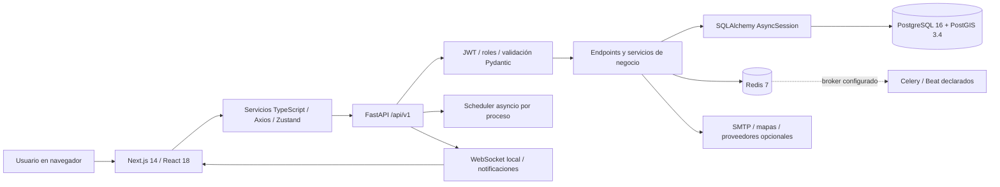
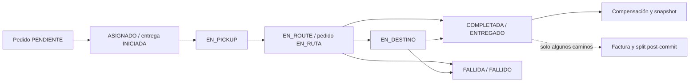
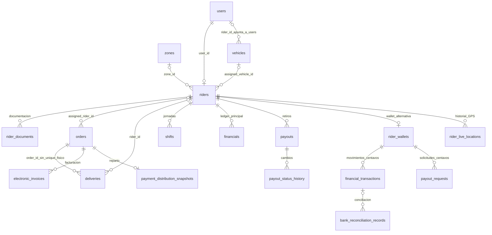

# Informe del Sistema — Delivery360 — V1

Documento informativo solicitado por el usuario. Incluye el análisis funcional y técnico, hallazgos, estructura, diccionario completo de base de datos e inventario de API y pantallas. No se aplicaron correcciones de código.

# Delivery360: informe técnico y funcional en profundidad

**Repositorio:** `corporacionbethelst-ux/Delivery_360-DEV`, rama seleccionada `main`. **Commit analizado:** `d6ce659e9afe039fbe6d74ec3a8a7e6d9f0df488`. **Fecha de revisión:** 23 de octubre de 2026, America/Caracas.

**Alcance:** análisis informativo de arquitectura, código, contratos HTTP, modelos, migraciones, esquema PostgreSQL y evidencia local de validación. No se modificó código, configuración del repositorio, dependencias, pruebas ni migraciones. La revisión original se realizó sin modificar el checkout. A petición del usuario, el informe se incorpora ahora como `Informe_Sistema_V1.md`; esta escritura documental no modifica el código ni los datos del sistema.


> Revisión actual: 23 de octubre de 2026, America/Caracas. Se reutiliza el análisis previo del mismo commit y se contrastan los módulos principales con los archivos actuales. Las consultas SQL, introspecciones y ejecuciones de pruebas descritas corresponden a evidencia anterior, no a nuevas ejecuciones. El diccionario representa el catálogo local conservado, no producción. En esta revisión se analizaron sintácticamente 187 archivos Python sin errores y se comprobaron hashes de 496 archivos propios, sin cambios.

## 1. Diagnóstico ejecutivo

Delivery360 es una plataforma web para administrar una operación de última milla: personas que reparten, vehículos, zonas, pedidos, entregas, turnos, ingresos, retiros, seguimiento GPS, alertas, auditoría y una ampliación fiscal. Su centro operativo es transformar un pedido de un cliente en una entrega asignada, registrar su resultado y calcular la compensación del repartidor.

El código muestra un producto en evolución por fases, con funcionalidades reales y una cantidad significativa de compatibilidad heredada. No hay evidencia suficiente para sostener la afirmación documental «LISTO PARA PRODUCCIÓN»: existen fallos comprobables en autorización, cálculo fiscal, contratos entre módulos, tareas en segundo plano y compilación del frontend.

La arquitectura desplegable es un **backend monolítico modular** con una aplicación Next.js separada y servicios auxiliares PostgreSQL/PostGIS y Redis. Celery está declarado como mecanismo de tareas, pero no aparece como servicio en Compose y presenta incompatibilidades internas. La documentación lo llama «microservicios»; la separación efectiva del código de negocio no corresponde a varios servicios autónomos.

### Magnitudes verificadas

| Elemento | Resultado | Interpretación |
|---|---:|---|
| Pantallas Next.js `page.tsx` | 60 | Existencia de pantalla, no garantía de funcionamiento |
| Rutas REST registradas | 164 | Incluye variantes con y sin `/` final |
| Paths REST distintos | 134 | No equivale al número de operaciones de negocio |
| Rutas WebSocket registradas | 2 | Tracking y notificaciones |
| Tablas físicas inventariadas | 38 | Incluye `alembic_version` y `wallets`; excluye tablas/vistas auxiliares de PostGIS |
| Columnas físicas | 590 | Leídas del catálogo local PostgreSQL |
| Nombres de tabla en modelos Python | 39 | Hay además dos definiciones incompatibles de `Alert` sobre `alerts` |
| Columnas de modelos canónicos extraídas | 620 | No incluye los campos de la definición alternativa `models/alert.py` |
| Tipos enum PostgreSQL | 34 | Valores completos en el diccionario |
| Restricciones físicas | 108 | 38 PK, 58 FK, 12 UNIQUE declaradas como restricciones |
| Índices físicos | 153 | Incluyen índices de PK y unicidad; no son todos índices adicionales |

### Documentos complementarios

- [Diccionario completo de base de datos](#diccionario-de-base-de-datos--delivery360): tabla por tabla, columnas, tipos, nulabilidad, defaults, relaciones, índices, enums y diferencias con el ORM.
- [Inventario de API y pantallas](#inventario-de-api-y-pantallas): rutas realmente registradas, archivo y función que las atiende, más el mapa de pantallas.
- `esquema-postgresql.json` (anexo histórico del entorno): evidencia estructural reutilizable; no contiene registros de personas ni valores de credenciales.
- `modelos.json` (anexo histórico del entorno), `rutas-codigo.json` (anexo histórico del entorno) y `api-registrada.json` (anexo histórico del entorno): distinguen existencia de código de exposición efectiva.

## 2. Qué hace, para qué lo hace y cuál es su finalidad

### 2.1 Problema que intenta resolver

Una operación de delivery necesita coordinar demanda, disponibilidad de repartidores, movimiento físico, prueba de entrega y pagos. Cuando estos procesos se llevan por mensajes o archivos separados aparecen pedidos sin responsable, estados inconsistentes, disputas sobre bonos y poca trazabilidad. Delivery360 intenta reunirlos en una misma plataforma.

La finalidad empresarial observable es controlar la operación y remuneración de una flota. No se observa un marketplace completo de comercios con catálogo, carrito y liquidación al vendedor. Los productos del pedido se guardan principalmente en `orders.items`, no en un catálogo normalizado de productos. El código fiscal reserva `restaurant_share_cents`, pero lo mantiene en cero porque todavía no existe un modelo Vendor.

### 2.2 Personas y responsabilidades

| Rol técnico | Función prevista | Límites observados |
|---|---|---|
| `SUPERADMIN` | Administrar usuarios, configuración global, operación y finanzas | Los roles son enum; no hay ACL dinámica persistida |
| `GERENTE` | Aprobar riders/documentos, gestionar flota, supervisar pedidos, retiros y auditoría | Algunas opciones se ocultan en la navegación aunque el backend las autoriza |
| `OPERADOR` | Crear/asignar pedidos, gestionar entregas y turnos | El mapa de tracking agregado exige GERENTE/SUPERADMIN, aunque existe página de mapa para operador |
| `REPARTIDOR` | Ejecutar sus entregas, reportar GPS, consultar ingresos y pedir retiros | Hay controles de pertenencia en varias rutas, pero no en todas |
| `CLIENTE` | Rol definido para cliente final | No hay panel completo equivalente al de manager/rider; el alcance API no está uniformemente restringido |
| `AUDITOR` | Rol previsto de consulta/seguimiento | Hay discrepancias entre rol definido y permisos concretos de endpoints |

El usuario y el repartidor son entidades distintas: `users.id` identifica la cuenta; `riders.id` identifica el perfil operativo. `riders.user_id` establece la relación uno a uno. Confundir ambos identificadores explica varias incompatibilidades de módulos heredados.

### 2.3 Beneficios buscados

1. Que cada pedido tenga un estado y un responsable identificable.
2. Saber dónde está el repartidor y estimar su llegada.
3. Conservar evidencia y tiempos de la entrega.
4. Calcular bonos según configuración, zona y nivel.
5. Gestionar solicitudes de retiro con trazabilidad.
6. Dar visibilidad a gerencia mediante reportes y alertas.
7. Añadir facturación y conciliación sin bloquear la operación principal.

Estos son objetivos del diseño; el alcance operativo real se delimita en los hallazgos.

## 3. Cómo está construido

### 3.1 Arquitectura y recorrido de una petición



La interfaz renderiza páginas de App Router; usa componentes de UI, hooks y stores para estado local. Los servicios TypeScript construyen peticiones REST. Axios incorpora el bearer token, controla expiración y solicita refresh. FastAPI valida datos, comprueba identidad/permisos, ejecuta consultas o servicios y devuelve JSON. PostgreSQL es el almacenamiento principal; Redis se usa de formas diferentes según módulo: caché, publicación de eventos, plantillas y broker de tareas.

El reparto de responsabilidades es irregular: algunos endpoints delegan en servicios; otros contienen directamente consultas, cálculo de bonos y commits. Por eso dos rutas que parecen realizar la misma operación pueden producir registros distintos.

### 3.2 Tecnologías verificadas en declaraciones

| Capa | Tecnología | Uso |
|---|---|---|
| Interfaz | Next.js 14.2.5, React 18.3.1, TypeScript | Rutas, SSR, componentes cliente y navegación |
| UI | Tailwind CSS, Radix UI, Lucide, Recharts, Sonner | Formularios, gráficos, modales y mensajes |
| Estado/datos | Zustand, Axios, React Hook Form, Zod | Sesión, peticiones y validación de formularios |
| Mapas | Leaflet, React Leaflet; Google opcional | Visualización y geolocalización |
| API | FastAPI 0.111.0, Uvicorn 0.30.1 | HTTP y WebSocket |
| Validación | Pydantic 2.8.2, pydantic-settings | Contratos y variables de configuración |
| Persistencia | SQLAlchemy 2.0.31, asyncpg 0.29.0 | ORM y conexiones asíncronas |
| Migraciones | Alembic 1.13.2 | Evolución del esquema |
| Geoespacial | PostGIS, GeoAlchemy2, Shapely, Haversine | Puntos GPS, cercanía y distancia aproximada |
| Seguridad | bcrypt, passlib, python-jose | Contraseñas y JWT |
| Asincronía | asyncio, Redis 5.0.7 cliente, Celery 5.4.0 | Schedulers, eventos y trabajos declarados |
| Pruebas | pytest/pytest-asyncio y Jest/Testing Library | Validación automatizada |
| Operación | Docker Compose, GitHub Actions, Prometheus | Servicios locales, CI y métricas |

El backend declara Python >=3.11; CI usa Python 3.11 y Node 20. La instancia preparada anteriormente usa Python 3.12.14 y Node 24.19.0. Las comprobaciones previas demuestran instalación en esa instancia, no equivalencia completa con cada matriz de CI.

## 4. Estructura del proyecto

```text
Delivery_360-DEV/
├── .github/workflows/ci-cd.yml      # pruebas, build, publicación y despliegue declarados
├── docker-compose.yml              # PostGIS, Redis, API y frontend
├── package.json                    # dependencia auxiliar de raíz
├── package-lock.json
├── node_modules/                   # existen dependencias rastreadas en raíz
├── .env.example
├── backend/
│   ├── Dockerfile
│   ├── requirements.txt
│   ├── pyproject.toml
│   ├── alembic.ini
│   ├── .env                        # archivo rastreado; no se reproducen sus valores
│   ├── alembic/
│   │   ├── env.py
│   │   └── versions/               # migraciones iniciales, finanzas y fases 7–10
│   ├── app/
│   │   ├── main.py                 # composición efectiva de FastAPI y lifecycle
│   │   ├── api/v1/                 # contratos REST y composición de routers
│   │   ├── core/                   # configuración, seguridad, DB, email, WS y seed
│   │   ├── models/                 # entidades ORM y enums
│   │   ├── schemas/                # validación y serialización Pydantic
│   │   ├── crud/                   # acceso a datos: conviven estilos sync y async
│   │   ├── services/               # negocio, dinero, tracking, fiscal y notificaciones
│   │   ├── integrations/           # conectores POS/ERP y HMAC de webhooks
│   │   ├── middleware/             # auditoría HTTP, caché, CORS y límites
│   │   ├── cache/                  # cliente/capa de caché Redis
│   │   ├── monitoring/             # health, Prometheus, logging y Sentry auxiliares
│   │   ├── workers/                # trabajos Celery declarados
│   │   ├── utils/                  # geografía, SLA, costes, LGPD y exportación
│   │   └── scripts/                # mantenimiento histórico de snapshots
│   ├── scripts/seed_data.py
│   ├── tests/                      # auth, payouts y fases 8/9/10
│   └── uploads/                    # documentos servidos por StaticFiles
├── frontend/
│   ├── Dockerfile
│   ├── package.json / package-lock.json
│   ├── next.config.js
│   ├── jest.config.js / jest.setup.js / babel.config.jest.js
│   └── src/
│       ├── app/
│       │   ├── (auth)/             # login, registro rider y recuperación
│       │   └── (dashboard)/
│       │       ├── manager/        # operaciones, flota, finanzas y administración
│       │       ├── operator/       # pedidos, entregas, turnos, mapas y alertas
│       │       ├── rider/          # mis pedidos, ganancias, retiros y documentos
│       │       └── notifications/  # bandeja y preferencias
│       ├── components/             # UI y componentes por dominio
│       ├── services/               # clientes REST por recurso
│       ├── stores/                 # estado Zustand
│       ├── hooks/                  # GPS, WS, datos y productividad
│       ├── lib/                    # Axios, moneda, fechas, CSV y autenticación
│       ├── config/navigation.config.ts
│       ├── types/                  # tipos TypeScript por dominio
│       └── middleware.ts           # control de navegación basado en cookies
├── Manual_de_Ingeniero.md
├── Manual_de_Usuario.md
├── Informe_de_Sistema.md
└── informes, recomendaciones, roadmaps y parches históricos
```

Los grupos `(auth)` y `(dashboard)` organizan archivos sin formar parte de la URL pública. Ejemplo: `src/app/(dashboard)/manager/fleet/riders/page.tsx` representa `/manager/fleet/riders`.

## 5. Flujos funcionales: qué ocurre, cómo y cuándo

### 5.1 Registro y habilitación del repartidor

**Cuándo:** al postularse una persona para repartir; posteriormente, cuando gerencia revisa su documentación.

`POST /api/v1/auth/register-rider` recibe datos personales y cuatro archivos: licencia, identidad, registro del vehículo y seguro. Crea la cuenta `User` con rol REPARTIDOR, su `Rider` y filas `rider_documents`. Los archivos se guardan en `uploads/documents/<rider_id>/` con nombres aleatorios.

El rider tiene estado PENDIENTE hasta aprobación. La lógica de conexión comprueba estado ACTIVO y documentación requerida aprobada. Hay operaciones administrativas para revisar, aprobar/rechazar y dar de baja. El cambio de vehículo desde el perfil propio invalida documentos y puede devolver al rider a PENDIENTE.

**Finalidad:** impedir que una persona no habilitada aparezca como recurso operativo disponible. **Limitación:** distintas rutas de GPS fuerzan `is_online=True` sin aplicar todos los controles de habilitación de la ruta específica de conexión.

### 5.2 Autenticación y sesión

**Cuándo:** login, petición autenticada, expiración del access token o recuperación de contraseña.

El login real recibe formulario OAuth2 (`username`, `password`), busca usuario activo y verifica bcrypt. Para REPARTIDOR exige que su perfil esté ACTIVO. Emite access y refresh JWT firmados, con `sub`, `exp`, `type`, `iat` y `jti`. Los defaults declarados son 30 minutos para access y 7 días para refresh. La dependencia backend vuelve a comprobar que el usuario exista y siga activo.

En frontend `authService.login` usa el formato correcto. Axios agrega Authorization y, ante 401, intenta renovar tokens; agrupa solicitudes mientras hay un refresh en curso. Zustand conserva estado de sesión. Los tokens también se guardan en localStorage y el access token se copia a una cookie legible desde JavaScript para el middleware de Next.js.

La recuperación genera token temporal, lo almacena con expiración y construye el enlace de cambio de contraseña. El logout expuesto solo devuelve un mensaje; no revoca JWT. `jti` proporciona identidad de token, pero no existe aquí una garantía de revocación/replay por el mero hecho de incluirlo.

### 5.3 Creación del pedido

**Cuándo:** un operador/gerente/superadmin registra una solicitud de entrega.

`orders` concentra cliente, teléfono, direcciones de recogida y destino, coordenadas, productos JSON, subtotal, tarifa de envío, total, prioridad, forma/estado de pago y tiempos. El estado inicial es PENDIENTE. El código proporciona creación, consulta, edición, cancelación y cambios de estado.

**Finalidad:** establecer la cabecera comercial y la promesa operativa. `Order` no equivale a `Delivery`: el primero representa la solicitud; el segundo, su ejecución física y evidencia.

### 5.4 Asignación manual y automática

**Cuándo:** hay un pedido pendiente y un rider apto disponible.

La asignación manual vincula `orders.assigned_rider_id`, cambia el pedido a ASIGNADO y crea/actualiza su entrega. La reasignación puede reiniciar tiempos de la entrega y transferir responsabilidad.

La asignación automática de `orders.py` exige pedido PENDIENTE y coordenadas de recogida. Busca riders ACTIVO, online y con `last_location` PostGIS, ordena por `ST_DistanceSphere` y toma el más cercano. Calcula distancia Haversine para la respuesta y crea trazabilidad/notificaciones.

**Limitación:** ese camino consume la columna geométrica, mientras otras rutas solo actualizan `last_lat/last_lng`. Un rider con coordenadas planas recientes pero geometría ausente puede quedar excluido de la asignación automática.

### 5.5 Ciclo operativo de entrega



Se almacenan salida, llegada al comercio, salida del comercio, llegada al destino y finalización. La evidencia prevista admite foto, firma y OTP, aunque no todos los endpoints exigen ni procesan todas las modalidades. Los tiempos permiten calcular duración total y SLA.

Hay tres caminos relevantes para cerrar una entrega: cambiar el estado de la orden, usar `/deliveries/{id}/complete` o usar `/deliveries/{id}/status`. Sus reglas no son equivalentes: difieren en bono, snapshot, contabilidad, autorización y activación de facturación. Esa multiplicidad es un hallazgo central.

### 5.6 Bonos, zonas y gamificación

**Cuándo:** al completar o fallar una entrega, si su causa habilita compensación.

La regla principal de éxito es:

`bono final = bono base configurado × multiplicador de zona × multiplicador de nivel`.

| Nivel | Factor |
|---|---:|
| BRONCE | 1.00 |
| PLATA | 1.05 |
| ORO | 1.10 |
| PLATINO | 1.15 |

Ejemplo de regla: base 2.500 COP, zona 1,5 y nivel ORO producen 4.125 COP. Es un ejemplo de la fórmula del código; los valores configurables pueden variar.

El intento fallido distingue causas externas bonificables —cliente ausente, dirección incorrecta, comercio cerrado, zona insegura, etc.— de causas atribuibles al repartidor. Se pretende congelar el monto al estado terminal en `locked_bonus_amount`, tipo, fecha y desglose para que un cambio posterior de tarifas no altere el histórico. La inmutabilidad es una convención de aplicación, no un bloqueo de PostgreSQL verificado.

También existen `level`, `total_points` y `badges`. No deben confundirse con un motor completo de progresión automática validado: el factor monetario efectivo lo controla `tier`, y las tareas de productividad no constituyen una progresión operativa fiable en su estado actual.

### 5.7 Dinero, saldo y retiros

**Cuándo:** creación de compensaciones; consulta de ganancias; petición y revisión de retiro.

Conviven al menos estas representaciones:

| Representación | Unidad/modelo | Uso observado |
|---|---|---|
| `financials` | `Numeric(10,2)` | Ledger usado por las rutas principales de bonos y payouts |
| `riders.wallet_balance`, `pending_balance` | `Numeric(10,2)` | Saldos auxiliares/heredados |
| `wallets` | tabla física con `balance`, moneda y versión | Legado sin clase ORM canónica en el inventario |
| `rider_wallets` | saldo entero en centavos, moneda por defecto USD | Subsistema alternativo de wallet |
| `financial_transactions` | importe entero y saldo posterior en centavos | Libro del subsistema alternativo |
| `payouts` | monto decimal, flujo principal COP | Retiros consultados por paneles principales |
| `payout_requests` | monto en centavos, wallet y datos bancarios | Flujo alternativo de retiro |

`FinancialService` normaliza a Decimal, distingue créditos/débitos, ofrece idempotencia y calcula `balance_before/after`. Sus auxiliares de bloqueo no se aplican automáticamente a todas las escrituras. El cálculo de saldo disponible de payouts suma ciertos créditos PROCESADO y resta solicitudes PENDIENTE/EN_PROCESO; no usa sin más el último saldo del ledger. Si no encuentra ingresos, puede estimarlos desde importes de órdenes entregadas.

El retiro principal valida monto positivo, saldo y mínimo 10,00; permite clave de idempotencia. La aprobación bloquea la fila de payout, cambia a EN_PROCESO y registra un RETIRO junto a historial. No se observa una ejecución bancaria real en ese endpoint. Aprobar administrativamente y mover contabilidad no prueba que un banco haya transferido dinero.

El subsistema `/wallet` presenta errores directos de enum y de sesiones sync/async. No hay evidencia de una sincronización general que mantenga todas las representaciones de saldo equivalentes.

### 5.8 GPS, mapas y ETA

**Cuándo:** el navegador obtiene permiso GPS y reporta heartbeat/posición; gerencia consulta mapa o seguimiento.

Hay ubicación actual en columnas planas de `riders`, geometría PostGIS y trazas `rider_live_locations`. El endpoint de telemetría actualiza la geometría; el servicio tracking persiste historial, actualiza posición plana y publica evento. La capa local WebSocket difunde a tópicos.

ETA local: distancia Haversine al destino dividida por velocidad media configurable, 18 km/h por defecto, con mínimo un minuto. Google Distance Matrix es opcional; si falla, se conserva la estimación local. Haversine mide distancia sobre la esfera y no incorpora calles, tráfico, restricciones de vía o tiempos reales de recogida.

Los mapas muestran última posición y/o polilíneas. No hay garantía de posición verdadera del dispositivo: las coordenadas son datos recibidos del cliente. La política de acceso a posiciones e históricos tiene brechas descritas en los hallazgos.

### 5.9 Optimización de rutas

**Cuándo:** disparo manual autorizado o scheduler interno cada 300 segundos por defecto.

El optimizador implementa una heurística greedy: para cada combinación rider/entrega calcula desplazamiento al pickup más desplazamiento al destino, elige el menor incremento y repite hasta agotar capacidad. Capacidad por defecto: cuatro entregas por rider. Considera riders ACTIVO u OCUPADO con coordenadas. Persiste secuencias y métricas en `delivery_route_snapshots`.

Compara distancia con una asignación round-robin de referencia. El «ahorro» es una estimación del algoritmo frente a esa línea base, no un ahorro real medido en viajes. OR-Tools está previsto/comentado, no es el solver ejecutado. Aunque el docstring menciona restricciones de zona, el bucle no impone una comparación de zona rider/entrega. Tampoco filtra `is_online` ni integra claramente la carga activa previa.

La supuesta predicción de demanda suma entregas de los últimos siete días por zona y multiplica por `1 + hours_ahead*0.05`; no implementa la regresión lineal descrita en comentarios.

### 5.10 Turnos y productividad

**Cuándo:** planificación/inicio/fin de jornada y consultas de desempeño.

Los turnos tienen fecha, horas programadas, check-in/out, ubicación y totales. La API transforma estados backend a etiquetas de UI: PROGRAMADO→PLANIFICADO, EN_CURSO→ACTIVO, COMPLETADO→FINALIZADO. Los endpoints efectivos permiten a roles operativos listar, crear, iniciar, finalizar y cancelar.

Existen tres modelos de productividad: consolidado por periodo (`productivity_metrics`), registros de SLA (`sla_records`) y métrica genérica (`productivity_records`). Solo este último está en el esquema migrado inspeccionado. El router registrado espera atributos que ese último modelo no tiene, y los hooks del frontend solicitan rutas que no coinciden con las registradas. Por tanto no puede afirmarse que el circuito integral de productividad esté operativo.

### 5.11 Alertas, notificaciones y auditoría

**Cuándo:** asignación, cambios de entrega, retiros, incidencias, ciclos de detección o petición de usuario.

Conviven notificaciones tradicionales (`notifications`) y omnicanal (`notification_templates`, `notification_logs`, preferencias y dispositivos). La API de alertas operacionales usa notificaciones de tipo `ALERTA_OPERACIONAL`, no necesariamente la tabla `alerts`.

El servicio omnicanal resuelve plantilla, usuario, canales, deduplicación, límites, renderizado y despacho. Soporta IN_APP, PUSH, EMAIL y SMS; los proveedores opcionales pueden devolver éxito simulado cuando no están configurados. Los logs guardan estado, reintentos y fechas. Hay reintentos exponenciales y limpieza por retención.

Auditoría HTTP añade request ID y log de método, path y duración. Eso no significa que cada lectura/escritura tenga automáticamente un registro de negocio en `audit_logs`: esa persistencia corresponde a servicios/llamadas específicas. Se observan trazas Redis auxiliares, pero no una conexión global garantizada por el lifecycle de `main.py`.

### 5.12 Facturación, impuestos, reparto y banco

**Cuándo:** ciertos cierres de entrega, petición fiscal manual o importación de extracto.

La fase fiscal define facturas, resoluciones, impuestos por país, notas crédito, anulación, snapshots de reparto y conciliación CSV. Se lanzan hooks de factura y split mediante `asyncio.create_task` tras el commit del endpoint unificado de estado. El fallo fiscal se captura para no revertir la entrega. No todos los caminos de cierre activan estos hooks.

El motor contempla reglas de Colombia, México, Chile y Perú. Los adaptadores concretos implementados son DIAN Colombia y SAT México; para países sin adaptador usa Colombia con warning. Sin credenciales se simula aceptación. Se construyen documentos y firmas; la presencia de XML o una fila ACEPTADA no demuestra validez tributaria externa.

El split divide **la tarifa de envío**, por defecto 20% plataforma y 80% rider, y guarda un snapshot. No ejecuta por sí mismo un pago al restaurante ni sustituye automáticamente el bono ya registrado. La conciliación procesa CSV con fecha/referencia/monto y compara contra `financial_transactions` por monto, fecha y referencia. No compara directamente el ledger principal `financials`.

## 6. Cuándo actúa automáticamente

| Mecanismo | Frecuencia declarada | Qué intenta hacer | Condición/estado real |
|---|---|---|---|
| Scheduler asyncio | cada 300 s | optimizar entregas pendientes | iniciado por lifespan de la API |
| Scheduler asyncio | cada 120 s | detectar desviación/silencio GPS | lógica compara distancia al destino; genera falsos positivos de desviación |
| Scheduler asyncio | cada 60 s | procesar reintentos de notificación | depende de BD y servicios; configurable |
| Scheduler asyncio | cada 24 h desde arranque | purgar ubicaciones y snapshots vencidos | no es una hora fija del calendario |
| Scheduler asyncio | cada 24 h desde arranque | purgar logs de notificación | retención por defecto 30 días |
| Hooks post-commit | al completar por ruta unificada | factura electrónica y split | tareas en memoria, sin cola duradera |
| Celery Beat | cada 5 minutos | monitor SLA | requiere Beat+worker; no desplegados en Compose; hay errores de imports/modelos |
| Celery Beat | diario 23:00 São Paulo | liquidación | equivale a 22:00 Caracas con offsets actuales; worker incompatible |
| Celery Beat | diario 22:00 São Paulo | productividad | equivale a 21:00 Caracas; nombre de tarea no coincide con el módulo esperado |
| Celery Beat | domingo 03:00 São Paulo | limpieza LGPD | equivale a domingo 02:00 Caracas; depende de worker |
| Conciliación bancaria | comentario dice diario | leer CSV local e importar | wrapper existe, pero no se encontró invocación periódica registrada |

Cada proceso API crea su propio scheduler. No se observa un liderazgo distribuido o lock global que haga único el trabajo entre procesos. Las tareas esperan su primer intervalo; arrancar la API no equivale a haber ejecutado todos sus ciclos. No se activaron nuevos schedulers ni workers durante este análisis.

## 7. Base de datos: panorama y relaciones

### 7.1 Dominios

| Dominio | Tablas principales | Finalidad |
|---|---|---|
| Identidad/flota | users, riders, rider_documents, vehicles, zones | cuentas, habilitación y recursos |
| Operación | orders, deliveries, shifts, check_in_out | solicitud, ejecución y jornada |
| Geografía | routes, route_points, route_deviations, rider_live_locations, delivery_route_snapshots | recorridos y posiciones |
| Finanzas principal | financials, payouts, payout_status_history | bonos, retiros y trazabilidad |
| Finanzas alternativa | wallets, rider_wallets, financial_transactions, payout_requests | saldos y libro paralelo |
| Productividad | productivity_records | métricas genéricas; otros dos modelos sin tabla |
| Comunicación | notifications, alerts, notification_templates, notification_logs, notification_preferences, user_device_tokens | avisos y canales |
| Auditoría/configuración | audit_logs, audit_actions, platform_settings | evidencia y parámetros |
| Integración | integrations | configuración de conexión; webhook_events falta en BD |
| Fiscal | electronic_invoices, invoice_resolutions, fiscal_configurations, payment_distribution_snapshots, bank_reconciliation_records | emisión, impuestos y conciliación |
| Técnica | alembic_version | revisión de esquema aplicada |



`rider_live_locations` está relacionada físicamente con `riders`, no con una entrega particular. El diccionario completo enumera las FK reales; no debe inferirse una restricción SQL adicional a partir de este dibujo conceptual.

### 7.2 Reglas que no deben darse por supuestas

- `Vehicle.rider_id` apunta a **users**, no a riders.
- `Order.delivery` se declara uno a uno en ORM, pero `deliveries.order_id` no tiene unicidad física verificada. SQL permite varias entregas para una orden.
- Muchos timestamps son `timestamp without time zone`; el código intenta guardar UTC naive, pero algunas rutas envían datetime aware.
- `default=` de SQLAlchemy actúa al insertar mediante ORM; no equivale a `DEFAULT` de PostgreSQL. El diccionario separa ambas cosas.
- Los valores monetarios mezclan float, decimal, entero de centavos y distintas monedas por defecto. El sufijo `_cents` identifica centavos, pero `orders.total` y `financials.amount` no usan esa unidad.
- No se encontraron restricciones CHECK físicas entre las 108 inventariadas. Validaciones de montos, rangos y estados dependen en buena medida del código.
- Hay FK con `ON DELETE CASCADE` que pueden borrar historial asociado; el término «inmutable» no representa una protección de almacenamiento implementada en todas las tablas.

### 7.3 Diccionario: cómo leerlo

El anexo [DICCIONARIO_BD.md](#diccionario-de-base-de-datos--delivery360) incluye las 38 tablas físicas y los tres modelos sin tabla (`productivity_metrics`, `sla_records`, `webhook_events`). Para cada columna se muestra su tipo real, posibilidad de NULL, default SQL, default Python cuando está declarado, significado funcional y relación cuando exista. También lista las restricciones y los 153 índices, y conserva los 34 enums con sus valores exactos.

El catálogo corresponde a la base local migrada hasta `20260930_fase10`, no a una base de producción inspeccionada. El SQL histórico `schema_completo.sql` es una referencia adicional; la fuente del estado físico de esta instancia es el catálogo, no ese archivo aislado.

## 8. Hallazgos: discrepancias y errores

**Criterio:** «confirmado» significa comprobado por lectura del flujo, introspección o cálculo local aislado. No significa explotación contra usuarios reales. «Condicionado» expresa que el impacto depende de una función habilitada, datos o despliegue. No se hicieron correcciones.

### H01 — Crítico: completar una entrega no comprueba su propietario

**Evidencia:** `backend/app/api/v1/deliveries.py:509`, `services/delivery_service.py`, método `complete_delivery`.

El endpoint exige autenticación, convierte el body y llama al servicio con `completed_by=current_user.id`. No comprueba que la entrega pertenezca al rider. El servicio comprueba transición, pero no usa `completed_by` para autorización. Otras rutas sí hacen esa comprobación, por lo que el control no es uniforme.

**Impacto:** una cuenta autenticada que conozca el UUID de una entrega en estado admisible puede solicitar su finalización aunque pertenezca a otro repartidor, con efecto en pedido, evidencia y compensación. **Estado:** defecto de autorización confirmado estáticamente; no se alteraron entregas para demostrarlo.

### H02 — Crítico: el propio repartidor puede cambiar su nivel que determina el bono

**Evidencia:** `api/v1/riders.py:144`, `:743`, `:832`, `:842`; fórmula de `services/delivery_service.py`.

El schema de actualización admite `tier`; la ruta de perfil propio lo convierte a RiderTier y lo asigna sin exigir un rol administrativo. El endpoint genérico de actualización también admite cambios de su propietario. El mismo campo aplica factores monetarios hasta 1,15.

**Impacto:** la clasificación deja de representar una evaluación controlada; puede elevar la remuneración sin aprobación. No se ejecutó un cambio de nivel.

### H03 — Crítico condicionado: caché HTTP compartida sin identidad

**Evidencia:** `middleware/cache_middleware.py:33–40`, `:79`, `main.py:92`, `cache_middleware.py:146`.

La clave de caché solo usa path y query. No incorpora usuario, rol ni bearer. En un hit devuelve el cuerpo antes de ejecutar el endpoint. Excluye auth/users/health, pero no pedidos, entregas, saldo o notificaciones.

**Impacto de diseño:** el almacenamiento no aísla respuestas por identidad. **Dos matices de ejecución:** su conexión se registra con `on_event`, mientras la app usa lifespan explícito; esa mezcla puede impedir la inicialización en el arranque actual. Además, `CacheService.get` ya deserializa JSON a dict y el middleware intenta aplicar `json.loads` otra vez: con las respuestas guardadas por ese mismo código, el hit falla antes de reconstruir la respuesta. Por tanto, el comportamiento inmediato esperado al conectar esa combinación es error en hits; una fuga entre usuarios sería un riesgo posterior si se corrige solo la deserialización manteniendo la clave. No se afirma que hubo una fuga real.

### H04 — Alto: posiciones e históricos sin control de pertenencia; WebSocket sin autorización por canal

**Evidencia:** `api/v1/tracking.py`, funciones `get_live_tracking`, `get_rider_history`, `tracking_websocket`.

Las consultas live/history exigen usuario, pero no comparan propietario ni limitan expresamente el rol. El handler WS valida JWT y luego suscribe el canal solicitado y los tópicos enviados por el cliente sin validar los permisos descritos en su docstring.

**Impacto:** riesgo de acceso cruzado a ubicaciones/históricos y al tópico global. El dashboard REST sí tiene chequeo GERENTE/SUPERADMIN, por lo que WS y REST no comparten la misma política.

### H05 — Alto: el WebSocket de tracking se registra con un parámetro query espurio

**Evidencia:** `main.py:155`; `api-registrada.json`.

`tracking_ws(websocket, channel: str)` no anota `websocket: WebSocket`. La introspección de FastAPI confirma `query_params: ['websocket']` en esa ruta, mientras notificaciones no tiene ese parámetro.

**Impacto:** el handshake esperado no coincide con la firma registrada; puede fallar antes de entrar en la autenticación. Es independiente de la falta de autorización del handler. No se abrió un socket contra datos reales.

### H06 — Alto: documentos personales expuestos por un montaje estático público

**Evidencia:** `main.py:185`, `api/v1/auth.py`, `_save_rider_document_file`, `api/v1/riders.py`, `_store_document_file`.

Documentos de identidad/licencias/seguro se guardan bajo `uploads`, que se monta con `StaticFiles` sin dependencia de autenticación. Los nombres aleatorios dificultan adivinarlos, pero una URL conocida no exige permiso de propietario.

**Impacto:** exposición de documentación personal por enlace compartido o filtrado. No se descargaron documentos de usuarios para este análisis.

### H07 — Alto: `/wallet` usa un rol inexistente y un servicio de sesión incompatible

**Evidencia:** `api/v1/wallet.py:31`, `:46`, `:86`, `:132`, `:191`; `services/wallet_service.py`.

`UserRole.RIDER` no existe; el enum define REPARTIDOR. Además, se inyecta AsyncSession en un servicio que usa `db.query`, `commit` y `refresh` síncronos. Introspección aislada confirmó ambas incompatibilidades.

**Impacto:** el subsistema de billetera no puede considerarse utilizable con la dependencia actual. Las rutas principales `/payouts` son otro circuito y no quedan validadas por la presencia del alternativo.

### H08 — Alto: tres cierres de entrega producen contabilidad distinta

**Evidencia:** `api/v1/orders.py`, `_ensure_delivery_and_financial_records`; `api/v1/deliveries.py:509`, `:821`, `:984`; `services/delivery_service.py`.

Cerrar por orden aplica bono base y crea Financial directamente; cerrar por estado unificado aplica base×zona×tier, guarda desglose y lanza fiscal/split; cerrar por servicio aplica su propia fórmula y crea transacción sin la misma clave de idempotencia. Algunas escrituras directas omiten los saldos antes/después del servicio canónico.

**Impacto:** diferencias de remuneración y trazabilidad según pantalla/ruta usada; posibles duplicaciones al combinar caminos y discrepancias con el saldo contable. No se creó un duplicado durante la revisión.

### H09 — Alto: estado terminal y compensación no son una sola transacción

**Evidencia:** `crud/delivery.py`, `update`; `services/delivery_service.py`, `complete_delivery` y `fail_delivery`.

El CRUD de entrega hace commit del estado/snapshot. Después se intenta crear la transacción financiera, con otro commit; el error se captura sin revertir el estado. Finalmente se actualiza la orden.

**Impacto:** puede quedar entrega completada sin compensación o con pedido desalineado. La existencia de un snapshot no garantiza que exista el movimiento financiero correspondiente.

### H10 — Alto: el endpoint unificado permite reabrir estados terminales

**Evidencia:** `api/v1/deliveries.py:747`.

Solo valida la transición si el estado actual figura en `allowed_transitions`. COMPLETADA y FALLIDA no figuran, de modo que no caen en una denegación explícita y pueden entrar en ramas de nuevos estados.

**Impacto:** contradice el cierre definitivo y permite inconsistencias con bonos/facturas ya generados. Hay idempotencia parcial de movimientos, pero eso no protege por sí mismo el estado operativo.

### H11 — Alto: OTP opcional puede evitar la verificación de entrega

**Evidencia:** `api/v1/deliveries.py:792`, schemas de `DeliveryComplete` y `ProofOfDeliveryCreate`.

La comparación solo se realiza cuando el body trae OTP y la entrega ya tiene OTP. Omitir el dato evita esa comparación. Otras rutas aceptan evidencia opcional y no verifican un secreto previamente emitido.

**Impacto:** no se puede presentar el OTP como prueba obligatoria de entrega en el flujo actual.

### H12 — Alto: faltan bloqueo común e idempotencia obligatoria en todas las escrituras de dinero

**Evidencia:** `services/financial_service.py:234`; `api/v1/payouts.py`, `request_payout` y `approve_payout`; `services/wallet_service.py`.

El ledger calcula el saldo leyendo el último registro, pero no adquiere automáticamente el lock del rider. La reserva de retiro valida y crea sin lock compartido del saldo; aprobar bloquea el payout particular. Distintas solicitudes simultáneas pueden leer el mismo disponible. La versión del rider se comprueba en memoria en un auxiliar, no con un UPDATE condicionado utilizado universalmente.

**Impacto:** riesgo de saldo posterior incorrecto, reservas concurrentes o sobreasignación. **Estado:** riesgo de concurrencia sustentado en el código; no se hizo prueba de carga ni se provocaron retiros.

### H13 — Alto: el auxiliar de conciliación puede crear una nueva discrepancia

**Evidencia:** `services/financial_service.py:168–229`; función `ledger_delta`.

Ante diferencia, crea `AJUSTE_MANUAL` por el absoluto de la diferencia. Ese tipo se trata siempre como débito. Luego fija el saldo almacenado al ledger anterior al ajuste. Ejemplo lógico: ledger 100 y almacenado 80 → crea débito 20 (ledger 80), luego fija almacenado a 100.

**Impacto:** el procedimiento que pretende corregir puede invertir o perpetuar la diferencia. **Alcance:** el router de conciliación de ese módulo se importa pero no está montado en main; el servicio existe y sería peligroso al invocarlo. No se ejecutó.

### H14 — Alto: cálculo de IVA incluido de México reduce indebidamente el total

**Evidencia:** `services/tax_engine.py:203–233`; comprobación pura sin BD.

Para entrada 11.600 centavos con IVA 16% incluido, devuelve base 10.000 e impuesto 1.600, pero `total_tax_cents=0` y `line_total_cents=10000`. El total debería conservar 11.600 bajo esa regla de precio incluido.

**Impacto:** factura por debajo del importe recibido. Se reprodujo únicamente el cálculo en memoria; no se emitió ninguna factura. Además, el redondeo a `0.01` de cantidades ya expresadas en centavos seguido de `int()` puede truncar fracciones de centavo.

### H15 — Alto: generalización fiscal y aceptación simulada no equivalen a integración tributaria real

**Evidencia:** `services/invoicing_engine.py:64`, `provider_for`, `create_electronic_invoice`, `:415`, `:452`, `cancel_invoice`.

La moneda se fija a COP incluso para otros países. Chile/Perú usan fallback al adaptador colombiano. La falta de credenciales simula aceptación; un fallo de firma real degrada a firma stub; el motor marca ACEPTADA al obtener resultado del adaptador. La cancelación cambia estado local, sin acreditar una cancelación externa. El hook automático calcula `fee_cents`, pero factura `order.total` completo como una sola línea «Servicio de entrega Delivery360»: si total incluye mercancía y transporte, la base y descripción no representan solo el servicio de envío. Es necesario definir el alcance comercial para evaluar el resultado tributario correcto.

**Impacto:** riesgo de interpretar estados locales como cumplimiento legal. No se verificaron proveedores reales ni normativa tributaria; los porcentajes/configuraciones son datos del programa, no una certificación fiscal.

### H16 — Alto: numeración fiscal y hooks requieren revisión de durabilidad

**Evidencia:** `services/invoicing_engine.py:339–352`, `:518`; `api/v1/deliveries.py:984`.

El contador se incrementa en UPDATE y luego se calcula `current_counter + 1`; el valor inicial cero produce primera secuencia dos bajo la actualización normal de sesión. No utiliza `start_range` para formar la secuencia. Los hooks se lanzan como tareas en memoria; terminar el proceso tras responder puede perder el trabajo pendiente.

**Impacto:** numeración inconsistente con rango y eventos fiscales no garantizados. La factura también carece de una clave única por evento de emisión de orden; la protección observada de secuencia no equivale a idempotencia de negocio. No se generaron facturas para probarlo.

### H17 — Alto: conciliación bancaria analiza otro ledger y su rama VARIANCIA no es alcanzable con el score actual

**Evidencia:** `services/bank_reconciliation_service.py:118–210`.

Consulta `FinancialTransaction` de `financial_transactions`, mientras los bonos/retiros principales escriben en `financials`. El score es 0,60 por importe exacto, 0,25 por fecha y 0,15 por referencia; una diferencia menor da 0,30 en monto. Con importe distinto, el máximo es 0,70 (o 0,40 para diferencia mayor), pero exige >=0,80 antes de clasificar VARIANCIA. Esa rama requiere a la vez un score incompatible con una diferencia mayor al umbral.

**Impacto:** discrepancias monetarias quedan como SIN_RELACIONAR y la conciliación no representa necesariamente el dinero del flujo principal. No se importaron extractos.

### H18 — Alto: rutas registradas con prefijos duplicados y atributos inexistentes

**Evidencia:** `api/v1/__init__.py`, `main.py`, `routers_combined.py:565`, `:663`; inventario de API registrado.

Se registran `/api/v1/productivity/productivity/...`, `/api/v1/dashboard/dashboard/...`, `/api/v1/routes/routes/...` y `/api/v1/integrations/integrations`. Los archivos individuales con endpoints «en desarrollo» existen, pero los cuatro módulos efectivos se envuelven desde `routers_combined`; no deben confundirse con la API activa.

El router de productividad espera `sla_compliance_pct`, `orders_per_hour`, `total_orders` y otros campos que no tiene ProductivityRecord. El de rutas usa `Route.rider_id`, `end_time`, `start_time` y `points` que no coinciden con Route actual.

**Impacto:** 404/422 por contratos diferentes o AttributeError al usar rutas efectivas. El problema no se explica únicamente por instalar dependencias.

### H19 — Alto: trabajos Celery declarados no están conectados de forma ejecutable consistente

**Evidencia:** `workers/celery_app.py`, `workers/liquidation_worker.py:1`, `workers/productivity_worker.py:6`, `models/all_models.py`, `docker-compose.yml`.

Se mezclan imports `backend.app` y `app`. Productividad importa `get_db_session`, que no existe. La tarea diaria se define en liquidation_worker con otro nombre de módulo, mientras Beat la solicita en productivity_worker. Otros jobs usan campos inexistentes de Financial, Order y Delivery; `all_models` no exporta la clase Productivity que se solicita. Compose no levanta worker ni Beat.

**Impacto:** no es correcto afirmar que las liquidaciones, productividad y SLA de Celery se ejecutan por el mero arranque de la API. No se arrancó Celery para evitar efectos sobre datos.

### H20 — Medio/alto: detector de desviación mide distancia al destino

**Evidencia:** `services/tracking_scheduler.py`, `_deviation_loop`.

Compara posición con destino y alerta si supera 0,5 km; no calcula distancia a una ruta planificada. Es habitual estar a más de 500 m del destino durante un trayecto normal. Además, selecciona varios managers pero notifica solo `manager_ids[0]`; no hay evidencia de que un WS personal lo convierta en aviso para todos. La condición de silencio solo entra en una rama alternativa cuando faltan coordenadas.

**Impacto:** falsos positivos y destinatarios incompletos; no demuestra desviación real de ruta.

### H21 — Medio/alto: deduplicación omnicanal no identifica al destinatario

**Evidencia:** `services/omnichannel_service.py:124`, `:334`; UNIQUE de `notification_logs.dedupe_key`.

La clave deriva de plantilla, entidad y ventana de cinco minutos, después agrega canal; no agrega `user_id`. El mismo evento/canal dirigido a usuarios diferentes puede colisionar. Además, la consulta inicial busca la clave base, pero lo guardado incorpora el canal.

**Impacto:** pérdida/supresión de avisos para destinatarios adicionales. El fallo previo de test-send muestra comportamiento de dedupe/mock; no se concluye que ese único test demuestre por sí solo todos los escenarios multireceptor.

### H22 — Medio/alto: envíos externos pueden marcarse exitosos sin enviarse

**Evidencia:** `services/omnichannel_service.py`, `dispatch_push`, `dispatch_sms`, `dispatch_email`, `_dispatch_one`.

Sin tokens o proveedor configurado se devuelve True; el log puede pasar a ENVIADO. FCM/Twilio son opcionales y no están entre las dependencias obligatorias. El envío SMTP mostrado no aporta username/password a `aiosmtplib.send` aunque usa su presencia para decidir que hay credenciales.

**Impacto:** el estado ENVIADO no acredita entrega externa. Es útil para stub de desarrollo, pero necesita distinguirse al interpretar métricas o soporte.

### H23 — Medio: health ready produce un diagnóstico falso y semántica HTTP insuficiente

**Evidencia:** `monitoring/health_check.py:16` y validación local anterior.

Usa `with engine.connect()` sobre motor asíncrono. Se observó `not_ready` con error de protocolo de contexto, aun cuando PostgreSQL/PostGIS respondían y las migraciones estaban al día. Devuelve un objeto de error sin fijar 503.

**Impacto:** orquestadores pueden aceptar HTTP 200 de un servicio no listo o rechazar lógicamente una conexión sana. Existe otro archivo `health_checks.py`, pero main monta el singular.

### H24 — Alto: frontend no supera controles básicos de entrega de software

**Evidencia anterior conservada:** `/workspace/.delivery360/types.log`, `jest.log`, `build.log`.

TypeScript informa siete errores: estados PROCESANDO/APROBADA ausentes en mapas tipados, import `deliveries.service` inexistente, tipo Delivery no exportado y valores undefined incompatibles en BonusBreakdownCard. Build encuentra hooks de React sin `use client` en `rider/notifications/page.tsx`. Jest no ejecuta pruebas porque Babel no transforma JSX de `jest.setup.js`.

**Impacto:** una pantalla de login que responde 200 no implica que se pueda compilar/publicar la aplicación completa. El build previo también tuvo acceso denegado a Google Fonts; ese bloqueo de red es distinto de los errores de código.

### H25 — Medio: parte de los gráficos ejecutivos son valores fabricados

**Evidencia:** `frontend/src/app/(dashboard)/manager/page.tsx:89–107` y componentes auxiliares de dashboard.

La página manager toma un total real, lo distribuye por factores fijos para crear barras diarias y fija `growth=12.5`. El conteo de órdenes es la longitud de una lista limitada a 100, no un agregado global. También hay componentes auxiliares con datos mock; no se asume que todos estén montados.

**Impacto:** tendencias y porcentajes pueden parecer indicadores medidos cuando son ilustraciones. El dashboard real mezcla consulta y simulación.

### H26 — Medio: modelos, migraciones y restricciones no expresan el mismo contrato

**Evidencia:** catálogo SQL y modelos; `DICCIONARIO_BD.md`.

Faltan físicamente productivity_metrics, sla_records y webhook_events. Existe wallets sin ORM canónico; payouts tiene failure_reason solo en BD. Dos clases definen alerts de manera diferente. La relación uno a uno Order.delivery no tiene UNIQUE en BD. Hay FK duplicada de financials.created_by_user_id y enums heredados.

**Impacto:** herramientas de generación, mantenimiento, autogenerate e integraciones pueden interpretar esquemas distintos. No se propone equiparar el esquema por modificación automática.

### H27 — Alto condicionado: valores sensibles y garantías de seguridad documental

**Evidencia:** `.env` rastreado en backend, Compose/ejemplos, `core/config.py`, modelos rider/integration; Manual_de_Ingeniero.

Se incluyen valores por defecto para infraestructura/firma en archivos del repositorio; no se reproducen aquí. Si se reutilizan fuera de desarrollo pueden comprometer autenticación o datos. La documentación afirma cifrado de CPF/CNH y el proyecto declara ENCRYPTION_MASTER_KEY, pero los modelos son String y no se encontró una implementación activa de cifrado que respalde esa afirmación. Tokens y parte del payload se imprimen en logs de auth; tokens también viven en localStorage/cookies JavaScript.

**Impacto:** gestión de secretos, datos personales y sesiones por debajo de las garantías documentadas. No se afirma que los valores versionados sean credenciales vigentes de producción ni que ya haya ocurrido una explotación.

### H28 — Medio: revocación y suspensión de rider incompletas entre sesión y operación

**Evidencia:** `api/v1/auth.py`, `login`, `refresh_token`, `logout`; `services/tracking_service.py`, `record_location_update`; `api/v1/telemetry.py`.

Login exige rider ACTIVO, pero refresh valida usuario activo sin repetir esa condición. JWT ya emitidos no se revocan al logout. GPS puede forzar online sin la aprobación documental del endpoint `/online`.

**Impacto:** suspender el perfil operativo no equivale necesariamente a retirar de inmediato toda capacidad de uso de una sesión existente. La desactivación de User sí se comprueba en la dependencia de autenticación.

### H29 — Medio: observabilidad y despliegue declarados superan lo conectado

**Evidencia:** `monitoring/metrics.py`, `main.py`, `.github/workflows/ci-cd.yml`.

`/metrics` expone el registro Prometheus, pero no se observa allí instrumentación completa de los KPI descritos. CI referencia `infrastructure/kubernetes/manifests`, directorio no presente en el árbol inspeccionado. La documentación menciona RabbitMQ, pero Compose configura Redis. Tener archivos de Sentry/logging no acredita que estén inicializados por main.

**Impacto:** cobertura operativa y de despliegue no demostrada. No se ejecutó publicación, despliegue ni envío de telemetría externa.

## 9. Evidencia de validación y límites

### 9.1 Resultados previos del mismo entorno

Se reutilizó la evidencia de preparación anterior para evitar ejecutar pruebas con escrituras durante esta revisión informativa:

| Comprobación | Resultado observado | Qué demuestra |
|---|---|---|
| Instalación Python | completada; `pip check` sin conflictos | dependencias instalables en esta instancia |
| Instalación npm con lockfile | completada con caché escribible | restauración de dependencias frontend |
| Migraciones | `20260930_fase10 (head)`; segunda ejecución correcta | esquema local inicializable/repetible |
| PostgreSQL/PostGIS | versión PostGIS 3.4 obtenida por SELECT | extensión disponible |
| Redis | PONG | conectividad del servicio |
| API `/ping` | success/pong | API básica responde |
| OpenAPI | 134 paths | contratos HTTP publicados |
| Login frontend | HTTP 200 y contenido de acceso | renderizado de esa pantalla |
| pytest | 88 passed, 1 failed | suite ejecutada; fallo de test-send notificaciones |
| TypeScript | 7 errores | tipos globales no aprobados |
| Jest | 1 suite fallida, 0 tests ejecutados | no valida funcionalidad frontend |
| Build Next.js | fallido | build de producción no aprobado |

### 9.2 Comprobaciones documentadas por el análisis previo

En la evidencia previa: lectura de archivos, análisis AST de clases/rutas, introspección del registro de FastAPI sin arrancar su lifespan, SELECT del catálogo PostgreSQL y comprobaciones en memoria de enums/atributos/cálculo fiscal. Se confirmó que UserRole.RIDER, get_db_session y varios campos usados por workers no existen. No se ejecutaron nuevas migraciones, seeds, retiros, cambios de perfiles, importaciones bancarias, envíos, cierres de entrega ni facturas.

No se inspeccionó una base productiva ni se verificaron certificados, pasarelas de pago, bancos o autoridades fiscales reales. No se hicieron pruebas de penetración destructivas, carga concurrente ni un recorrido navegador completo de los seis roles. El informe no atribuye a la aplicación resultados de producción que no fueron medidos.

## 10. Lectura de madurez por capacidad

| Capacidad | Evaluación informativa |
|---|---|
| Base de desarrollo | dependencias y servicios locales preparados |
| Usuarios/roles | CRUD real y roles fijos; autorización desigual por módulo |
| Alta/documentos de riders | flujo real; privacidad de archivos y actualización de tier requieren atención |
| Pedidos/asignación | implementación real; contratos y geometría deben interpretarse por ruta |
| Entregas | implementación real con múltiples caminos inconsistentes |
| Bonos/payouts | lógica real; no apta para afirmar integridad financiera completa |
| Wallet alternativa | errores directos bloqueantes |
| Tracking REST | lógica real con brechas de acceso y de sincronización de ubicación |
| Tracking WS | registro incorrecto y política de canales insuficiente |
| Optimización | heurística funcional de código, sin garantías de optimización global ni restricciones completas |
| Productividad | modelos/routers/hooks incompatibles |
| Notificaciones | IN_APP y simulaciones disponibles; entrega externa no demostrada |
| Facturación | motor local y adaptadores/stubs; errores de cálculo/generalización |
| Conciliación | importador CSV implementado, con incompatibilidades de fuente y score |
| Automatización Celery | declarada, no acreditada como operativa |
| Publicación de frontend | bloqueada por errores existentes |

La finalidad del sistema se entiende con claridad y hay una base extensa de implementación. La principal deuda observada es que varias generaciones del mismo flujo conviven sin compartir un contrato único de permisos, estado, dinero y persistencia. Este informe registra esa situación y sus evidencias; no ejecuta ni presupone correcciones.

## Hallazgo adicional de esta revisión: AUDITOR difiere entre ORM y catálogo

`backend/app/models/user.py` incluye AUDITOR en UserRole; el snapshot SQL conservado de `userrole` solo contiene SUPERADMIN, GERENTE, OPERADOR, REPARTIDOR y CLIENTE. Esto evidencia deriva de contrato entre modelo y catálogo. Insertar AUDITOR contra una base que conserve ese enum fallaría. No se intentó insertar ni se verificó el catálogo actual del servidor.


---

# Diccionario de base de datos — Delivery360

Commit: `d6ce659e9afe039fbe6d74ec3a8a7e6d9f0df488`. Análisis informativo; no contiene filas de negocio ni valores secretos.

## Alcance y convenciones

Catálogo de PostgreSQL local migrado a `20260930_fase10`: **38 tablas, 590 columnas, 153 índices y 34 enums**. No es una inspección de producción. Se excluyen `spatial_ref_sys` y vistas auxiliares de PostGIS. `wallets` y `alembic_version` sí se incluyen.

**NULL sí** permite ausencia de valor. **Default SQL** es el default real del servidor. **Default/actualización ORM** proviene del modelo Python y no se ejecuta automáticamente en inserciones SQL externas. Los significados funcionales interpretan nombres y consumidores del código; no son comentarios oficiales del motor. Las restricciones e índices se copian del catálogo.

Los campos `_cents` representan centavos enteros; no mezclar con `amount`, `total`, `delivery_fee` ni `wallet_balance`. Muchos timestamps no guardan zona horaria. UUID identifica registro; por sí solo no constituye autorización.

## Índice de tablas

| Tabla | Columnas BD | Finalidad |
|---|---:|---|
| [alembic_version](#alembic-version) | 1 | Revisión de migraciones aplicada a la base, sin modelo de negocio. |
| [alerts](#alerts) | 18 | Modelo canónico de alertas con reconocimiento y resolución; no confundir con las notificaciones usadas por la API /alerts. |
| [audit_actions](#audit-actions) | 7 | Desglose de cambios de campos asociado a un registro de auditoría. |
| [audit_logs](#audit-logs) | 24 | Auditoría de acciones de negocio con actor, recurso y contexto. |
| [bank_reconciliation_records](#bank-reconciliation-records) | 12 | Resultado de asociar un renglón de extracto bancario con financial_transactions. |
| [check_in_out](#check-in-out) | 11 | Registro individual de entrada o salida asociado a rider/turno. |
| [deliveries](#deliveries) | 45 | Ejecución logística del pedido, hitos, prueba de entrega, SLA y snapshot de bono. |
| [delivery_route_snapshots](#delivery-route-snapshots) | 8 | Secuencia y métricas de optimización calculadas para entregas; snapshot anclado en una entrega. |
| [electronic_invoices](#electronic-invoices) | 27 | Factura/nota crédito electrónica, importes en centavos, identificador y estado de emisión local. |
| [financial_transactions](#financial-transactions) | 12 | Libro de movimientos de rider_wallets; distinto de financials. |
| [financials](#financials) | 16 | Libro usado por el flujo principal de compensaciones y retiros; montos decimales, no centavos enteros. |
| [fiscal_configurations](#fiscal-configurations) | 13 | Reglas fiscales por país y zona: tasa, condición, orden y precio con/sin impuesto incluido. |
| [integrations](#integrations) | 24 | Configuración y estado de conectores externos POS/ERP/API/webhooks. |
| [invoice_resolutions](#invoice-resolutions) | 14 | Rango de numeración fiscal autorizado/configurado, vigencia y referencias a certificados. |
| [notification_logs](#notification-logs) | 19 | Intentos/envíos omnicanal por destinatario y evento, con reintentos y deduplicación. |
| [notification_preferences](#notification-preferences) | 7 | Preferencias por usuario, evento y canal. |
| [notification_templates](#notification-templates) | 9 | Plantillas de notificación por código, canal e idioma. |
| [notifications](#notifications) | 23 | Notificación tradicional, bandeja y alertas operativas según tipo. |
| [orders](#orders) | 40 | Cabecera comercial del pedido, cliente, direcciones, importes y estado general. |
| [payment_distribution_snapshots](#payment-distribution-snapshots) | 9 | Distribución informativa del ingreso de un pedido; el flujo actual reparte tarifa de envío y reserva restaurante en cero. |
| [payout_requests](#payout-requests) | 19 | Solicitudes alternativas de retiro asociadas a rider_wallets; monto en centavos. |
| [payout_status_history](#payout-status-history) | 9 | Historial de cambios de estado de payout con actor y saldo contextual. |
| [payouts](#payouts) | 17 | Solicitud/revisión de retiro del circuito principal; importes decimales. |
| [platform_settings](#platform-settings) | 6 | Parámetros de plataforma almacenados como clave/valor de texto. |
| [productivity_records](#productivity-records) | 9 | Métrica genérica por rider/turno/fecha, expresada como tipo, valor y unidad. |
| [rider_documents](#rider-documents) | 8 | Documentación del repartidor y resultado de revisión. file_url es una referencia al archivo, no su contenido. |
| [rider_live_locations](#rider-live-locations) | 9 | Historial reciente de posiciones GPS por rider. |
| [rider_wallets](#rider-wallets) | 8 | Billetera alternativa por rider, saldo entero en centavos y moneda explícita. |
| [riders](#riders) | 30 | Perfil operativo de repartidor; habilitación, vehículo, zona, ubicación y campos auxiliares de saldo. |
| [route_deviations](#route-deviations) | 19 | Incidencias/desviaciones de una ruta y su resolución. |
| [route_points](#route-points) | 14 | Puntos de telemetría de una ruta con información del dispositivo. |
| [routes](#routes) | 24 | Ruta logística asociada a una entrega, planificación, ejecución y eficiencia. |
| [shifts](#shifts) | 19 | Turnos programados y ejecutados por repartidor. |
| [user_device_tokens](#user-device-tokens) | 8 | Dispositivos para push y control de fallos del token. |
| [users](#users) | 17 | Cuentas de acceso, identidad, rol, contraseña y recuperación de sesión. |
| [vehicles](#vehicles) | 12 | Flota y vehículo asignado a una persona. Atención: rider_id referencia users.id. |
| [wallets](#wallets) | 8 | Tabla física heredada de saldo. No se encontró una clase ORM canónica correspondiente. |
| [zones](#zones) | 15 | Zonas operativas, tarifa base, coste por kilómetro y multiplicador de bono. |

## Diccionario físico completo

### alembic_version

Revisión de migraciones aplicada a la base, sin modelo de negocio.

**Modelo:** no hay clase ORM canónica identificada.

| Campo | Tipo PostgreSQL | NULL | Default SQL | Default/actualización ORM | Significado |
|---|---|---|---|---|---|
| `version_num` | varchar(32) | no | — | — | Identificador de revisión Alembic. |

**Restricciones físicas**

- `alembic_version_pkc`: `PRIMARY KEY (version_num)`.

**Índices físicos**

| Nombre | Definición |
|---|---|
| `alembic_version_pkc` | `CREATE UNIQUE INDEX alembic_version_pkc ON public.alembic_version USING btree (version_num)` |
### alerts

Modelo canónico de alertas con reconocimiento y resolución; no confundir con las notificaciones usadas por la API /alerts.

**Modelo:** `Alert` — [backend/app/models/notification.py](backend/app/models/notification.py#L131).

| Campo | Tipo PostgreSQL | NULL | Default SQL | Default/actualización ORM | Significado |
|---|---|---|---|---|---|
| `id` | uuid | no | gen_random_uuid() | default=uuid.uuid4, server_default=sa.text('gen_random_uuid()') | Identificador único del registro. |
| `alert_type` | varchar(50) | no | — | — | Clasificación de alerta. |
| `severity` | varchar(20) | sí | — | — | Severidad de alerta/desviación. |
| `title` | varchar(255) | no | — | — | Título legible. |
| `description` | text | sí | — | — | Descripción legible del registro. |
| `order_id` | uuid | sí | — | — | Identificador del pedido relacionado. |
| `delivery_id` | uuid | sí | — | — | Identificador de la entrega relacionada. |
| `rider_id` | uuid | sí | — | — | Identificador del perfil de repartidor; en vehicles referencia users.id. |
| `status` | varchar(20) | sí | — | default='OPEN' | Estado del registro; consultar enum específico cuando el tipo es enum. |
| `acknowledged_by` | uuid | sí | — | — | Usuario que reconoce la alerta. |
| `acknowledged_at` | timestamp without time zone | sí | — | — | Momento de reconocimiento. |
| `resolved_by` | uuid | sí | — | — | Actor que resuelve; ver FK/tipo real. |
| `resolved_at` | timestamp without time zone | sí | — | — | Momento de resolución. |
| `resolution_notes` | text | sí | — | — | Notas de resolución. |
| `auto_resolve_at` | timestamp without time zone | sí | — | — | Fecha prevista de cierre automático. |
| `auto_resolved` | boolean | sí | — | default=False | Marca de resolución automática. |
| `created_at` | timestamp without time zone | sí | — | default=utc_now_naive | Momento de creación del registro. |
| `updated_at` | timestamp without time zone | sí | — | default=utc_now_naive, onupdate=utc_now_naive | Momento de última actualización. |

**Restricciones físicas**

- `alerts_acknowledged_by_fkey`: `FOREIGN KEY (acknowledged_by) REFERENCES users(id)`.
- `alerts_delivery_id_fkey`: `FOREIGN KEY (delivery_id) REFERENCES deliveries(id)`.
- `alerts_order_id_fkey`: `FOREIGN KEY (order_id) REFERENCES orders(id)`.
- `alerts_pkey`: `PRIMARY KEY (id)`.
- `alerts_resolved_by_fkey`: `FOREIGN KEY (resolved_by) REFERENCES users(id)`.
- `alerts_rider_id_fkey`: `FOREIGN KEY (rider_id) REFERENCES riders(id)`.

**Índices físicos**

| Nombre | Definición |
|---|---|
| `alerts_pkey` | `CREATE UNIQUE INDEX alerts_pkey ON public.alerts USING btree (id)` |
| `ix_alerts_created_at` | `CREATE INDEX ix_alerts_created_at ON public.alerts USING btree (created_at)` |
| `ix_alerts_id` | `CREATE INDEX ix_alerts_id ON public.alerts USING btree (id)` |

<details><summary>Declaraciones ORM exactas por columna</summary>

```python
id = Column(UUID(as_uuid=True), primary_key=True, index=True, default=uuid.uuid4, server_default=sa.text('gen_random_uuid()'))
alert_type = Column(String(50), nullable=False)
severity = Column(String(20))
title = Column(String(255), nullable=False)
description = Column(Text)
order_id = Column(UUID(as_uuid=True), ForeignKey('orders.id'), index=True)
delivery_id = Column(UUID(as_uuid=True), ForeignKey('deliveries.id'), index=True)
rider_id = Column(UUID(as_uuid=True), ForeignKey('riders.id'), index=True)
status = Column(String(20), default='OPEN')
acknowledged_by = Column(UUID(as_uuid=True), ForeignKey('users.id'))
acknowledged_at = Column(DateTime)
resolved_by = Column(UUID(as_uuid=True), ForeignKey('users.id'))
resolved_at = Column(DateTime)
resolution_notes = Column(Text)
auto_resolve_at = Column(DateTime)
auto_resolved = Column(Boolean, default=False)
created_at = Column(DateTime, default=utc_now_naive, index=True)
updated_at = Column(DateTime, default=utc_now_naive, onupdate=utc_now_naive)
```

</details>

### audit_actions

Desglose de cambios de campos asociado a un registro de auditoría.

**Modelo:** `AuditAction` — [backend/app/models/audit_log.py](backend/app/models/audit_log.py#L104).

| Campo | Tipo PostgreSQL | NULL | Default SQL | Default/actualización ORM | Significado |
|---|---|---|---|---|---|
| `id` | uuid | no | gen_random_uuid() | default=uuid.uuid4, server_default=text('gen_random_uuid()') | Identificador único del registro. |
| `audit_log_id` | uuid | sí | — | — | Identificador del registro de auditoría padre. |
| `field_name` | varchar(100) | sí | — | — | Nombre del campo modificado. |
| `old_value` | text | sí | — | — | Valor anterior textual. |
| `new_value` | text | sí | — | — | Valor posterior textual. |
| `change_type` | varchar(20) | sí | — | — | Tipo de cambio aplicado. |
| `created_at` | timestamp without time zone | sí | — | default=utc_now_naive | Momento de creación del registro. |

**Restricciones físicas**

- `audit_actions_audit_log_id_fkey`: `FOREIGN KEY (audit_log_id) REFERENCES audit_logs(id)`.
- `audit_actions_pkey`: `PRIMARY KEY (id)`.

**Índices físicos**

| Nombre | Definición |
|---|---|
| `audit_actions_pkey` | `CREATE UNIQUE INDEX audit_actions_pkey ON public.audit_actions USING btree (id)` |
| `ix_audit_actions_audit_log_id` | `CREATE INDEX ix_audit_actions_audit_log_id ON public.audit_actions USING btree (audit_log_id)` |
| `ix_audit_actions_created_at` | `CREATE INDEX ix_audit_actions_created_at ON public.audit_actions USING btree (created_at)` |
| `ix_audit_actions_id` | `CREATE INDEX ix_audit_actions_id ON public.audit_actions USING btree (id)` |

<details><summary>Declaraciones ORM exactas por columna</summary>

```python
id = Column(UUID(as_uuid=True), primary_key=True, index=True, default=uuid.uuid4, server_default=text('gen_random_uuid()'))
audit_log_id = Column(UUID(as_uuid=True), ForeignKey('audit_logs.id'), index=True)
field_name = Column(String(100))
old_value = Column(Text)
new_value = Column(Text)
change_type = Column(String(20))
created_at = Column(DateTime, default=utc_now_naive, index=True)
```

</details>

### audit_logs

Auditoría de acciones de negocio con actor, recurso y contexto.

**Modelo:** `AuditLog` — [backend/app/models/audit_log.py](backend/app/models/audit_log.py#L36).

| Campo | Tipo PostgreSQL | NULL | Default SQL | Default/actualización ORM | Significado |
|---|---|---|---|---|---|
| `id` | uuid | no | gen_random_uuid() | default=uuid.uuid4, server_default=text('gen_random_uuid()') | Identificador único del registro. |
| `user_id` | uuid | sí | — | — | Identificador de la cuenta de usuario relacionada. |
| `user_email` | varchar(255) | sí | — | — | Email del actor conservado como snapshot. |
| `user_role` | varchar(50) | sí | — | — | Rol del actor conservado como snapshot. |
| `action_type` | actiontype | no | — | — | Acción de auditoría o interacción según entidad. |
| `resource_type` | varchar(50) | sí | — | — | Tipo del recurso auditado. |
| `resource_id` | varchar(100) | sí | — | — | ID textual del recurso auditado. |
| `description` | text | sí | — | — | Descripción legible del registro. |
| `old_values` | json | sí | — | — | Valores anteriores en JSON. |
| `new_values` | json | sí | — | — | Valores posteriores en JSON. |
| `changes_summary` | varchar(500) | sí | — | — | Resumen de cambios. |
| `ip_address` | varchar(45) | sí | — | — | Dirección IP registrada. |
| `user_agent` | varchar(500) | sí | — | — | Identificador del cliente HTTP. |
| `request_method` | varchar(10) | sí | — | — | Método HTTP. |
| `request_path` | varchar(255) | sí | — | — | Ruta HTTP. |
| `latitude` | double precision | sí | — | — | Latitud en grados. |
| `longitude` | double precision | sí | — | — | Longitud en grados. |
| `status_code` | integer | sí | — | — | Estado HTTP registrado. |
| `success` | boolean | sí | — | default=True | Resultado positivo/negativo del evento. |
| `error_message` | text | sí | — | — | Mensaje de error del proceso/proveedor. |
| `contains_personal_data` | boolean | sí | — | default=False | Marca de contenido con datos personales. |
| `data_subject_id` | integer | sí | — | — | Identidad del titular de datos. |
| `retention_until` | timestamp without time zone | sí | — | — | Fecha límite prevista de conservación. |
| `created_at` | timestamp without time zone | sí | — | default=utc_now_naive | Momento de creación del registro. |

**Restricciones físicas**

- `audit_logs_pkey`: `PRIMARY KEY (id)`.
- `audit_logs_user_id_fkey`: `FOREIGN KEY (user_id) REFERENCES users(id)`.

**Índices físicos**

| Nombre | Definición |
|---|---|
| `audit_logs_pkey` | `CREATE UNIQUE INDEX audit_logs_pkey ON public.audit_logs USING btree (id)` |
| `idx_audit_resource` | `CREATE INDEX idx_audit_resource ON public.audit_logs USING btree (resource_type, resource_id)` |
| `idx_audit_user_date` | `CREATE INDEX idx_audit_user_date ON public.audit_logs USING btree (user_id, created_at)` |
| `ix_audit_logs_action_type` | `CREATE INDEX ix_audit_logs_action_type ON public.audit_logs USING btree (action_type)` |
| `ix_audit_logs_created_at` | `CREATE INDEX ix_audit_logs_created_at ON public.audit_logs USING btree (created_at)` |
| `ix_audit_logs_id` | `CREATE INDEX ix_audit_logs_id ON public.audit_logs USING btree (id)` |
| `ix_audit_logs_resource_id` | `CREATE INDEX ix_audit_logs_resource_id ON public.audit_logs USING btree (resource_id)` |
| `ix_audit_logs_resource_type` | `CREATE INDEX ix_audit_logs_resource_type ON public.audit_logs USING btree (resource_type)` |
| `ix_audit_logs_user_id` | `CREATE INDEX ix_audit_logs_user_id ON public.audit_logs USING btree (user_id)` |

<details><summary>Declaraciones ORM exactas por columna</summary>

```python
id = Column(UUID(as_uuid=True), primary_key=True, index=True, default=uuid.uuid4, server_default=text('gen_random_uuid()'))
user_id = Column(UUID(as_uuid=True), ForeignKey('users.id'), index=True)
user_email = Column(String(255))
user_role = Column(String(50))
action_type = Column(SQLEnum(ActionType), nullable=False, index=True)
resource_type = Column(String(50), index=True)
resource_id = Column(String(100), index=True)
description = Column(Text)
old_values = Column(JSON)
new_values = Column(JSON)
changes_summary = Column(String(500))
ip_address = Column(String(45))
user_agent = Column(String(500))
request_method = Column(String(10))
request_path = Column(String(255))
latitude = Column(Float)
longitude = Column(Float)
status_code = Column(Integer)
success = Column(Boolean, default=True)
error_message = Column(Text)
contains_personal_data = Column(Boolean, default=False)
data_subject_id = Column(Integer)
retention_until = Column(DateTime)
created_at = Column(DateTime, default=utc_now_naive, index=True)
```

</details>

### bank_reconciliation_records

Resultado de asociar un renglón de extracto bancario con financial_transactions.

**Modelo:** `BankReconciliationRecord` — [backend/app/models/fiscal.py](backend/app/models/fiscal.py#L250).

| Campo | Tipo PostgreSQL | NULL | Default SQL | Default/actualización ORM | Significado |
|---|---|---|---|---|---|
| `id` | uuid | no | — | default=uuid.uuid4 | Identificador único del registro. |
| `statement_date` | date | no | — | — | Fecha de línea de extracto bancario. |
| `bank_reference` | varchar(100) | sí | — | — | Referencia del banco. |
| `internal_transaction_id` | uuid | sí | — | — | Movimiento de financial_transactions asociado. |
| `statement_amount_cents` | bigint | no | — | — | Monto bancario en centavos. |
| `matched_amount_cents` | bigint | sí | — | — | Monto interno asociado en centavos. |
| `variance_cents` | bigint | no | '0'::bigint | default=0 | Diferencia monetaria en centavos. |
| `match_confidence_score` | numeric(3,2) | sí | — | — | Puntuación de coincidencia del algoritmo. |
| `status` | reconciliationstatus | no | 'SIN_RELACIONAR'::reconciliationstatus | default=ReconciliationStatus.SIN_RELACIONAR | Estado del registro; consultar enum específico cuando el tipo es enum. |
| `resolved_manually` | boolean | no | false | default=False | Resolución manual marcada. |
| `notes` | text | sí | — | — | Observaciones de texto libre. |
| `created_at` | timestamp without time zone | no | now() | default=utc_now_naive | Momento de creación del registro. |

**Restricciones físicas**

- `bank_reconciliation_records_internal_transaction_id_fkey`: `FOREIGN KEY (internal_transaction_id) REFERENCES financial_transactions(id) ON DELETE SET NULL`.
- `bank_reconciliation_records_pkey`: `PRIMARY KEY (id)`.

**Índices físicos**

| Nombre | Definición |
|---|---|
| `bank_reconciliation_records_pkey` | `CREATE UNIQUE INDEX bank_reconciliation_records_pkey ON public.bank_reconciliation_records USING btree (id)` |
| `idx_reconciliation_bank_ref` | `CREATE INDEX idx_reconciliation_bank_ref ON public.bank_reconciliation_records USING btree (bank_reference)` |
| `idx_reconciliation_date` | `CREATE INDEX idx_reconciliation_date ON public.bank_reconciliation_records USING btree (statement_date DESC)` |
| `idx_reconciliation_status` | `CREATE INDEX idx_reconciliation_status ON public.bank_reconciliation_records USING btree (status)` |

<details><summary>Declaraciones ORM exactas por columna</summary>

```python
id = Column(UUID(as_uuid=True), primary_key=True, default=uuid.uuid4)
statement_date = Column(Date, nullable=False, index=True)
bank_reference = Column(String(100), nullable=True, index=True)
internal_transaction_id = Column(UUID(as_uuid=True), ForeignKey('financial_transactions.id', ondelete='SET NULL'), nullable=True)
statement_amount_cents = Column(BigInteger, nullable=False)
matched_amount_cents = Column(BigInteger, nullable=True)
variance_cents = Column(BigInteger, nullable=False, default=0)
match_confidence_score = Column(Numeric(3, 2), nullable=True)
status = Column(_pg_enum(ReconciliationStatus, 'reconciliationstatus'), nullable=False, default=ReconciliationStatus.SIN_RELACIONAR, index=True)
resolved_manually = Column(Boolean, nullable=False, default=False)
notes = Column(Text, nullable=True)
created_at = Column(DateTime, default=utc_now_naive, nullable=False)
```

</details>

### check_in_out

Registro individual de entrada o salida asociado a rider/turno.

**Modelo:** `CheckInOut` — [backend/app/models/shift.py](backend/app/models/shift.py#L67).

| Campo | Tipo PostgreSQL | NULL | Default SQL | Default/actualización ORM | Significado |
|---|---|---|---|---|---|
| `id` | uuid | no | gen_random_uuid() | default=uuid.uuid4 | Identificador único del registro. |
| `rider_id` | uuid | no | — | — | Identificador del perfil de repartidor; en vehicles referencia users.id. |
| `shift_id` | uuid | sí | — | — | Identificador del turno relacionado. |
| `check_type` | varchar(10) | no | — | — | Entrada o salida según enum de registro. |
| `timestamp` | timestamp without time zone | no | — | default=utc_now_naive | Momento del evento GPS/asistencia. |
| `latitude` | double precision | sí | — | — | Latitud en grados. |
| `longitude` | double precision | sí | — | — | Longitud en grados. |
| `device_id` | varchar(255) | sí | — | — | Identificador del dispositivo. |
| `ip_address` | varchar(45) | sí | — | — | Dirección IP registrada. |
| `notes` | varchar(500) | sí | — | — | Observaciones de texto libre. |
| `created_at` | timestamp without time zone | sí | — | default=utc_now_naive | Momento de creación del registro. |

**Restricciones físicas**

- `check_in_out_pkey`: `PRIMARY KEY (id)`.
- `check_in_out_rider_id_fkey`: `FOREIGN KEY (rider_id) REFERENCES riders(id) ON DELETE CASCADE`.
- `check_in_out_shift_id_fkey`: `FOREIGN KEY (shift_id) REFERENCES shifts(id) ON DELETE CASCADE`.

**Índices físicos**

| Nombre | Definición |
|---|---|
| `check_in_out_pkey` | `CREATE UNIQUE INDEX check_in_out_pkey ON public.check_in_out USING btree (id)` |
| `ix_check_in_out_id` | `CREATE INDEX ix_check_in_out_id ON public.check_in_out USING btree (id)` |
| `ix_check_in_out_rider_id` | `CREATE INDEX ix_check_in_out_rider_id ON public.check_in_out USING btree (rider_id)` |
| `ix_check_in_out_shift_id` | `CREATE INDEX ix_check_in_out_shift_id ON public.check_in_out USING btree (shift_id)` |

<details><summary>Declaraciones ORM exactas por columna</summary>

```python
id = Column(UUID(as_uuid=True), primary_key=True, default=uuid.uuid4, index=True)
rider_id = Column(UUID(as_uuid=True), ForeignKey('riders.id', ondelete='CASCADE'), nullable=False, index=True)
shift_id = Column(UUID(as_uuid=True), ForeignKey('shifts.id', ondelete='CASCADE'), nullable=True, index=True)
check_type = Column(String(10), nullable=False)
timestamp = Column(DateTime, default=utc_now_naive, nullable=False)
latitude = Column(Float)
longitude = Column(Float)
device_id = Column(String(255))
ip_address = Column(String(45))
notes = Column(String(500))
created_at = Column(DateTime, default=utc_now_naive)
```

</details>

### deliveries

Ejecución logística del pedido, hitos, prueba de entrega, SLA y snapshot de bono.

**Modelo:** `Delivery` — [backend/app/models/delivery.py](backend/app/models/delivery.py#L95).

| Campo | Tipo PostgreSQL | NULL | Default SQL | Default/actualización ORM | Significado |
|---|---|---|---|---|---|
| `id` | uuid | no | gen_random_uuid() | default=uuid.uuid4 | Identificador único del registro. |
| `order_id` | uuid | no | — | — | Identificador del pedido relacionado. |
| `rider_id` | uuid | no | — | — | Identificador del perfil de repartidor; en vehicles referencia users.id. |
| `status` | deliverystatus | sí | — | default=DeliveryStatus.PENDIENTE | Estado del registro; consultar enum específico cuando el tipo es enum. |
| `started_at` | timestamp without time zone | sí | — | — | Inicio efectivo de ejecución. |
| `arrived_pickup_at` | timestamp without time zone | sí | — | — | Llegada al punto de recogida. |
| `left_pickup_at` | timestamp without time zone | sí | — | — | Salida del punto de recogida. |
| `arrived_delivery_at` | timestamp without time zone | sí | — | — | Llegada al destino. |
| `completed_at` | timestamp without time zone | sí | — | — | Finalización satisfactoria o cierre correspondiente a la entidad. |
| `current_latitude` | double precision | sí | — | — | Latitud actual registrada en la entrega. |
| `current_longitude` | double precision | sí | — | — | Longitud actual registrada en la entrega. |
| `last_location_update` | timestamp without time zone | sí | — | — | Fecha de actualización GPS de la entrega. |
| `route_data` | json | sí | — | — | Datos JSON del recorrido de la entrega. |
| `distance_total` | double precision | sí | — | — | Distancia total registrada; interpretar unidad en consumidores del flujo. |
| `distance_pickup` | double precision | sí | — | — | Distancia atribuida al tramo hasta recogida. |
| `distance_delivery` | double precision | sí | — | — | Distancia atribuida al tramo de reparto. |
| `proof_type` | prooftype | sí | — | — | Modalidad de evidencia: foto, firma, OTP o ninguna. |
| `proof_photo_url` | varchar(500) | sí | — | — | URL de fotografía como prueba. |
| `proof_signature` | text | sí | — | — | Firma/evidencia codificada. |
| `proof_otp` | varchar(10) | sí | — | — | Código OTP asociado a la evidencia; obligatoriedad no garantizada por todos los endpoints. |
| `proof_notes` | text | sí | — | — | Notas de prueba de entrega. |
| `customer_name_received` | varchar(255) | sí | — | — | Nombre de quien recibió. |
| `has_issues` | boolean | sí | — | default=False | Marca de incidencia. |
| `issue_type` | varchar(50) | sí | — | — | Tipo de incidencia textual. |
| `issue_description` | text | sí | — | — | Descripción de incidencia. |
| `issue_resolved` | boolean | sí | — | default=False | Indicador de resolución de incidencia. |
| `time_to_pickup` | integer | sí | — | — | Duración hasta recogida; revisar segundos/minutos en el código consumidor. |
| `time_at_pickup` | integer | sí | — | — | Tiempo de permanencia en recogida. |
| `time_to_delivery` | integer | sí | — | — | Duración del tramo de entrega. |
| `total_time` | integer | sí | — | — | Duración acumulada; ciertos flujos la producen en segundos, aunque hay consumidores que la etiquetan como minutos. |
| `sla_expected_minutes` | integer | sí | — | — | SLA previsto en minutos. |
| `sla_actual_minutes` | integer | sí | — | — | Duración real usada para SLA, en minutos. |
| `sla_compliant` | boolean | sí | — | — | Resultado de cumplimiento SLA. |
| `created_at` | timestamp without time zone | sí | — | default=utc_now_naive | Momento de creación del registro. |
| `updated_at` | timestamp without time zone | sí | — | default=utc_now_naive, onupdate=utc_now_naive | Momento de última actualización. |
| `issue_analysis_result` | varchar | sí | — | — | Resultado persistido del análisis de incidencia. |
| `failure_cause` | deliveryfailurecause | sí | — | — | Causa estandarizada de fallo; determina compensación prevista. |
| `locked_bonus_amount` | numeric(10,2) | sí | — | — | Monto congelado de compensación en unidad monetaria decimal. |
| `locked_bonus_type` | lockedbonustype | sí | — | — | Clasificación del bono congelado. |
| `bonus_snapshot_date` | timestamp without time zone | sí | — | — | Fecha del cálculo/congelación del bono. |
| `bonus_config_warning_snapshot` | text | sí | — | — | Advertencia de configuración conservada con el cálculo. |
| `locked_bonus_base` | numeric(10,2) | sí | — | — | Base utilizada en el cálculo congelado. |
| `locked_bonus_zone_multiplier` | numeric(4,2) | sí | — | — | Factor de zona usado al cerrar. |
| `locked_bonus_tier_multiplier` | numeric(4,2) | sí | — | — | Factor de nivel usado al cerrar. |
| `locked_bonus_tier_level` | varchar(20) | sí | — | — | Nivel usado en el cálculo congelado. |

**Restricciones físicas**

- `deliveries_order_id_fkey`: `FOREIGN KEY (order_id) REFERENCES orders(id) ON DELETE CASCADE`.
- `deliveries_pkey`: `PRIMARY KEY (id)`.
- `deliveries_rider_id_fkey`: `FOREIGN KEY (rider_id) REFERENCES riders(id) ON DELETE SET NULL`.

**Índices físicos**

| Nombre | Definición |
|---|---|
| `deliveries_pkey` | `CREATE UNIQUE INDEX deliveries_pkey ON public.deliveries USING btree (id)` |
| `ix_deliveries_id` | `CREATE INDEX ix_deliveries_id ON public.deliveries USING btree (id)` |
| `ix_deliveries_order_id` | `CREATE UNIQUE INDEX ix_deliveries_order_id ON public.deliveries USING btree (order_id)` |
| `ix_deliveries_rider_id` | `CREATE INDEX ix_deliveries_rider_id ON public.deliveries USING btree (rider_id)` |

<details><summary>Declaraciones ORM exactas por columna</summary>

```python
id = Column(UUID(as_uuid=True), primary_key=True, index=True, default=uuid.uuid4)
order_id = Column(UUID(as_uuid=True), ForeignKey('orders.id', ondelete='CASCADE'), unique=True, nullable=False, index=True)
rider_id = Column(UUID(as_uuid=True), ForeignKey('riders.id', ondelete='SET NULL'), nullable=False, index=True)
status = Column(SQLEnum(DeliveryStatus), default=DeliveryStatus.PENDIENTE)
started_at = Column(DateTime)
arrived_pickup_at = Column(DateTime)
left_pickup_at = Column(DateTime)
arrived_delivery_at = Column(DateTime)
completed_at = Column(DateTime)
current_latitude = Column(Float)
current_longitude = Column(Float)
last_location_update = Column(DateTime)
route_data = Column(JSON)
distance_total = Column(Float)
distance_pickup = Column(Float)
distance_delivery = Column(Float)
proof_type = Column(SQLEnum(ProofType))
proof_photo_url = Column(String(500))
proof_signature = Column(Text)
proof_otp = Column(String(10))
proof_notes = Column(Text)
customer_name_received = Column(String(255))
has_issues = Column(Boolean, default=False)
failure_cause = Column(SQLEnum(DeliveryFailureCause), nullable=True)
issue_type = Column(String(50))
issue_description = Column(Text)
issue_resolved = Column(Boolean, default=False)
issue_analysis_result = Column(Text)
time_to_pickup = Column(Integer)
time_at_pickup = Column(Integer)
time_to_delivery = Column(Integer)
total_time = Column(Integer)
sla_expected_minutes = Column(Integer)
sla_actual_minutes = Column(Integer)
sla_compliant = Column(Boolean)
locked_bonus_amount = Column(Numeric(10, 2), nullable=True, comment='Monto del bono congelado en el momento de finalizar la entrega. Inmutable.')
locked_bonus_type = Column(SQLEnum(LockedBonusType), nullable=True, comment='Tipo de bono congelado. Inmutable.')
bonus_snapshot_date = Column(DateTime, nullable=True, comment='Fecha y hora exacta en que se congeló el bono. Inmutable.')
bonus_config_warning_snapshot = Column(Text, nullable=True, comment='Mensaje de alerta sobre configuración faltante en el momento del snapshot. Para auditoría.')
locked_bonus_base = Column(Numeric(10, 2), nullable=True, comment='Bono base configurado al momento del cálculo. Para desglose frontend.')
locked_bonus_zone_multiplier = Column(Numeric(4, 2), nullable=True, comment='Multiplicador de zona aplicado. Para desglose frontend.')
locked_bonus_tier_multiplier = Column(Numeric(4, 2), nullable=True, comment='Multiplicador de tier aplicado. Para desglose frontend.')
locked_bonus_tier_level = Column(String(20), nullable=True, comment='Nivel del rider (BRONCE/PLATA/ORO/PLATINO) al momento del cálculo.')
created_at = Column(DateTime, default=utc_now_naive)
updated_at = Column(DateTime, default=utc_now_naive, onupdate=utc_now_naive)
```

</details>

### delivery_route_snapshots

Secuencia y métricas de optimización calculadas para entregas; snapshot anclado en una entrega.

**Modelo:** `DeliveryRouteSnapshot` — [backend/app/models/location.py](backend/app/models/location.py#L58).

| Campo | Tipo PostgreSQL | NULL | Default SQL | Default/actualización ORM | Significado |
|---|---|---|---|---|---|
| `id` | uuid | no | — | default=uuid.uuid4 | Identificador único del registro. |
| `delivery_id` | uuid | no | — | — | Identificador de la entrega relacionada. |
| `optimized_sequence_json` | varchar | no | — | — | Secuencia ordenada de IDs de entrega serializada en JSON. |
| `original_distance_km` | double precision | no | — | — | Distancia de referencia comparada. |
| `optimized_distance_km` | double precision | no | — | — | Distancia estimada de la solución. |
| `savings_percentage` | double precision | no | '0'::double precision | default=0.0 | Porcentaje de reducción estimada frente a línea base. |
| `calculated_at` | timestamp without time zone | no | now() | default=utc_now_naive | Momento de cálculo. |
| `expires_at` | timestamp without time zone | sí | — | — | Expiración del dato/snapshot. |

**Restricciones físicas**

- `delivery_route_snapshots_delivery_id_fkey`: `FOREIGN KEY (delivery_id) REFERENCES deliveries(id) ON DELETE CASCADE`.
- `delivery_route_snapshots_pkey`: `PRIMARY KEY (id)`.

**Índices físicos**

| Nombre | Definición |
|---|---|
| `delivery_route_snapshots_pkey` | `CREATE UNIQUE INDEX delivery_route_snapshots_pkey ON public.delivery_route_snapshots USING btree (id)` |
| `idx_route_snapshots_delivery` | `CREATE INDEX idx_route_snapshots_delivery ON public.delivery_route_snapshots USING btree (delivery_id)` |
| `idx_route_snapshots_expires` | `CREATE INDEX idx_route_snapshots_expires ON public.delivery_route_snapshots USING btree (expires_at)` |

<details><summary>Declaraciones ORM exactas por columna</summary>

```python
id = Column(UUID(as_uuid=True), primary_key=True, default=uuid.uuid4, index=True)
delivery_id = Column(UUID(as_uuid=True), ForeignKey('deliveries.id', ondelete='CASCADE'), nullable=False, index=True)
optimized_sequence_json = Column(String, nullable=False)
original_distance_km = Column(Float, nullable=False)
optimized_distance_km = Column(Float, nullable=False)
savings_percentage = Column(Float, nullable=False, default=0.0)
calculated_at = Column(DateTime, default=utc_now_naive, nullable=False)
expires_at = Column(DateTime, nullable=True, index=True)
```

</details>

### electronic_invoices

Factura/nota crédito electrónica, importes en centavos, identificador y estado de emisión local.

**Modelo:** `ElectronicInvoice` — [backend/app/models/fiscal.py](backend/app/models/fiscal.py#L98).

| Campo | Tipo PostgreSQL | NULL | Default SQL | Default/actualización ORM | Significado |
|---|---|---|---|---|---|
| `id` | uuid | no | — | default=uuid.uuid4 | Identificador único del registro. |
| `order_id` | uuid | no | — | — | Identificador del pedido relacionado. |
| `invoice_type` | invoicetype | no | 'VENTA'::invoicetype | default=InvoiceType.VENTA | Factura de venta o nota crédito, según enum. |
| `resolution_number` | integer | no | — | — | Número/rango de resolución registrado en factura. |
| `sequence_number` | integer | no | — | — | Consecutivo de la emisión. |
| `unique_identifier` | varchar(100) | sí | — | — | Identificador fiscal devuelto o simulado. |
| `issue_date` | date | no | — | default=utc_now_naive | Fecha de emisión. |
| `issue_time` | time without time zone | no | — | default=datetime.min.time | Hora de emisión. |
| `cancellation_date` | timestamp without time zone | sí | — | — | Fecha de anulación local. |
| `provider_type` | countrytaxregime | no | — | — | Régimen/país del proveedor fiscal. |
| `currency_code` | varchar(3) | no | 'COP'::character varying | default='COP' | Código monetario fiscal; la emisión actual lo fija a COP. |
| `exchange_rate` | numeric(10,4) | no | '1'::numeric | default=1 | Tasa de cambio guardada. |
| `subtotal_cents` | bigint | no | — | — | Subtotal/base imponible en centavos. |
| `tax_total_cents` | bigint | no | '0'::bigint | default=0 | Impuestos trasladados en centavos según motor. |
| `retention_total_cents` | bigint | no | '0'::bigint | default=0 | Retenciones en centavos. |
| `discount_total_cents` | bigint | no | '0'::bigint | default=0 | Descuentos en centavos. |
| `grand_total_cents` | bigint | no | — | — | Total calculado de factura en centavos. |
| `status` | invoicestatus | no | 'PENDIENTE'::invoicestatus | default=InvoiceStatus.PENDIENTE | Estado del registro; consultar enum específico cuando el tipo es enum. |
| `error_message` | text | sí | — | — | Mensaje de error del proceso/proveedor. |
| `signed_xml_content` | text | sí | — | — | Documento guardado; el nombre no demuestra firma válida ante autoridad. |
| `pdf_url` | text | sí | — | — | Referencia al PDF; puede usar esquema stub. |
| `qr_code_url` | text | sí | — | — | Referencia al QR. |
| `reference_invoice_id` | uuid | sí | — | — | Factura original relacionada, por ejemplo para una nota crédito. |
| `customer_info_json` | text | no | '{}'::text | default='{}' | Snapshot serializado de datos fiscales del cliente. |
| `tax_breakdown_json` | text | sí | — | — | Desglose del cálculo fiscal serializado. |
| `created_at` | timestamp without time zone | no | now() | default=utc_now_naive | Momento de creación del registro. |
| `updated_at` | timestamp without time zone | no | now() | default=utc_now_naive, onupdate=utc_now_naive | Momento de última actualización. |

**Restricciones físicas**

- `electronic_invoices_order_id_fkey`: `FOREIGN KEY (order_id) REFERENCES orders(id) ON DELETE CASCADE`.
- `electronic_invoices_pkey`: `PRIMARY KEY (id)`.
- `electronic_invoices_reference_invoice_id_fkey`: `FOREIGN KEY (reference_invoice_id) REFERENCES electronic_invoices(id) ON DELETE SET NULL`.
- `uq_invoice_resolution_sequence`: `UNIQUE (provider_type, resolution_number, sequence_number)`.

**Índices físicos**

| Nombre | Definición |
|---|---|
| `electronic_invoices_pkey` | `CREATE UNIQUE INDEX electronic_invoices_pkey ON public.electronic_invoices USING btree (id)` |
| `idx_einvoices_issue_date` | `CREATE INDEX idx_einvoices_issue_date ON public.electronic_invoices USING btree (issue_date DESC)` |
| `idx_einvoices_order` | `CREATE INDEX idx_einvoices_order ON public.electronic_invoices USING btree (order_id)` |
| `idx_einvoices_status` | `CREATE INDEX idx_einvoices_status ON public.electronic_invoices USING btree (status)` |
| `idx_einvoices_unique_id` | `CREATE INDEX idx_einvoices_unique_id ON public.electronic_invoices USING btree (unique_identifier)` |
| `uq_invoice_resolution_sequence` | `CREATE UNIQUE INDEX uq_invoice_resolution_sequence ON public.electronic_invoices USING btree (provider_type, resolution_number, sequence_number)` |

<details><summary>Declaraciones ORM exactas por columna</summary>

```python
id = Column(UUID(as_uuid=True), primary_key=True, default=uuid.uuid4)
order_id = Column(UUID(as_uuid=True), ForeignKey('orders.id', ondelete='CASCADE'), nullable=False, index=True)
invoice_type = Column(_pg_enum(InvoiceType, 'invoicetype'), nullable=False, default=InvoiceType.VENTA)
resolution_number = Column(Integer, nullable=False)
sequence_number = Column(Integer, nullable=False)
unique_identifier = Column(String(100), nullable=True, index=True)
issue_date = Column(Date, nullable=False, index=True, default=utc_now_naive)
issue_time = Column(Time, nullable=False, default=datetime.min.time)
cancellation_date = Column(DateTime, nullable=True)
provider_type = Column(_pg_enum(CountryTaxRegime, 'countrytaxregime'), nullable=False)
currency_code = Column(String(3), nullable=False, default='COP')
exchange_rate = Column(Numeric(10, 4), nullable=False, default=1)
subtotal_cents = Column(BigInteger, nullable=False)
tax_total_cents = Column(BigInteger, nullable=False, default=0)
retention_total_cents = Column(BigInteger, nullable=False, default=0)
discount_total_cents = Column(BigInteger, nullable=False, default=0)
grand_total_cents = Column(BigInteger, nullable=False)
status = Column(_pg_enum(InvoiceStatus, 'invoicestatus'), nullable=False, default=InvoiceStatus.PENDIENTE, index=True)
error_message = Column(Text, nullable=True)
signed_xml_content = Column(Text, nullable=True)
pdf_url = Column(Text, nullable=True)
qr_code_url = Column(Text, nullable=True)
reference_invoice_id = Column(UUID(as_uuid=True), ForeignKey('electronic_invoices.id', ondelete='SET NULL'), nullable=True)
customer_info_json = Column(Text, nullable=False, default='{}')
tax_breakdown_json = Column(Text, nullable=True)
created_at = Column(DateTime, default=utc_now_naive, nullable=False)
updated_at = Column(DateTime, default=utc_now_naive, onupdate=utc_now_naive, nullable=False)
```

</details>

### financial_transactions

Libro de movimientos de rider_wallets; distinto de financials.

**Modelo:** `FinancialTransaction` — [backend/app/models/financial.py](backend/app/models/financial.py#L117).

| Campo | Tipo PostgreSQL | NULL | Default SQL | Default/actualización ORM | Significado |
|---|---|---|---|---|---|
| `id` | uuid | no | gen_random_uuid() | default=uuid.uuid4 | Identificador único del registro. |
| `wallet_id` | uuid | no | — | — | Identificador de rider_wallets relacionado. |
| `transaction_type` | transactiontype | no | 'RETIRO'::transactiontype | — | Clasificación financiera; ver enum transactiontype. |
| `amount_cents` | integer | no | — | — | Monto en centavos enteros; en el ledger alternativo puede ser negativo para débito. |
| `description` | text | sí | — | — | Descripción legible del registro. |
| `reference_id` | varchar(255) | sí | — | — | Identificador textual del objeto origen. |
| `metadata_json` | text | sí | — | — | Metadatos adicionales de texto; no necesariamente JSON validado. |
| `status` | transactionstatus | no | 'PENDING'::transactionstatus | default=TransactionStatus.PENDING | Estado del registro; consultar enum específico cuando el tipo es enum. |
| `balance_after_cents` | integer | no | — | — | Snapshot del saldo posterior en centavos. |
| `created_by_user_id` | uuid | sí | — | — | Cuenta que originó el movimiento. |
| `idempotency_key` | varchar(100) | sí | — | — | Clave de no duplicación; puede ser NULL según definición. |
| `created_at` | timestamp with time zone | no | now() | default=utc_now_naive | Momento de creación del registro. |

**Restricciones físicas**

- `financial_transactions_created_by_user_id_fkey`: `FOREIGN KEY (created_by_user_id) REFERENCES users(id)`.
- `financial_transactions_idempotency_key_key`: `UNIQUE (idempotency_key)`.
- `financial_transactions_pkey`: `PRIMARY KEY (id)`.
- `financial_transactions_wallet_id_fkey`: `FOREIGN KEY (wallet_id) REFERENCES rider_wallets(id) ON DELETE CASCADE`.

**Índices físicos**

| Nombre | Definición |
|---|---|
| `financial_transactions_idempotency_key_key` | `CREATE UNIQUE INDEX financial_transactions_idempotency_key_key ON public.financial_transactions USING btree (idempotency_key)` |
| `financial_transactions_pkey` | `CREATE UNIQUE INDEX financial_transactions_pkey ON public.financial_transactions USING btree (id)` |
| `ix_financial_transactions_created_at` | `CREATE INDEX ix_financial_transactions_created_at ON public.financial_transactions USING btree (created_at)` |
| `ix_financial_transactions_wallet_id` | `CREATE INDEX ix_financial_transactions_wallet_id ON public.financial_transactions USING btree (wallet_id)` |

<details><summary>Declaraciones ORM exactas por columna</summary>

```python
id = Column(UUID(as_uuid=True), primary_key=True, default=uuid.uuid4)
wallet_id = Column(UUID(as_uuid=True), ForeignKey('rider_wallets.id', ondelete='CASCADE'), nullable=False, index=True)
transaction_type = Column(SQLEnum(TransactionType), nullable=False)
amount_cents = Column(Integer, nullable=False)
description = Column(Text, nullable=True)
reference_id = Column(String(255), nullable=True)
metadata_json = Column(Text, nullable=True)
status = Column(SQLEnum(TransactionStatus), default=TransactionStatus.PENDING, nullable=False)
balance_after_cents = Column(Integer, nullable=False)
created_by_user_id = Column(UUID(as_uuid=True), ForeignKey('users.id'), nullable=True)
idempotency_key = Column(String(100), unique=True, index=True, nullable=True)
created_at = Column(DateTime, default=utc_now_naive, index=True)
```

</details>

### financials

Libro usado por el flujo principal de compensaciones y retiros; montos decimales, no centavos enteros.

**Modelo:** `Financial` — [backend/app/models/financial.py](backend/app/models/financial.py#L204).

| Campo | Tipo PostgreSQL | NULL | Default SQL | Default/actualización ORM | Significado |
|---|---|---|---|---|---|
| `id` | uuid | no | gen_random_uuid() | default=uuid.uuid4 | Identificador único del registro. |
| `rider_id` | uuid | no | — | — | Identificador del perfil de repartidor; en vehicles referencia users.id. |
| `shift_id` | uuid | sí | — | — | Identificador del turno relacionado. |
| `transaction_type` | transactiontype | no | — | — | Clasificación financiera; ver enum transactiontype. |
| `amount` | numeric(10,2) | no | — | default=0.0 | Monto monetario decimal; el signo efectivo depende del tipo de movimiento. |
| `balance_before` | numeric(10,2) | sí | — | default=0.0 | Saldo anterior en unidad monetaria decimal. |
| `balance_after` | numeric(10,2) | sí | — | default=0.0 | Saldo posterior en unidad monetaria decimal. |
| `status` | paymentstatus | sí | — | default=PaymentStatus.PENDIENTE | Estado del registro; consultar enum específico cuando el tipo es enum. |
| `description` | text | sí | — | — | Descripción legible del registro. |
| `reference_id` | varchar(100) | sí | — | — | Identificador textual del objeto origen. |
| `source_type` | varchar(50) | sí | — | — | Tipo de origen del movimiento. |
| `source_id` | varchar(100) | sí | — | — | Identificador textual del origen. |
| `idempotency_key` | varchar(100) | sí | — | — | Clave de no duplicación; puede ser NULL según definición. |
| `created_by_user_id` | uuid | sí | — | — | Cuenta que originó el movimiento. |
| `created_at` | timestamp without time zone | sí | — | default=utc_now_naive | Momento de creación del registro. |
| `updated_at` | timestamp without time zone | sí | — | default=utc_now_naive, onupdate=utc_now_naive | Momento de última actualización. |

**Restricciones físicas**

- `financials_created_by_user_id_fkey`: `FOREIGN KEY (created_by_user_id) REFERENCES users(id)`.
- `financials_pkey`: `PRIMARY KEY (id)`.
- `financials_rider_id_fkey`: `FOREIGN KEY (rider_id) REFERENCES riders(id)`.
- `financials_shift_id_fkey`: `FOREIGN KEY (shift_id) REFERENCES shifts(id)`.
- `fk_financials_created_by_user_id`: `FOREIGN KEY (created_by_user_id) REFERENCES users(id)`.

**Índices físicos**

| Nombre | Definición |
|---|---|
| `financials_pkey` | `CREATE UNIQUE INDEX financials_pkey ON public.financials USING btree (id)` |
| `ix_financials_balance_after` | `CREATE INDEX ix_financials_balance_after ON public.financials USING btree (balance_after)` |
| `ix_financials_created_by_user_id` | `CREATE INDEX ix_financials_created_by_user_id ON public.financials USING btree (created_by_user_id)` |
| `ix_financials_id` | `CREATE INDEX ix_financials_id ON public.financials USING btree (id)` |
| `ix_financials_idempotency_key` | `CREATE UNIQUE INDEX ix_financials_idempotency_key ON public.financials USING btree (idempotency_key)` |
| `ix_financials_rider_id` | `CREATE INDEX ix_financials_rider_id ON public.financials USING btree (rider_id)` |
| `ix_financials_shift_id` | `CREATE INDEX ix_financials_shift_id ON public.financials USING btree (shift_id)` |
| `ix_financials_source_id` | `CREATE INDEX ix_financials_source_id ON public.financials USING btree (source_id)` |
| `ix_financials_source_type` | `CREATE INDEX ix_financials_source_type ON public.financials USING btree (source_type)` |

<details><summary>Declaraciones ORM exactas por columna</summary>

```python
id = Column(UUID(as_uuid=True), primary_key=True, index=True, default=uuid.uuid4)
rider_id = Column(UUID(as_uuid=True), ForeignKey('riders.id'), nullable=False, index=True)
shift_id = Column(UUID(as_uuid=True), ForeignKey('shifts.id'), nullable=True, index=True)
transaction_type = Column(SQLEnum(TransactionType), nullable=False)
amount = Column(Numeric(10, 2), nullable=False, default=0.0)
balance_before = Column(Numeric(10, 2), default=0.0)
balance_after = Column(Numeric(10, 2), default=0.0)
status = Column(SQLEnum(PaymentStatus), default=PaymentStatus.PENDIENTE)
description = Column(Text)
reference_id = Column(String(100))
source_type = Column(String(50), index=True)
source_id = Column(String(100), index=True)
idempotency_key = Column(String(100), unique=True, index=True)
created_by_user_id = Column(UUID(as_uuid=True), ForeignKey('users.id'), nullable=True, index=True)
created_at = Column(DateTime, default=utc_now_naive)
updated_at = Column(DateTime, default=utc_now_naive, onupdate=utc_now_naive)
```

</details>

### fiscal_configurations

Reglas fiscales por país y zona: tasa, condición, orden y precio con/sin impuesto incluido.

**Modelo:** `FiscalConfiguration` — [backend/app/models/fiscal.py](backend/app/models/fiscal.py#L222).

| Campo | Tipo PostgreSQL | NULL | Default SQL | Default/actualización ORM | Significado |
|---|---|---|---|---|---|
| `id` | uuid | no | — | default=uuid.uuid4 | Identificador único del registro. |
| `country_code` | countrytaxregime | no | — | — | País/régimen fiscal. |
| `zone_id` | uuid | sí | — | — | Identificador de zona; NULL puede representar regla global o ausencia de zona. |
| `tax_code` | varchar(20) | no | — | — | Código de impuesto/retención. |
| `tax_name` | varchar(100) | no | — | — | Nombre del impuesto. |
| `rate` | numeric(5,4) | no | — | — | Tasa decimal del impuesto, no porcentaje entero. |
| `applicability_condition` | text | sí | — | — | Condición que decide aplicar la regla. |
| `taxable_base_type` | varchar(20) | no | 'gross'::character varying | default='gross' | Tipo declarado de base de cálculo. |
| `included_in_price` | boolean | no | false | default=False | Impuesto incluido en el precio de entrada. |
| `priority` | integer | no | 0 | default=0 | Prioridad operativa o de notificación. |
| `is_active` | boolean | no | true | default=True | Indicador de habilitación del registro. |
| `created_at` | timestamp without time zone | no | now() | default=utc_now_naive | Momento de creación del registro. |
| `updated_at` | timestamp without time zone | no | now() | default=utc_now_naive, onupdate=utc_now_naive | Momento de última actualización. |

**Restricciones físicas**

- `fiscal_configurations_pkey`: `PRIMARY KEY (id)`.
- `fiscal_configurations_zone_id_fkey`: `FOREIGN KEY (zone_id) REFERENCES zones(id) ON DELETE CASCADE`.
- `uq_fiscal_country_tax_zone`: `UNIQUE (country_code, tax_code, zone_id)`.

**Índices físicos**

| Nombre | Definición |
|---|---|
| `fiscal_configurations_pkey` | `CREATE UNIQUE INDEX fiscal_configurations_pkey ON public.fiscal_configurations USING btree (id)` |
| `uq_fiscal_country_tax_zone` | `CREATE UNIQUE INDEX uq_fiscal_country_tax_zone ON public.fiscal_configurations USING btree (country_code, tax_code, zone_id)` |

<details><summary>Declaraciones ORM exactas por columna</summary>

```python
id = Column(UUID(as_uuid=True), primary_key=True, default=uuid.uuid4)
country_code = Column(_pg_enum(CountryTaxRegime, 'countrytaxregime'), nullable=False)
zone_id = Column(UUID(as_uuid=True), ForeignKey('zones.id', ondelete='CASCADE'), nullable=True)
tax_code = Column(String(20), nullable=False)
tax_name = Column(String(100), nullable=False)
rate = Column(Numeric(5, 4), nullable=False)
applicability_condition = Column(Text, nullable=True)
taxable_base_type = Column(String(20), nullable=False, default='gross')
included_in_price = Column(Boolean, nullable=False, default=False)
priority = Column(Integer, nullable=False, default=0)
is_active = Column(Boolean, nullable=False, default=True)
created_at = Column(DateTime, default=utc_now_naive, nullable=False)
updated_at = Column(DateTime, default=utc_now_naive, onupdate=utc_now_naive, nullable=False)
```

</details>

### integrations

Configuración y estado de conectores externos POS/ERP/API/webhooks.

**Modelo:** `Integration` — [backend/app/models/integration.py](backend/app/models/integration.py#L42).

| Campo | Tipo PostgreSQL | NULL | Default SQL | Default/actualización ORM | Significado |
|---|---|---|---|---|---|
| `id` | uuid | no | gen_random_uuid() | default=uuid.uuid4, server_default=text('gen_random_uuid()') | Identificador único del registro. |
| `name` | varchar(100) | no | — | — | Nombre descriptivo. |
| `integration_type` | integrationtype | no | — | — | Tipo de conector externo. |
| `provider` | varchar(50) | sí | — | — | Nombre del proveedor. |
| `api_url` | varchar(500) | sí | — | — | URL base del proveedor. |
| `api_version` | varchar(20) | sí | — | — | Versión de la API externa. |
| `auth_type` | varchar(20) | sí | — | — | Esquema de autenticación externo. |
| `credentials` | text | sí | — | — | Configuración sensible serializada; el campo no garantiza cifrado por su tipo. |
| `token_expires_at` | timestamp without time zone | sí | — | — | Expiración del token externo. |
| `status` | integrationstatus | sí | — | default=IntegrationStatus.INACTIVE | Estado del registro; consultar enum específico cuando el tipo es enum. |
| `last_sync_at` | timestamp without time zone | sí | — | — | Última sincronización. |
| `last_error_at` | timestamp without time zone | sí | — | — | Fecha del último error externo. |
| `last_error_message` | text | sí | — | — | Detalle del último fallo externo. |
| `consecutive_failures` | integer | sí | — | default=0 | Contador de fallos consecutivos. |
| `config` | text | sí | — | — | Configuración del conector en JSON. |
| `webhook_url` | varchar(500) | sí | — | — | Destino de webhook. |
| `webhook_secret` | varchar(255) | sí | — | — | Secreto de firma de webhook; no se incluyen valores. |
| `sync_enabled` | boolean | sí | — | default=False | Sincronización periódica habilitada. |
| `sync_frequency_minutes` | integer | sí | — | default=60 | Frecuencia configurada de sincronización. |
| `sync_last_run` | timestamp without time zone | sí | — | — | Última ejecución de sincronización. |
| `sync_next_run` | timestamp without time zone | sí | — | — | Próxima sincronización prevista. |
| `created_at` | timestamp without time zone | sí | — | default=utc_now_naive | Momento de creación del registro. |
| `updated_at` | timestamp without time zone | sí | — | default=utc_now_naive, onupdate=utc_now_naive | Momento de última actualización. |
| `created_by` | uuid | sí | — | — | Identificador del creador según tipo declarado. |

**Restricciones físicas**

- `integrations_created_by_fkey`: `FOREIGN KEY (created_by) REFERENCES users(id)`.
- `integrations_pkey`: `PRIMARY KEY (id)`.

**Índices físicos**

| Nombre | Definición |
|---|---|
| `integrations_pkey` | `CREATE UNIQUE INDEX integrations_pkey ON public.integrations USING btree (id)` |
| `ix_integrations_created_by` | `CREATE INDEX ix_integrations_created_by ON public.integrations USING btree (created_by)` |
| `ix_integrations_id` | `CREATE INDEX ix_integrations_id ON public.integrations USING btree (id)` |

<details><summary>Declaraciones ORM exactas por columna</summary>

```python
id = Column(UUID(as_uuid=True), primary_key=True, index=True, default=uuid.uuid4, server_default=text('gen_random_uuid()'))
name = Column(String(100), nullable=False)
integration_type = Column(SQLEnum(IntegrationType), nullable=False)
provider = Column(String(50))
api_url = Column(String(500))
api_version = Column(String(20))
auth_type = Column(String(20))
credentials = Column(Text)
token_expires_at = Column(DateTime)
status = Column(SQLEnum(IntegrationStatus), default=IntegrationStatus.INACTIVE)
last_sync_at = Column(DateTime)
last_error_at = Column(DateTime)
last_error_message = Column(Text)
consecutive_failures = Column(Integer, default=0)
config = Column(Text)
webhook_url = Column(String(500))
webhook_secret = Column(String(255))
sync_enabled = Column(Boolean, default=False)
sync_frequency_minutes = Column(Integer, default=60)
sync_last_run = Column(DateTime)
sync_next_run = Column(DateTime)
created_at = Column(DateTime, default=utc_now_naive)
updated_at = Column(DateTime, default=utc_now_naive, onupdate=utc_now_naive)
created_by = Column(UUID(as_uuid=True), ForeignKey('users.id'), index=True)
```

</details>

### invoice_resolutions

Rango de numeración fiscal autorizado/configurado, vigencia y referencias a certificados.

**Modelo:** `InvoiceResolution` — [backend/app/models/fiscal.py](backend/app/models/fiscal.py#L168).

| Campo | Tipo PostgreSQL | NULL | Default SQL | Default/actualización ORM | Significado |
|---|---|---|---|---|---|
| `id` | uuid | no | — | default=uuid.uuid4 | Identificador único del registro. |
| `prefix` | varchar(10) | no | — | — | Prefijo de numeración fiscal. |
| `start_range` | integer | no | — | — | Inicio del rango configurado. |
| `end_range` | integer | no | — | — | Fin del rango configurado. |
| `current_counter` | integer | no | 0 | default=0 | Contador actual de emisión. |
| `valid_from` | date | no | — | — | Inicio de vigencia. |
| `valid_until` | date | no | — | — | Fin de vigencia. |
| `is_active` | boolean | no | true | default=True | Indicador de habilitación del registro. |
| `private_key_path` | text | sí | — | — | Ruta a clave privada; no contiene en sí el material de clave. |
| `certificate_path` | text | sí | — | — | Ruta a certificado. |
| `password_encrypted` | text | sí | — | — | Campo destinado a contraseña cifrada; el nombre no acredita el proceso de cifrado. |
| `country_code` | countrytaxregime | no | 'CO'::countrytaxregime | default=CountryTaxRegime.COLOMBIA | País/régimen fiscal. |
| `created_at` | timestamp without time zone | no | now() | default=utc_now_naive | Momento de creación del registro. |
| `updated_at` | timestamp without time zone | no | now() | default=utc_now_naive, onupdate=utc_now_naive | Momento de última actualización. |

**Restricciones físicas**

- `invoice_resolutions_pkey`: `PRIMARY KEY (id)`.
- `uq_resolution_prefix_range`: `UNIQUE (prefix, start_range, end_range)`.

**Índices físicos**

| Nombre | Definición |
|---|---|
| `invoice_resolutions_pkey` | `CREATE UNIQUE INDEX invoice_resolutions_pkey ON public.invoice_resolutions USING btree (id)` |
| `uq_resolution_prefix_range` | `CREATE UNIQUE INDEX uq_resolution_prefix_range ON public.invoice_resolutions USING btree (prefix, start_range, end_range)` |

<details><summary>Declaraciones ORM exactas por columna</summary>

```python
id = Column(UUID(as_uuid=True), primary_key=True, default=uuid.uuid4)
prefix = Column(String(10), nullable=False)
start_range = Column(Integer, nullable=False)
end_range = Column(Integer, nullable=False)
current_counter = Column(Integer, nullable=False, default=0)
valid_from = Column(Date, nullable=False)
valid_until = Column(Date, nullable=False)
is_active = Column(Boolean, nullable=False, default=True)
private_key_path = Column(Text, nullable=True)
certificate_path = Column(Text, nullable=True)
password_encrypted = Column(Text, nullable=True)
country_code = Column(_pg_enum(CountryTaxRegime, 'countrytaxregime'), nullable=False, default=CountryTaxRegime.COLOMBIA)
created_at = Column(DateTime, default=utc_now_naive, nullable=False)
updated_at = Column(DateTime, default=utc_now_naive, onupdate=utc_now_naive, nullable=False)
```

</details>

### notification_logs

Intentos/envíos omnicanal por destinatario y evento, con reintentos y deduplicación.

**Modelo:** `NotificationLog` — [backend/app/models/notification.py](backend/app/models/notification.py#L228).

| Campo | Tipo PostgreSQL | NULL | Default SQL | Default/actualización ORM | Significado |
|---|---|---|---|---|---|
| `id` | uuid | no | gen_random_uuid() | default=uuid.uuid4 | Identificador único del registro. |
| `user_id` | uuid | no | — | — | Identificador de la cuenta de usuario relacionada. |
| `template_code` | varchar(50) | sí | — | — | Código de plantilla aplicada. |
| `delivery_id` | uuid | sí | — | — | Identificador de la entrega relacionada. |
| `payout_id` | uuid | sí | — | — | Identificador del retiro principal relacionado. |
| `channel` | notificationchannel | no | — | — | Canal de notificación. |
| `status` | notificationstatus_fase9 | no | 'PENDIENTE'::notificationstatus_fase9 | default=OmnichannelStatus.PENDIENTE | Estado del registro; consultar enum específico cuando el tipo es enum. |
| `payload_json` | text | sí | — | — | Contexto serializado del evento. |
| `provider_message_id` | varchar(200) | sí | — | — | Identificador de mensaje del proveedor. |
| `error_message` | text | sí | — | — | Mensaje de error del proceso/proveedor. |
| `retry_count` | integer | no | 0 | default=0 | Reintentos acumulados. |
| `next_retry_at` | timestamp without time zone | sí | — | — | Momento del siguiente intento. |
| `dedupe_key` | varchar(120) | sí | — | — | Clave única de deduplicación. |
| `title` | varchar(255) | sí | — | — | Título legible. |
| `body` | text | sí | — | — | Texto renderizado de la notificación. |
| `read_at` | timestamp without time zone | sí | — | — | Fecha de lectura. |
| `created_at` | timestamp without time zone | no | now() | default=utc_now_naive | Momento de creación del registro. |
| `sent_at` | timestamp without time zone | sí | — | — | Fecha de envío registrada, que puede corresponder a stub. |
| `delivered_at` | timestamp without time zone | sí | — | — | Momento de entrega del pedido, distinto de completed_at de Delivery. |

**Restricciones físicas**

- `notification_logs_delivery_id_fkey`: `FOREIGN KEY (delivery_id) REFERENCES deliveries(id) ON DELETE SET NULL`.
- `notification_logs_payout_id_fkey`: `FOREIGN KEY (payout_id) REFERENCES payouts(id) ON DELETE SET NULL`.
- `notification_logs_pkey`: `PRIMARY KEY (id)`.
- `notification_logs_user_id_fkey`: `FOREIGN KEY (user_id) REFERENCES users(id) ON DELETE CASCADE`.
- `uq_notiflogs_dedupe_key`: `UNIQUE (dedupe_key)`.

**Índices físicos**

| Nombre | Definición |
|---|---|
| `idx_notiflogs_status_retry` | `CREATE INDEX idx_notiflogs_status_retry ON public.notification_logs USING btree (status, next_retry_at)` |
| `idx_notiflogs_user_created` | `CREATE INDEX idx_notiflogs_user_created ON public.notification_logs USING btree (user_id, created_at DESC)` |
| `idx_notiflogs_user_id` | `CREATE INDEX idx_notiflogs_user_id ON public.notification_logs USING btree (user_id)` |
| `notification_logs_pkey` | `CREATE UNIQUE INDEX notification_logs_pkey ON public.notification_logs USING btree (id)` |
| `uq_notiflogs_dedupe_key` | `CREATE UNIQUE INDEX uq_notiflogs_dedupe_key ON public.notification_logs USING btree (dedupe_key)` |

<details><summary>Declaraciones ORM exactas por columna</summary>

```python
id = Column(UUID(as_uuid=True), primary_key=True, default=uuid.uuid4)
user_id = Column(UUID(as_uuid=True), ForeignKey('users.id'), nullable=False, index=True)
template_code = Column(String(50), nullable=True)
delivery_id = Column(UUID(as_uuid=True), ForeignKey('deliveries.id'), nullable=True)
payout_id = Column(UUID(as_uuid=True), ForeignKey('payouts.id'), nullable=True)
channel = Column(_pg_enum(NotificationChannel, 'notificationchannel'), nullable=False)
status = Column(_pg_enum(OmnichannelStatus, 'notificationstatus_fase9'), nullable=False, default=OmnichannelStatus.PENDIENTE)
payload_json = Column(Text, nullable=True)
provider_message_id = Column(String(200), nullable=True)
error_message = Column(Text, nullable=True)
retry_count = Column(Integer, nullable=False, default=0)
next_retry_at = Column(DateTime, nullable=True)
dedupe_key = Column(String(120), unique=True, nullable=True)
title = Column(String(255), nullable=True)
body = Column(Text, nullable=True)
read_at = Column(DateTime, nullable=True)
created_at = Column(DateTime, nullable=False, default=utc_now_naive, index=True)
sent_at = Column(DateTime, nullable=True)
delivered_at = Column(DateTime, nullable=True)
```

</details>

### notification_preferences

Preferencias por usuario, evento y canal.

**Modelo:** `NotificationPreference` — [backend/app/models/notification.py](backend/app/models/notification.py#L280).

| Campo | Tipo PostgreSQL | NULL | Default SQL | Default/actualización ORM | Significado |
|---|---|---|---|---|---|
| `id` | uuid | no | gen_random_uuid() | default=uuid.uuid4 | Identificador único del registro. |
| `user_id` | uuid | no | — | — | Identificador de la cuenta de usuario relacionada. |
| `event_code` | varchar(50) | no | — | — | Código del evento de preferencia. |
| `channel` | notificationchannel | no | — | — | Canal de notificación. |
| `enabled` | boolean | no | true | default=True | Preferencia habilitada. |
| `created_at` | timestamp without time zone | no | now() | default=utc_now_naive | Momento de creación del registro. |
| `updated_at` | timestamp without time zone | no | now() | default=utc_now_naive, onupdate=utc_now_naive | Momento de última actualización. |

**Restricciones físicas**

- `notification_preferences_pkey`: `PRIMARY KEY (id)`.
- `notification_preferences_user_id_fkey`: `FOREIGN KEY (user_id) REFERENCES users(id) ON DELETE CASCADE`.
- `uq_notifpref_user_event_channel`: `UNIQUE (user_id, event_code, channel)`.

**Índices físicos**

| Nombre | Definición |
|---|---|
| `notification_preferences_pkey` | `CREATE UNIQUE INDEX notification_preferences_pkey ON public.notification_preferences USING btree (id)` |
| `uq_notifpref_user_event_channel` | `CREATE UNIQUE INDEX uq_notifpref_user_event_channel ON public.notification_preferences USING btree (user_id, event_code, channel)` |

<details><summary>Declaraciones ORM exactas por columna</summary>

```python
id = Column(UUID(as_uuid=True), primary_key=True, default=uuid.uuid4)
user_id = Column(UUID(as_uuid=True), ForeignKey('users.id'), nullable=False, index=True)
event_code = Column(String(50), nullable=False)
channel = Column(_pg_enum(NotificationChannel, 'notificationchannel'), nullable=False)
enabled = Column(Boolean, nullable=False, default=True)
created_at = Column(DateTime, nullable=False, default=utc_now_naive)
updated_at = Column(DateTime, nullable=False, default=utc_now_naive, onupdate=utc_now_naive)
```

</details>

### notification_templates

Plantillas de notificación por código, canal e idioma.

**Modelo:** `NotificationTemplate` — [backend/app/models/notification.py](backend/app/models/notification.py#L209).

| Campo | Tipo PostgreSQL | NULL | Default SQL | Default/actualización ORM | Significado |
|---|---|---|---|---|---|
| `id` | uuid | no | gen_random_uuid() | default=uuid.uuid4 | Identificador único del registro. |
| `code` | varchar(50) | no | — | — | Código identificador del catálogo o plantilla. |
| `channel` | notificationchannel | no | — | — | Canal de notificación. |
| `subject` | varchar(200) | sí | — | — | Asunto de plantilla. |
| `body_template` | text | no | — | — | Plantilla del cuerpo del mensaje. |
| `language` | varchar(5) | no | 'es'::character varying | default='es' | Idioma de plantilla. |
| `is_active` | boolean | no | true | default=True | Indicador de habilitación del registro. |
| `created_at` | timestamp without time zone | no | now() | default=utc_now_naive | Momento de creación del registro. |
| `updated_at` | timestamp without time zone | no | now() | default=utc_now_naive, onupdate=utc_now_naive | Momento de última actualización. |

**Restricciones físicas**

- `notification_templates_pkey`: `PRIMARY KEY (id)`.
- `uq_notiftemplates_code`: `UNIQUE (code)`.

**Índices físicos**

| Nombre | Definición |
|---|---|
| `idx_notiftemplates_code` | `CREATE UNIQUE INDEX idx_notiftemplates_code ON public.notification_templates USING btree (code)` |
| `notification_templates_pkey` | `CREATE UNIQUE INDEX notification_templates_pkey ON public.notification_templates USING btree (id)` |
| `uq_notiftemplates_code` | `CREATE UNIQUE INDEX uq_notiftemplates_code ON public.notification_templates USING btree (code)` |

<details><summary>Declaraciones ORM exactas por columna</summary>

```python
id = Column(UUID(as_uuid=True), primary_key=True, default=uuid.uuid4)
code = Column(String(50), unique=True, nullable=False, index=True)
channel = Column(_pg_enum(NotificationChannel, 'notificationchannel'), nullable=False)
subject = Column(String(200), nullable=True)
body_template = Column(Text, nullable=False)
language = Column(String(5), nullable=False, default='es')
is_active = Column(Boolean, nullable=False, default=True)
created_at = Column(DateTime, nullable=False, default=utc_now_naive)
updated_at = Column(DateTime, nullable=False, default=utc_now_naive, onupdate=utc_now_naive)
```

</details>

### notifications

Notificación tradicional, bandeja y alertas operativas según tipo.

**Modelo:** `Notification` — [backend/app/models/notification.py](backend/app/models/notification.py#L68).

| Campo | Tipo PostgreSQL | NULL | Default SQL | Default/actualización ORM | Significado |
|---|---|---|---|---|---|
| `id` | uuid | no | gen_random_uuid() | default=uuid.uuid4 | Identificador único del registro. |
| `user_id` | uuid | sí | — | — | Identificador de la cuenta de usuario relacionada. |
| `rider_id` | uuid | sí | — | — | Identificador del perfil de repartidor; en vehicles referencia users.id. |
| `notification_type` | notificationtype | no | — | — | Tipo de notificación tradicional. |
| `priority` | notificationpriority | sí | — | default=NotificationPriority.NORMAL | Prioridad operativa o de notificación. |
| `title` | varchar(255) | no | — | — | Título legible. |
| `message` | text | no | — | — | Contenido legible del mensaje. |
| `data` | json | sí | — | — | Contexto adicional JSON. |
| `channels` | varchar(100) | sí | — | — | Canales solicitados. |
| `sent_channels` | varchar(100) | sí | — | — | Canales registrados como enviados. |
| `is_read` | boolean | sí | — | default=False | Notificación leída. |
| `read_at` | timestamp without time zone | sí | — | — | Fecha de lectura. |
| `is_sent` | boolean | sí | — | default=False | Marca de envío. |
| `sent_at` | timestamp without time zone | sí | — | — | Fecha de envío registrada, que puede corresponder a stub. |
| `failed_channels` | varchar(100) | sí | — | — | Canales fallidos. |
| `error_message` | text | sí | — | — | Mensaje de error del proceso/proveedor. |
| `action_url` | varchar(500) | sí | — | — | Destino asociado a la notificación. |
| `action_type` | varchar(50) | sí | — | — | Acción de auditoría o interacción según entidad. |
| `related_type` | varchar(50) | sí | — | — | Tipo de objeto relacionado. |
| `related_id` | varchar(100) | sí | — | — | Identificador del objeto relacionado. |
| `scheduled_for` | timestamp without time zone | sí | — | — | Momento previsto para envío. |
| `expires_at` | timestamp without time zone | sí | — | — | Expiración del dato/snapshot. |
| `created_at` | timestamp without time zone | sí | — | default=utc_now_naive | Momento de creación del registro. |

**Restricciones físicas**

- `notifications_pkey`: `PRIMARY KEY (id)`.
- `notifications_rider_id_fkey`: `FOREIGN KEY (rider_id) REFERENCES riders(id)`.
- `notifications_user_id_fkey`: `FOREIGN KEY (user_id) REFERENCES users(id)`.

**Índices físicos**

| Nombre | Definición |
|---|---|
| `ix_notifications_created_at` | `CREATE INDEX ix_notifications_created_at ON public.notifications USING btree (created_at)` |
| `ix_notifications_id` | `CREATE INDEX ix_notifications_id ON public.notifications USING btree (id)` |
| `ix_notifications_rider_id` | `CREATE INDEX ix_notifications_rider_id ON public.notifications USING btree (rider_id)` |
| `ix_notifications_user_id` | `CREATE INDEX ix_notifications_user_id ON public.notifications USING btree (user_id)` |
| `notifications_pkey` | `CREATE UNIQUE INDEX notifications_pkey ON public.notifications USING btree (id)` |

<details><summary>Declaraciones ORM exactas por columna</summary>

```python
id = Column(UUID(as_uuid=True), primary_key=True, index=True, default=uuid.uuid4)
user_id = Column(UUID(as_uuid=True), ForeignKey('users.id'), index=True)
rider_id = Column(UUID(as_uuid=True), ForeignKey('riders.id'), index=True)
notification_type = Column(SQLEnum(NotificationType), nullable=False)
priority = Column(SQLEnum(NotificationPriority), default=NotificationPriority.NORMAL)
title = Column(String(255), nullable=False)
message = Column(Text, nullable=False)
data = Column(sa.JSON)
channels = Column(String(100))
sent_channels = Column(String(100))
is_read = Column(Boolean, default=False)
read_at = Column(DateTime)
is_sent = Column(Boolean, default=False)
sent_at = Column(DateTime)
failed_channels = Column(String(100))
error_message = Column(Text)
action_url = Column(String(500))
action_type = Column(String(50))
related_type = Column(String(50))
related_id = Column(String(100))
scheduled_for = Column(DateTime)
expires_at = Column(DateTime)
created_at = Column(DateTime, default=utc_now_naive, index=True)
```

</details>

### orders

Cabecera comercial del pedido, cliente, direcciones, importes y estado general.

**Modelo:** `Order` — [backend/app/models/order.py](backend/app/models/order.py#L30).

| Campo | Tipo PostgreSQL | NULL | Default SQL | Default/actualización ORM | Significado |
|---|---|---|---|---|---|
| `id` | uuid | no | gen_random_uuid() | default=uuid.uuid4 | Identificador único del registro. |
| `external_id` | varchar(100) | sí | — | — | Identificador externo/visible del pedido. |
| `customer_name` | varchar(255) | no | — | — | Nombre del cliente. |
| `customer_phone` | varchar(20) | no | — | — | Teléfono del cliente. |
| `customer_email` | varchar(255) | sí | — | — | Correo del cliente. |
| `pickup_address` | text | no | — | — | Dirección de recogida. |
| `pickup_name` | varchar(255) | sí | — | — | Contacto/nombre en el punto de recogida. |
| `pickup_phone` | varchar(20) | sí | — | — | Teléfono del punto de recogida. |
| `delivery_address` | text | no | — | — | Dirección de entrega. |
| `delivery_reference` | varchar(255) | sí | — | — | Referencia para localizar el destino. |
| `delivery_instructions` | text | sí | — | — | Instrucciones de entrega. |
| `pickup_latitude` | double precision | sí | — | — | Latitud de recogida. |
| `pickup_longitude` | double precision | sí | — | — | Longitud de recogida. |
| `delivery_latitude` | double precision | sí | — | — | Latitud de destino. |
| `delivery_longitude` | double precision | sí | — | — | Longitud de destino. |
| `items` | json | sí | — | — | Líneas/productos del pedido en JSON; no FK a catálogo normalizado. |
| `subtotal` | double precision | sí | — | default=0.0 | Subtotal monetario del pedido en unidad decimal, no centavos enteros. |
| `delivery_fee` | double precision | sí | — | default=0.0 | Tarifa de envío en unidad monetaria decimal. |
| `total` | double precision | sí | — | default=0.0 | Importe total del pedido, unidad monetaria decimal. |
| `payment_method` | varchar(50) | sí | — | — | Método de pago declarado. |
| `payment_status` | varchar(20) | sí | — | default='pendiente' | Estado de pago declarado del pedido. |
| `status` | orderstatus | sí | — | default=OrderStatus.PENDIENTE | Estado del registro; consultar enum específico cuando el tipo es enum. |
| `priority` | orderpriority | sí | — | default=OrderPriority.NORMAL | Prioridad operativa o de notificación. |
| `assigned_rider_id` | uuid | sí | — | — | Repartidor asignado al pedido. |
| `ordered_at` | timestamp without time zone | no | — | default=utc_now_naive | Momento de registro de la solicitud. |
| `accepted_at` | timestamp without time zone | sí | — | — | Momento de aceptación/asignación. |
| `picked_up_at` | timestamp without time zone | sí | — | — | Momento de recogida informado. |
| `delivered_at` | timestamp without time zone | sí | — | — | Momento de entrega del pedido, distinto de completed_at de Delivery. |
| `estimated_delivery_time` | timestamp without time zone | sí | — | — | Fecha/hora estimada de entrega. |
| `sla_deadline` | timestamp without time zone | sí | — | — | Fecha/hora límite prometida para SLA. |
| `failure_reason` | varchar(255) | sí | — | — | Motivo de fallo. |
| `failure_notes` | text | sí | — | — | Notas de la incidencia del pedido. |
| `cancelled_by` | varchar(50) | sí | — | — | Actor/categoría que canceló. |
| `cancellation_reason` | text | sí | — | — | Motivo de cancelación. |
| `source` | varchar(50) | sí | — | default='app' | Origen del dato/pedido/telemetría. |
| `integration_id` | varchar(100) | sí | — | — | Referencia de integración; el tipo y la FK reales se detallan en esta tabla. |
| `webhook_sent` | boolean | sí | — | default=False | Marca de envío de webhook asociada al pedido. |
| `created_at` | timestamp without time zone | sí | — | default=utc_now_naive | Momento de creación del registro. |
| `updated_at` | timestamp without time zone | sí | — | default=utc_now_naive, onupdate=utc_now_naive | Momento de última actualización. |
| `failure_cause_external` | boolean | sí | — | — | Indicador de causa externa al repartidor. |

**Restricciones físicas**

- `orders_assigned_rider_id_fkey`: `FOREIGN KEY (assigned_rider_id) REFERENCES riders(id) ON DELETE SET NULL`.
- `orders_pkey`: `PRIMARY KEY (id)`.

**Índices físicos**

| Nombre | Definición |
|---|---|
| `ix_orders_assigned_rider_id` | `CREATE INDEX ix_orders_assigned_rider_id ON public.orders USING btree (assigned_rider_id)` |
| `ix_orders_external_id` | `CREATE UNIQUE INDEX ix_orders_external_id ON public.orders USING btree (external_id)` |
| `ix_orders_id` | `CREATE INDEX ix_orders_id ON public.orders USING btree (id)` |
| `orders_pkey` | `CREATE UNIQUE INDEX orders_pkey ON public.orders USING btree (id)` |

<details><summary>Declaraciones ORM exactas por columna</summary>

```python
id = Column(UUID(as_uuid=True), primary_key=True, index=True, default=uuid.uuid4)
external_id = Column(String(100), unique=True, index=True)
customer_name = Column(String(255), nullable=False)
customer_phone = Column(String(20), nullable=False)
customer_email = Column(String(255))
pickup_address = Column(Text, nullable=False)
pickup_name = Column(String(255))
pickup_phone = Column(String(20))
delivery_address = Column(Text, nullable=False)
delivery_reference = Column(String(255))
delivery_instructions = Column(Text)
pickup_latitude = Column(Float)
pickup_longitude = Column(Float)
delivery_latitude = Column(Float)
delivery_longitude = Column(Float)
items = Column(JSON)
subtotal = Column(Float, default=0.0)
delivery_fee = Column(Float, default=0.0)
total = Column(Float, default=0.0)
payment_method = Column(String(50))
payment_status = Column(String(20), default='pendiente')
status = Column(SQLEnum(OrderStatus), default=OrderStatus.PENDIENTE)
priority = Column(SQLEnum(OrderPriority), default=OrderPriority.NORMAL)
assigned_rider_id = Column(UUID(as_uuid=True), ForeignKey('riders.id', ondelete='SET NULL'), index=True)
ordered_at = Column(DateTime, default=utc_now_naive, nullable=False)
accepted_at = Column(DateTime)
picked_up_at = Column(DateTime)
delivered_at = Column(DateTime)
estimated_delivery_time = Column(DateTime)
sla_deadline = Column(DateTime)
failure_reason = Column(String(255))
failure_notes = Column(Text)
failure_cause_external = Column(Boolean)
cancelled_by = Column(String(50))
cancellation_reason = Column(Text)
source = Column(String(50), default='app')
integration_id = Column(String(100))
webhook_sent = Column(Boolean, default=False)
created_at = Column(DateTime, default=utc_now_naive)
updated_at = Column(DateTime, default=utc_now_naive, onupdate=utc_now_naive)
```

</details>

### payment_distribution_snapshots

Distribución informativa del ingreso de un pedido; el flujo actual reparte tarifa de envío y reserva restaurante en cero.

**Modelo:** `PaymentDistributionSnapshot` — [backend/app/models/fiscal.py](backend/app/models/fiscal.py#L200).

| Campo | Tipo PostgreSQL | NULL | Default SQL | Default/actualización ORM | Significado |
|---|---|---|---|---|---|
| `id` | uuid | no | — | default=uuid.uuid4 | Identificador único del registro. |
| `order_id` | uuid | no | — | — | Identificador del pedido relacionado. |
| `gross_amount_cents` | bigint | no | — | — | Importe bruto del pedido en centavos. |
| `platform_share_cents` | bigint | no | — | — | Participación de la plataforma en centavos. |
| `restaurant_share_cents` | bigint | no | '0'::bigint | default=0 | Participación reservada a restaurante; flujo actual fija cero. |
| `rider_share_cents` | bigint | no | — | — | Participación informativa del rider en centavos. |
| `applied_rule_json` | text | no | '{}'::text | default='{}' | Regla de reparto congelada. |
| `tax_allocation_json` | text | sí | — | — | Asignación fiscal de reparto serializada. |
| `settled_at` | timestamp without time zone | no | now() | default=utc_now_naive | Fecha del snapshot de distribución. |

**Restricciones físicas**

- `payment_distribution_snapshots_order_id_fkey`: `FOREIGN KEY (order_id) REFERENCES orders(id) ON DELETE CASCADE`.
- `payment_distribution_snapshots_pkey`: `PRIMARY KEY (id)`.
- `uq_distribution_order`: `UNIQUE (order_id)`.

**Índices físicos**

| Nombre | Definición |
|---|---|
| `idx_distribution_order` | `CREATE INDEX idx_distribution_order ON public.payment_distribution_snapshots USING btree (order_id)` |
| `payment_distribution_snapshots_pkey` | `CREATE UNIQUE INDEX payment_distribution_snapshots_pkey ON public.payment_distribution_snapshots USING btree (id)` |
| `uq_distribution_order` | `CREATE UNIQUE INDEX uq_distribution_order ON public.payment_distribution_snapshots USING btree (order_id)` |

<details><summary>Declaraciones ORM exactas por columna</summary>

```python
id = Column(UUID(as_uuid=True), primary_key=True, default=uuid.uuid4)
order_id = Column(UUID(as_uuid=True), ForeignKey('orders.id', ondelete='CASCADE'), nullable=False, index=True)
gross_amount_cents = Column(BigInteger, nullable=False)
platform_share_cents = Column(BigInteger, nullable=False)
restaurant_share_cents = Column(BigInteger, nullable=False, default=0)
rider_share_cents = Column(BigInteger, nullable=False)
applied_rule_json = Column(Text, nullable=False, default='{}')
tax_allocation_json = Column(Text, nullable=True)
settled_at = Column(DateTime, default=utc_now_naive, nullable=False)
```

</details>

### payout_requests

Solicitudes alternativas de retiro asociadas a rider_wallets; monto en centavos.

**Modelo:** `PayoutRequest` — [backend/app/models/financial.py](backend/app/models/financial.py#L154).

| Campo | Tipo PostgreSQL | NULL | Default SQL | Default/actualización ORM | Significado |
|---|---|---|---|---|---|
| `id` | uuid | no | gen_random_uuid() | default=uuid.uuid4 | Identificador único del registro. |
| `wallet_id` | uuid | no | — | — | Identificador de rider_wallets relacionado. |
| `rider_id` | uuid | no | — | — | Identificador del perfil de repartidor; en vehicles referencia users.id. |
| `amount_cents` | integer | no | — | — | Monto en centavos enteros; en el ledger alternativo puede ser negativo para débito. |
| `currency` | varchar(3) | no | 'USD'::character varying | default='USD' | Código de moneda. |
| `bank_account_last4` | varchar(4) | sí | — | — | Últimos dígitos de cuenta bancaria, sin número completo. |
| `bank_name` | varchar(100) | sí | — | — | Nombre del banco. |
| `account_holder_name` | varchar(255) | sí | — | — | Nombre del titular. |
| `provider_payout_id` | varchar(255) | sí | — | — | Identificador externo del pago. |
| `provider_response_json` | text | sí | — | — | Respuesta serializada del proveedor. |
| `status` | payoutstatus | no | 'PENDIENTE'::payoutstatus | default=PayoutStatus.PENDIENTE | Estado del registro; consultar enum específico cuando el tipo es enum. |
| `rejection_reason` | text | sí | — | — | Motivo de rechazo. |
| `failure_reason` | text | sí | — | — | Motivo de fallo. |
| `idempotency_key` | varchar(100) | sí | — | — | Clave de no duplicación; puede ser NULL según definición. |
| `created_at` | timestamp with time zone | no | now() | default=utc_now_naive | Momento de creación del registro. |
| `approved_at` | timestamp with time zone | sí | — | — | Momento de aprobación. |
| `processed_at` | timestamp with time zone | sí | — | — | Momento de procesamiento. |
| `completed_at` | timestamp with time zone | sí | — | — | Finalización satisfactoria o cierre correspondiente a la entidad. |
| `failed_at` | timestamp with time zone | sí | — | — | Momento de fallo. |

**Restricciones físicas**

- `payout_requests_idempotency_key_key`: `UNIQUE (idempotency_key)`.
- `payout_requests_pkey`: `PRIMARY KEY (id)`.
- `payout_requests_rider_id_fkey`: `FOREIGN KEY (rider_id) REFERENCES riders(id) ON DELETE CASCADE`.
- `payout_requests_wallet_id_fkey`: `FOREIGN KEY (wallet_id) REFERENCES rider_wallets(id) ON DELETE CASCADE`.

**Índices físicos**

| Nombre | Definición |
|---|---|
| `ix_payout_requests_rider_id` | `CREATE INDEX ix_payout_requests_rider_id ON public.payout_requests USING btree (rider_id)` |
| `ix_payout_requests_status` | `CREATE INDEX ix_payout_requests_status ON public.payout_requests USING btree (status)` |
| `payout_requests_idempotency_key_key` | `CREATE UNIQUE INDEX payout_requests_idempotency_key_key ON public.payout_requests USING btree (idempotency_key)` |
| `payout_requests_pkey` | `CREATE UNIQUE INDEX payout_requests_pkey ON public.payout_requests USING btree (id)` |

<details><summary>Declaraciones ORM exactas por columna</summary>

```python
id = Column(UUID(as_uuid=True), primary_key=True, default=uuid.uuid4)
wallet_id = Column(UUID(as_uuid=True), ForeignKey('rider_wallets.id', ondelete='CASCADE'), nullable=False, index=True)
rider_id = Column(UUID(as_uuid=True), ForeignKey('riders.id', ondelete='CASCADE'), nullable=False, index=True)
amount_cents = Column(Integer, nullable=False)
currency = Column(String(3), default='USD', nullable=False)
bank_account_last4 = Column(String(4), nullable=True)
bank_name = Column(String(100), nullable=True)
account_holder_name = Column(String(255), nullable=True)
provider_payout_id = Column(String(255), nullable=True)
provider_response_json = Column(Text, nullable=True)
status = Column(SQLEnum(PayoutStatus, name='payoutstatus', create_type=False), default=PayoutStatus.PENDIENTE, nullable=False, index=True)
rejection_reason = Column(Text, nullable=True)
failure_reason = Column(Text, nullable=True)
idempotency_key = Column(String(100), unique=True, index=True, nullable=True)
created_at = Column(DateTime, default=utc_now_naive)
approved_at = Column(DateTime, nullable=True)
processed_at = Column(DateTime, nullable=True)
completed_at = Column(DateTime, nullable=True)
failed_at = Column(DateTime, nullable=True)
```

</details>

### payout_status_history

Historial de cambios de estado de payout con actor y saldo contextual.

**Modelo:** `PayoutStatusHistory` — [backend/app/models/payout.py](backend/app/models/payout.py#L77).

| Campo | Tipo PostgreSQL | NULL | Default SQL | Default/actualización ORM | Significado |
|---|---|---|---|---|---|
| `id` | uuid | no | gen_random_uuid() | default=uuid.uuid4 | Identificador único del registro. |
| `payout_id` | uuid | no | — | — | Identificador del retiro principal relacionado. |
| `old_status` | varchar(30) | sí | — | — | Estado anterior del retiro. |
| `new_status` | varchar(30) | no | — | — | Nuevo estado del retiro. |
| `reason` | text | sí | — | — | Motivo del cambio. |
| `changed_by_user_id` | uuid | sí | — | — | Usuario responsable del cambio. |
| `balance_before` | numeric(10,2) | sí | — | — | Saldo anterior en unidad monetaria decimal. |
| `balance_after` | numeric(10,2) | sí | — | — | Saldo posterior en unidad monetaria decimal. |
| `created_at` | timestamp without time zone | sí | — | default=utc_now_naive | Momento de creación del registro. |

**Restricciones físicas**

- `payout_status_history_changed_by_user_id_fkey`: `FOREIGN KEY (changed_by_user_id) REFERENCES users(id)`.
- `payout_status_history_payout_id_fkey`: `FOREIGN KEY (payout_id) REFERENCES payouts(id) ON DELETE CASCADE`.
- `payout_status_history_pkey`: `PRIMARY KEY (id)`.

**Índices físicos**

| Nombre | Definición |
|---|---|
| `idx_payout_status_history_payout_date` | `CREATE INDEX idx_payout_status_history_payout_date ON public.payout_status_history USING btree (payout_id, created_at)` |
| `ix_payout_status_history_changed_by_user_id` | `CREATE INDEX ix_payout_status_history_changed_by_user_id ON public.payout_status_history USING btree (changed_by_user_id)` |
| `ix_payout_status_history_created_at` | `CREATE INDEX ix_payout_status_history_created_at ON public.payout_status_history USING btree (created_at)` |
| `ix_payout_status_history_payout_id` | `CREATE INDEX ix_payout_status_history_payout_id ON public.payout_status_history USING btree (payout_id)` |
| `payout_status_history_pkey` | `CREATE UNIQUE INDEX payout_status_history_pkey ON public.payout_status_history USING btree (id)` |

<details><summary>Declaraciones ORM exactas por columna</summary>

```python
id = Column(UUID(as_uuid=True), primary_key=True, default=uuid.uuid4)
payout_id = Column(UUID(as_uuid=True), ForeignKey('payouts.id', ondelete='CASCADE'), nullable=False, index=True)
old_status = Column(String(30), nullable=True)
new_status = Column(String(30), nullable=False)
reason = Column(Text, nullable=True)
changed_by_user_id = Column(UUID(as_uuid=True), ForeignKey('users.id'), nullable=True, index=True)
balance_before = Column(Numeric(10, 2), nullable=True)
balance_after = Column(Numeric(10, 2), nullable=True)
created_at = Column(DateTime, default=utc_now_naive, index=True)
```

</details>

### payouts

Solicitud/revisión de retiro del circuito principal; importes decimales.

**Modelo:** `Payout` — [backend/app/models/payout.py](backend/app/models/payout.py#L28).

| Campo | Tipo PostgreSQL | NULL | Default SQL | Default/actualización ORM | Significado |
|---|---|---|---|---|---|
| `id` | uuid | no | gen_random_uuid() | default=uuid.uuid4 | Identificador único del registro. |
| `rider_id` | uuid | no | — | — | Identificador del perfil de repartidor; en vehicles referencia users.id. |
| `amount` | numeric(10,2) | no | — | — | Monto monetario decimal; el signo efectivo depende del tipo de movimiento. |
| `method` | payoutmethod | sí | — | default=PayoutMethod.TRANSFERENCIA | Modalidad de retiro. |
| `bank_account_last4` | varchar(10) | sí | — | — | Últimos dígitos de cuenta bancaria, sin número completo. |
| `reference_code` | varchar(50) | sí | — | — | Referencia legible del retiro. |
| `rejection_reason` | text | sí | — | — | Motivo de rechazo. |
| `idempotency_key` | varchar(100) | sí | — | — | Clave de no duplicación; puede ser NULL según definición. |
| `balance_before` | numeric(10,2) | sí | — | — | Saldo anterior en unidad monetaria decimal. |
| `balance_after` | numeric(10,2) | sí | — | — | Saldo posterior en unidad monetaria decimal. |
| `requested_by_user_id` | uuid | sí | — | — | Cuenta solicitante. |
| `processed_by_user_id` | uuid | sí | — | — | Cuenta que procesó/aprobó. |
| `requested_at` | timestamp without time zone | sí | — | default=utc_now_naive | Fecha de solicitud. |
| `processed_at` | timestamp without time zone | sí | — | — | Momento de procesamiento. |
| `updated_at` | timestamp without time zone | sí | — | default=utc_now_naive, onupdate=utc_now_naive | Momento de última actualización. |
| `status` | payoutstatus | sí | 'PENDIENTE'::payoutstatus | — | Estado del registro; consultar enum específico cuando el tipo es enum. |
| `failure_reason` | text | sí | — | — | Motivo de fallo. Columna presente en BD y ausente del modelo Payout inspeccionado. |

**Restricciones físicas**

- `fk_payouts_processed_by_user_id`: `FOREIGN KEY (processed_by_user_id) REFERENCES users(id)`.
- `fk_payouts_requested_by_user_id`: `FOREIGN KEY (requested_by_user_id) REFERENCES users(id)`.
- `payouts_pkey`: `PRIMARY KEY (id)`.
- `payouts_processed_by_user_id_fkey`: `FOREIGN KEY (processed_by_user_id) REFERENCES users(id)`.
- `payouts_requested_by_user_id_fkey`: `FOREIGN KEY (requested_by_user_id) REFERENCES users(id)`.
- `payouts_rider_id_fkey`: `FOREIGN KEY (rider_id) REFERENCES riders(id) ON DELETE CASCADE`.

**Índices físicos**

| Nombre | Definición |
|---|---|
| `ix_payouts_id` | `CREATE INDEX ix_payouts_id ON public.payouts USING btree (id)` |
| `ix_payouts_idempotency_key` | `CREATE UNIQUE INDEX ix_payouts_idempotency_key ON public.payouts USING btree (idempotency_key)` |
| `ix_payouts_processed_by_user_id` | `CREATE INDEX ix_payouts_processed_by_user_id ON public.payouts USING btree (processed_by_user_id)` |
| `ix_payouts_requested_by_user_id` | `CREATE INDEX ix_payouts_requested_by_user_id ON public.payouts USING btree (requested_by_user_id)` |
| `ix_payouts_rider_id` | `CREATE INDEX ix_payouts_rider_id ON public.payouts USING btree (rider_id)` |
| `payouts_pkey` | `CREATE UNIQUE INDEX payouts_pkey ON public.payouts USING btree (id)` |

<details><summary>Declaraciones ORM exactas por columna</summary>

```python
id = Column(UUID(as_uuid=True), primary_key=True, default=uuid.uuid4, index=True)
rider_id = Column(UUID(as_uuid=True), ForeignKey('riders.id', ondelete='CASCADE'), nullable=False, index=True)
amount = Column(Numeric(10, 2), nullable=False)
status = Column('status', SQLEnum(PayoutStatus, name='payoutstatus', create_type=False), nullable=True)
method = Column(SQLEnum(PayoutMethod, name='payoutmethod', create_type=False), default=PayoutMethod.TRANSFERENCIA)
bank_account_last4 = Column(String(10), nullable=True)
reference_code = Column(String(50), nullable=True)
rejection_reason = Column(Text, nullable=True)
idempotency_key = Column(String(100), unique=True, nullable=True, index=True)
balance_before = Column(Numeric(10, 2), nullable=True)
balance_after = Column(Numeric(10, 2), nullable=True)
requested_by_user_id = Column(UUID(as_uuid=True), ForeignKey('users.id'), nullable=True, index=True)
processed_by_user_id = Column(UUID(as_uuid=True), ForeignKey('users.id'), nullable=True, index=True)
requested_at = Column(DateTime, default=utc_now_naive)
processed_at = Column(DateTime, nullable=True)
updated_at = Column(DateTime, default=utc_now_naive, onupdate=utc_now_naive)
```

</details>

### platform_settings

Parámetros de plataforma almacenados como clave/valor de texto.

**Modelo:** `PlatformSetting` — [backend/app/models/platform_setting.py](backend/app/models/platform_setting.py#L18).

| Campo | Tipo PostgreSQL | NULL | Default SQL | Default/actualización ORM | Significado |
|---|---|---|---|---|---|
| `key` | varchar(100) | no | — | — | Clave de configuración de plataforma. |
| `value` | json | no | — | — | Valor de configuración o métrica, según tabla. |
| `description` | varchar(255) | sí | — | — | Descripción legible del registro. |
| `updated_by_user_id` | uuid | sí | — | — | Cuenta que modificó la configuración. |
| `created_at` | timestamp without time zone | no | now() | default=utc_now_naive, server_default=text('NOW()') | Momento de creación del registro. |
| `updated_at` | timestamp without time zone | sí | — | default=utc_now_naive, onupdate=utc_now_naive | Momento de última actualización. |

**Restricciones físicas**

- `platform_settings_pkey`: `PRIMARY KEY (key)`.
- `platform_settings_updated_by_user_id_fkey`: `FOREIGN KEY (updated_by_user_id) REFERENCES users(id)`.

**Índices físicos**

| Nombre | Definición |
|---|---|
| `ix_platform_settings_key` | `CREATE INDEX ix_platform_settings_key ON public.platform_settings USING btree (key)` |
| `ix_platform_settings_updated_by_user_id` | `CREATE INDEX ix_platform_settings_updated_by_user_id ON public.platform_settings USING btree (updated_by_user_id)` |
| `platform_settings_pkey` | `CREATE UNIQUE INDEX platform_settings_pkey ON public.platform_settings USING btree (key)` |

<details><summary>Declaraciones ORM exactas por columna</summary>

```python
key = Column(String(100), primary_key=True, index=True)
value = Column(JSON, nullable=False)
description = Column(String(255), nullable=True)
updated_by_user_id = Column(UUID(as_uuid=True), ForeignKey('users.id'), nullable=True, index=True)
created_at = Column(DateTime, default=utc_now_naive, server_default=text('NOW()'), nullable=False)
updated_at = Column(DateTime, default=utc_now_naive, onupdate=utc_now_naive, nullable=True)
```

</details>

### productivity_records

Métrica genérica por rider/turno/fecha, expresada como tipo, valor y unidad.

**Modelo:** `ProductivityRecord` — [backend/app/models/productivity.py](backend/app/models/productivity.py#L116).

| Campo | Tipo PostgreSQL | NULL | Default SQL | Default/actualización ORM | Significado |
|---|---|---|---|---|---|
| `id` | uuid | no | gen_random_uuid() | default=uuid.uuid4 | Identificador único del registro. |
| `rider_id` | uuid | no | — | — | Identificador del perfil de repartidor; en vehicles referencia users.id. |
| `shift_id` | uuid | sí | — | — | Identificador del turno relacionado. |
| `metric_type` | metrictype | no | — | — | Clase de métrica genérica. |
| `value` | double precision | no | — | — | Valor de configuración o métrica, según tabla. |
| `unit` | varchar(50) | sí | — | — | Unidad del valor de métrica. |
| `date` | timestamp without time zone | no | — | — | Fecha de métrica/registro. |
| `notes` | varchar(500) | sí | — | — | Observaciones de texto libre. |
| `created_at` | timestamp without time zone | sí | — | default=utc_now_naive | Momento de creación del registro. |

**Restricciones físicas**

- `productivity_records_pkey`: `PRIMARY KEY (id)`.
- `productivity_records_rider_id_fkey`: `FOREIGN KEY (rider_id) REFERENCES riders(id) ON DELETE SET NULL`.
- `productivity_records_shift_id_fkey`: `FOREIGN KEY (shift_id) REFERENCES shifts(id) ON DELETE CASCADE`.

**Índices físicos**

| Nombre | Definición |
|---|---|
| `ix_productivity_records_id` | `CREATE INDEX ix_productivity_records_id ON public.productivity_records USING btree (id)` |
| `ix_productivity_records_rider_id` | `CREATE INDEX ix_productivity_records_rider_id ON public.productivity_records USING btree (rider_id)` |
| `ix_productivity_records_shift_id` | `CREATE INDEX ix_productivity_records_shift_id ON public.productivity_records USING btree (shift_id)` |
| `productivity_records_pkey` | `CREATE UNIQUE INDEX productivity_records_pkey ON public.productivity_records USING btree (id)` |

<details><summary>Declaraciones ORM exactas por columna</summary>

```python
id = Column(UUID(as_uuid=True), primary_key=True, index=True, default=uuid.uuid4)
rider_id = Column(UUID(as_uuid=True), ForeignKey('riders.id', ondelete='SET NULL'), nullable=False, index=True)
shift_id = Column(UUID(as_uuid=True), ForeignKey('shifts.id', ondelete='CASCADE'), nullable=True, index=True)
metric_type = Column(SQLEnum(MetricType), nullable=False)
value = Column(Float, nullable=False)
unit = Column(String(50))
date = Column(DateTime, nullable=False)
notes = Column(String(500))
created_at = Column(DateTime, default=utc_now_naive)
```

</details>

### rider_documents

Documentación del repartidor y resultado de revisión. file_url es una referencia al archivo, no su contenido.

**Modelo:** `RiderDocument` — [backend/app/models/rider_document.py](backend/app/models/rider_document.py#L21).

| Campo | Tipo PostgreSQL | NULL | Default SQL | Default/actualización ORM | Significado |
|---|---|---|---|---|---|
| `id` | uuid | no | gen_random_uuid() | default=uuid.uuid4 | Identificador único del registro. |
| `rider_id` | uuid | no | — | — | Identificador del perfil de repartidor; en vehicles referencia users.id. |
| `type` | documenttype | no | — | — | Tipo de documento, vehículo u objeto según la tabla. |
| `status` | documentstatus | no | — | default=DocumentStatus.PENDIENTE | Estado del registro; consultar enum específico cuando el tipo es enum. |
| `file_url` | text | sí | — | — | Ruta/URL del archivo almacenado. |
| `rejection_reason` | text | sí | — | — | Motivo de rechazo. |
| `created_at` | timestamp without time zone | sí | now() | server_default=sa.text('NOW()') | Momento de creación del registro. |
| `updated_at` | timestamp without time zone | sí | now() | server_default=sa.text('NOW()'), onupdate=sa.text('NOW()') | Momento de última actualización. |

**Restricciones físicas**

- `rider_documents_pkey`: `PRIMARY KEY (id)`.
- `rider_documents_rider_id_fkey`: `FOREIGN KEY (rider_id) REFERENCES riders(id) ON DELETE CASCADE`.

**Índices físicos**

| Nombre | Definición |
|---|---|
| `ix_rider_documents_id` | `CREATE INDEX ix_rider_documents_id ON public.rider_documents USING btree (id)` |
| `ix_rider_documents_rider_id` | `CREATE INDEX ix_rider_documents_rider_id ON public.rider_documents USING btree (rider_id)` |
| `rider_documents_pkey` | `CREATE UNIQUE INDEX rider_documents_pkey ON public.rider_documents USING btree (id)` |

<details><summary>Declaraciones ORM exactas por columna</summary>

```python
id = Column(UUID(as_uuid=True), primary_key=True, index=True, default=uuid.uuid4)
rider_id = Column(UUID(as_uuid=True), ForeignKey('riders.id', ondelete='CASCADE'), nullable=False, index=True)
type = Column(Enum(DocumentType), nullable=False)
status = Column(Enum(DocumentStatus), default=DocumentStatus.PENDIENTE, nullable=False)
file_url = Column(Text, nullable=True)
rejection_reason = Column(Text, nullable=True)
created_at = Column(DateTime(timezone=False), server_default=sa.text('NOW()'), nullable=True)
updated_at = Column(DateTime(timezone=False), server_default=sa.text('NOW()'), onupdate=sa.text('NOW()'), nullable=True)
```

</details>

### rider_live_locations

Historial reciente de posiciones GPS por rider.

**Modelo:** `RiderLiveLocation` — [backend/app/models/location.py](backend/app/models/location.py#L24).

| Campo | Tipo PostgreSQL | NULL | Default SQL | Default/actualización ORM | Significado |
|---|---|---|---|---|---|
| `id` | uuid | no | — | default=uuid.uuid4 | Identificador único del registro. |
| `rider_id` | uuid | no | — | — | Identificador del perfil de repartidor; en vehicles referencia users.id. |
| `latitude` | double precision | no | — | — | Latitud en grados. |
| `longitude` | double precision | no | — | — | Longitud en grados. |
| `accuracy_meters` | double precision | sí | — | — | Precisión horizontal GPS, en metros. |
| `speed_kmh` | double precision | sí | — | — | Velocidad en km/h. |
| `heading_degrees` | double precision | sí | — | — | Rumbo en grados. |
| `recorded_at` | timestamp without time zone | no | now() | default=utc_now_naive | Momento de medición GPS. |
| `created_at` | timestamp without time zone | no | now() | default=utc_now_naive | Momento de creación del registro. |

**Restricciones físicas**

- `rider_live_locations_pkey`: `PRIMARY KEY (id)`.
- `rider_live_locations_rider_id_fkey`: `FOREIGN KEY (rider_id) REFERENCES riders(id) ON DELETE CASCADE`.

**Índices físicos**

| Nombre | Definición |
|---|---|
| `idx_rider_live_locations_recorded_at` | `CREATE INDEX idx_rider_live_locations_recorded_at ON public.rider_live_locations USING btree (recorded_at)` |
| `idx_rider_live_locations_rider_id` | `CREATE INDEX idx_rider_live_locations_rider_id ON public.rider_live_locations USING btree (rider_id)` |
| `idx_rider_locations_gist` | `CREATE INDEX idx_rider_locations_gist ON public.rider_live_locations USING gist (st_makepoint(longitude, latitude))` |
| `idx_rider_locations_recent` | `CREATE INDEX idx_rider_locations_recent ON public.rider_live_locations USING btree (rider_id, recorded_at DESC)` |
| `rider_live_locations_pkey` | `CREATE UNIQUE INDEX rider_live_locations_pkey ON public.rider_live_locations USING btree (id)` |

<details><summary>Declaraciones ORM exactas por columna</summary>

```python
id = Column(UUID(as_uuid=True), primary_key=True, default=uuid.uuid4, index=True)
rider_id = Column(UUID(as_uuid=True), ForeignKey('riders.id', ondelete='CASCADE'), nullable=False, index=True)
latitude = Column(Float, nullable=False)
longitude = Column(Float, nullable=False)
accuracy_meters = Column(Float, nullable=True)
speed_kmh = Column(Float, nullable=True)
heading_degrees = Column(Float, nullable=True)
recorded_at = Column(DateTime, default=utc_now_naive, nullable=False, index=True)
created_at = Column(DateTime, default=utc_now_naive, nullable=False)
```

</details>

### rider_wallets

Billetera alternativa por rider, saldo entero en centavos y moneda explícita.

**Modelo:** `RiderWallet` — [backend/app/models/financial.py](backend/app/models/financial.py#L74).

| Campo | Tipo PostgreSQL | NULL | Default SQL | Default/actualización ORM | Significado |
|---|---|---|---|---|---|
| `id` | uuid | no | gen_random_uuid() | default=uuid.uuid4 | Identificador único del registro. |
| `rider_id` | uuid | no | — | — | Identificador del perfil de repartidor; en vehicles referencia users.id. |
| `balance_cents` | integer | no | 0 | default=0 | Saldo disponible en centavos enteros. |
| `currency` | varchar(3) | no | 'USD'::character varying | default='USD' | Código de moneda. |
| `is_active` | boolean | no | true | default=True | Indicador de habilitación del registro. |
| `last_transaction_at` | timestamp with time zone | sí | — | — | Fecha del último movimiento de la wallet. |
| `created_at` | timestamp with time zone | no | now() | default=utc_now_naive | Momento de creación del registro. |
| `updated_at` | timestamp with time zone | no | now() | default=utc_now_naive, onupdate=utc_now_naive | Momento de última actualización. |

**Restricciones físicas**

- `rider_wallets_pkey`: `PRIMARY KEY (id)`.
- `rider_wallets_rider_id_fkey`: `FOREIGN KEY (rider_id) REFERENCES riders(id) ON DELETE CASCADE`.
- `rider_wallets_rider_id_key`: `UNIQUE (rider_id)`.

**Índices físicos**

| Nombre | Definición |
|---|---|
| `ix_rider_wallets_rider_id` | `CREATE INDEX ix_rider_wallets_rider_id ON public.rider_wallets USING btree (rider_id)` |
| `rider_wallets_pkey` | `CREATE UNIQUE INDEX rider_wallets_pkey ON public.rider_wallets USING btree (id)` |
| `rider_wallets_rider_id_key` | `CREATE UNIQUE INDEX rider_wallets_rider_id_key ON public.rider_wallets USING btree (rider_id)` |

<details><summary>Declaraciones ORM exactas por columna</summary>

```python
id = Column(UUID(as_uuid=True), primary_key=True, default=uuid.uuid4)
rider_id = Column(UUID(as_uuid=True), ForeignKey('riders.id', ondelete='CASCADE'), unique=True, nullable=False, index=True)
balance_cents = Column(Integer, default=0, nullable=False)
currency = Column(String(3), default='USD', nullable=False)
is_active = Column(Boolean, default=True, nullable=False)
last_transaction_at = Column(DateTime, nullable=True)
created_at = Column(DateTime, default=utc_now_naive)
updated_at = Column(DateTime, default=utc_now_naive, onupdate=utc_now_naive)
```

</details>

### riders

Perfil operativo de repartidor; habilitación, vehículo, zona, ubicación y campos auxiliares de saldo.

**Modelo:** `Rider` — [backend/app/models/rider.py](backend/app/models/rider.py#L44).

| Campo | Tipo PostgreSQL | NULL | Default SQL | Default/actualización ORM | Significado |
|---|---|---|---|---|---|
| `id` | uuid | no | gen_random_uuid() | default=uuid.uuid4 | Identificador único del registro. |
| `user_id` | uuid | no | — | — | Identificador de la cuenta de usuario relacionada. |
| `vehicle_type` | vehicletype | sí | — | default=VehicleType.MOTO | Tipo de vehículo del perfil operativo. |
| `vehicle_plate` | varchar(20) | sí | — | — | Placa informada por el repartidor. |
| `vehicle_model` | varchar(100) | sí | — | — | Modelo informado del vehículo. |
| `operating_zone` | varchar(100) | sí | — | — | Nombre de zona operativa en texto, separado de zone_id. |
| `zone_id` | uuid | sí | — | — | Identificador de zona; NULL puede representar regla global o ausencia de zona. |
| `cpf` | varchar(14) | sí | — | — | Identificador personal de nomenclatura brasileña; campo String sin cifrado activo acreditado. |
| `cnh` | varchar(20) | sí | — | — | Número de licencia de nomenclatura brasileña; campo String. |
| `status` | riderstatus | sí | — | default=RiderStatus.PENDIENTE | Estado del registro; consultar enum específico cuando el tipo es enum. |
| `is_online` | boolean | sí | — | default=False | Disponibilidad/conexión operativa declarada. |
| `last_location` | geometry | sí | — | — | Último punto geográfico PostGIS; no equivale automáticamente a last_lat/last_lng. |
| `last_lat` | double precision | sí | — | — | Última latitud plana registrada. |
| `last_lng` | double precision | sí | — | — | Última longitud plana registrada. |
| `last_location_at` | timestamp without time zone | sí | — | — | Fecha de última posición conocida. |
| `level` | integer | sí | — | default=1 | Nivel numérico de gamificación. |
| `total_points` | integer | sí | — | default=0 | Puntos acumulados de gamificación. |
| `badges` | json | sí | — | default=list | Insignias en estructura JSON. |
| `notes` | text | sí | — | — | Observaciones de texto libre. |
| `approved_at` | timestamp without time zone | sí | — | — | Momento de aprobación. |
| `current_order_id` | uuid | sí | — | — | Pedido considerado activo para el repartidor. |
| `created_at` | timestamp without time zone | sí | — | default=utc_now_naive | Momento de creación del registro. |
| `updated_at` | timestamp without time zone | sí | — | default=utc_now_naive, onupdate=utc_now_naive | Momento de última actualización. |
| `wallet_balance` | numeric(10,2) | sí | — | default=0.0 | Saldo auxiliar decimal en el perfil; distinto de balance_cents. |
| `pending_balance` | numeric(10,2) | sí | — | default=0.0 | Saldo auxiliar pendiente en el perfil. |
| `documents_metadata` | json | sí | — | — | Metadatos JSON de documentación. |
| `version` | integer | no | 0 | default=0 | Contador de versión previsto para control de concurrencia. |
| `vehicle_ownership_type` | vehicleownershiptype | no | 'PROPIO'::vehicleownershiptype | default=VehicleOwnershipType.PROPIO.value | Propiedad del vehículo: PROPIO o EMPRESA. |
| `assigned_vehicle_id` | uuid | sí | — | — | Vehículo de flota asignado al perfil. |
| `tier` | rider_tier | no | 'BRONCE'::rider_tier | default=RiderTier.BRONCE | Nivel monetario de bonificación: BRONCE/PLATA/ORO/PLATINO. |

**Restricciones físicas**

- `fk_riders_assigned_vehicle_id_vehicles`: `FOREIGN KEY (assigned_vehicle_id) REFERENCES vehicles(id) ON DELETE SET NULL`.
- `fk_riders_current_order`: `FOREIGN KEY (current_order_id) REFERENCES orders(id) ON DELETE SET NULL`.
- `riders_pkey`: `PRIMARY KEY (id)`.
- `riders_user_id_fkey`: `FOREIGN KEY (user_id) REFERENCES users(id) ON DELETE CASCADE`.
- `riders_zone_id_fkey`: `FOREIGN KEY (zone_id) REFERENCES zones(id) ON DELETE SET NULL`.

**Índices físicos**

| Nombre | Definición |
|---|---|
| `idx_riders_last_location` | `CREATE INDEX idx_riders_last_location ON public.riders USING gist (last_location)` |
| `ix_riders_assigned_vehicle_id` | `CREATE INDEX ix_riders_assigned_vehicle_id ON public.riders USING btree (assigned_vehicle_id)` |
| `ix_riders_id` | `CREATE INDEX ix_riders_id ON public.riders USING btree (id)` |
| `ix_riders_user_id` | `CREATE UNIQUE INDEX ix_riders_user_id ON public.riders USING btree (user_id)` |
| `ix_riders_zone_id` | `CREATE INDEX ix_riders_zone_id ON public.riders USING btree (zone_id)` |
| `riders_pkey` | `CREATE UNIQUE INDEX riders_pkey ON public.riders USING btree (id)` |

<details><summary>Declaraciones ORM exactas por columna</summary>

```python
id = Column(UUID(as_uuid=True), primary_key=True, default=uuid.uuid4, index=True)
user_id = Column(UUID(as_uuid=True), ForeignKey('users.id', ondelete='CASCADE'), unique=True, index=True, nullable=False)
vehicle_type = Column(SQLEnum(VehicleType), default=VehicleType.MOTO)
vehicle_plate = Column(String(20))
vehicle_model = Column(String(100))
operating_zone = Column(String(100))
zone_id = Column(UUID(as_uuid=True), ForeignKey('zones.id', ondelete='SET NULL'), nullable=True, index=True)
cpf = Column(String(14))
cnh = Column(String(20))
vehicle_ownership_type = Column(SQLEnum(*[e.value for e in VehicleOwnershipType], name='vehicleownershiptype', create_type=True), default=VehicleOwnershipType.PROPIO.value)
assigned_vehicle_id = Column(UUID(as_uuid=True), ForeignKey('vehicles.id', ondelete='SET NULL'), nullable=True, index=True)
status = Column(SQLEnum(RiderStatus), default=RiderStatus.PENDIENTE)
tier = Column(SQLEnum(RiderTier, name='rider_tier', create_type=False), default=RiderTier.BRONCE, nullable=False)
is_online = Column(Boolean, default=False)
last_location = Column(Geometry(geometry_type='POINT', srid=4326, spatial_index=True), nullable=True)
current_order_id = Column(UUID(as_uuid=True), ForeignKey('orders.id', ondelete='SET NULL'), nullable=True, index=True)
last_lat = Column(Float, nullable=True)
last_lng = Column(Float, nullable=True)
last_location_at = Column(DateTime)
level = Column(Integer, default=1)
total_points = Column(Integer, default=0)
badges = Column(JSON, default=list)
notes = Column(Text)
documents_metadata = Column(JSON)
approved_at = Column(DateTime)
created_at = Column(DateTime, default=utc_now_naive)
updated_at = Column(DateTime, default=utc_now_naive, onupdate=utc_now_naive)
wallet_balance = Column(Numeric(10, 2), default=0.0)
pending_balance = Column(Numeric(10, 2), default=0.0)
version = Column(Integer, default=0, nullable=False)
```

</details>

### route_deviations

Incidencias/desviaciones de una ruta y su resolución.

**Modelo:** `RouteDeviation` — [backend/app/models/route.py](backend/app/models/route.py#L92).

| Campo | Tipo PostgreSQL | NULL | Default SQL | Default/actualización ORM | Significado |
|---|---|---|---|---|---|
| `id` | uuid | no | gen_random_uuid() | default=uuid.uuid4 | Identificador único del registro. |
| `route_id` | uuid | sí | — | — | Identificador de la ruta relacionada. |
| `deviation_type` | varchar(50) | sí | — | — | Clasificación de desviación. |
| `severity` | varchar(20) | sí | — | — | Severidad de alerta/desviación. |
| `latitude` | double precision | sí | — | — | Latitud en grados. |
| `longitude` | double precision | sí | — | — | Longitud en grados. |
| `detected_at` | timestamp without time zone | no | — | — | Momento de detección. |
| `resolved_at` | timestamp without time zone | sí | — | — | Momento de resolución. |
| `expected_location` | json | sí | — | — | Ubicación esperada serializada. |
| `actual_location` | json | sí | — | — | Ubicación real serializada. |
| `distance_from_route_km` | double precision | sí | — | — | Separación de ruta en km. |
| `time_lost_minutes` | integer | sí | — | default=0 | Tiempo perdido en minutos. |
| `status` | varchar(20) | sí | — | default='abierto' | Estado del registro; consultar enum específico cuando el tipo es enum. |
| `resolution_notes` | text | sí | — | — | Notas de resolución. |
| `resolved_by` | uuid | sí | — | — | Actor que resuelve; ver FK/tipo real. |
| `alert_sent` | boolean | sí | — | default=False | Indicador de aviso emitido. |
| `alert_channels` | json | sí | — | — | Canales de aviso. |
| `created_at` | timestamp without time zone | sí | — | default=utc_now_naive | Momento de creación del registro. |
| `updated_at` | timestamp without time zone | sí | — | default=utc_now_naive, onupdate=utc_now_naive | Momento de última actualización. |

**Restricciones físicas**

- `route_deviations_pkey`: `PRIMARY KEY (id)`.
- `route_deviations_resolved_by_fkey`: `FOREIGN KEY (resolved_by) REFERENCES users(id)`.
- `route_deviations_route_id_fkey`: `FOREIGN KEY (route_id) REFERENCES routes(id)`.

**Índices físicos**

| Nombre | Definición |
|---|---|
| `ix_route_deviations_id` | `CREATE INDEX ix_route_deviations_id ON public.route_deviations USING btree (id)` |
| `ix_route_deviations_route_id` | `CREATE INDEX ix_route_deviations_route_id ON public.route_deviations USING btree (route_id)` |
| `route_deviations_pkey` | `CREATE UNIQUE INDEX route_deviations_pkey ON public.route_deviations USING btree (id)` |

<details><summary>Declaraciones ORM exactas por columna</summary>

```python
id = Column(UUID(as_uuid=True), primary_key=True, default=uuid.uuid4, index=True)
route_id = Column(UUID(as_uuid=True), ForeignKey('routes.id'), index=True)
deviation_type = Column(String(50))
severity = Column(String(20))
latitude = Column(Float)
longitude = Column(Float)
detected_at = Column(DateTime, nullable=False)
resolved_at = Column(DateTime)
expected_location = Column(JSON)
actual_location = Column(JSON)
distance_from_route_km = Column(Float)
time_lost_minutes = Column(Integer, default=0)
status = Column(String(20), default='abierto')
resolution_notes = Column(Text)
resolved_by = Column(UUID(as_uuid=True), ForeignKey('users.id'))
alert_sent = Column(Boolean, default=False)
alert_channels = Column(JSON)
created_at = Column(DateTime, default=utc_now_naive)
updated_at = Column(DateTime, default=utc_now_naive, onupdate=utc_now_naive)
```

</details>

### route_points

Puntos de telemetría de una ruta con información del dispositivo.

**Modelo:** `RoutePoint` — [backend/app/models/route.py](backend/app/models/route.py#L67).

| Campo | Tipo PostgreSQL | NULL | Default SQL | Default/actualización ORM | Significado |
|---|---|---|---|---|---|
| `id` | uuid | no | gen_random_uuid() | default=uuid.uuid4 | Identificador único del registro. |
| `route_id` | uuid | sí | — | — | Identificador de la ruta relacionada. |
| `latitude` | double precision | no | — | — | Latitud en grados. |
| `longitude` | double precision | no | — | — | Longitud en grados. |
| `altitude` | double precision | sí | — | — | Altitud registrada. |
| `accuracy` | double precision | sí | — | — | Precisión GPS registrada. |
| `speed` | double precision | sí | — | — | Velocidad registrada. |
| `heading` | double precision | sí | — | — | Orientación/rumbo. |
| `timestamp` | timestamp without time zone | no | — | — | Momento del evento GPS/asistencia. |
| `battery_level` | integer | sí | — | — | Carga de batería del dispositivo. |
| `is_charging` | boolean | sí | — | default=False | Dispositivo cargando. |
| `network_type` | varchar(20) | sí | — | — | Tipo de conexión del dispositivo. |
| `source` | varchar(50) | sí | — | default='gps' | Origen del dato/pedido/telemetría. |
| `created_at` | timestamp without time zone | sí | — | default=utc_now_naive | Momento de creación del registro. |

**Restricciones físicas**

- `route_points_pkey`: `PRIMARY KEY (id)`.
- `route_points_route_id_fkey`: `FOREIGN KEY (route_id) REFERENCES routes(id)`.

**Índices físicos**

| Nombre | Definición |
|---|---|
| `ix_route_points_id` | `CREATE INDEX ix_route_points_id ON public.route_points USING btree (id)` |
| `ix_route_points_route_id` | `CREATE INDEX ix_route_points_route_id ON public.route_points USING btree (route_id)` |
| `ix_route_points_timestamp` | `CREATE INDEX ix_route_points_timestamp ON public.route_points USING btree ("timestamp")` |
| `route_points_pkey` | `CREATE UNIQUE INDEX route_points_pkey ON public.route_points USING btree (id)` |

<details><summary>Declaraciones ORM exactas por columna</summary>

```python
id = Column(UUID(as_uuid=True), primary_key=True, default=uuid.uuid4, index=True)
route_id = Column(UUID(as_uuid=True), ForeignKey('routes.id'), index=True)
latitude = Column(Float, nullable=False)
longitude = Column(Float, nullable=False)
altitude = Column(Float)
accuracy = Column(Float)
speed = Column(Float)
heading = Column(Float)
timestamp = Column(DateTime, nullable=False, index=True)
battery_level = Column(Integer)
is_charging = Column(Boolean, default=False)
network_type = Column(String(20))
source = Column(String(50), default='gps')
created_at = Column(DateTime, default=utc_now_naive)
```

</details>

### routes

Ruta logística asociada a una entrega, planificación, ejecución y eficiencia.

**Modelo:** `Route` — [backend/app/models/route.py](backend/app/models/route.py#L20).

| Campo | Tipo PostgreSQL | NULL | Default SQL | Default/actualización ORM | Significado |
|---|---|---|---|---|---|
| `id` | uuid | no | gen_random_uuid() | default=uuid.uuid4 | Identificador único del registro. |
| `delivery_id` | uuid | sí | — | — | Identificador de la entrega relacionada. |
| `status` | routestatus | sí | — | default=RouteStatus.PLANIFICADA | Estado del registro; consultar enum específico cuando el tipo es enum. |
| `planned_route` | json | sí | — | — | Trazado planificado en estructura JSON. |
| `actual_route` | json | sí | — | — | Trazado ejecutado en estructura JSON. |
| `pickup_latitude` | double precision | sí | — | — | Latitud de recogida. |
| `pickup_longitude` | double precision | sí | — | — | Longitud de recogida. |
| `delivery_latitude` | double precision | sí | — | — | Latitud de destino. |
| `delivery_longitude` | double precision | sí | — | — | Longitud de destino. |
| `planned_distance_km` | double precision | sí | — | — | Distancia planificada en km. |
| `actual_distance_km` | double precision | sí | — | — | Distancia ejecutada en km. |
| `planned_duration_minutes` | integer | sí | — | — | Duración planificada en minutos. |
| `actual_duration_minutes` | integer | sí | — | — | Duración real en minutos. |
| `has_deviation` | boolean | sí | — | default=False | Marca de desviación. |
| `deviation_distance_km` | double precision | sí | — | default=0.0 | Distancia de desviación en km. |
| `deviation_time_minutes` | integer | sí | — | default=0 | Tiempo adicional por desviación. |
| `deviation_reason` | varchar(255) | sí | — | — | Motivo de desviación. |
| `traffic_level` | varchar(20) | sí | — | — | Condición de tráfico registrada. |
| `weather_condition` | varchar(50) | sí | — | — | Condición meteorológica registrada. |
| `efficiency_score` | double precision | sí | — | default=0.0 | Puntuación de eficiencia. |
| `started_at` | timestamp without time zone | sí | — | — | Inicio efectivo de ejecución. |
| `completed_at` | timestamp without time zone | sí | — | — | Finalización satisfactoria o cierre correspondiente a la entidad. |
| `created_at` | timestamp without time zone | sí | — | default=utc_now_naive | Momento de creación del registro. |
| `updated_at` | timestamp without time zone | sí | — | default=utc_now_naive, onupdate=utc_now_naive | Momento de última actualización. |

**Restricciones físicas**

- `routes_delivery_id_fkey`: `FOREIGN KEY (delivery_id) REFERENCES deliveries(id)`.
- `routes_pkey`: `PRIMARY KEY (id)`.

**Índices físicos**

| Nombre | Definición |
|---|---|
| `ix_routes_delivery_id` | `CREATE UNIQUE INDEX ix_routes_delivery_id ON public.routes USING btree (delivery_id)` |
| `ix_routes_id` | `CREATE INDEX ix_routes_id ON public.routes USING btree (id)` |
| `routes_pkey` | `CREATE UNIQUE INDEX routes_pkey ON public.routes USING btree (id)` |

<details><summary>Declaraciones ORM exactas por columna</summary>

```python
id = Column(UUID(as_uuid=True), primary_key=True, default=uuid.uuid4, index=True)
delivery_id = Column(UUID(as_uuid=True), ForeignKey('deliveries.id'), unique=True, index=True)
status = Column(SQLEnum(RouteStatus), default=RouteStatus.PLANIFICADA)
planned_route = Column(JSON)
actual_route = Column(JSON)
pickup_latitude = Column(Float)
pickup_longitude = Column(Float)
delivery_latitude = Column(Float)
delivery_longitude = Column(Float)
planned_distance_km = Column(Float)
actual_distance_km = Column(Float)
planned_duration_minutes = Column(Integer)
actual_duration_minutes = Column(Integer)
has_deviation = Column(Boolean, default=False)
deviation_distance_km = Column(Float, default=0.0)
deviation_time_minutes = Column(Integer, default=0)
deviation_reason = Column(String(255))
traffic_level = Column(String(20))
weather_condition = Column(String(50))
efficiency_score = Column(Float, default=0.0)
started_at = Column(DateTime)
completed_at = Column(DateTime)
created_at = Column(DateTime, default=utc_now_naive)
updated_at = Column(DateTime, default=utc_now_naive, onupdate=utc_now_naive)
```

</details>

### shifts

Turnos programados y ejecutados por repartidor.

**Modelo:** `Shift` — [backend/app/models/shift.py](backend/app/models/shift.py#L22).

| Campo | Tipo PostgreSQL | NULL | Default SQL | Default/actualización ORM | Significado |
|---|---|---|---|---|---|
| `id` | uuid | no | gen_random_uuid() | default=uuid.uuid4 | Identificador único del registro. |
| `rider_id` | uuid | no | — | — | Identificador del perfil de repartidor; en vehicles referencia users.id. |
| `shift_date` | timestamp without time zone | no | — | — | Fecha de jornada/turno. |
| `start_time` | time without time zone | no | — | — | Hora programada de inicio. |
| `end_time` | time without time zone | no | — | — | Hora programada de fin. |
| `check_in_at` | timestamp without time zone | sí | — | — | Momento de entrada efectiva. |
| `check_out_at` | timestamp without time zone | sí | — | — | Momento de salida efectiva. |
| `status` | shiftstatus | sí | — | default=ShiftStatus.PROGRAMADO | Estado del registro; consultar enum específico cuando el tipo es enum. |
| `check_in_latitude` | double precision | sí | — | — | Latitud de check-in. |
| `check_in_longitude` | double precision | sí | — | — | Longitud de check-in. |
| `check_out_latitude` | double precision | sí | — | — | Latitud de check-out. |
| `check_out_longitude` | double precision | sí | — | — | Longitud de check-out. |
| `total_deliveries` | integer | sí | — | default=0 | Cantidad total de entregas. |
| `completed_deliveries` | integer | sí | — | default=0 | Cantidad de entregas completadas. |
| `total_earnings` | double precision | sí | — | default=0.0 | Ganancias agregadas de la entidad/periodo. |
| `notes` | varchar(500) | sí | — | — | Observaciones de texto libre. |
| `cancellation_reason` | varchar(255) | sí | — | — | Motivo de cancelación. |
| `created_at` | timestamp without time zone | sí | — | default=utc_now_naive | Momento de creación del registro. |
| `updated_at` | timestamp without time zone | sí | — | default=utc_now_naive, onupdate=utc_now_naive | Momento de última actualización. |

**Restricciones físicas**

- `shifts_pkey`: `PRIMARY KEY (id)`.
- `shifts_rider_id_fkey`: `FOREIGN KEY (rider_id) REFERENCES riders(id) ON DELETE CASCADE`.

**Índices físicos**

| Nombre | Definición |
|---|---|
| `ix_shifts_id` | `CREATE INDEX ix_shifts_id ON public.shifts USING btree (id)` |
| `ix_shifts_rider_id` | `CREATE INDEX ix_shifts_rider_id ON public.shifts USING btree (rider_id)` |
| `ix_shifts_shift_date` | `CREATE INDEX ix_shifts_shift_date ON public.shifts USING btree (shift_date)` |
| `shifts_pkey` | `CREATE UNIQUE INDEX shifts_pkey ON public.shifts USING btree (id)` |

<details><summary>Declaraciones ORM exactas por columna</summary>

```python
id = Column(UUID(as_uuid=True), primary_key=True, default=uuid.uuid4, index=True)
rider_id = Column(UUID(as_uuid=True), ForeignKey('riders.id', ondelete='CASCADE'), nullable=False, index=True)
shift_date = Column(DateTime, nullable=False, index=True)
start_time = Column(Time, nullable=False)
end_time = Column(Time, nullable=False)
check_in_at = Column(DateTime)
check_out_at = Column(DateTime)
status = Column(SQLEnum(ShiftStatus), default=ShiftStatus.PROGRAMADO)
check_in_latitude = Column(Float)
check_in_longitude = Column(Float)
check_out_latitude = Column(Float)
check_out_longitude = Column(Float)
total_deliveries = Column(Integer, default=0)
completed_deliveries = Column(Integer, default=0)
total_earnings = Column(Float, default=0.0)
notes = Column(String(500))
cancellation_reason = Column(String(255))
created_at = Column(DateTime, default=utc_now_naive)
updated_at = Column(DateTime, default=utc_now_naive, onupdate=utc_now_naive)
```

</details>

### user_device_tokens

Dispositivos para push y control de fallos del token.

**Modelo:** `UserDeviceToken` — [backend/app/models/notification.py](backend/app/models/notification.py#L263).

| Campo | Tipo PostgreSQL | NULL | Default SQL | Default/actualización ORM | Significado |
|---|---|---|---|---|---|
| `id` | uuid | no | gen_random_uuid() | default=uuid.uuid4 | Identificador único del registro. |
| `user_id` | uuid | no | — | — | Identificador de la cuenta de usuario relacionada. |
| `device_token` | varchar(255) | no | — | — | Token del proveedor push del dispositivo. |
| `platform` | varchar(10) | no | 'web'::character varying | default='web' | Plataforma del dispositivo. |
| `failure_count` | integer | no | 0 | default=0 | Fallos de envío acumulados del dispositivo. |
| `is_active` | boolean | no | true | default=True | Indicador de habilitación del registro. |
| `last_seen_at` | timestamp without time zone | no | now() | default=utc_now_naive | Última actividad del dispositivo. |
| `created_at` | timestamp without time zone | no | now() | default=utc_now_naive | Momento de creación del registro. |

**Restricciones físicas**

- `uq_device_tokens_token`: `UNIQUE (device_token)`.
- `user_device_tokens_pkey`: `PRIMARY KEY (id)`.
- `user_device_tokens_user_id_fkey`: `FOREIGN KEY (user_id) REFERENCES users(id) ON DELETE CASCADE`.

**Índices físicos**

| Nombre | Definición |
|---|---|
| `idx_device_tokens_user` | `CREATE INDEX idx_device_tokens_user ON public.user_device_tokens USING btree (user_id)` |
| `uq_device_tokens_token` | `CREATE UNIQUE INDEX uq_device_tokens_token ON public.user_device_tokens USING btree (device_token)` |
| `user_device_tokens_pkey` | `CREATE UNIQUE INDEX user_device_tokens_pkey ON public.user_device_tokens USING btree (id)` |

<details><summary>Declaraciones ORM exactas por columna</summary>

```python
id = Column(UUID(as_uuid=True), primary_key=True, default=uuid.uuid4)
user_id = Column(UUID(as_uuid=True), ForeignKey('users.id'), nullable=False, index=True)
device_token = Column(String(255), unique=True, nullable=False)
platform = Column(String(10), nullable=False, default='web')
failure_count = Column(Integer, nullable=False, default=0)
is_active = Column(Boolean, nullable=False, default=True)
last_seen_at = Column(DateTime, nullable=False, default=utc_now_naive)
created_at = Column(DateTime, nullable=False, default=utc_now_naive)
```

</details>

### users

Cuentas de acceso, identidad, rol, contraseña y recuperación de sesión.

**Modelo:** `User` — [backend/app/models/user.py](backend/app/models/user.py#L28).

| Campo | Tipo PostgreSQL | NULL | Default SQL | Default/actualización ORM | Significado |
|---|---|---|---|---|---|
| `id` | uuid | no | gen_random_uuid() | default=uuid.uuid4 | Identificador único del registro. |
| `email` | varchar(255) | no | — | — | Correo electrónico de la cuenta. |
| `hashed_password` | varchar(255) | no | — | — | Hash de contraseña, no contraseña en texto claro. |
| `is_active` | boolean | sí | — | default=True | Indicador de habilitación del registro. |
| `is_superuser` | boolean | sí | — | default=False | Indicador auxiliar de cuenta superusuario. |
| `first_name` | varchar(100) | no | — | — | Nombre de la persona. |
| `last_name` | varchar(100) | no | — | — | Apellido de la persona. |
| `phone` | varchar(20) | sí | — | — | Teléfono de contacto. |
| `role` | userrole | sí | — | default=UserRole.OPERADOR | Rol fijo de autorización de UserRole. |
| `avatar_url` | varchar(500) | sí | — | — | URL de imagen de perfil. |
| `last_login` | timestamp without time zone | sí | — | — | Fecha del último inicio de sesión registrado. |
| `failed_login_attempts` | varchar | sí | — | default='0' | Contador de intentos fallidos; en User está declarado como texto. |
| `locked_until` | timestamp without time zone | sí | — | — | Fin previsto de bloqueo de acceso. |
| `reset_token` | varchar(500) | sí | — | — | Token temporal de recuperación de contraseña. |
| `reset_token_expires` | timestamp without time zone | sí | — | — | Expiración del token de recuperación. |
| `created_at` | timestamp without time zone | sí | — | default=utc_now_naive | Momento de creación del registro. |
| `updated_at` | timestamp without time zone | sí | — | default=utc_now_naive, onupdate=utc_now_naive | Momento de última actualización. |

**Restricciones físicas**

- `users_pkey`: `PRIMARY KEY (id)`.

**Índices físicos**

| Nombre | Definición |
|---|---|
| `ix_users_email` | `CREATE UNIQUE INDEX ix_users_email ON public.users USING btree (email)` |
| `ix_users_id` | `CREATE INDEX ix_users_id ON public.users USING btree (id)` |
| `users_pkey` | `CREATE UNIQUE INDEX users_pkey ON public.users USING btree (id)` |

<details><summary>Declaraciones ORM exactas por columna</summary>

```python
id = Column(UUID(as_uuid=True), primary_key=True, default=uuid.uuid4, index=True)
email = Column(String(255), unique=True, index=True, nullable=False)
hashed_password = Column(String(255), nullable=False)
is_active = Column(Boolean, default=True)
is_superuser = Column(Boolean, default=False)
first_name = Column(String(100), nullable=False)
last_name = Column(String(100), nullable=False)
phone = Column(String(20))
role = Column(SQLEnum(UserRole), default=UserRole.OPERADOR)
avatar_url = Column(String(500))
last_login = Column(DateTime)
failed_login_attempts = Column(String, default='0')
locked_until = Column(DateTime)
reset_token = Column(String(500), nullable=True)
reset_token_expires = Column(DateTime, nullable=True)
created_at = Column(DateTime, default=utc_now_naive)
updated_at = Column(DateTime, default=utc_now_naive, onupdate=utc_now_naive)
```

</details>

### vehicles

Flota y vehículo asignado a una persona. Atención: rider_id referencia users.id.

**Modelo:** `Vehicle` — [backend/app/models/vehicle.py](backend/app/models/vehicle.py#L16).

| Campo | Tipo PostgreSQL | NULL | Default SQL | Default/actualización ORM | Significado |
|---|---|---|---|---|---|
| `id` | uuid | no | gen_random_uuid() | default=uuid.uuid4 | Identificador único del registro. |
| `type` | vehicletype | no | — | — | Tipo de documento, vehículo u objeto según la tabla. |
| `status` | vehiclestatus | no | 'ACTIVO'::vehiclestatus | default='ACTIVO' | Estado del registro; consultar enum específico cuando el tipo es enum. |
| `plate` | varchar(20) | no | — | — | Placa única del vehículo. |
| `model` | varchar(100) | no | — | — | Modelo del vehículo. |
| `color` | varchar(50) | no | — | — | Color del vehículo. |
| `year` | integer | no | — | — | Año del vehículo. |
| `insurance_expiry` | date | sí | — | — | Fecha de vencimiento del seguro. |
| `notes` | text | sí | — | — | Observaciones de texto libre. |
| `rider_id` | uuid | sí | — | — | FK a users.id: persona dueña/asignada al vehículo, no FK a riders.id. |
| `created_at` | timestamp without time zone | no | now() | default=utc_now_naive | Momento de creación del registro. |
| `updated_at` | timestamp without time zone | sí | — | default=utc_now_naive, onupdate=utc_now_naive | Momento de última actualización. |

**Restricciones físicas**

- `vehicles_pkey`: `PRIMARY KEY (id)`.
- `vehicles_rider_id_fkey`: `FOREIGN KEY (rider_id) REFERENCES users(id) ON DELETE SET NULL`.

**Índices físicos**

| Nombre | Definición |
|---|---|
| `ix_vehicles_id` | `CREATE INDEX ix_vehicles_id ON public.vehicles USING btree (id)` |
| `ix_vehicles_plate` | `CREATE UNIQUE INDEX ix_vehicles_plate ON public.vehicles USING btree (plate)` |
| `ix_vehicles_rider_id` | `CREATE INDEX ix_vehicles_rider_id ON public.vehicles USING btree (rider_id)` |
| `ix_vehicles_status` | `CREATE INDEX ix_vehicles_status ON public.vehicles USING btree (status)` |
| `vehicles_pkey` | `CREATE UNIQUE INDEX vehicles_pkey ON public.vehicles USING btree (id)` |

<details><summary>Declaraciones ORM exactas por columna</summary>

```python
id = Column(UUID(as_uuid=True), primary_key=True, default=uuid.uuid4)
type = Column(SQLEnum(*[e.value for e in VehicleType], name='vehicletype', create_type=True), nullable=False)
status = Column(SQLEnum(*[e.value for e in VehicleStatus], name='vehiclestatus', create_type=True), nullable=False, default='ACTIVO')
plate = Column(String(20), unique=True, index=True, nullable=False)
model = Column(String(100), nullable=False)
color = Column(String(50), nullable=False)
year = Column(Integer, nullable=False)
insurance_expiry = Column(Date, nullable=True)
notes = Column(Text, nullable=True)
rider_id = Column(UUID(as_uuid=True), ForeignKey('users.id', ondelete='SET NULL', use_alter=True), nullable=True)
created_at = Column(DateTime(timezone=False), default=utc_now_naive, nullable=False)
updated_at = Column(DateTime(timezone=False), default=utc_now_naive, onupdate=utc_now_naive, nullable=True)
```

</details>

### wallets

Tabla física heredada de saldo. No se encontró una clase ORM canónica correspondiente.

**Modelo:** no hay clase ORM canónica identificada.

| Campo | Tipo PostgreSQL | NULL | Default SQL | Default/actualización ORM | Significado |
|---|---|---|---|---|---|
| `id` | uuid | no | gen_random_uuid() | — | Identificador único del registro. |
| `rider_id` | uuid | no | — | — | Identificador del perfil de repartidor; en vehicles referencia users.id. |
| `balance` | numeric(12,2) | no | — | — | Saldo decimal de la wallet heredada. |
| `currency` | varchar(3) | no | — | — | Código de moneda. |
| `status` | walletstatus | no | — | — | Estado del registro; consultar enum específico cuando el tipo es enum. |
| `created_at` | timestamp without time zone | no | now() | — | Momento de creación del registro. |
| `updated_at` | timestamp without time zone | sí | — | — | Momento de última actualización. |
| `version` | integer | no | 0 | — | Contador de versión previsto para control de concurrencia. |

**Restricciones físicas**

- `uq_wallets_rider_id`: `UNIQUE (rider_id)`.
- `wallets_pkey`: `PRIMARY KEY (id)`.
- `wallets_rider_id_fkey`: `FOREIGN KEY (rider_id) REFERENCES riders(id) ON DELETE CASCADE`.

**Índices físicos**

| Nombre | Definición |
|---|---|
| `ix_wallets_id` | `CREATE INDEX ix_wallets_id ON public.wallets USING btree (id)` |
| `ix_wallets_rider_id` | `CREATE INDEX ix_wallets_rider_id ON public.wallets USING btree (rider_id)` |
| `ix_wallets_status` | `CREATE INDEX ix_wallets_status ON public.wallets USING btree (status)` |
| `uq_wallets_rider_id` | `CREATE UNIQUE INDEX uq_wallets_rider_id ON public.wallets USING btree (rider_id)` |
| `wallets_pkey` | `CREATE UNIQUE INDEX wallets_pkey ON public.wallets USING btree (id)` |
### zones

Zonas operativas, tarifa base, coste por kilómetro y multiplicador de bono.

**Modelo:** `Zone` — [backend/app/models/zone.py](backend/app/models/zone.py#L18).

| Campo | Tipo PostgreSQL | NULL | Default SQL | Default/actualización ORM | Significado |
|---|---|---|---|---|---|
| `id` | uuid | no | gen_random_uuid() | default=uuid.uuid4, server_default=text('gen_random_uuid()') | Identificador único del registro. |
| `name` | varchar(100) | no | — | — | Nombre descriptivo. |
| `code` | varchar(20) | no | — | — | Código identificador del catálogo o plantilla. |
| `description` | text | sí | — | — | Descripción legible del registro. |
| `delivery_fee_base` | double precision | no | '0'::double precision | default=0.0 | Tarifa base de entrega de la zona. |
| `cost_per_km` | double precision | no | '0'::double precision | default=0.0 | Coste configurado por kilómetro. |
| `estimated_time_min` | double precision | no | '30'::double precision | default=30.0 | Duración estimada de referencia, en minutos. |
| `is_priority` | boolean | no | false | default=False | Marca de zona prioritaria. |
| `is_active` | boolean | no | true | default=True | Indicador de habilitación del registro. |
| `color_hex` | varchar(7) | no | '#6b7280'::character varying | default='#6b7280' | Color de representación hexadecimal. |
| `center_lat` | double precision | sí | — | — | Latitud del centro de referencia de zona. |
| `center_lng` | double precision | sí | — | — | Longitud del centro de referencia de zona. |
| `created_at` | timestamp without time zone | no | now() | default=utc_now_naive | Momento de creación del registro. |
| `updated_at` | timestamp without time zone | sí | — | default=utc_now_naive, onupdate=utc_now_naive | Momento de última actualización. |
| `bonus_multiplier` | double precision | no | 1.0 | default=1.0 | Factor de zona aplicado al bono. |

**Restricciones físicas**

- `zones_pkey`: `PRIMARY KEY (id)`.

**Índices físicos**

| Nombre | Definición |
|---|---|
| `ix_zones_active_priority` | `CREATE INDEX ix_zones_active_priority ON public.zones USING btree (is_active, is_priority)` |
| `ix_zones_code` | `CREATE UNIQUE INDEX ix_zones_code ON public.zones USING btree (code)` |
| `ix_zones_id` | `CREATE INDEX ix_zones_id ON public.zones USING btree (id)` |
| `zones_pkey` | `CREATE UNIQUE INDEX zones_pkey ON public.zones USING btree (id)` |

<details><summary>Declaraciones ORM exactas por columna</summary>

```python
id = Column(UUID(as_uuid=True), primary_key=True, default=uuid.uuid4, server_default=text('gen_random_uuid()'), index=True)
name = Column(String(100), nullable=False)
code = Column(String(20), unique=True, index=True, nullable=False)
description = Column(Text, nullable=True)
delivery_fee_base = Column(Float, nullable=False, default=0.0)
cost_per_km = Column(Float, nullable=False, default=0.0)
estimated_time_min = Column(Float, nullable=False, default=30.0)
bonus_multiplier = Column(Float, nullable=False, default=1.0)
is_priority = Column(Boolean, nullable=False, default=False)
is_active = Column(Boolean, nullable=False, default=True)
color_hex = Column(String(7), nullable=False, default='#6b7280')
center_lat = Column(Float, nullable=True)
center_lng = Column(Float, nullable=True)
created_at = Column(DateTime(timezone=False), default=utc_now_naive, nullable=False)
updated_at = Column(DateTime(timezone=False), default=utc_now_naive, onupdate=utc_now_naive, nullable=True)
```

</details>


## Modelos definidos sin tabla física

Los siguientes modelos existen en Python pero no tienen tabla en la base migrada inspeccionada. Tipos/defaults son **declaraciones ORM**, no un esquema ya creado.

### productivity_metrics

Modelo de consolidación de productividad por periodo; no tiene tabla en la base local inspeccionada.

Fuente: [backend/app/models/productivity.py](backend/app/models/productivity.py#L24).

| Campo | Declaración ORM | Significado |
|---|---|---|
| `id` | `Column(UUID(as_uuid=True), primary_key=True, index=True, default=uuid.uuid4)` | Identificador único del registro. |
| `rider_id` | `Column(UUID(as_uuid=True), ForeignKey('riders.id', ondelete='CASCADE'), nullable=False, index=True)` | Identificador del perfil de repartidor; en vehicles referencia users.id. |
| `shift_id` | `Column(UUID(as_uuid=True), ForeignKey('shifts.id', ondelete='SET NULL'), nullable=True, index=True)` | Identificador del turno relacionado. |
| `total_deliveries` | `Column(Integer, default=0)` | Cantidad total de entregas. |
| `on_time_deliveries` | `Column(Integer, default=0)` | Entregas dentro del SLA. |
| `late_deliveries` | `Column(Integer, default=0)` | Entregas fuera de SLA. |
| `avg_delivery_time_minutes` | `Column(Float, default=0.0)` | Tiempo medio en minutos. |
| `total_distance_km` | `Column(Float, default=0.0)` | Distancia agregada en km. |
| `total_earnings` | `Column(Float, default=0.0)` | Ganancias agregadas de la entidad/periodo. |
| `customer_rating_avg` | `Column(Float, default=0.0)` | Calificación media de clientes. |
| `customer_rating_count` | `Column(Integer, default=0)` | Número de calificaciones. |
| `sla_compliance_rate` | `Column(Float, default=100.0)` | Porcentaje de cumplimiento SLA. |
| `period_start` | `Column(DateTime, nullable=False)` | Inicio del intervalo agregado. |
| `period_end` | `Column(DateTime, nullable=False)` | Fin del intervalo agregado. |
| `created_at` | `Column(DateTime, default=utc_now_naive)` | Momento de creación del registro. |
| `updated_at` | `Column(DateTime, default=utc_now_naive, onupdate=utc_now_naive)` | Momento de última actualización. |
### sla_records

Modelo de cumplimiento de SLA por entrega; no tiene tabla en la base local inspeccionada.

Fuente: [backend/app/models/productivity.py](backend/app/models/productivity.py#L72).

| Campo | Declaración ORM | Significado |
|---|---|---|
| `id` | `Column(UUID(as_uuid=True), primary_key=True, index=True, default=uuid.uuid4)` | Identificador único del registro. |
| `rider_id` | `Column(UUID(as_uuid=True), ForeignKey('riders.id', ondelete='SET NULL'), nullable=True, index=True)` | Identificador del perfil de repartidor; en vehicles referencia users.id. |
| `delivery_id` | `Column(UUID(as_uuid=True), ForeignKey('deliveries.id', ondelete='CASCADE'), nullable=False, index=True)` | Identificador de la entrega relacionada. |
| `order_id` | `Column(UUID(as_uuid=True), ForeignKey('orders.id', ondelete='CASCADE'), nullable=True, index=True)` | Identificador del pedido relacionado. |
| `promised_delivery_minutes` | `Column(Integer, nullable=False)` | SLA prometido en minutos. |
| `actual_delivery_minutes` | `Column(Integer, nullable=True)` | Duración real de entrega en minutos. |
| `sla_met` | `Column(Boolean, default=True)` | Cumplimiento de la promesa de SLA. |
| `delay_minutes` | `Column(Integer, default=0)` | Retraso en minutos. |
| `promised_at` | `Column(DateTime, nullable=False)` | Marca temporal de promesa de entrega. |
| `completed_at` | `Column(DateTime, nullable=True)` | Finalización satisfactoria o cierre correspondiente a la entidad. |
| `created_at` | `Column(DateTime, default=utc_now_naive)` | Momento de creación del registro. |
### webhook_events

Modelo para intentos y resultados de webhooks; no tiene tabla en la base local inspeccionada.

Fuente: [backend/app/models/integration.py](backend/app/models/integration.py#L99).

| Campo | Declaración ORM | Significado |
|---|---|---|
| `id` | `Column(UUID(as_uuid=True), primary_key=True, index=True, default=uuid.uuid4, server_default=text('gen_random_uuid()'))` | Identificador único del registro. |
| `integration_id` | `Column(UUID(as_uuid=True), ForeignKey('integrations.id'), nullable=False, index=True)` | Referencia de integración; el tipo y la FK reales se detallan en esta tabla. |
| `event_type` | `Column(SQLEnum(WebhookEventType), nullable=False)` | Nombre de evento de integración. |
| `payload` | `Column(sa.JSON)` | Cuerpo del webhook. |
| `headers` | `Column(sa.JSON)` | Cabeceras registradas de webhook. |
| `success` | `Column(Boolean, default=False)` | Resultado positivo/negativo del evento. |
| `response_code` | `Column(Integer)` | Código HTTP del destinatario. |
| `response_body` | `Column(Text)` | Respuesta del destinatario. |
| `error_message` | `Column(Text)` | Mensaje de error del proceso/proveedor. |
| `triggered_at` | `Column(DateTime, default=utc_now_naive)` | Momento en que se disparó el webhook. |
| `retry_count` | `Column(Integer, default=0)` | Reintentos acumulados. |
| `next_retry_at` | `Column(DateTime)` | Momento del siguiente intento. |
| `created_at` | `Column(DateTime, default=utc_now_naive)` | Momento de creación del registro. |

## Enums reales de PostgreSQL

Los enums heredados se conservan aunque no todos estén usados por la ruta principal. No equiparar estados de `payouts`, `payout_requests` y `financials` solo por su nombre.

| Tipo | Valores permitidos, en orden |
|---|---|
| `actiontype` | `LOGIN`, `LOGOUT`, `CREATE`, `READ`, `UPDATE`, `DELETE`, `ASSIGN`, `REASSIGN`, `STATUS_CHANGE`, `PAYMENT`, `EXPORT`, `IMPORT`, `CONFIG_CHANGE`, `ACCESS_DENIED` |
| `countrytaxregime` | `CO`, `MX`, `CL`, `PE` |
| `deliveryfailurecause` | `CLIENTE_NO_ESTA`, `CLIENTE_NO_CONTESTA`, `DIRECCION_INCORRECTA`, `DIRECCION_NO_EXISTE`, `COMERCIO_CERRADO`, `CLIENTE_RECHAZA`, `ZONA_INSEGURA`, `FUERZA_MAYOR`, `EDIFICIO_RESTRINGIDO`, `REPARTIDOR_NO_QUIERE_ENTREGAR`, `REPARTIDOR_LLEGO_TARDE`, `REPARTIDOR_ERROR_PROPIO`, `REPARTIDOR_VEHICULO_FALLA`, `REPARTIDOR_SIN_BATERIA`, `OTRO_REPARTIDOR` |
| `deliverystatus` | `PENDIENTE`, `INICIADA`, `EN_PICKUP`, `EN_ROUTE`, `EN_DESTINO`, `COMPLETADA`, `FALLIDA` |
| `documentstatus` | `PENDIENTE`, `APROBADO`, `RECHAZADO` |
| `documenttype` | `LICENCIA`, `DOCUMENTO_IDENTIDAD`, `REGISTRO_VEHICULO`, `SEGURO` |
| `integrationstatus` | `ACTIVE`, `INACTIVE`, `ERROR` |
| `integrationtype` | `ERP`, `POS`, `PAYMENT`, `MAPS`, `SMS`, `EMAIL` |
| `invoicestatus` | `PENDIENTE`, `ENVIADA`, `ACEPTADA`, `RECHAZADA`, `CANCELADA` |
| `invoicetype` | `VENTA`, `COMPRA`, `NOTA_CREDITO`, `NOTA_DEBITO` |
| `lockedbonustype` | `SUCCESS`, `FAILED_ATTEMPT` |
| `metrictype` | `ENTREGAS_TOTAL`, `TIEMPO_PROMEDIO`, `CALIFICACION`, `DISTANCIA_TOTAL`, `INGRESOS_TURNO` |
| `notificationchannel` | `PUSH`, `SMS`, `EMAIL`, `IN_APP` |
| `notificationpriority` | `BAJA`, `NORMAL`, `ALTA`, `CRITICA` |
| `notificationstatus_fase9` | `PENDIENTE`, `ENVIADO`, `ENTREGADO`, `FALLIDO`, `LEIDO` |
| `notificationtype` | `ALERTA_OPERACIONAL`, `ASIGNACION_PEDIDO`, `ESTADO_ENTREGA`, `RECORDATORIO`, `LOGRO`, `SISTEMA`, `URGENTE` |
| `orderpriority` | `NORMAL`, `ALTA`, `URGENTE` |
| `orderstatus` | `PENDIENTE`, `ASIGNADO`, `EN_RECOLECCION`, `RECOLECTADO`, `EN_RUTA`, `ENTREGADO`, `FALLIDO`, `CANCELADO` |
| `paymentstatus` | `PENDIENTE`, `PROCESADO`, `PAGADO`, `RECHAZADO` |
| `payoutmethod` | `TRANSFERENCIA`, `EFECTIVO`, `BILLETERA_DIGITAL` |
| `payoutstatus` | `PENDIENTE`, `APROBADO`, `EN_PROCESO`, `COMPLETADO`, `RECHAZADO`, `FALLIDO` |
| `prooftype` | `FOTO`, `FIRMA`, `OTP`, `NINGUNO` |
| `reconciliationstatus` | `SIN_RELACIONAR`, `RELACIONADO`, `VARIANCIA`, `RESUELTO_MANUAL` |
| `rider_tier` | `BRONCE`, `PLATA`, `ORO`, `PLATINO` |
| `riderstatus` | `PENDIENTE`, `ACTIVO`, `INACTIVO`, `OCUPADO`, `SUSPENDIDO` |
| `routestatus` | `PLANIFICADA`, `EN_PROGRESO`, `COMPLETADA`, `CANCELADA` |
| `shiftstatus` | `PROGRAMADO`, `EN_CURSO`, `COMPLETADO`, `CANCELADO`, `INCOMPLETO` |
| `transactionstatus` | `PENDING`, `COMPLETED`, `FAILED`, `CANCELLED`, `PROCESSING` |
| `transactiontype` | `PAGO_ENTREGA`, `PAGO_INTENTO_FALLIDO`, `BONO_RENDIMIENTO`, `PENALIZACION`, `AJUSTE_MANUAL`, `INGRESO`, `RETIRO`, `BONO`, `DESCUENTO`, `AJUSTE` |
| `userrole` | `SUPERADMIN`, `GERENTE`, `OPERADOR`, `REPARTIDOR`, `CLIENTE` |
| `vehicleownershiptype` | `PROPIO`, `EMPRESA` |
| `vehiclestatus` | `ACTIVO`, `MANTENIMIENTO`, `BAJA` |
| `vehicletype` | `MOTO`, `BICICLETA`, `PATINETA`, `AUTO`, `FURGONETA` |
| `walletstatus` | `ACTIVE`, `INACTIVE`, `BLOCKED` |

## Discrepancias y lectura de integridad

- `productivity_metrics`, `sla_records`, `webhook_events`: modelo sin tabla local.
- `wallets`: tabla física sin clase ORM canónica encontrada.
- `payouts.failure_reason`: columna solo en PostgreSQL.
- `alerts`: dos definiciones de clase con la misma tabla en notification.py y alert.py; se documenta la canónica importada por models/__init__.py. La alternativa utiliza mapped_column y otro contrato.
- `deliveries.order_id`: FK sin UNIQUE físico. El ORM dice uselist=False; SQL no impide múltiples entregas por pedido.
- `financials.created_by_user_id`: dos restricciones FK al mismo destino.
- No hay CHECK físicos entre las restricciones inventariadas. La positividad de dinero/rangos depende de código y no queda garantizada universalmente por PostgreSQL.
- Un índice UNIQUE también puede imponer unicidad aunque no se liste como restricción UNIQUE. Por eso se conservan tanto restricciones como definiciones de índices.
- Las FK con CASCADE pueden borrar datos dependientes; no asumir retención fiscal/financiera a partir de la palabra snapshot o inmutable.
- La implementación principal y la alternativa de wallet usan tablas y unidades distintas. Conciliación bancaria se relaciona con financial_transactions, no con financials.

Ver el informe principal para efectos funcionales y hallazgos de seguridad.


---

# Inventario de API y pantallas

# Inventario de API y pantallas — Delivery360

Fuente: introspección de FastAPI al importar la aplicación **sin arrancar lifespan**, sin peticiones de escritura ni conexión con proveedores. Commit `d6ce659e9afe039fbe6d74ec3a8a7e6d9f0df488`.

**164 registros REST, 134 paths REST distintos y 2 WebSocket.** Las variantes con/sin barra final cuentan como registros distintos. La existencia de un endpoint no acredita que funcione con datos reales.

## API efectiva

| Método | Ruta completa | Función | Fuente |
|---|---|---|---|
| POST | `/api/v1/auth/login` | `login` | [app.api.v1.auth:131](backend/app/api/v1/auth.py#L131) |
| POST | `/api/v1/auth/refresh` | `refresh_token` | [app.api.v1.auth:176](backend/app/api/v1/auth.py#L176) |
| POST | `/api/v1/auth/register-rider` | `register_rider` | [app.api.v1.auth:201](backend/app/api/v1/auth.py#L201) |
| POST | `/api/v1/auth/logout` | `logout` | [app.api.v1.auth:295](backend/app/api/v1/auth.py#L295) |
| GET | `/api/v1/auth/me` | `get_current_user_info` | [app.api.v1.auth:300](backend/app/api/v1/auth.py#L300) |
| POST | `/api/v1/auth/forgot-password` | `forgot_password` | [app.api.v1.auth:326](backend/app/api/v1/auth.py#L326) |
| POST | `/api/v1/auth/reset-password` | `reset_password` | [app.api.v1.auth:375](backend/app/api/v1/auth.py#L375) |
| GET | `/api/v1/users/me` | `get_me` | [app.api.v1.users:138](backend/app/api/v1/users.py#L138) |
| PATCH | `/api/v1/users/me` | `update_me` | [app.api.v1.users:144](backend/app/api/v1/users.py#L144) |
| PUT | `/api/v1/users/me` | `update_me` | [app.api.v1.users:144](backend/app/api/v1/users.py#L144) |
| GET | `/api/v1/users/` | `list_users` | [app.api.v1.users:169](backend/app/api/v1/users.py#L169) |
| GET | `/api/v1/users` | `list_users` | [app.api.v1.users:169](backend/app/api/v1/users.py#L169) |
| POST | `/api/v1/users/` | `create_user` | [app.api.v1.users:205](backend/app/api/v1/users.py#L205) |
| POST | `/api/v1/users` | `create_user` | [app.api.v1.users:205](backend/app/api/v1/users.py#L205) |
| GET | `/api/v1/users/{user_id}` | `get_user` | [app.api.v1.users:233](backend/app/api/v1/users.py#L233) |
| PATCH | `/api/v1/users/{user_id}` | `update_user` | [app.api.v1.users:251](backend/app/api/v1/users.py#L251) |
| PATCH | `/api/v1/users/{user_id}/password` | `update_user_password` | [app.api.v1.users:284](backend/app/api/v1/users.py#L284) |
| DELETE | `/api/v1/users/{user_id}` | `delete_user` | [app.api.v1.users:302](backend/app/api/v1/users.py#L302) |
| GET | `/api/v1/roles/permissions` | `list_permissions` | [app.api.v1.roles:148](backend/app/api/v1/roles.py#L148) |
| GET | `/api/v1/roles/` | `list_roles` | [app.api.v1.roles:156](backend/app/api/v1/roles.py#L156) |
| GET | `/api/v1/roles` | `list_roles` | [app.api.v1.roles:156](backend/app/api/v1/roles.py#L156) |
| GET | `/api/v1/roles/{role_id}` | `get_role` | [app.api.v1.roles:167](backend/app/api/v1/roles.py#L167) |
| POST | `/api/v1/roles/` | `create_role` | [app.api.v1.roles:183](backend/app/api/v1/roles.py#L183) |
| POST | `/api/v1/roles` | `create_role` | [app.api.v1.roles:183](backend/app/api/v1/roles.py#L183) |
| PATCH | `/api/v1/roles/{role_id}` | `update_role` | [app.api.v1.roles:193](backend/app/api/v1/roles.py#L193) |
| DELETE | `/api/v1/roles/{role_id}` | `delete_role` | [app.api.v1.roles:203](backend/app/api/v1/roles.py#L203) |
| GET | `/api/v1/riders/me/documents` | `get_my_documents` | [app.api.v1.riders:294](backend/app/api/v1/riders.py#L294) |
| POST | `/api/v1/riders/me/documents/upload` | `upload_my_document` | [app.api.v1.riders:335](backend/app/api/v1/riders.py#L335) |
| PATCH | `/api/v1/riders/documents/{doc_id}/status` | `update_document_status` | [app.api.v1.riders:411](backend/app/api/v1/riders.py#L411) |
| POST | `/api/v1/riders/{rider_id}/documents/upload` | `upload_document_for_rider` | [app.api.v1.riders:471](backend/app/api/v1/riders.py#L471) |
| DELETE | `/api/v1/riders/documents/{doc_id}` | `delete_document` | [app.api.v1.riders:548](backend/app/api/v1/riders.py#L548) |
| POST | `/api/v1/riders` | `create_rider` | [app.api.v1.riders:579](backend/app/api/v1/riders.py#L579) |
| GET | `/api/v1/riders` | `list_riders` | [app.api.v1.riders:687](backend/app/api/v1/riders.py#L687) |
| GET | `/api/v1/riders/me` | `get_my_rider_profile` | [app.api.v1.riders:720](backend/app/api/v1/riders.py#L720) |
| PUT | `/api/v1/riders/me` | `update_my_rider_profile` | [app.api.v1.riders:742](backend/app/api/v1/riders.py#L742) |
| GET | `/api/v1/riders/documents/pending` | `get_pending_documents` | [app.api.v1.riders:874](backend/app/api/v1/riders.py#L874) |
| GET | `/api/v1/riders/audit/summary` | `get_riders_audit_summary` | [app.api.v1.riders:892](backend/app/api/v1/riders.py#L892) |
| GET | `/api/v1/riders/{rider_id}` | `get_rider` | [app.api.v1.riders:1078](backend/app/api/v1/riders.py#L1078) |
| PATCH | `/api/v1/riders/{rider_id}` | `update_rider` | [app.api.v1.riders:1112](backend/app/api/v1/riders.py#L1112) |
| PATCH | `/api/v1/riders/{rider_id}/approve` | `approve_rider` | [app.api.v1.riders:1205](backend/app/api/v1/riders.py#L1205) |
| POST | `/api/v1/riders/{rider_id}/reject` | `reject_rider` | [app.api.v1.riders:1239](backend/app/api/v1/riders.py#L1239) |
| DELETE | `/api/v1/riders/{rider_id}` | `delete_rider` | [app.api.v1.riders:1259](backend/app/api/v1/riders.py#L1259) |
| PATCH | `/api/v1/riders/{rider_id}/heartbeat` | `update_heartbeat` | [app.api.v1.riders:1278](backend/app/api/v1/riders.py#L1278) |
| PATCH | `/api/v1/riders/{rider_id}/location` | `update_location` | [app.api.v1.riders:1314](backend/app/api/v1/riders.py#L1314) |
| PATCH | `/api/v1/riders/{rider_id}/online` | `toggle_online` | [app.api.v1.riders:1340](backend/app/api/v1/riders.py#L1340) |
| PATCH | `/api/v1/riders/{rider_id}/status` | `update_rider_status` | [app.api.v1.riders:1362](backend/app/api/v1/riders.py#L1362) |
| POST | `/api/v1/riders/nearby` | `get_nearby_riders` | [app.api.v1.riders:1397](backend/app/api/v1/riders.py#L1397) |
| GET | `/api/v1/riders/{rider_id}/documents` | `get_rider_documents` | [app.api.v1.riders:1444](backend/app/api/v1/riders.py#L1444) |
| GET | `/api/v1/orders` | `list_orders` | [app.api.v1.orders:329](backend/app/api/v1/orders.py#L329) |
| POST | `/api/v1/orders` | `create_order` | [app.api.v1.orders:367](backend/app/api/v1/orders.py#L367) |
| GET | `/api/v1/orders/stats/summary` | `orders_summary` | [app.api.v1.orders:441](backend/app/api/v1/orders.py#L441) |
| GET | `/api/v1/orders/{order_id}` | `get_order` | [app.api.v1.orders:458](backend/app/api/v1/orders.py#L458) |
| PATCH | `/api/v1/orders/{order_id}` | `update_order` | [app.api.v1.orders:489](backend/app/api/v1/orders.py#L489) |
| PATCH | `/api/v1/orders/{order_id}/assign` | `assign_rider` | [app.api.v1.orders:570](backend/app/api/v1/orders.py#L570) |
| PATCH | `/api/v1/orders/{order_id}/status` | `update_status` | [app.api.v1.orders:655](backend/app/api/v1/orders.py#L655) |
| PATCH | `/api/v1/orders/{order_id}/cancel` | `cancel_order` | [app.api.v1.orders:862](backend/app/api/v1/orders.py#L862) |
| POST | `/api/v1/orders/{order_id}/assign-auto` | `assign_order_auto` | [app.api.v1.orders:893](backend/app/api/v1/orders.py#L893) |
| GET | `/api/v1/deliveries` | `list_deliveries` | [app.api.v1.deliveries:230](backend/app/api/v1/deliveries.py#L230) |
| GET | `/api/v1/deliveries/{delivery_id}` | `get_delivery` | [app.api.v1.deliveries:341](backend/app/api/v1/deliveries.py#L341) |
| POST | `/api/v1/deliveries/{delivery_id}/assign` | `assign_delivery` | [app.api.v1.deliveries:382](backend/app/api/v1/deliveries.py#L382) |
| POST | `/api/v1/deliveries/{delivery_id}/start` | `start_delivery` | [app.api.v1.deliveries:458](backend/app/api/v1/deliveries.py#L458) |
| POST | `/api/v1/deliveries/{delivery_id}/complete` | `complete_delivery` | [app.api.v1.deliveries:508](backend/app/api/v1/deliveries.py#L508) |
| POST | `/api/v1/deliveries/{delivery_id}/fail` | `fail_delivery` | [app.api.v1.deliveries:561](backend/app/api/v1/deliveries.py#L561) |
| PATCH | `/api/v1/deliveries/{delivery_id}/location` | `update_location` | [app.api.v1.deliveries:633](backend/app/api/v1/deliveries.py#L633) |
| GET | `/api/v1/deliveries/navigation/previous` | `get_previous_view` | [app.api.v1.deliveries:680](backend/app/api/v1/deliveries.py#L680) |
| PATCH | `/api/v1/deliveries/{delivery_id}/status` | `update_delivery_status` | [app.api.v1.deliveries:701](backend/app/api/v1/deliveries.py#L701) |
| GET | `/api/v1/vehicles/available` | `get_available_vehicles` | [app.api.v1.vehicles:185](backend/app/api/v1/vehicles.py#L185) |
| GET | `/api/v1/vehicles` | `list_vehicles` | [app.api.v1.vehicles:224](backend/app/api/v1/vehicles.py#L224) |
| GET | `/api/v1/vehicles/{vehicle_id}` | `get_vehicle` | [app.api.v1.vehicles:283](backend/app/api/v1/vehicles.py#L283) |
| POST | `/api/v1/vehicles` | `create_vehicle` | [app.api.v1.vehicles:311](backend/app/api/v1/vehicles.py#L311) |
| PATCH | `/api/v1/vehicles/{vehicle_id}` | `update_vehicle` | [app.api.v1.vehicles:346](backend/app/api/v1/vehicles.py#L346) |
| DELETE | `/api/v1/vehicles/{vehicle_id}` | `delete_vehicle` | [app.api.v1.vehicles:391](backend/app/api/v1/vehicles.py#L391) |
| GET | `/api/v1/zones` | `list_zones` | [app.api.v1.zones:110](backend/app/api/v1/zones.py#L110) |
| GET | `/api/v1/zones/{zone_id}` | `get_zone` | [app.api.v1.zones:132](backend/app/api/v1/zones.py#L132) |
| POST | `/api/v1/zones` | `create_zone` | [app.api.v1.zones:142](backend/app/api/v1/zones.py#L142) |
| PATCH | `/api/v1/zones/{zone_id}` | `update_zone` | [app.api.v1.zones:178](backend/app/api/v1/zones.py#L178) |
| DELETE | `/api/v1/zones/{zone_id}` | `delete_zone` | [app.api.v1.zones:208](backend/app/api/v1/zones.py#L208) |
| GET | `/api/v1/shifts` | `list_shifts` | [app.api.v1.shifts:117](backend/app/api/v1/shifts.py#L117) |
| POST | `/api/v1/shifts` | `create_shift` | [app.api.v1.shifts:152](backend/app/api/v1/shifts.py#L152) |
| GET | `/api/v1/shifts/{shift_id}` | `get_shift` | [app.api.v1.shifts:184](backend/app/api/v1/shifts.py#L184) |
| PATCH | `/api/v1/shifts/{shift_id}/start` | `start_shift` | [app.api.v1.shifts:197](backend/app/api/v1/shifts.py#L197) |
| PATCH | `/api/v1/shifts/{shift_id}/end` | `end_shift` | [app.api.v1.shifts:219](backend/app/api/v1/shifts.py#L219) |
| PATCH | `/api/v1/shifts/{shift_id}/cancel` | `cancel_shift` | [app.api.v1.shifts:242](backend/app/api/v1/shifts.py#L242) |
| GET | `/api/v1/productivity/productivity/rider/{rider_id}` | `rider_productivity` | [app.api.v1.routers_combined:564](backend/app/api/v1/routers_combined.py#L564) |
| GET | `/api/v1/productivity/productivity/ranking` | `performance_ranking` | [app.api.v1.routers_combined:600](backend/app/api/v1/routers_combined.py#L600) |
| GET | `/api/v1/financial/riders/me` | `get_my_earnings` | [app.api.v1.financial:29](backend/app/api/v1/financial.py#L29) |
| GET | `/api/v1/financial/riders/me/earnings` | `get_my_earnings_breakdown` | [app.api.v1.financial:106](backend/app/api/v1/financial.py#L106) |
| GET | `/api/v1/financial/summary` | `get_financial_summary` | [app.api.v1.financial:177](backend/app/api/v1/financial.py#L177) |
| GET | `/api/v1/financial/reports/orders` | `get_orders_financial_report` | [app.api.v1.financial:314](backend/app/api/v1/financial.py#L314) |
| GET | `/api/v1/financial/reconciliation` | `get_financial_reconciliation` | [app.api.v1.financial:388](backend/app/api/v1/financial.py#L388) |
| GET | `/api/v1/financial/transactions` | `get_transactions` | [app.api.v1.financial:493](backend/app/api/v1/financial.py#L493) |
| GET | `/api/v1/financial/transactions/{transaction_id}` | `get_transaction_detail` | [app.api.v1.financial:536](backend/app/api/v1/financial.py#L536) |
| GET | `/api/v1/dashboard/dashboard/manager` | `manager_dashboard` | [app.api.v1.routers_combined:710](backend/app/api/v1/routers_combined.py#L710) |
| GET | `/api/v1/dashboard/dashboard/operator` | `operator_dashboard` | [app.api.v1.routers_combined:758](backend/app/api/v1/routers_combined.py#L758) |
| POST | `/api/v1/routes/routes/{rider_id}/track` | `add_gps_point` | [app.api.v1.routers_combined:662](backend/app/api/v1/routers_combined.py#L662) |
| GET | `/api/v1/alerts` | `list_alerts` | [app.api.v1.alerts:89](backend/app/api/v1/alerts.py#L89) |
| PATCH | `/api/v1/alerts/{alert_id}/read` | `mark_as_read` | [app.api.v1.alerts:130](backend/app/api/v1/alerts.py#L130) |
| POST | `/api/v1/alerts/read-all` | `mark_all_as_read` | [app.api.v1.alerts:155](backend/app/api/v1/alerts.py#L155) |
| DELETE | `/api/v1/alerts/{alert_id}` | `dismiss_alert` | [app.api.v1.alerts:177](backend/app/api/v1/alerts.py#L177) |
| GET | `/api/v1/integrations/integrations` | `list_integrations` | [app.api.v1.routers_combined:839](backend/app/api/v1/routers_combined.py#L839) |
| GET | `/api/v1/audit/` | `list_audit_logs` | [app.api.v1.audit:186](backend/app/api/v1/audit.py#L186) |
| GET | `/api/v1/audit` | `list_audit_logs` | [app.api.v1.audit:186](backend/app/api/v1/audit.py#L186) |
| GET | `/api/v1/audit/summary` | `get_audit_summary` | [app.api.v1.audit:222](backend/app/api/v1/audit.py#L222) |
| GET | `/api/v1/audit/export` | `export_audit_logs` | [app.api.v1.audit:256](backend/app/api/v1/audit.py#L256) |
| GET | `/api/v1/audit/{audit_id}` | `get_audit_log` | [app.api.v1.audit:300](backend/app/api/v1/audit.py#L300) |
| POST | `/api/v1/settings/simulate-bonus` | `simulate_bonus_impact` | [app.api.v1.settings:156](backend/app/api/v1/settings.py#L156) |
| GET | `/api/v1/settings/` | `get_platform_settings` | [app.api.v1.settings:291](backend/app/api/v1/settings.py#L291) |
| GET | `/api/v1/settings` | `get_platform_settings` | [app.api.v1.settings:291](backend/app/api/v1/settings.py#L291) |
| PATCH | `/api/v1/settings/` | `update_platform_settings` | [app.api.v1.settings:302](backend/app/api/v1/settings.py#L302) |
| PATCH | `/api/v1/settings` | `update_platform_settings` | [app.api.v1.settings:302](backend/app/api/v1/settings.py#L302) |
| PUT | `/api/v1/settings/` | `replace_platform_settings` | [app.api.v1.settings:356](backend/app/api/v1/settings.py#L356) |
| PUT | `/api/v1/settings` | `replace_platform_settings` | [app.api.v1.settings:356](backend/app/api/v1/settings.py#L356) |
| GET | `/health/check` | `health_check` | [app.monitoring.health_check:9](backend/app/monitoring/health_check.py#L9) |
| GET | `/health/ready` | `readiness_check` | [app.monitoring.health_check:15](backend/app/monitoring/health_check.py#L15) |
| GET | `/health/live` | `liveness_check` | [app.monitoring.health_check:26](backend/app/monitoring/health_check.py#L26) |
| GET | `/metrics` | `metrics` | [app.monitoring.metrics:8](backend/app/monitoring/metrics.py#L8) |
| GET | `/api/v1/payouts/` | `list_payouts` | [app.api.v1.payouts:198](backend/app/api/v1/payouts.py#L198) |
| GET | `/api/v1/payouts` | `list_payouts` | [app.api.v1.payouts:198](backend/app/api/v1/payouts.py#L198) |
| GET | `/api/v1/payouts/balance` | `get_available_balance` | [app.api.v1.payouts:229](backend/app/api/v1/payouts.py#L229) |
| POST | `/api/v1/payouts/request` | `request_payout` | [app.api.v1.payouts:264](backend/app/api/v1/payouts.py#L264) |
| GET | `/api/v1/payouts/{payout_id}` | `get_payout` | [app.api.v1.payouts:363](backend/app/api/v1/payouts.py#L363) |
| GET | `/api/v1/payouts/{payout_id}/history` | `get_payout_history` | [app.api.v1.payouts:388](backend/app/api/v1/payouts.py#L388) |
| PATCH | `/api/v1/payouts/{payout_id}/approve` | `approve_payout` | [app.api.v1.payouts:417](backend/app/api/v1/payouts.py#L417) |
| PATCH | `/api/v1/payouts/{payout_id}/reject` | `reject_payout` | [app.api.v1.payouts:537](backend/app/api/v1/payouts.py#L537) |
| GET | `/api/v1/wallet` | `get_my_wallet` | [app.api.v1.wallet:36](backend/app/api/v1/wallet.py#L36) |
| GET | `/api/v1/wallet/transactions` | `get_wallet_transactions` | [app.api.v1.wallet:74](backend/app/api/v1/wallet.py#L74) |
| POST | `/api/v1/wallet/payout-requests` | `create_payout_request` | [app.api.v1.wallet:121](backend/app/api/v1/wallet.py#L121) |
| GET | `/api/v1/wallet/payout-requests` | `get_my_payout_requests` | [app.api.v1.wallet:179](backend/app/api/v1/wallet.py#L179) |
| GET | `/api/v1/admin/payout-requests/pending` | `get_pending_payout_requests` | [app.api.v1.wallet:223](backend/app/api/v1/wallet.py#L223) |
| POST | `/api/v1/admin/payout-requests/{payout_id}/approve` | `approve_payout_request` | [app.api.v1.wallet:258](backend/app/api/v1/wallet.py#L258) |
| POST | `/api/v1/admin/payout-requests/{payout_id}/complete` | `complete_payout_request` | [app.api.v1.wallet:305](backend/app/api/v1/wallet.py#L305) |
| POST | `/api/v1/admin/payout-requests/{payout_id}/reject` | `reject_payout_request` | [app.api.v1.wallet:354](backend/app/api/v1/wallet.py#L354) |
| POST | `/api/v1/telemetry/riders/{rider_id}/heartbeat` | `rider_heartbeat` | [app.api.v1.telemetry:17](backend/app/api/v1/telemetry.py#L17) |
| POST | `/api/v1/tracking/update-location` | `update_location` | [app.api.v1.tracking:79](backend/app/api/v1/tracking.py#L79) |
| GET | `/api/v1/tracking/live/{order_id}` | `get_live_tracking` | [app.api.v1.tracking:139](backend/app/api/v1/tracking.py#L139) |
| GET | `/api/v1/tracking/dashboard/active-riders` | `get_dashboard_data` | [app.api.v1.tracking:195](backend/app/api/v1/tracking.py#L195) |
| POST | `/api/v1/tracking/routes/optimize` | `optimize_routes_batch` | [app.api.v1.tracking:262](backend/app/api/v1/tracking.py#L262) |
| GET | `/api/v1/tracking/history/{rider_id}` | `get_rider_history` | [app.api.v1.tracking:280](backend/app/api/v1/tracking.py#L280) |
| WS | `/api/v1/tracking/ws/{channel}` | `create_app.<locals>.tracking_ws` | [app.main:154](backend/app/main.py#L154) |
| POST | `/api/v1/notifications/register-device` | `register_device` | [app.api.v1.notifications:130](backend/app/api/v1/notifications.py#L130) |
| GET | `/api/v1/notifications/inbox` | `get_inbox` | [app.api.v1.notifications:170](backend/app/api/v1/notifications.py#L170) |
| GET | `/api/v1/notifications/unread-count` | `get_unread_count` | [app.api.v1.notifications:209](backend/app/api/v1/notifications.py#L209) |
| PATCH | `/api/v1/notifications/{notification_id}/read` | `mark_read` | [app.api.v1.notifications:227](backend/app/api/v1/notifications.py#L227) |
| DELETE | `/api/v1/notifications/{notification_id}` | `delete_notification` | [app.api.v1.notifications:252](backend/app/api/v1/notifications.py#L252) |
| GET | `/api/v1/notifications/preferences` | `list_preferences` | [app.api.v1.notifications:276](backend/app/api/v1/notifications.py#L276) |
| PUT | `/api/v1/notifications/preferences` | `update_preferences` | [app.api.v1.notifications:298](backend/app/api/v1/notifications.py#L298) |
| POST | `/api/v1/notifications/test-send` | `test_send` | [app.api.v1.notifications:344](backend/app/api/v1/notifications.py#L344) |
| GET | `/api/v1/notifications/templates` | `list_templates` | [app.api.v1.notifications:374](backend/app/api/v1/notifications.py#L374) |
| PATCH | `/api/v1/notifications/templates/{code}` | `toggle_template` | [app.api.v1.notifications:397](backend/app/api/v1/notifications.py#L397) |
| WS | `/api/v1/notifications/ws` | `create_app.<locals>.notifications_ws` | [app.main:168](backend/app/main.py#L168) |
| POST | `/api/v1/fiscal/invoices` | `emit_invoice` | [app.api.v1.fiscal:105](backend/app/api/v1/fiscal.py#L105) |
| GET | `/api/v1/fiscal/invoices` | `list_invoices` | [app.api.v1.fiscal:131](backend/app/api/v1/fiscal.py#L131) |
| GET | `/api/v1/fiscal/invoices/{invoice_id}` | `get_invoice` | [app.api.v1.fiscal:149](backend/app/api/v1/fiscal.py#L149) |
| GET | `/api/v1/fiscal/invoices/{invoice_id}/status` | `invoice_status_check` | [app.api.v1.fiscal:158](backend/app/api/v1/fiscal.py#L158) |
| POST | `/api/v1/fiscal/invoices/{invoice_id}/credit-note` | `create_credit_note` | [app.api.v1.fiscal:169](backend/app/api/v1/fiscal.py#L169) |
| POST | `/api/v1/fiscal/invoices/{invoice_id}/cancel` | `cancel_invoice` | [app.api.v1.fiscal:183](backend/app/api/v1/fiscal.py#L183) |
| POST | `/api/v1/fiscal/orders/{order_id}/settle` | `settle_order` | [app.api.v1.fiscal:198](backend/app/api/v1/fiscal.py#L198) |
| GET | `/api/v1/fiscal/split-rules/current` | `current_split_rule` | [app.api.v1.fiscal:217](backend/app/api/v1/fiscal.py#L217) |
| GET | `/api/v1/fiscal/config` | `get_fiscal_config` | [app.api.v1.fiscal:227](backend/app/api/v1/fiscal.py#L227) |
| PATCH | `/api/v1/fiscal/config/{config_id}` | `patch_fiscal_config` | [app.api.v1.fiscal:249](backend/app/api/v1/fiscal.py#L249) |
| GET | `/api/v1/fiscal/resolutions` | `list_resolutions` | [app.api.v1.fiscal:271](backend/app/api/v1/fiscal.py#L271) |
| GET | `/api/v1/fiscal/reconciliation/records` | `reconciliation_records` | [app.api.v1.fiscal:286](backend/app/api/v1/fiscal.py#L286) |
| POST | `/api/v1/fiscal/reconciliation/run` | `run_reconciliation_endpoint` | [app.api.v1.fiscal:316](backend/app/api/v1/fiscal.py#L316) |
| POST | `/api/v1/fiscal/reconciliation/records/{record_id}/resolve` | `resolve_record` | [app.api.v1.fiscal:325](backend/app/api/v1/fiscal.py#L325) |
| GET | `/` | `create_app.<locals>.root` | [app.main:189](backend/app/main.py#L189) |
| GET | `/ping` | `create_app.<locals>.ping` | [app.main:201](backend/app/main.py#L201) |

## Incompatibilidades relevantes de montaje

- Productividad, dashboard, rutas e integraciones provienen de wrappers sobre routers_combined.py. Los archivos individuales con placeholders no son la implementación efectiva montada para esos nombres.
- Prefijos repetidos: /api/v1/productivity/productivity; /api/v1/dashboard/dashboard; /api/v1/routes/routes; /api/v1/integrations/integrations.
- reconciliation.py está importado por api/v1/__init__.py, pero su router no se incluye en main.py. No confundir sus endpoints con /api/v1/fiscal/reconciliation ni con /api/v1/financial/reconciliation.
- La ruta WS de tracking declara websocket sin anotación: FastAPI lo registra como query param requerido. La de notificaciones sí recibe WebSocket correctamente.
- La ruta /uploads es un montaje StaticFiles público y no aparece como APIRoute de negocio. Swagger/redoc/openapi son rutas de documentación del framework.

## Pantallas Next.js

| URL derivada | Archivo |
|---|---|
| `/forgot-password` | [frontend/src/app/(auth)/forgot-password/page.tsx](frontend/src/app/(auth)/forgot-password/page.tsx) |
| `/login` | [frontend/src/app/(auth)/login/page.tsx](frontend/src/app/(auth)/login/page.tsx) |
| `/register-rider` | [frontend/src/app/(auth)/register-rider/page.tsx](frontend/src/app/(auth)/register-rider/page.tsx) |
| `/reset-password` | [frontend/src/app/(auth)/reset-password/page.tsx](frontend/src/app/(auth)/reset-password/page.tsx) |
| `/manager/[...catchall]` | [frontend/src/app/(dashboard)/manager/[...catchall]/page.tsx](frontend/src/app/(dashboard)/manager/[...catchall]/page.tsx) |
| `/manager/admin/audit` | [frontend/src/app/(dashboard)/manager/admin/audit/page.tsx](frontend/src/app/(dashboard)/manager/admin/audit/page.tsx) |
| `/manager/admin/roles` | [frontend/src/app/(dashboard)/manager/admin/roles/page.tsx](frontend/src/app/(dashboard)/manager/admin/roles/page.tsx) |
| `/manager/admin/settings` | [frontend/src/app/(dashboard)/manager/admin/settings/page.tsx](frontend/src/app/(dashboard)/manager/admin/settings/page.tsx) |
| `/manager/admin/users/[id]` | [frontend/src/app/(dashboard)/manager/admin/users/[id]/page.tsx](frontend/src/app/(dashboard)/manager/admin/users/[id]/page.tsx) |
| `/manager/admin/users/new` | [frontend/src/app/(dashboard)/manager/admin/users/new/page.tsx](frontend/src/app/(dashboard)/manager/admin/users/new/page.tsx) |
| `/manager/admin/users` | [frontend/src/app/(dashboard)/manager/admin/users/page.tsx](frontend/src/app/(dashboard)/manager/admin/users/page.tsx) |
| `/manager/financial/payouts/[id]` | [frontend/src/app/(dashboard)/manager/financial/payouts/[id]/page.tsx](frontend/src/app/(dashboard)/manager/financial/payouts/[id]/page.tsx) |
| `/manager/financial/payouts` | [frontend/src/app/(dashboard)/manager/financial/payouts/page.tsx](frontend/src/app/(dashboard)/manager/financial/payouts/page.tsx) |
| `/manager/financial/reports` | [frontend/src/app/(dashboard)/manager/financial/reports/page.tsx](frontend/src/app/(dashboard)/manager/financial/reports/page.tsx) |
| `/manager/financial/resumen` | [frontend/src/app/(dashboard)/manager/financial/resumen/page.tsx](frontend/src/app/(dashboard)/manager/financial/resumen/page.tsx) |
| `/manager/financial/transactions/[id]` | [frontend/src/app/(dashboard)/manager/financial/transactions/[id]/page.tsx](frontend/src/app/(dashboard)/manager/financial/transactions/[id]/page.tsx) |
| `/manager/financial/transactions` | [frontend/src/app/(dashboard)/manager/financial/transactions/page.tsx](frontend/src/app/(dashboard)/manager/financial/transactions/page.tsx) |
| `/manager/fleet/riders/[id]/documents` | [frontend/src/app/(dashboard)/manager/fleet/riders/[id]/documents/page.tsx](frontend/src/app/(dashboard)/manager/fleet/riders/[id]/documents/page.tsx) |
| `/manager/fleet/riders/[id]` | [frontend/src/app/(dashboard)/manager/fleet/riders/[id]/page.tsx](frontend/src/app/(dashboard)/manager/fleet/riders/[id]/page.tsx) |
| `/manager/fleet/riders/map` | [frontend/src/app/(dashboard)/manager/fleet/riders/map/page.tsx](frontend/src/app/(dashboard)/manager/fleet/riders/map/page.tsx) |
| `/manager/fleet/riders/new` | [frontend/src/app/(dashboard)/manager/fleet/riders/new/page.tsx](frontend/src/app/(dashboard)/manager/fleet/riders/new/page.tsx) |
| `/manager/fleet/riders` | [frontend/src/app/(dashboard)/manager/fleet/riders/page.tsx](frontend/src/app/(dashboard)/manager/fleet/riders/page.tsx) |
| `/manager/fleet/vehicles/[id]` | [frontend/src/app/(dashboard)/manager/fleet/vehicles/[id]/page.tsx](frontend/src/app/(dashboard)/manager/fleet/vehicles/[id]/page.tsx) |
| `/manager/fleet/vehicles/new` | [frontend/src/app/(dashboard)/manager/fleet/vehicles/new/page.tsx](frontend/src/app/(dashboard)/manager/fleet/vehicles/new/page.tsx) |
| `/manager/fleet/vehicles` | [frontend/src/app/(dashboard)/manager/fleet/vehicles/page.tsx](frontend/src/app/(dashboard)/manager/fleet/vehicles/page.tsx) |
| `/manager/fleet/zones/[id]` | [frontend/src/app/(dashboard)/manager/fleet/zones/[id]/page.tsx](frontend/src/app/(dashboard)/manager/fleet/zones/[id]/page.tsx) |
| `/manager/fleet/zones` | [frontend/src/app/(dashboard)/manager/fleet/zones/page.tsx](frontend/src/app/(dashboard)/manager/fleet/zones/page.tsx) |
| `/manager/operations/alerts` | [frontend/src/app/(dashboard)/manager/operations/alerts/page.tsx](frontend/src/app/(dashboard)/manager/operations/alerts/page.tsx) |
| `/manager/operations/deliveries` | [frontend/src/app/(dashboard)/manager/operations/deliveries/page.tsx](frontend/src/app/(dashboard)/manager/operations/deliveries/page.tsx) |
| `/manager/operations/live-map` | [frontend/src/app/(dashboard)/manager/operations/live-map/page.tsx](frontend/src/app/(dashboard)/manager/operations/live-map/page.tsx) |
| `/manager/operations/orders/[id]/edit` | [frontend/src/app/(dashboard)/manager/operations/orders/[id]/edit/page.tsx](frontend/src/app/(dashboard)/manager/operations/orders/[id]/edit/page.tsx) |
| `/manager/operations/orders/[id]` | [frontend/src/app/(dashboard)/manager/operations/orders/[id]/page.tsx](frontend/src/app/(dashboard)/manager/operations/orders/[id]/page.tsx) |
| `/manager/operations/orders/new` | [frontend/src/app/(dashboard)/manager/operations/orders/new/page.tsx](frontend/src/app/(dashboard)/manager/operations/orders/new/page.tsx) |
| `/manager/operations/orders` | [frontend/src/app/(dashboard)/manager/operations/orders/page.tsx](frontend/src/app/(dashboard)/manager/operations/orders/page.tsx) |
| `/manager/operations/rider-audit/[id]` | [frontend/src/app/(dashboard)/manager/operations/rider-audit/[id]/page.tsx](frontend/src/app/(dashboard)/manager/operations/rider-audit/[id]/page.tsx) |
| `/manager/operations/rider-audit` | [frontend/src/app/(dashboard)/manager/operations/rider-audit/page.tsx](frontend/src/app/(dashboard)/manager/operations/rider-audit/page.tsx) |
| `/manager` | [frontend/src/app/(dashboard)/manager/page.tsx](frontend/src/app/(dashboard)/manager/page.tsx) |
| `/notifications` | [frontend/src/app/(dashboard)/notifications/page.tsx](frontend/src/app/(dashboard)/notifications/page.tsx) |
| `/notifications/preferences` | [frontend/src/app/(dashboard)/notifications/preferences/page.tsx](frontend/src/app/(dashboard)/notifications/preferences/page.tsx) |
| `/operator/alerts` | [frontend/src/app/(dashboard)/operator/alerts/page.tsx](frontend/src/app/(dashboard)/operator/alerts/page.tsx) |
| `/operator/deliveries/[id]` | [frontend/src/app/(dashboard)/operator/deliveries/[id]/page.tsx](frontend/src/app/(dashboard)/operator/deliveries/[id]/page.tsx) |
| `/operator/deliveries` | [frontend/src/app/(dashboard)/operator/deliveries/page.tsx](frontend/src/app/(dashboard)/operator/deliveries/page.tsx) |
| `/operator/live-map` | [frontend/src/app/(dashboard)/operator/live-map/page.tsx](frontend/src/app/(dashboard)/operator/live-map/page.tsx) |
| `/operator/orders/[id]` | [frontend/src/app/(dashboard)/operator/orders/[id]/page.tsx](frontend/src/app/(dashboard)/operator/orders/[id]/page.tsx) |
| `/operator/orders` | [frontend/src/app/(dashboard)/operator/orders/page.tsx](frontend/src/app/(dashboard)/operator/orders/page.tsx) |
| `/operator` | [frontend/src/app/(dashboard)/operator/page.tsx](frontend/src/app/(dashboard)/operator/page.tsx) |
| `/operator/settings` | [frontend/src/app/(dashboard)/operator/settings/page.tsx](frontend/src/app/(dashboard)/operator/settings/page.tsx) |
| `/operator/shifts/[id]` | [frontend/src/app/(dashboard)/operator/shifts/[id]/page.tsx](frontend/src/app/(dashboard)/operator/shifts/[id]/page.tsx) |
| `/operator/shifts` | [frontend/src/app/(dashboard)/operator/shifts/page.tsx](frontend/src/app/(dashboard)/operator/shifts/page.tsx) |
| `/rider/earnings` | [frontend/src/app/(dashboard)/rider/earnings/page.tsx](frontend/src/app/(dashboard)/rider/earnings/page.tsx) |
| `/rider/earnings/payouts` | [frontend/src/app/(dashboard)/rider/earnings/payouts/page.tsx](frontend/src/app/(dashboard)/rider/earnings/payouts/page.tsx) |
| `/rider/earnings/withdraw` | [frontend/src/app/(dashboard)/rider/earnings/withdraw/page.tsx](frontend/src/app/(dashboard)/rider/earnings/withdraw/page.tsx) |
| `/rider/my-orders/[id]` | [frontend/src/app/(dashboard)/rider/my-orders/[id]/page.tsx](frontend/src/app/(dashboard)/rider/my-orders/[id]/page.tsx) |
| `/rider/my-orders` | [frontend/src/app/(dashboard)/rider/my-orders/page.tsx](frontend/src/app/(dashboard)/rider/my-orders/page.tsx) |
| `/rider/notifications` | [frontend/src/app/(dashboard)/rider/notifications/page.tsx](frontend/src/app/(dashboard)/rider/notifications/page.tsx) |
| `/rider` | [frontend/src/app/(dashboard)/rider/page.tsx](frontend/src/app/(dashboard)/rider/page.tsx) |
| `/rider/productivity` | [frontend/src/app/(dashboard)/rider/productivity/page.tsx](frontend/src/app/(dashboard)/rider/productivity/page.tsx) |
| `/rider/profile/documents` | [frontend/src/app/(dashboard)/rider/profile/documents/page.tsx](frontend/src/app/(dashboard)/rider/profile/documents/page.tsx) |
| `/rider/profile` | [frontend/src/app/(dashboard)/rider/profile/page.tsx](frontend/src/app/(dashboard)/rider/profile/page.tsx) |
| `/` | [frontend/src/app/page.tsx](frontend/src/app/page.tsx) |

## Cómo navegar el código

- `frontend/src/services`: contrato REST que consume la interfaz.
- `frontend/src/hooks`: sincronización GPS/WS, consultas y refresco.
- `frontend/src/stores`: estado y persistencia local.
- `backend/app/api/v1/__init__.py` y `backend/app/main.py`: composición efectiva; leer ambos antes de asumir que un archivo con nombre similar se utiliza.
- `backend/app/services`: reglas de negocio; hay endpoints con lógica directa que no usan siempre estos servicios.
- `backend/app/models` y catálogo PostgreSQL: definición lógica frente a estructura aplicada.
