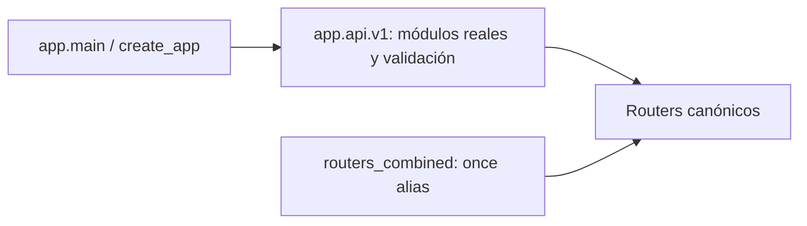

# Composición canónica de la API — entrega 55

## Finalidad

La aplicación carga los módulos API reales de este repositorio y comprueba que
cada componente requerido exponga un APIRouter poblado. Un módulo ausente, un
error al importar sus dependencias o un router inválido impiden terminar la
importación de app.main. No se ofrece una API alternativa para ocultar ese fallo.

Se conserva la superficie HTTP/WebSocket existente, sus prefijos, alias,
dependencias de autenticación/autorización, códigos declarados y OpenAPI. No se
modifican handlers de negocio, modelos SQL, migraciones, configuración o frontend.

## Arquitectura resultante

app/api/v1/__init__.py importa explícitamente los módulos, valida sus routers y
exporta los nombres canónicos. No crea types.ModuleType ficticios, captura
ImportError para omitir componentes ni selecciona un módulo de pagos alternativo.
Los objetos importados coinciden con importlib.import_module para su ruta real.

main.py mantiene el montaje explícito y el orden anterior. Tracking, telemetría,
notificaciones y fiscal se montan como componentes requeridos. Los WebSockets
mantienen sus wrappers y delegan en los mismos handlers de autenticación y envío.

routers_combined.py queda como compatibilidad de imports. No define endpoints,
esquemas de petición, consultas SQL ni workflows de negocio. Sus alias apuntan
al mismo objeto APIRouter que el módulo canónico; la aplicación principal no se
monta a través de ese archivo.

## Módulos requeridos y límites

Se exportan veinticuatro módulos: auth, orders, riders, telemetry, tracking,
users, roles, audit, settings, deliveries, alerts, vehicles, zones, financial,
shifts, reconciliation, productivity, routes, dashboard, integrations, payouts,
wallet, notifications y fiscal.

Cada módulo debe importar correctamente y ofrecer un APIRouter con rutas.
La comprobación no prueba el funcionamiento de una base de datos, proveedor,
worker, credencial, envío o emisión fiscal. Una ruta disponible puede rechazar
una operación por sus permisos, configuración o barreras de seguridad existentes.

Los SDK opcionales de proveedores conservan la inicialización diferida en sus
adaptadores. No se realizan llamadas externas para validar la composición.
Los errores opcionales del scheduler en lifespan mantienen su tratamiento actual;
esta entrega no convierte ese job en dependencia obligatoria de arranque.

En el baseline de la entrega 55, reconciliation se importaba sin estar montado
como router independiente en main. La entrega 56 incorpora sus cinco rutas bajo
/api/v1/reconciliation, con consulta acotada y reparación explícita de caché
verificada. Consulte [alcance, permisos y límites](CACHE_RECONCILIATION.md).
Los endpoints existentes bajo /financial/reconciliation y /fiscal/reconciliation
son contratos distintos y se conservan.

## Compatibilidad de imports y prefijos

| Alias en routers_combined | Módulo real | Prefijo interno | Prefijo en main |
| --- | --- | --- | --- |
| deliveries_router | deliveries | /deliveries | /api/v1 |
| shifts_router | shifts | vacío | /api/v1/shifts |
| financial_router | financial | /financial | /api/v1 |
| productivity_router | productivity | vacío | /api/v1/productivity |
| routes_router | routes | vacío | /api/v1/routes |
| dashboard_router | dashboard | vacío | /api/v1/dashboard |
| alerts_router | alerts | /alerts | /api/v1 |
| audit_router | audit | vacío | /api/v1/audit |
| integrations_router | integrations | vacío | /api/v1/integrations |
| users_router | users | vacío | /api/v1/users |
| payouts_router | payouts | /payouts | /api/v1 |

Un consumidor interno que use estos alias recibe el router canónico y debe usar
el prefijo correcto. Los handlers/esquemas/helpers retirados del archivo legacy
no eran parte de la API montada ni tenían consumidores directos en el repositorio.
Los alias HTTP históricos de GPS, dashboard, productividad e integraciones se
conservan en sus routers, con sus controles de permiso.

## Código obsoleto retirado

El archivo legacy aún contenía versiones de entregas, finanzas, retiros, alertas,
auditoría y usuarios. Algunas consultaban atributos inexistentes o seguían
contratos antiguos. El fallback de payouts podía seleccionar esa versión si
fallaba la importación del módulo vigente, incluso por una dependencia interna.
Se retira esa ruta de ejecución junto con los handlers obsoletos.

Los workflows canónicos siguen gestionando reservas, transacciones, verificación
bancaria, permisos, auditoría y estados. No se reescriben saldos, pagos, entregas
o historiales al cambiar los imports. La reducción de Mypy procede de retirar
definiciones muertas y asignaciones opcionales, sin ignorar errores ni excluir archivos.

## Contrato de superficie antes/después

El baseline se obtuvo del main verificado antes de cambiar los tres archivos de
producción. Vive en tests/fixtures/api_surface_before_bootstrap.json y registra:

- Las 197 entradas de app.routes, en su orden de resolución: 190 APIRoute HTTP,
  dos APIWebSocketRoute, cuatro rutas de documentación y el montaje de uploads.
- Clase de ruta, path, métodos, nombre, status_code, tags e inclusión en OpenAPI.
- Grafo de dependencias con llamadas identificadas por módulo/qualname, nombres
  de inyección, use_cache, scopes y allowlists de roles declaradas.
- SHA-256 del documento OpenAPI completo serializado canónicamente.

El grafo usa 188 definiciones compartidas para evitar repetir dependencias. El
helper solo inspecciona roles enum declarados; no serializa estados arbitrarios
de closures, tokens, credenciales, configuraciones o datos de usuarios.

El SHA-256 anterior y posterior coincide:
9d63eb9e4c9469b55c51f7adcf99a7df5d472dbdd00333a33b32dcf24b533631.
La comparación incluye alias fuera de OpenAPI; conservar solo el hash público
no habría protegido esas rutas ni sus dependencias de autorización.

Dos fábricas independientes deben producir el mismo inventario, sin duplicar
registro ni mutar routers globales. La composición tampoco debe abrir conexiones
de base de datos ni ejecutar create_all. Las migraciones siguen a cargo de Alembic.

Para cambios futuros intencionales de contrato se debe revisar el inventario y
actualizar el baseline con la versión aprobada. No se regenera automáticamente
durante los tests ni se considera un hash nuevo equivalente al contrato anterior.

## Fallos probados en procesos nuevos

tests/test_api_bootstrap.py simula con import hooks del intérprete:

1. Ausencia de cada uno de los veinticuatro módulos requeridos.
2. ModuleNotFoundError de una dependencia interna e ImportError de inicialización
   en payouts, tracking, notifications y fiscal.
3. Router ausente, null o vacío en esos cuatro componentes.

Se comprueba que el fallo se alcanzó y que no se publicó/cacheó app.main con una
aplicación parcial. Python puede representar una ausencia en un from-import como
ImportError o ModuleNotFoundError; la prueba admite esa semántica sin admitir
un arranque exitoso o un fallo ajeno al módulo inyectado.

Cada escenario usa un intérprete nuevo. No se recargan módulos de la aplicación
de pruebas ni se mezclan sus caches, dependencias de autenticación o WebSockets.
Los tests no activan lifespan, envíos, jobs o contactos con proveedores.

## Operación y pendientes

Validar las dependencias y el arranque del artefacto completo en staging antes de
reemplazar instancias. Un fallo de importación ahora debe corregirse en ese
artefacto; la instancia nueva no debe aceptarse como saludable por responder con
una API reducida. El error conserva el módulo y el contexto de importación.

La entrega no aplica migraciones, despliega, activa workers o cambia las barreras
fiscales y de integraciones. No añade flags que vuelvan opcionales los componentes
requeridos. No certifica conectividad externa ni disponibilidad operativa global.

La entrega 56 resuelve el montaje y revisión del componente reconciliation;
conserva este inventario de 197 rutas como baseline histórico y añade un contrato
posterior de 202 rutas. Quedan pendientes deuda global de tipado/cobertura,
pruebas de carga/rolling deployment, readiness y observabilidad,
outbox, sesiones por dispositivo, adaptadores externos homologados y los restantes
criterios de aceptación del roadmap. Los resultados de regresión y CI se registran
en el informe raíz de la entrega.
