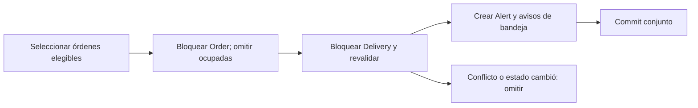

# SLA y bandeja legacy — entrega 59

## Problemas resueltos

La revisión del PR #299 identificó un ciclo de bloqueos real. La cancelación
tomaba Order y después esperaba Delivery; el monitor tomaba Delivery y al insertar
Alert necesitaba un bloqueo de clave compartida en Order por su FK. PostgreSQL
debía abortar una transacción. Filtrar CANCELADO no eliminaba el ciclo mientras la
cancelación no estuviera confirmada. Una prueba nativa reproduce el deadlock con
el monitor de main anterior y pasa con el protocolo nuevo.

Además, el servicio legacy de notificaciones construía atributos `channel` y
`status` inexistentes, usaba miembros de enum inexistentes, confundía rider_id con
user_id y podía declarar SENT tras funciones de transporte vacías. El servicio de
avisos SLA consultaba IN_PROGRESS y expected_completion_at, tampoco existentes,
y no devolvía la lista prometida. Destinatarios UUID podían descartarse y producir
notificaciones sin destinatario; el lector de alertas fallaba con JSON histórico
guardado como texto o con otros tipos.

## Protocolo de bloqueo y selección

`sla_monitor.lock_sla_deliveries` selecciona como máximo cien candidatos:

1. Calcula el plazo real `started_at + sla_expected_minutes`, exige inicio y SLA
   positivo, entrega activa y orden existente que no esté CANCELADO. Conserva la
   interpretación anterior de órdenes cuyo status es NULL: pueden generar una
   alerta informativa si su entrega tiene los datos necesarios.
2. Bloquea primero las órdenes, en orden de UUID, con `FOR UPDATE OF orders SKIP
   LOCKED`. Una cancelación pendiente se omite antes de tocar su entrega. Una
   orden ocupada no impide procesar otra elegible dentro del límite.
3. Vuelve a consultar cada entrega, verifica vínculo, estado, plazo y ausencia de
   recibo; la bloquea con `FOR UPDATE OF deliveries SKIP LOCKED` y refresca la
   identidad ORM. No confirma dentro del selector.
4. El llamador registra alerta y bandeja en la misma transacción y confirma; ante
   fallo revierte. El recibo durable impide repetir la misma clase de aviso.

Los cierres y la cancelación ya cooperan con Order → Delivery. El monitor no toma
primero el hijo ni espera una orden manteniendo solo ese hijo bloqueado. El lote
retiene sus bloqueos hasta confirmar/revertir; el selector limita candidatos, no
garantiza completar todos si otro escritor no cooperante retiene una entrega.
No sustituye la revisión de otros bloqueos del sistema ni protege SQL manual.

## Aviso previo, incumplimiento y ejecución

| Camino | Condición | Recibo | Bandeja |
| --- | --- | --- | --- |
| Aviso previo | `ahora < plazo <= ahora + ventana` | Alert, tipo SLA_WARNING | Notification legacy, por usuario |
| Incumplimiento | `plazo < ahora` | Alert, tipo SLA_BREACH | NotificationLog IN_APP, por usuario |
| Plazo exactamente igual a ahora | No se genera aviso previo ni breach en ese instante | Conserva la regla estricta anterior de breach | El próximo escaneo posterior puede detectarlo |

La ventana previa predeterminada es cinco minutos; las llamadas internas admiten
de uno a sesenta. El worker existente `check_sla_breaches`, cuando se habilita,
ejecuta primero aviso previo y después incumplimiento con un mismo reloj UTC
naive y filtro delivery_id opcional. Cada fase tiene su commit: si la segunda
falla, la primera permanece y su recibo evita duplicados durante el reintento.
El resultado añade `warning_inbox_created`, número de filas de bandeja legacy,
sin confundirlo con entregas externas o número de alertas.

Se conservan los flags y la agenda: WORKER_SLA_MONITOR_ENABLED=false y
CELERY_BEAT_ENABLED=false por defecto. Con ambos habilitados, Beat conserva su
escaneo cada cinco minutos. Esta entrega no los activa. El intervalo, la carga,
los bloqueos omitidos y la disponibilidad del worker pueden hacer que no se
observe toda ventana previa; no se garantiza un aviso previo para cada entrega.

Destinatarios: gerencia/superadministración activa y usuario activo dueño del
rider. Se evita duplicar un mismo usuario. Se mantiene un máximo de doscientos
gerentes y se exige particionar si se supera; el dueño puede ser un destinatario
adicional. NOTIFICATIONS_ENABLED=false y la preferencia IN_APP de sla_warning
suprimen las filas de bandeja correspondientes, conservando el recibo Alert.
No se escriben pagos, SLA finales ni estados de entrega desde este monitor.

El recibo queda en Alert aunque se descarte la notificación de la bandeja. Una
cancelación coordinada resuelve SLA_WARNING y SLA_BREACH pendientes dentro de su
transacción, conservando incidentes y evidencia histórica. No se implementa aquí
la resolución automática de todas las alertas al completar/fallar una entrega ni
al pasar de warning a breach; sigue pendiente homologar su ciclo operativo. Los
recibos no se borran automáticamente para permitir avisos repetidos.

## Bandeja legacy y aceptación de proveedores

NotificationService es un adaptador de **persistencia legacy**. Guarda `channels`
como canal solicitado y `is_sent=false`, sin `sent_at` ni `sent_channels` ficticios.
No existe un campo físico `status` o `channel` en esta tabla. Sus helpers usan
ASIGNACION_PEDIDO, SLA_WARNING y PAGO_RECIBIDO y resuelven Rider.user_id. Un aviso
de pago es texto informativo de un llamador interno; no verifica ni ejecuta un
pago y no asigna una moneda inexistente a su importe.

`create_notification(..., commit=False)` permite preparar un aviso dentro de la
unidad del llamador mediante flush. Con el default commit=True, el servicio posee
commit/rollback; debe usarse en una sesión/unidad adecuada. AlertService.create_alert
también posee su commit/rollback y no debe incrustarse en una unidad financiera
sin adaptar expresamente esa responsabilidad. Los métodos de negocio que ya
confirmaron su operación pueden registrar el aviso después; ese camino sigue
siendo best effort. La asignación de orden usa el user_id persistido del rider,
sin exigir que esté cargada la relación lazy, y registra el aviso después del
commit de asignación. Un fallo de registro no revierte una asignación confirmada.

Los registros legacy **no se convierten automáticamente en NotificationLog ni
entran en la cola omnicanal de reintentos**. Para entrega externa debe usarse el
servicio omnicanal con plantilla, preferencias, proveedor y evidencia de aceptación.
Esta entrega no añade ese puente ni un outbox; tampoco envía mensajes reales.
La API legacy /alerts presenta avisos ALERTA_OPERACIONAL del usuario; la bandeja
omnicanal conserva su propio contrato. No se unifican ambas tablas en este cambio.

## Validación, lectura y diccionario

- IDs nuevos: UUID real; no booleanos ni enteros usados como UUID. Las listas
  explícitas requieren de uno a doscientos destinatarios, se deduplican y todos
  deben existir y estar activos. Sin lista, AlertService usa gerencia activa;
  sin destinatario válido se rechaza, en lugar de crear filas huérfanas.
- Título: 1–255 caracteres; mensaje: 1–4000, recortados y representables en UTF-8,
  sin NUL ni sustitutos aislados. El mensaje puede contener saltos de línea.
- Datos: objeto JSON o None, copia validada, sin números no finitos, claves no
  textuales, ciclos u objetos arbitrarios; como máximo 16 KiB en la serialización
  ASCII segura empleada para validar el límite. Se rechazan sustitutos Unicode.
- Canal solicitado: in_app, push, email o sms. El valor no certifica aceptación.
- Lectura: el parser admite objetos y texto JSON histórico acotado; otros tipos
  usan metadatos neutros. Un timestamp desconocido se representa con cadena vacía
  conservando el contrato string, sin inventar una fecha. NULL is_read cuenta
  como no leído. Marcar leído guarda read_at una vez; read-all conserva usuarios
  ajenos y otros tipos de notificación.

| Dato | Uso real |
| --- | --- |
| notifications.user_id | UUID del usuario destinatario, distinto de rider.id |
| notifications.data | JSON real, no un segundo json.dumps del objeto |
| notifications.related_id | Referencia textual, incluyendo UUID canónico |
| notifications.channels | Solicitud de canal; no prueba de entrega |
| notifications.is_sent / sent_at / sent_channels | Permanecen sin aceptación ficticia |
| notifications.is_read / read_at | Acuse de lectura del propietario |
| alerts.alert_type | SLA_WARNING y SLA_BREACH, recibos separados por entrega |
| alerts.status / campos de resolución | Conservan evidencia y resolución por cancelación |
| notification_logs | Pipeline omnicanal existente para avisos de incumplimiento |

Se tipa Notification con Mapped/mapped_column conservando exactamente columnas,
NULL, defaults, índices, relaciones FK, enums y DDL. Un fixture capturado de main
antes de modificar el modelo comprueba esa igualdad; no se regeneran los fixtures
anteriores. **No hay migración de esquema, nuevas dependencias ni rutas nuevas.**

## Validación y pendientes

Las pruebas nativas controlan ambos órdenes de concurrencia, observan bloqueos
reales con pg_blocking_pids, comprueban SKIP LOCKED, ventanas exactas, reintentos,
preferencias, cancelación, fallos tardíos, lectura HTTP con JWT real y alcance del
propietario. Se comprueba expresamente el fallo del monitor anterior con el mismo
test de deadlock; el código corregido pasa. Las pruebas de entrada inválida
exigen cero acceso a base de datos. Los contratos de rutas/OpenAPI se conservan.

La interfaz protege las fechas ausentes o inválidas con «Fecha no disponible».
Interpreta las fechas ISO sin zona de esta API como UTC, según el almacenamiento
legacy, y conserva offsets explícitos. Las páginas de gerencia/operador y las
componentes de alerta comparten esa interpretación. AlertPanel usa los campos,
severidades y endpoints reales: PATCH /alerts/{id}/read y DELETE /alerts/{id}.
Marcar leída registra un acuse personal. Descartar elimina la fila de bandeja
legacy; el recibo SLA de Alert permanece. Un rechazo conserva visible el aviso.

Se eliminan 22 errores reales de Mypy, quedando 99 previos en 25 archivos. No se
añaden ignores ni se reduce el umbral de cobertura. Persisten reparación histórica,
cierre completo del ciclo de alertas, unificación de bandejas, outbox para hooks,
entrega externa homologada, liderazgo/observabilidad de Beat, límites de grandes
lotes y el resto del roadmap. No se declara producción completa.
